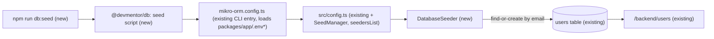

# Idempotent database seeder (`npm run db:seed`)

Tracking issue: #17

## 📝 TLDR

After `npm run db:migrate`, a developer setting up DevMentor locally gets an empty `users` table. `/backend/users` then shows only its empty state until they create a user by hand. This spec **proposes** a MikroORM seeder in `@devmentor/db` and a root `npm run db:seed` script. The seeder inserts one sample user, Ada Lovelace (`ada@devmentor.dev`), and leaves an existing row with that email untouched, so the command is safe to run any number of times.

## 📝 Problem Statement

- **Who has it:** anyone setting up the repo locally or resetting their database (README › Local setup › "Reset the database").
- **Today:** there is no seeding mechanism (no `db:seed` script, no `@mikro-orm/seeder` dependency, no `seeders/` folder on `main`). The users panel and the dashboard count start empty.
- **Course reference (lesson 03 snapshot):** it ships a seeder that calls `em.create(...)` without checking for an existing row. A second run fails on the unique `email` constraint, so it is not idempotent. It also seeds a `MentorProfile`, an entity this repo does not have.

## 📝 Proposed Solution

Register `SeedManager` from `@mikro-orm/seeder` in the shared ORM config. Add one `DatabaseSeeder` class that runs a find-or-create on `User` by `email`, and expose it as `npm run db:seed`, which runs `mikro-orm seeder:run`.

**Seed data (confirmed by the maintainer on #17):** exactly one `User`: `{ email: "ada@devmentor.dev", name: "Ada Lovelace" }`. If a row with that email already exists, the seeder leaves it as is. It does not update `name`, so local edits survive a re-run.

**Alternatives considered**

| Option | Why it lost |
| --- | --- |
| `em.upsert(User, …)` | Overwrites `name` on every run, which contradicts the confirmed "leave existing rows unchanged" rule. |
| Raw `INSERT … ON CONFLICT DO NOTHING` in a SQL script or migration | Seed data in a migration would reach every environment, including shared ones. Raw SQL bypasses entity metadata and `baseProperties` defaults. |
| Glob discovery of `src/seeders/*.ts` (MikroORM default, used by the reference) | `seeder:run` dynamically imports **every** file matching the glob (`SeedManager.seedString`). A colocated `*.test.ts` would be imported outside Vitest, the same trap `.ai/lessons.md` records for migrations. It also contradicts the repo's "no folder discovery" rule for entities. We use the explicit `seedersList` option instead. |
| Register `SeedManager` only in the CLI entry `packages/db/mikro-orm.config.ts` | This would keep `@mikro-orm/seeder` out of the app server. The app builds its ORM with the synchronous `new MikroORM(config)` (`packages/db/src/register.ts`), and that constructor does not auto-load extensions. Only the async `MikroORM.init()` that the CLI uses does. It lost anyway: the wiring would move outside `src/` and the coverage gate, and the config would be split across two files. Shipping one lazily built extension that the app never calls costs nothing at runtime: `SeedManager` is only built when `orm.seeder` is accessed. |
| Seeding inside `npm run setup` | Out of scope: `scripts/setup.mjs` is still in open PR #15. This is a follow-up. |

## 📝 Architecture

- **`packages/db` (primary).**
  - New dependency: `@mikro-orm/seeder@^7.2.5`, the same version line as the other `@mikro-orm/*` packages. Only `db` may import `@mikro-orm/*` (ESLint `no-restricted-imports`).
  - New file: `src/seeders/database.seeder.ts`.
  - `src/config.ts` changes: `extensions: [Migrator, SeedManager]` and `seeder: { defaultSeeder: "DatabaseSeeder", seedersList: [DatabaseSeeder] }`.
  - New package script: `"seed": "mikro-orm seeder:run"`.
  - The seeder is **not** exported from `@devmentor/db` (`exports` stays `.` and `./config`).
- **Root `package.json`.** Add `"db:seed": "npm run seed --workspace @devmentor/db"`. It runs through the existing CLI entry, so it uses the same `.env` loading as `db:migrate`.
- **`packages/app/next.config.ts`.** Add `"@mikro-orm/seeder"` to `serverExternalPackages`. The app imports `config.ts`, which now imports `SeedManager` and `DatabaseSeeder`, and `AGENTS.md` requires every new MikroORM package to be listed there.
- **No runtime change in the app.** No DI registration, route, page or event changes. The ORM gains a seeder extension that only the CLI invokes.



Takeaway: the seeder is a CLI-only path into the existing `users` table, and the app's request path is unchanged.

## 📝 Data Model

No entity or schema change and no migration. The seeder writes one `users` row using the existing `User` entity (`baseProperties` + `email` unique + `name`). The seed data is synthetic, not personal data.

## 📝 Seeder contract

```ts
// packages/db/src/seeders/database.seeder.ts (shape, not final code)
export class DatabaseSeeder extends Seeder {
  async run(em: EntityManager): Promise<void> {
    const existing = await em.findOne(User, { email: SAMPLE_USER.email });
    if (!existing) em.create(User, SAMPLE_USER);
  }
}
```

- `SeedManager.seed()` calls `em.flush()` and `em.clear()` after `run()` (verified in `@mikro-orm/seeder@7.2.5`), so `run()` doesn't flush on its own.
- A re-run makes no writes: `findOne` hits, nothing is persisted, and the flush is a no-op.
- Exit code: `0` on success. Any DB error (no connection, migrations not applied) propagates through the MikroORM CLI as a non-zero exit with its error message.

## 📝 Edge Cases & Failure Scenarios

| Scenario | Behavior |
| --- | --- |
| Run twice, or after a "Reset the database" | The second run is a no-op. Ada appears exactly once. |
| A user `ada@devmentor.dev` was already created by hand with a different name | Left unchanged (confirmed rule). |
| Migrations not applied (`users` missing) | The CLI exits non-zero with `relation "users" does not exist`. The README orders `db:migrate` before `db:seed`. |
| Postgres not running or `DATABASE_URL` wrong | The CLI exits non-zero with a connection error. This is the same failure mode as `db:migrate`. |
| Two concurrent `db:seed` runs (find-then-create race) | One insert hits the unique `email` constraint and that run exits non-zero. The data stays correct (one row). This is acceptable for a local dev command, and the spec documents it rather than guarding against it. |
| `NODE_ENV=test` | The CLI reads `.env.test*`, the same precedence as the migration scripts (README table). |

## 📝 Risks & Impact Review

- **Contracts (`BACKWARD_COMPATIBILITY.md`).**
  - Root `db:*` scripts: additive. `db:seed` is new, and no existing script changes.
  - `@devmentor/db` exports: unchanged.
  - DB schema: unchanged.
  - Env vars: no new ones.
- **Shared config.** `config.ts` is used by both the app and the CLI. Adding an extension that the app never calls carries no runtime behavior change. A missing `serverExternalPackages` entry would surface as a build or bundling error, which `npm run build` in the gate catches.
- **Rollback.** Revert the PR. Rows already seeded stay in local databases. They are ordinary `users` rows and can be deleted from the panel or with a DB reset.
- **Integration isolation.** Existing integration scenarios assert the empty state, so seeding must not happen in `global-setup.ts` (`AGENTS.md`: never depend on demo data). The new scenario runs last and seeds only its own container.

## 📋 Phasing

A single phase that ships independently: the seeder, the script, docs and tests land together in one PR.

**Follow-up (separate issue, after PR #15 merges):** wire `db:seed` into `npm run setup` / `scripts/setup.mjs`.

## 📋 Implementation Plan

1. **Dependency.** Run `npm install @mikro-orm/seeder@^7.2.5 -w @devmentor/db`. Add `"@mikro-orm/seeder"` to `serverExternalPackages` in `packages/app/next.config.ts`.
   - *Test:* `npm run build` passes.
2. **Seeder class.** Create `packages/db/src/seeders/database.seeder.ts` with `DatabaseSeeder` and a module-level `SAMPLE_USER` constant.
   - *Test:* colocated `database.seeder.test.ts` with a mocked `em` (safe because of `seedersList`):
     - (a) no existing row → `em.create(User, { email: "ada@devmentor.dev", name: "Ada Lovelace" })` is called once;
     - (b) existing row → `em.create` is not called, and the existing entity isn't modified;
     - (c) `findOne` is queried by email.
   - Coverage must be 100% for the file.
3. **Config wiring.** In `packages/db/src/config.ts`, add `SeedManager` to `extensions` and `seeder: { defaultSeeder: "DatabaseSeeder", seedersList: [DatabaseSeeder] }`.
   - *Test:* update `packages/db/src/config.test.ts`:
     - replace the existing `expect(config.extensions).toHaveLength(1)`: `extensions` now contains `Migrator` and `SeedManager` (length 2);
     - `seeder.defaultSeeder === "DatabaseSeeder"`;
     - `seeder.seedersList` equals `[DatabaseSeeder]`.
4. **Scripts and integration scenario.** Add the scripts and the automated proof that they work together:
   - Add `"seed": "mikro-orm seeder:run"` to `packages/db/package.json` and `"db:seed": "npm run seed --workspace @devmentor/db"` to the root `package.json`, next to the other `db:*` scripts.
   - Add `databaseURL` to `ProvidedContext` in `packages/app/tests/integration/context.ts` and `project.provide("databaseURL", …)` in `global-setup.ts`.
   - Add a **last** case to `packages/app/tests/integration/app.test.ts`:
     - spawn `npm run db:seed` twice, asserting exit 0 both times. Use the same pattern as the migration spawn in `global-setup.ts`: `{ ...process.env, NODE_ENV: "production", DATABASE_URL: <container URL> }`, a 60-second timeout, a kill of the child on timeout or failure, and stdout/stderr piped to `seed.log` in the integration artifacts directory;
     - open `/backend/users` and assert that the `ada@devmentor.dev` cell appears exactly once.
   - Earlier cases assert the empty state and the users flow, so this case must stay last. After it runs, `/backend` shows one more registered user than before, so any dashboard assertion added later must run before it.
   - *Test:* the integration case above, plus a manual run against the local DB.
5. **Docs.**
   - README › Local setup: add "### 6. Seed sample data (optional)" after "5. Run migrations" (`npm run db:seed`, and note that it is idempotent and leaves existing rows untouched). Renumber "Start the app" to 7.
   - Add `npm run db:seed` to "Reset the database".
   - Add the command to the `AGENTS.md` Commands table.
   - Expect a README rebase against PR #15.
6. **Gate and run log.**
   - Run `npm run lint`, `typecheck`, `build`, `test:coverage` and `test:integration`; all must pass.
   - Write the run log in `.ai/runs/`.
   - Move this spec to `.ai/specs/implemented/`.

## Resolved assumptions (autonomous defaults)

No open questions were left to autonomous defaults. The maintainer confirmed both product decisions on #17:

- **Seed content:** a single user, Ada Lovelace (`ada@devmentor.dev`), without the reference's mentor profile.
- **Re-run behavior:** an existing row is left unchanged (find-or-create, no update).

The design choices this spec makes on its own are explicit `seedersList` (no glob discovery), registration in the shared `config.ts`, and an integration case that runs last. They are documented above with the alternatives that lost. Each is reversible within the implementation PR.
