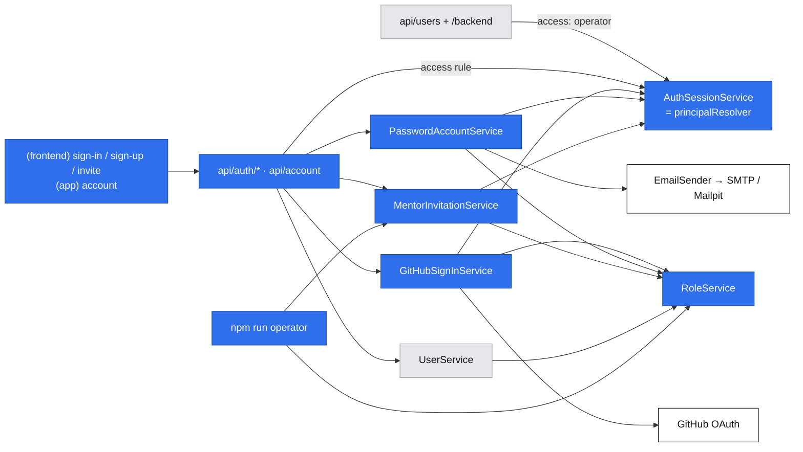
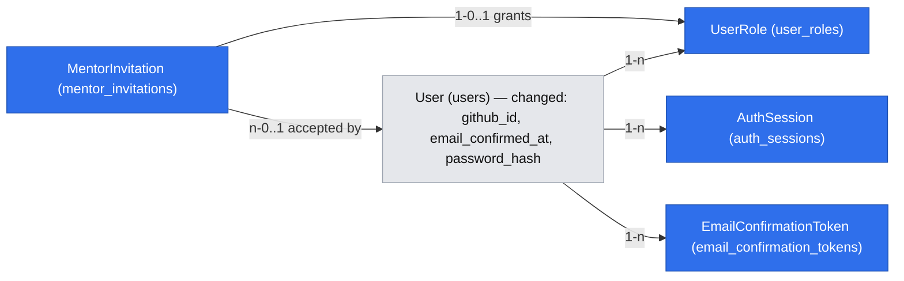

# E01 — Accounts and roles

- Epic: #28 (E01) · Stories: #34 (E01-S01), #35 (E01-S02), #36 (E01-S03) · Task: #46 (E01-S03-T01)
- Companion spec: [`2026-10-17-platform-primitives.md`](./2026-10-17-platform-primitives.md), cited below as "platform P*n*/F*n*". Each phase here builds the primitives it first needs.
- Design authority: `.ai/specs/product-brief.md` (D13, D14, N03; the D12 boundary)
- Research: one shared pass for both specs. It lives in the platform spec, section "Research".
- Status: **draft for review** (Open Questions resolved 2026-10-17)

## 📝 TLDR

**Today:** nobody can sign in. The baseline has a `users` table, an unauthenticated `/api/users` example that creates users, and no sessions, roles or email.

**Proposed (future behavior):**

- A visitor signs in with GitHub (primary) and gets an account whose display name comes from GitHub and can be edited.
- A person without GitHub registers with email and password, and can sign in only after confirming the address.
- An engineer becomes a mentor only by accepting a single-use invitation the operator creates from a CLI. Accepting adds the mentor role to an account that already has the mentee role.

The work extends the baseline `auth` concept (`User`, `UserService`, `userCreateSchema`, `/api/users`). It does not create a parallel stack.

## 📝 Decisions

The product owner settled these on 2026-10-17. They are spec-level ids.

| Id | Decision | Why |
|---|---|---|
| AD1 | **Thin in-house auth** on MikroORM. OAuth mechanics come from `arctic`'s generic `OAuth2Client` with PKCE (S256), because its `GitHub` class has no PKCE and fixed endpoints. Passwords use `bcryptjs` (cost 12). No auth library. (Q1) | Entities, migrations and DI follow house rules (`defineEntity`, MikroORM migrations only, Awilix). Invitations, combined roles and `returnTo` are custom in any library. |
| AD2 | **Database sessions**, not JWT (Q2):<br>• an opaque 256-bit token in an httpOnly cookie<br>• its SHA-256 hash in `auth_sessions`<br>• 30-day expiry, extended to 30 days again when under 15 days remain<br>• sessions can be revoked<br>**This deviates from** `.ai/specs/implemented/2026-09-01-engineering-standards.md` ("JWT HS256 … 24h"). Step 1.11 updates that document. | D14: a mentor role granted by invitation must apply on the **next request**. A stateless token freezes roles until it expires and cannot be revoked at sign-out. Database sessions also need no signing secret. |
| AD3 | **Link GitHub to an existing account only through GitHub's verified primary email.** If that account's password was never confirmed, the GitHub sign-in claims the account and discards the unconfirmed password. (Q3) | One person, one account, and the email stays unique, which the baseline and D15 rely on. Discarding an unconfirmed password defeats pre-hijacking: an attacker who registered your email first loses access the moment you prove ownership. |
| AD4 | **`/backend/**` and `/api/users` require the `operator` role.** It is granted only by `npm run operator -- role grant`. The users example stays the reference example. (Q6) | Once real accounts exist, those routes would expose every email. D12 rules out operator screens for operator *processes*. The admin is not one, and the role cannot be gained in the product. |
| AD5 | **The invitation link opens a page. The role is granted by pressing "Accept" (a POST).** Links expire after 14 days by default; `--expires-in-days` overrides it. (Q7) | Mail and chat link scanners prefetch GET URLs, and a single-use link consumed by a scanner fails for the real invitee. Expiry bounds the damage of a link pasted in the wrong place. |
| AD7 | **Email confirmation takes the link *and* the password.**<br>• The link opens `/confirm-email`, which shows "expired", "already confirmed" or "not valid" immediately.<br>• For a valid link, the person enters the password they chose and presses **Confirm** (a POST).<br>• That confirms the address, signs them in and returns them to `returnTo`.<br>(Q9, raised by the architectural review.) | Confirm-on-open lets an attacker pre-register your email with their own password. A mail scanner or one stray click would then confirm an account the attacker can sign into, and AD3 would no longer wipe that password because it is "confirmed". Requiring the password the registrant chose means only that registrant can confirm. Because the password proves identity, signing in on confirm is now safe. |
| AD6 | **Passwords are at least 15 characters and at most 72 UTF-8 bytes, with no composition rules.** Longer input is rejected, never truncated. The form hints "use a short phrase". (Q8, raised by research) | NIST 800-63B rev 4 requires ≥15 characters for single-factor passwords, and DevMentor has no MFA. 72 bytes is bcrypt's hard limit. GitHub is the primary path (D13), so the friction falls on the fallback only (A05). |

## 📝 Problem Statement

- **Nothing knows who is calling, and every later epic needs it.** The mentor's own profile, slots and Stripe status (E02), booking (E04, where D13 puts sign-in at slot selection), and private session lists and the session screen (E05) all depend on identity.
- **D13 fixes the sign-in methods** (GitHub first, email and password with confirmation as the fallback). **N03** excludes password reset in 1.0.
- **D14 fixes the mentor path:** an operator-made single-use invitation, with no open mentor registration, and one account may hold both roles.
- **The baseline is unsafe once accounts are real.** `/api/users` carries `TODO(auth)` and lets anyone create users, and `/backend` lists every user.

## 📝 Proposed Solution

Each story keeps its own user flow. None of them is reduced to CRUD on `users`.

### Flow 1: GitHub sign-in (#34)

1. The visitor presses **Sign in with GitHub** on `/sign-in` (or on the invitation page). The browser navigates to `GET /api/auth/github?returnTo=…`.
2. The route sets a short-lived `devmentor_oauth` cookie:
   - httpOnly, `SameSite=Lax`
   - 10 minutes
   - `Path=/api/auth/github`
   - holds `state`, the PKCE verifier and `returnTo`

   Then it redirects to GitHub with scope `user:email`. This is an external redirect, allowed only to `config.github().oauthUrl` (platform P7).
3. GitHub returns to `/api/auth/github/callback`. The handler covers every outcome:

   | Callback outcome | Result |
   |---|---|
   | `error=access_denied` (cancel or deny) | Redirect to `/sign-in?error=github_cancelled`, which shows "GitHub sign-in was cancelled" and offers the email option. |
   | State missing or mismatched | `github_failed`; nothing is created. |
   | Token exchange fails | `github_failed`; nothing is created. |
   | No verified primary email | `github_no_verified_email`, with a message telling the person to verify an email on GitHub or use email sign-up. |

4. Account resolution, in one transaction (AD3):
   1. A user with this `githubId` → reuse it. The display name is **not** overwritten, because the person may have edited it.
   2. Otherwise, a user with this email (normalized lowercase):
      - It already has a *different* `githubId` → `github_email_taken`.
      - Otherwise, link it: set `githubId` and `emailConfirmedAt ??= now`.
      - If the account had an unconfirmed password: clear `passwordHash` and delete its open confirmation links (Phase 2).
   3. Otherwise, create a user with `name = github.name?.trim() || github.login` (cut to 100 characters), the email, `emailConfirmedAt = now` and the `mentee` role.
5. Start a database session (AD2) and clear the OAuth cookie. Redirect to `returnTo`. A **new** account with no `returnTo` lands on `/account?welcome=1`, where the display name shows with a "This is the name others see. You can change it." notice. That makes "editable by the person" visible on first sign-in.

### Flow 2: email and password with confirmation (#35)

**Register.** `/sign-up` takes a display name, email and password. The response is the same whether or not the email exists, so it never reveals which emails have accounts:

| The email belongs to… | What happens |
|---|---|
| No one | Create the user with the `mentee` role and an unconfirmed email. Issue a confirmation link and send it. The link expires after 24 hours and carries `returnTo` in its own query string, so the path is never stored (a path such as `/invite/<token>` contains a secret). |
| An unconfirmed account | Replace the display name and password hash, **delete** earlier links, and send a new link. The last registration wins; earlier links stop working. |
| A confirmed account | Hash the submitted password anyway and discard it, so timing matches the other paths. Send an "you already have an account — sign in with GitHub or your password" email. No reset is offered (N03). |

In every case the response is "Check your inbox at *email*". If sending failed, it adds "We couldn't send the email — try again". Sending is not retried in the background.

**Confirm (AD7).** The link opens the public page `/confirm-email?token=…&returnTo=…`. The GET only *inspects* the token (platform P9 `inspectSingleUseToken`); it never consumes it. The page shows one state:

| Link state | Page |
|---|---|
| Valid, and the token's `email` still equals the account email | "Enter your password to confirm *email*" with a password field and a **Confirm** button. |
| Expired | "This link has expired." Sign in to get a new one: the `email_not_confirmed` response offers Resend. |
| Used, and the address is confirmed | "Your address is already confirmed — sign in." |
| Unknown, tampered, or replaced by a newer link | "This link isn't valid. If you registered more than once, use the link in the most recent email." |

**Confirm** sends `POST /api/auth/confirm-email {token, password, returnTo}`. In one transaction it:

1. checks the password against the account the token belongs to, failing with `invalid_credentials` and the sign-in rate limits
2. consumes the token
3. sets `emailConfirmedAt`
4. starts a session

It then answers `{ redirectTo: returnTo ?? "/" }`.

A scanner that prefetches the link changes nothing. A person who did not register cannot confirm, because they don't know the password the registrant chose.

**Sign in.** The email form on `/sign-in`:

| Case | Response |
|---|---|
| Wrong email or password, or a GitHub-only account | One generic message: "Email or password is incorrect" (401 `invalid_credentials`). A dummy bcrypt compare runs, so timing does not reveal whether the account exists. |
| Correct password, address unconfirmed | 403 `email_not_confirmed`. The form shows "Confirm your email first" with a **Resend confirmation** button. Resend re-posts the same email and password to the resend endpoint, so only the person who knows the current password can trigger a new link. |
| Correct and confirmed | A session starts and the browser goes to `returnTo` (default `/`). |

### Flow 3: mentor invitation (#46, then #36)

1. **The operator creates an invitation** (#46):
   ```
   npm run operator -- invite create --note "Ada, TypeScript" [--expires-in-days 14]
   ```
   It prints `https://<APP_URL>/invite/<token>` and the expiry. Only the token's hash is stored.
2. **The invitee opens the link.** `/invite/[token]` is a public page. Its `generateMetadata` sets `referrer: "no-referrer"` and `robots: { index: false }`, the same as `/confirm-email`. It shows one state:

   | State | The page shows |
   |---|---|
   | Invalid, used or expired | "This invitation is not valid. Ask the DevMentor team for a new link." One message for all three, so probing learns nothing. |
   | Valid, signed out | "You've been invited to offer sessions as a mentor on DevMentor. Sign in or create an account to accept." It offers GitHub, email sign-in and sign-up, all with `returnTo=/invite/<token>`. The email path goes through confirmation; the link carries `returnTo`, so the invitee comes back here. |
   | Valid, signed in, already a mentor | "You already have the mentor role." The invitation is **not** consumed. |
   | Valid, signed in | An **Accept invitation** button. |

3. **Accept** sends `POST /api/auth/invitations/accept {token}`, which runs one transaction:
   1. consume the token (platform P9)
   2. grant `mentor` with `invitationId`
   3. record `acceptedBy`
   4. rotate the session (new token on a privilege change, per OWASP)

   The page then shows "You're now a mentor". The account keeps `mentee`, so it holds both roles. The next step (mentor profile, E02-S01) is linked once it exists; until then it links to `/account`, which lists the roles.
4. **No open mentor registration.** No route, form field or CLI command grants `mentor` outside step 3:
   - `RoleService` exposes `grantMentorFromInvitation(userId, invitation)` and a generic `grant` typed to `"mentee" | "operator"`, so misuse fails to compile.
   - Sign-up schemas strip unknown keys, so a `role` field is ignored.

### Account and sign-out (shared by all flows)

- **Account page.** `/account` (signed-in area) shows the display name in an editable form, plus the email, roles and sign-in methods ("GitHub", "Email and password"). It reads through `UserService` in the Server Component (platform F5) and writes with `PATCH /api/account`.
- **Sign out.** Available in both headers. `POST /api/auth/sign-out` deletes the session row and clears the cookie.

**Alternatives rejected:**

- **Confirming on open (GET).** A scanner or a stray click would confirm an attacker's pre-registration (AD7).
- **Granting the role on GET.** See AD5.
- **A `roles text[]` column.** A row per role records which invitation granted it, and the unique constraint `(user_id, role)` makes grants idempotent.
- **A generic `auth_identities` table.** One provider (D13) fits a nullable unique `github_id` column. Moving to a table later is a mechanical migration.
- **Renaming `users.name` to `display_name`.** That is a breaking schema and DTO change (protected surfaces 1 and 4) for a label. Instead, `User.name` **is** the display name, and the UI and DTOs that are new in this spec call it `displayName`.

## 📝 Architecture

**Services.** All live in the existing concept folder `app/src/server/services/auth/` and are registered one line each in `container.ts` and `cradle.ts`. All are TRANSIENT and depend on the scoped `em`, except the adapters (SINGLETON).

| Service | Responsibility | Phase |
|---|---|---|
| `UserService` (existing) | Keeps `list`/`count`/`create`. `create` (operator admin) now also grants `mentee`. Adds `getAccount(userId) → AccountDto` and `updateDisplayName(userId, name)`. | 1 |
| `RoleService` | `grant(userId, "mentee" \| "operator")` (idempotent), `rolesOf(userId)`, `grantMentorFromInvitation` (Phase 3). | 1, 3 |
| `AuthSessionService` | Implements the platform P3 `PrincipalResolver`. Methods: `start(userId, cookies)`, `resolve(req, cookies)` (sliding refresh), `resolveToken(raw)` (page guards; no refresh), `end(sessionId, cookies)`, `rotate(principal, cookies)`. Also registered as `principalResolver`. | 1 |
| `GitHubSignInService` | `begin(returnTo, cookies) → URL`, `complete(query, cookies) → { redirectTo }`. Flow 1 resolution (AD3). | 1 (claim rule completed in 2) |
| `GitHubOAuth` port (`github-oauth.port.ts`) + `adapters/arctic-github-oauth.ts` | `authorizationUrl(state, verifier)`, `exchangeCode(code, verifier)`, `fetchIdentity(accessToken) → { id, login, name, emails[] }`.<br>• The adapter wraps arctic's `OAuth2Client`, and its endpoints come from `config.github()`, so integration tests point them at a local stub.<br>• It reads `/user` and `/user/emails?per_page=100`. The access token is used once and never stored.<br>• arctic's `OAuth2RequestError`, `ArcticFetchError` and `UnexpectedResponseError` all map to `github_failed`. | 1 |
| `PasswordAccountService` | `register`, `signIn`, `resendConfirmation`, `inspectConfirmation(token)` (page), `confirmEmail(token, password, cookies)` (Flow 2, AD7). | 2 |
| `PasswordHasher` (`password-hasher.ts`) | `bcryptjs`, cost 12, plus a `dummyCompare()` that equalizes timing. | 2 |
| `MentorInvitationService` | `create({ expiresInDays, note }) → { url, expiresAt }`, `inspect(token, principal?)`, `accept(token, principal, cookies)`. | 3 |

**Routes.** All go through `@/server/http`; no route has its own `try/catch`.

| Route | Kind | Access |
|---|---|---|
| `api/auth/github/route.ts` (GET) | `navigationHandler` | public |
| `api/auth/github/callback/route.ts` (GET) | `navigationHandler` | public |
| `api/auth/sign-out/route.ts` (POST) | `apiHandler` | optional |
| `api/account/route.ts` (GET, PATCH) | `apiHandler` | user |
| `api/users/route.ts` (existing) | `makeCrudRoute` | `{ role: "operator" }` |
| `api/auth/sign-up/route.ts`, `api/auth/sign-in/route.ts`, `api/auth/confirm-email/route.ts`, `api/auth/confirm-email/resend/route.ts` (POST) | `apiHandler` | public |
| `api/auth/invitations/accept/route.ts` (POST) | `apiHandler` | user |

**CLI commands** (platform P12) live in `app/src/server/cli/commands/`:

- `role-grant.command.ts` (Phase 1): `--email <e> --role operator`. Only `operator` is accepted, so `mentor` stays invitation-only.
- `invite-create.command.ts` (Phase 3)



Takeaway: three entry flows (GitHub, password, invitation) converge on two shared services. `RoleService` decides what a person may do. `AuthSessionService` decides who they are on every request, and the same service backs `apiHandler`, the navigation routes and the page guards.

## 📝 Data Model

All new tables spread `baseProperties` (uuid `id`, `created_at`, `updated_at`). Each phase ships one migration with a working `down()` and a migration test one directory above `src/migrations/`.

**`users`** (existing; the columns are added across phases):

| Column | Type | Phase | Notes |
|---|---|---|---|
| `email` | existing | — | Lowercased by schema; unique (existing). |
| `name` | existing | — | **The display name.** 1–100 characters after trim. |
| `github_id` | `varchar(32)`, null, unique | 1 | GitHub numeric id as a string. |
| `email_confirmed_at` | `timestamptz`, null | 1 | Set for GitHub sign-ins (verified primary email) and on confirmation. |
| `password_hash` | `varchar(60)`, null | 2 | bcrypt; null for GitHub-only accounts. |

**`user_roles`** (Phase 1):

| Column | Type | Notes |
|---|---|---|
| `user_id` | FK `users`, on delete cascade | |
| `role` | enum `mentee \| mentor \| operator` | check constraint |
| `invitation_id` | FK `mentor_invitations`, null | Added in Phase 3; set only for `mentor`. |

Unique `(user_id, role)`. The Phase 1 migration backfills `mentee` for every existing user, so seeded and admin-created users keep working.

**`auth_sessions`** (Phase 1). The name avoids the domain term **Session**, which the brief glossary reserves for the text session.

| Column | Type | Notes |
|---|---|---|
| `user_id` | FK `users`, on delete cascade | |
| `token_hash` | `char(64)`, unique | SHA-256 hex (platform P8). |
| `expires_at` | `timestamptz` | |

Index on `user_id`.

**`email_confirmation_tokens`** (Phase 2) adds `singleUseTokenProperties` (platform P9) to these columns:

| Column | Type | Notes |
|---|---|---|
| `user_id` | FK `users`, on delete cascade | |
| `email` | `varchar(255)` | The address the link was sent to. A confirmation applies only while it still equals `users.email`, binding the token to the user **and** the address (Copenhagen Book). |

There is no `return_to` column: `returnTo` travels in the link's query string, so no raw secret (such as an invitation path) is ever stored.

**`mentor_invitations`** (Phase 3) adds `singleUseTokenProperties` to these columns:

| Column | Type | Notes |
|---|---|---|
| `note` | `varchar(200)`, null | The operator's label for the invitation. |
| `accepted_by_user_id` | FK `users`, null, on delete set null | |

`consumed_at` doubles as the acceptance time.

**Sensitive data:**

- Passwords exist only as bcrypt hashes.
- Session, confirmation and invitation tokens exist only as SHA-256 hashes. Raw values live only in the cookie, the email or the CLI output.
- Emails are personal data: they are visible to the account owner and to operators (`/backend/users`), and to no one else in E01.
- Q05 (terms of service and data processing owner) remains a release condition and does not change this design.



Interactive view: `.ai/data-model/2026-10-17-accounts-and-roles.html`.

## 📝 API Contracts

All JSON routes use the existing envelope. Schemas live in `core/src/validators/auth/`, one file each, shared by the route and its form.

| Route | Request | Success | Failures |
|---|---|---|---|
| `GET /api/auth/github?returnTo` | — | 303 → GitHub | config missing → `/error?code=internal_error` |
| `GET /api/auth/github/callback` | `code`, `state` \| `error` | 303 → `returnTo`, `/`, or `/account?welcome=1` | 303 → `/sign-in?error=github_cancelled \| github_failed \| github_no_verified_email \| github_email_taken` |
| `POST /api/auth/sign-out` | — | 200 `{ redirectTo: "/" }` | — |
| `GET /api/account` | — | 200 `AccountDto` | 401 |
| `PATCH /api/account` | `accountUpdateSchema` `{ displayName: string.trim 1–100 }` | 200 `AccountDto` | 400 field errors, 401 |
| `POST /api/auth/sign-up` | `signUpSchema` `{ displayName, email, password, returnTo? }` | 201 `{ email, emailSent: boolean }`, identical for new and existing emails | 400, 429 `rate_limited` |
| `POST /api/auth/sign-in` | `signInSchema` `{ email, password, returnTo? }` | 200 `{ redirectTo }` + `Set-Cookie` | 401 `invalid_credentials`, 403 `email_not_confirmed`, 429 |
| `POST /api/auth/confirm-email/resend` | `signInSchema` (email + password) | 200 `{ emailSent: boolean, alreadyConfirmed: boolean }` | 401 `invalid_credentials`, 429 |
| `POST /api/auth/confirm-email` | `emailConfirmSchema` `{ token, password, returnTo? }` | 200 `{ redirectTo }` + `Set-Cookie` | 401 `invalid_credentials`, 404 `not_found` (expired, used or invalid, with a reason-specific message, e.g. when another tab won the race), 429 |
| `POST /api/auth/invitations/accept` | `invitationAcceptSchema` `{ token: string }` | 200 `AccountDto` + rotated `Set-Cookie` | 401, 404 `not_found` "This invitation is not valid", 409 `conflict` "You already have the mentor role" |
| `GET/POST /api/users` (existing) | unchanged | unchanged | **new** 401/403 for non-operators |

```ts
type AccountDto = {
  id: string; email: string; displayName: string;
  roles: Role[];                          // e.g. ["mentee", "mentor"]
  signInMethods: { github: boolean; password: boolean };
};
```

**Rules:**

- **Passwords** (`passwordSchema`, AD6): at least 15 characters, at most 72 UTF-8 bytes, no composition rules. Over-long input is rejected, never truncated.
- **Rate limits** (platform P11, keys hashed). Every endpoint that sends email is limited per address as well as per IP:

  | Endpoint | Limit | Key |
  |---|---|---|
  | sign-in and confirm | 10 per 15 min | email + IP |
  | sign-in and confirm | 30 per hour | email, across all IPs (credential stuffing) |
  | sign-up | 5 per hour | IP |
  | sign-up | 3 per hour | email |
  | resend | 3 per hour | email |

  When the client IP is unknown (`TRUST_PROXY=false`, the default), the per-IP rules are **skipped**, never pooled into one shared bucket. The per-email rules still apply (platform P11).

- **Session cookie:**
  - name `__Host-devmentor_session` when `APP_URL` is https, otherwise `devmentor_session`
  - `HttpOnly; SameSite=Lax; Path=/`, plus `Secure` on https
  - `Max-Age` 30 days, re-sent whenever the expiry is extended

## 📝 UI/UX

The three-area rule comes from platform PD2/F4: public pages use the Tailwind kit, the signed-in area uses shadcn.

| Page | Area | States |
|---|---|---|
| `/sign-in` | public | **GitHub button first**; email form below (Phase 2); "Create an account" link. Banners from the query string:<br>• `error=github_cancelled`: "GitHub sign-in was cancelled. Try again or sign in with email."<br>• other `github_*` codes: specific plain messages<br>• `confirmed=1`: "Address confirmed — sign in"<br>• form errors inline; `email_not_confirmed` shows **Resend confirmation**. |
| `/sign-up` | public | Display name, email, password (with the length rule shown before typing). Submit leads to `/sign-up/check-email?email=…`. |
| `/sign-up/check-email` | public | "Check your inbox at …" (plus the not-sent variant). Explains the 24-hour expiry. |
| `/confirm-email` | public | The four Flow 2 states. In the valid state: a password field and **Confirm**, then a redirect to `returnTo`, signed in. Every state says why in one sentence, plus the next action. |
| `/invite/[token]` | public | The four states in Flow 3. |
| `/account` | signed-in | Editable display name (`CrudForm` with the new additive `resetOnSuccess={false}`, so the saved name stays in the field). Email, role badges and sign-in methods, read-only. A `welcome=1` notice. |
| Header (public and signed-in) | both | Signed out: **Sign in**. Signed in: display name, which links to `/account`, and **Sign out**. Operators also get a **Backend** link. |
| `/` (home) | public | "Open backend" is replaced by **Sign in** / account, since the backend becomes operator-only. |

**Accessibility:**

- Every banner is a `Notice` with `role="status"` (info, success) or `role="alert"` (error).
- Form errors are tied to their inputs with `aria-invalid` and `aria-describedby`, the same as `CrudForm` today.
- The GitHub button is a real link to the navigation route, so it works without JavaScript.

## 📝 Edge Cases & Failure Scenarios

| Scenario | What happens / what the user sees |
|---|---|
| GitHub is down, or the token exchange fails | `/sign-in?error=github_failed`: "GitHub sign-in failed. Try again or sign in with email." Nothing is created. Logged. |
| The OAuth state cookie expired (more than 10 minutes on GitHub) | `github_failed`; retry works. |
| The GitHub account has no verified email | `github_no_verified_email`, explaining what to do. No account is created, because D15 needs an email for booking information. |
| A second GitHub account with an email already linked to another GitHub id | `github_email_taken`: "An account with this email is linked to a different GitHub account." |
| The same GitHub user signs in twice at once | The unique `github_id` and `email` constraints mean one insert wins. The loser re-reads and reuses the winner, so no duplicate is created (AC 3 of #34). |
| The operator renames, or GitHub changes the name | The display name never changes after creation, except from `/account`. |
| A sign-up for an email that already exists | Same response as a new email, plus an informational email to the address. Nothing leaks. |
| SMTP fails at sign-up | The account exists. "We couldn't send the email — try again" offers resend through sign-in. |
| A confirmation link prefetched by a scanner | Nothing changes: the GET only inspects the token (AD7). |
| An attacker pre-registers someone else's email | The owner receives a link but cannot confirm, because they don't know the attacker's password. Registering themselves replaces the hash and deletes the attacker's link. If the owner uses GitHub instead, AD3 claims the still-unconfirmed account and wipes the attacker's password. |
| An invitation opened by a scanner | The GET shows the page only. Nothing is consumed (AD5). |
| Two people accept the same invitation at once | The conditional consume (platform P9) lets one win. The other gets 404 "This invitation is not valid". |
| The invitee is already a mentor | 409 with a plain message; the invitation stays unused for whoever should get it. |
| The invitation expired | "This invitation is not valid. Ask the DevMentor team for a new link." The operator runs `invite create` again. |
| A session expired in the database but the cookie is still present | Treated as signed out, the row is deleted, and the cookie is cleared on the next API or navigation response. Pages redirect to sign-in with `returnTo`. |
| The database is down during principal resolution | 500 on APIs, the error page on pages. Never treated as an allowed request (fail closed). |
| Brute force on sign-in | 429 `rate_limited`: "Too many attempts — try again in N minutes". |
| A cookie stolen from a signed-out browser | Sign-out deletes the row, so the stolen token stops working immediately. This is a property of AD2. |

## 📝 Risks & Impact Review

- **Schema (protected surface 4, `risk-high`).** Three migrations, all additive: nullable columns and new tables. The only data change is the `mentee` backfill. Every migration has a `down()` that drops what it added. The backfill's `down` is the table drop itself. No existing column is renamed or narrowed.
- **API (protected surface 1).**
  - `/api/users` now returns 401/403 to non-operators. This is a deliberate break with one in-repo consumer, the admin panel, which sits behind the same gate.
  - `apiHandler`'s new required `access` option and the `./backend/api/*` move are covered in the platform spec.
  - Both are listed under 💥 in the Phase 1 PR.
- **Env (protected surface 5).** New variables:
  - `APP_URL`, `GITHUB_CLIENT_ID`, `GITHUB_CLIENT_SECRET` (Phase 1)
  - optional `GITHUB_OAUTH_URL`, `GITHUB_API_URL` (integration stub overrides)
  - `SMTP_URL`, `MAIL_FROM` (Phase 2)
  - optional `TRUST_PROXY` (Phase 2, default `false`)

  Each phase updates `.env.example`, `README.md` and CI. A developer needs a GitHub OAuth App to sign in with GitHub locally. `README.md` documents creating one with the callback `http://localhost:3000/api/auth/github/callback`. Email sign-up works locally with Mailpit and no external account.
- **Direction calls (the product owner's, recorded):**
  - AD2 deviates from the engineering standards. Step 1.11 brings the document in line.
  - AD5 reads #36 AC 1 ("When they open it, Then they get the mentor role") as "open, then accept".
  - Both are recorded here so a reviewer does not flag them as defects.
- **Residual risk, accepted:** an attacker can keep re-registering a victim's unconfirmed email. That replaces the victim's pending password and link, which annoys the victim but gives the attacker no access (AD7). Per-email sign-up limits (3 per hour) bound it. Every confirmation email says "If you didn't create a DevMentor account, ignore this email".
- **#35 AC 2 is read as "open the link, enter the password, confirm" (AD7)**, a product-owner decision recorded so a reviewer does not flag it as a defect.
- **Rollback.** Each phase is one PR. Reverting a phase reverts its migration with `db:migrate:down` before deploying the previous build. Phase 1 cannot be rolled back alone once Phase 2 is deployed, because Phase 2 depends on its sessions.
- **Release conditions that are not planning blockers:**
  - Q05 (terms of service and data processing owner)
  - Q13 (the operator email address, which the invitation email or CLI output may reference)
  - the hosting decision for the rate limiter (platform Risks)

## 📝 Decisions in play

- **D13:** GitHub is primary; email and password with confirmation is the fallback. Mentor listings and profiles stay public, and E01 adds no gate to them. Sign-in at slot selection uses the `returnTo` built here (E04-S01).
- **D14:** the mentor role comes only from a single-use invitation created manually by the operator. There is no open registration. One account may hold both roles.
- **N03:** no password reset in 1.0. No "forgot password" link or route exists. The "you already have an account" email does not offer one.
- **D12:** no screens for operator processes. Invitations are created through the CLI (#46, confirmed by the product owner 2026-10-17: script or CLI, no admin page).
- **D15:** the display name is what the other participant sees, so the display name is required and editable here.
- **Superseded:** none. AD2 changes an engineering-standards text, not a brief decision.

## 📋 Phasing

| Phase | Story | Ships | Primitives it builds (platform ids) | Done when |
|---|---|---|---|---|
| 1 | #34 E01-S01 | GitHub sign-in, sessions, roles, account page, sign-out, operator-gated admin, `role grant` CLI | P1, P2, P3, P4, P6, P7, P8, P12 (runner), F1–F5 | #34 ACs 1–3 pass, and the deny case leaves the visitor signed out. Phase 1 may ship as two PRs: 1A is Steps 1–7 (foundation, with no behavior change visible to users), and 1B is Steps 8–11. |
| 2 | #35 E01-S02 | Sign-up, confirmation (AD7), email sign-in, resend; the AD3 claim rule completed | P9, P10 (+ Mailpit), P11, F3 `PasswordField` | #35 ACs 1–4 pass, and #34 AC 4's email option is live. **#34 closes here.** |
| 3 | #46 + #36 E01-S03-T01, E01-S03 | `invite create` CLI, invitation page, accept | P12 command (reuses P9) | #46 done-when and #36 ACs 1–4 pass. |

Every phase ends with the full gate:

- `npm run lint`
- `npm run typecheck`
- `npm run build`
- `npm run test:coverage` (100% per file)
- `npm run test:integration`
- the migration applying cleanly
- a run log in `.ai/runs/`

## 📋 Implementation Plan

Each step leaves the app working and is verified by the tests it names. A step that changes behavior visible to users updates the integration scenarios it affects in the same step. Unit tests are colocated; integration tests live in `packages/app/tests/integration/`.

### Phase 1 — #34 GitHub sign-in (plus the foundation)

1. **Config and clock** (platform P1, P2).
   - Build:
     - `core/src/config/env.ts` (`defineConfigSection`, `ConfigError`)
     - `core/src/time/clock.ts`
     - `app/src/server/config.ts` with the `app` (url) and `github` sections
     - registration of `config` and `clock`
   - Update `.env.example` and `README.md`.
   - Tests: missing-key messages name keys but not values, memoization, `fixedClock`.
2. **Tokens, cookies, `returnTo` and roles in core** (P8, P3 types, P6).
   - Build:
     - `security/tokens.ts`
     - `http/cookies.ts` (add `cookie@2` to core)
     - `validators/auth/role.schema.ts`
     - `validators/auth/return-to.schema.ts`
   - Tests: a table of hostile `returnTo` payloads, cookie serialization attributes, token length and alphabet.
3. **Identity context on `apiHandler` and `makeCrudRoute`** (P3, PD3).
   - Build:
     - the required `access` option
     - `principal` and `cookies` args
     - `Set-Cookie` application
     - the `PrincipalResolver` cradle key
     - unexpected-error logs record the path **without the query string**
   - `/api/users` gets `access: "public"` explicitly. This keeps today's behavior until the gate in Step 1.10, so the baseline integration scenarios stay green.
   - Tests: the access matrix (public, optional, user, role × no principal, principal, wrong role), cookie writes on success and on error, resolver failure → 500, no query string in the log.
4. **Navigation handler** (P7, including the external-redirect allowlist) plus the `(frontend)/error` page.
   - Tests:
     - a 303 resolved against `APP_URL`, never the `Host` header
     - an off-site `redirectTo` rejected, while an allowlisted `externalUrl` passes and a non-allowlisted one fails
     - `AppError` → `onError` target
     - an unknown error → `/error?code=internal_error` plus a log entry with no query string
     - a GET-only guard
5. **Schema: `user_roles`, `auth_sessions`, new `users` columns**, with entities and a migration (mentee backfill, `down()`).
   - Update the seeder to grant `mentee`.
   - Tests: a migration test, plus a seeder idempotency test that also covers the role.
6. **`RoleService`, `AuthSessionService` (registered as `principalResolver`), `UserService.getAccount`/`updateDisplayName`, `UserService.create` granting `mentee`.**
   - Tests: session start, resolve, expiry (fixed clock), sliding refresh at under 15 days, end, rotate; idempotent grant; `AccountDto` mapping.
7. **Page guards** (P4), the operator CLI runner (P12), and `role grant --role operator`.
   - The root script `npm run operator` runs `tsx --conditions=react-server`.
   - The entry `operator.ts` is a one-line call to an exported `main(argv, env, deps)`, so it is fully covered by a unit test.
   - Tests:
     - guards redirect with `returnTo`
     - wrong role → `notFound`
     - CLI parsing, an unknown command
     - a refused `--role mentor`
     - exit codes
     - the database host printed and `--yes` required in production
   - No route or layout uses the guards yet, so behavior does not change.
8. **GitHub sign-in backend.**
   - Build:
     - the `GitHubOAuth` port and arctic `OAuth2Client` adapter
     - `GitHubSignInService` (Flow 1 resolution, minus the Phase 2 claim)
     - both navigation routes
     - the integration GitHub stub (`tests/integration/github-stub.ts`: authorize with approve or deny, token, `/user`, `/user/emails`), wired through `GITHUB_OAUTH_URL`/`GITHUB_API_URL`
   - Unit tests:
     - create; reuse by `githubId` with the name not overwritten; link by email; `github_email_taken`
     - no verified email; denied; state mismatch; exchange failure (each arctic error class)
     - a concurrent-insert retry
9. **UI: shared client core, areas, sign-in and account** (F1–F5).
   - Build:
     - move `apiCall` to `ui/src/api`
     - `useSchemaForm`, and `CrudForm` rewritten over it, where the only prop change is the additive `resetOnSuccess`, default `true`
     - the Tailwind kit (`SchemaForm`, `TextField`, `SubmitButton`, `Notice`, `LinkButton`)
     - ESLint area rules and `tests/eslint-config.test.ts` cases
     - the `(frontend)` layout header
     - `/sign-in` (GitHub button and banners)
     - the `(app)` layout and `/account` with `api/account`
     - sign-out
   - Unit tests: React Testing Library for each new component and page state. The existing `CrudForm` tests pass unchanged.
   - Integration:
     - GitHub sign-in through the stub leads to `/account?welcome=1` showing the GitHub name
     - editing the display name persists, and the field keeps the new value
     - a second sign-in creates no duplicate
     - deny shows the cancelled banner, and the header still shows **Sign in**
     - sign-out
10. **Operator gate (AD4).**
    - `/api/users` becomes `access: { role: "operator" }`, and `/backend/layout.tsx` plus its pages call `requireRole("operator")`.
    - The home page's "Open backend" link is replaced by the header's sign-in state.
    - In the same step, the existing home, dashboard and users integration scenarios change to sign in through the stub and run `npm run operator -- role grant` first.
    - New cases: `/backend` returns 404 for a mentee; `/api/users` returns 401 signed out and 403 for a mentee.
11. **Documentation.**
    - `AGENTS.md`:
      - the PD2 three-area rule
      - PD3 (required access)
      - the isomorphism rule
      - the catalog homes
      - `npm run operator`
      - remove "auth.ts is added together with the auth concept"
      - replace references to `ui/src/backend/api`
    - `BACKWARD_COMPATIBILITY.md`:
      - the new surfaces: session cookie name, env vars, export paths, the `operator` command
      - fix §1 and §2, which name `ui/src/backend/api/types.ts` as the client twin and CSRF declaration (now `ui/src/api/types.ts`)
      - §1's route list gains the auth routes
    - **The engineering-standards update (AD2):** add `Corrections (2026-10-17)` to `.ai/specs/implemented/2026-09-01-engineering-standards.md`:
      - DB sessions replace "JWT HS256 24h", for the reason given in D14
      - no session signing secret is needed
      - the "JWT secret env" note is superseded
      - `requireSession(req)` in every route is replaced by PD3's required `access` option
      - minimum password length 15 (AD6)
    - `README.md`: GitHub OAuth App setup and the operator CLI.
    - The run log.

### Phase 2 — #35 email and password with confirmation

1. **Single-use token records** (P9): `singleUseTokenProperties`, `inspectSingleUseToken`, `consumeSingleUseToken`.
   - Unit tests (mocked `em`, per the `AGENTS.md` rule to mock external resources):
     - every status
     - a conditional update that affects 0 rows → `used`
   - The real-database race is proven by the Phase 3 integration test (two parallel accepts).
2. **`EmailSender`** (P10): the port, the SMTP and memory adapters, templates, `config.email()`.
   - Add the `mailpit` service to `docker-compose.yml` and the Mailpit container to integration global setup, with an inbox helper that reads messages over the HTTP API.
   - Tests: template output with absolute links, and an SMTP adapter error that propagates.
3. **Rate limiter** (P11): `TooManyRequestsError` (429, `Retry-After`), `clientIp`, and `config.app().trustProxy` (`TRUST_PROXY`, default `false`).
   - Tests:
     - window rollover with `fixedClock`, and `Retry-After`
     - `clientIp` with and without `TRUST_PROXY`
     - per-IP rules skipped when the IP is unknown
4. **Schema:** `users.password_hash` and `email_confirmation_tokens`, with a migration and `down()`, plus migration tests.
5. **`PasswordHasher` and `PasswordAccountService`** (register, sign-in, resend, inspect, confirm), the schemas, and the four POST routes.
   - Complete the AD3 claim rule in `GitHubSignInService` (clear the unconfirmed password, delete its links).
   - Unit tests cover every Flow 2 row:
     - identical responses for new, unconfirmed and confirmed emails, with a dummy hash on the confirmed path
     - last registration wins, and older links are deleted
     - a dummy compare when the account is missing
     - `email_not_confirmed` only with the correct password
     - send failure → `emailSent: false`
     - inspect: valid, expired, used-and-confirmed, invalid, and an email mismatch → invalid
     - confirm: a wrong password → 401 with nothing consumed; correct → consumed, confirmed, session started, `redirectTo`
     - rate limits, including per-email across IPs
     - the claim rule
6. **UI:**
   - the `/sign-in` email form with the resend state
   - `/sign-up` with F3's new `PasswordField`, which shows the 15-character rule up front
   - `/sign-up/check-email`
   - `/confirm-email` (four states, `referrer: "no-referrer"`)
   - the GitHub-cancelled banner gains its live link to the email form
   - Unit tests: RTL for each state.
   - Integration:
     - sign up, then the message in Mailpit
     - signing in before confirming is refused, then Resend sends a second message
     - opening the first link → "not valid… use the most recent email"
     - opening the newest link, entering the password and pressing Confirm → signed in on `returnTo` (`/` by default), and `/account` shows "Email and password"
     - reopening the link → "already confirmed — sign in"
     - a wrong password on the confirm page → an error, and the address stays unconfirmed
     - an expired link (set `expires_at` in the past through the test database) → "expired"
     - a tampered token → "not valid"
     - the GitHub-cancelled banner links to the email form
7. **Documentation:** env vars, Mailpit in `README.md`, the `BACKWARD_COMPATIBILITY.md` env list, the run log.

### Phase 3 — #46 invitation CLI, then #36 acceptance

1. **Schema:** `mentor_invitations` and `user_roles.invitation_id`, with a migration, `down()` and a migration test.
2. **`MentorInvitationService.create`** and the `invite create` command (#46).
   - Tests:
     - the default 14-day expiry; `--expires-in-days` bounds (1–90)
     - only the hash is stored
     - the printed URL uses `APP_URL`
   - #46's "works once, then rejected" test lives in Step 3.3's integration test.
3. **`inspect` and `accept`, `RoleService.grantMentorFromInvitation`, `POST /api/auth/invitations/accept`, the `/invite/[token]` page** (four states, `no-referrer`, `noindex`).
   - Unit tests:
     - every page state
     - accept consumes the invitation, grants the role, records `acceptedBy` and rotates the session
     - an already-mentor gets 409 and the invitation is not consumed
     - a race → one winner
     - `mentor` cannot be granted through `grant()` (a type test plus a runtime guard)
     - `signUpSchema` strips `role`
   - Integration (#36 ACs, #46 done-when):
     1. the CLI creates a link
     2. a signed-out visitor sees the sign-in prompt
     3. signs in through the GitHub stub
     4. returns to the invitation
     5. presses Accept
     6. `/account` shows Mentee and Mentor
   - Further integration cases:
     - the same link again → "not valid" (works once, then rejected)
     - two parallel accept requests from two signed-in accounts → exactly one gets the mentor role; the other gets 404
     - a tampered token → "not valid"
     - an email-signup invitee completes confirmation and returns to the invitation through `returnTo`
     - no page or route offers a mentor sign-up
4. **Documentation:** the operator runbook section in `README.md` (`invite create`, sharing the link, expiry), the run log, and the move of both specs to `.ai/specs/implemented/` once Phase 3 merges.
