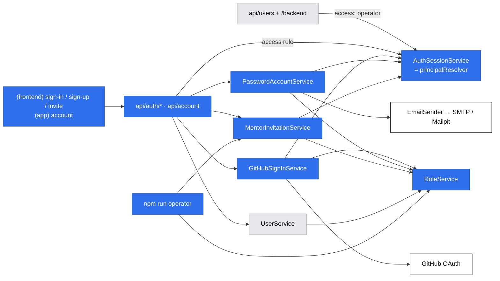
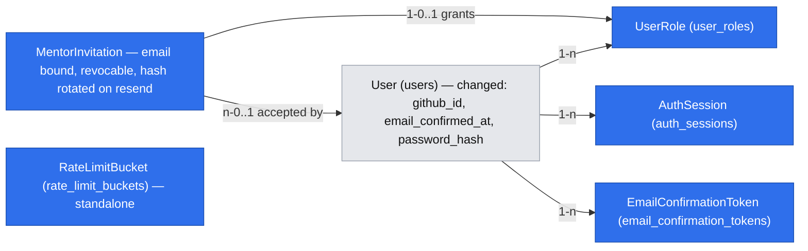

# E01 — Accounts and roles

- Epic: #28 (E01) · Stories: #34 (E01-S01), #35 (E01-S02), #36 (E01-S03) · Task: #46 (E01-S03-T01)
- Companion spec: [`2026-10-17-platform-primitives.md`](./2026-10-17-platform-primitives.md), cited below as "platform P*n*/F*n*". Each phase here builds the primitives it first needs.
- Design authority: `.ai/specs/product-brief.md` (D13, D14, N03; the D12 boundary)
- Research: one shared pass for both specs. It lives in the platform spec, section "Research".
- Status: **draft for review** (PO revisions and design-review decisions 2026-10-18)

## 📝 TLDR

**Today:** nobody can sign in. The baseline has a `users` table, an unauthenticated `/api/users` example that creates users, and no sessions, roles or email.

**Proposed (future behavior):**

- A visitor signs in with GitHub (primary) and gets an account whose display name comes from GitHub and can be edited.
- A person without GitHub registers with email and password, and can sign in only after confirming the address.
- An engineer becomes a mentor only by accepting a single-use, email-bound invitation the operator creates from a CLI and the system emails to that address. Only an account with that verified email can accept. Accepting adds mentor to the account's existing roles.

The work extends the baseline `auth` concept (`User`, `UserService`, `userCreateSchema`, `/api/users`). It does not create a parallel stack.

**Identifier legend.** `AD` = accounts decision; `platform.PD` = platform decision; `platform.P` = server primitive; `platform.F` = frontend primitive. Brief `D`, `N`, `R`, `A` and zero-padded `Q` mean decision, non-goal, business rule, assumption and question. `E01-S01` is a backlog story. Historical authoring questions use `accounts.gate.Q1`, distinct from `brief.Q01`; no bare gate `Q1` references remain. Unqualified AD references are local; P/F references always refer to the companion platform catalog.

## 📝 Decisions

The original decisions were settled on 2026-10-17 and revised by the product owner on 2026-10-18 as recorded below. These are spec-level ids. The revision adopts the course authors' invitation model as described by the PO; the course material itself was not independently inspected. It supersedes issue #46's earlier create-only bearer-link decision without editing the product brief or tracker. A design review the same day (2026-10-18) made roles live, simplified session activity, rate limiting, concurrency tests and rollback, and added the Non-goals section. This is a course project: where two options both suffice, the spec takes the simpler one, and the course model is the reference.

| Id | Decision | Why |
|---|---|---|
| AD1 | **Thin in-house auth** on MikroORM. OAuth mechanics come from `arctic`'s generic `OAuth2Client` with PKCE (S256), because its `GitHub` class has no PKCE and fixed endpoints. Passwords use `bcryptjs` (cost 12). No auth library. (accounts.gate.Q1) | Entities, migrations and DI follow house rules (`defineEntity`, MikroORM migrations only, Awilix). Invitations, combined roles and `returnTo` are custom in any library. |
| AD2 | **Database sessions**, not JWT (accounts.gate.Q2; revised 2026-10-18):<br>• an opaque 256-bit token in an HttpOnly cookie, with only its SHA-256 hash in `auth_sessions`<br>• valid for **30 days from the last visit**: every authenticated page or API request counts as activity and moves DB expiry to request time + 30 days, but the write is skipped when expiry was already moved within the last hour; the cookie is renewed on every request<br>• page guards record activity; platform.P4's cookie-only Proxy renews page cookies and does no authorization and no DB access (authorization stays where platform.PD4 puts it); API/navigation wrappers renew theirs<br>• roles are read live from the DB on every request: operator grant/revoke and invitation acceptance apply on the user's next request, with no session deletion, rotation or fresh sign-in<br>**This deviates from** the implemented engineering standards' JWT/24h text and the earlier 15-day renewal threshold. Step 1.11 updates the implementation documentation. | Roles come from the DB on every request, so no role change waits for a token to expire. No cross-request identity/role cache is permitted. Accepted risk: a session, including a stolen cookie, holds whatever roles its user has at request time, including roles granted later. |
| AD3 | **Link GitHub to an existing account only through GitHub's verified primary email.** If that account's password was never confirmed, the GitHub sign-in claims the account and discards the unconfirmed password. (accounts.gate.Q3) | One person, one account, and the email stays unique, which the baseline and D15 rely on. Discarding an unconfirmed password defeats pre-hijacking: an attacker who registered your email first loses access the moment you prove ownership. |
| AD4 | **`/backend/**` and `/api/users` require the `operator` role.** It is granted only by `npm run operator -- role grant`. The users example stays the reference example. (accounts.gate.Q6) | Once real accounts exist, those routes would expose every email. D12 rules out operator screens for operator *processes*. The admin is not one, and the role cannot be gained in the product. |
| AD5 | **Email-bound invitations, revised 2026-10-18.** CLI `invite create/revoke/resend --email <address>`; no list UI, `--note`, expiry override or token output. Fixed validity **14 days** from creation/resend; at most one open invitation per normalized email. Resend rotates the token; revoke invalidates the current link. Only an account with the matching **verified** email may accept, by POST after seeing the receiving account. | Supersedes the create-only bearer-link decision recorded in [issue #46](https://github.com/rafsaw/ai_techleaders/issues/46#issuecomment-6250466206). A forwarded link alone cannot grant mentor to an unrelated account. Scanners never consume it. A mismatching GitHub user can sign out and register/confirm the invited address with email/password, or ask the operator to re-invite their account email. |
| AD7 | **Email confirmation takes the link *and* the password.**<br>• The link opens `/confirm-email`, which shows "expired", "already confirmed" or "not valid" immediately.<br>• For a valid link, the person enters the password they chose and presses **Confirm** (a POST).<br>• That confirms the address, signs them in and returns them to `returnTo`.<br>(accounts.gate.Q9, raised by the architectural review.) | Confirm-on-open lets an attacker pre-register your email with their own password. A mail scanner or one stray click would then confirm an account the attacker can sign into, and AD3 would no longer wipe that password because it is "confirmed". Requiring the password the registrant chose means only that registrant can confirm. Because the password proves identity, signing in on confirm is now safe. |
| AD6 | **Passwords are at least 15 Unicode code points and at most 72 UTF-8 bytes, with no composition rules**, plus a modest local common-password blocklist. Longer input is rejected, never truncated. The form hints "use a short phrase" and supports password-manager autofill/paste. (accounts.gate.Q8) | Length and blocking common passwords address different attacks. The 72-byte bcrypt ceiling remains an explicit limitation for multibyte passwords. No external breached-password service is added. N03 remains in force. |

## 📝 Problem Statement

- **Nothing knows who is calling, and every later epic needs it.** The mentor's own profile, slots and Stripe status (E02), booking (E04, where D13 puts sign-in at slot selection), and private session lists and the session screen (E05) all depend on identity.
- **D13 fixes the sign-in methods** (GitHub first, email and password with confirmation as the fallback). **N03** excludes password reset in 1.0.
- **D14 fixes the mentor path:** an operator-made single-use invitation, with no open mentor registration, and one account may hold both roles.
- **The baseline is unsafe once accounts are real.** `/api/users` carries `TODO(auth)` and lets anyone create users, and `/backend` lists every user.

## 📝 Proposed Solution

Each story keeps its own user flow. None of them is reduced to CRUD on `users`.

### Flow 1: GitHub sign-in (#34)

1. The visitor presses **Sign in with GitHub** on `/sign-in` (or on the invitation page). The browser navigates to `GET /api/auth/github?returnTo=…`.
2. The route sets a short-lived `devmentor_oauth` cookie:
   - httpOnly, `SameSite=Lax`
   - `Secure` on HTTPS; production `APP_URL` must be HTTPS
   - 10 minutes
   - `Path=/api/auth/github`
   - holds `state`, the PKCE verifier and `returnTo`

   Then it redirects to GitHub with scope `user:email`. This is an external redirect, allowed only to `config.github().oauthUrl` (platform P7).
3. GitHub returns to `/api/auth/github/callback`. The handler covers every outcome:

   Validate the OAuth state/PKCE binding before handling success or denial. Read `returnTo` from the OAuth cookie through platform.P6, and preserve that safe path on recoverable redirects to sign-in (including cancellation, missing email and provider failure), so switching to email does not lose an invitation/slot. Clear the OAuth cookie on every terminal success/failure; never log it or the redirect URL. Missing/malformed cookies fall back to `/`.

   | Callback outcome | Result |
   |---|---|
   | `error=access_denied` (cancel or deny) | Redirect to `/sign-in?error=github_cancelled`, which shows "GitHub sign-in was cancelled" and offers the email option. |
   | State missing or mismatched | `github_failed`; nothing is created. |
   | Token exchange fails | `github_failed`; nothing is created. |
   | No verified primary email | `github_no_verified_email`, with a message telling the person to verify an email on GitHub or use email sign-up. |

4. Account resolution, in one transaction (AD3):
   1. A user with this `githubId` → reuse it. The display name is **not** overwritten, because the person may have edited it.
   2. Otherwise, a user with this email (normalized lowercase):
      - It already has a *different* `githubId` → `github_email_taken`.
      - Otherwise, link it: set `githubId` and `emailConfirmedAt ??= now`.
      - If the account had an unconfirmed password: clear `passwordHash` and delete its open confirmation links (Phase 2).
   3. Otherwise, create a user with `name = github.name?.trim() || github.login` (cut to 100 characters), the email, `emailConfirmedAt = now` and the `mentee` role.
5. Start a database session (AD2) and clear the OAuth cookie. Redirect to `returnTo`. A **new** account with no `returnTo` lands on `/account?welcome=1`, where the display name shows with a "This is the name others see. You can change it." notice. That makes "editable by the person" visible on first sign-in. On failure, the sign-in page carries the validated `returnTo` into retry/sign-up/email actions; error table paths above are abbreviated and include that parameter when present.

### Flow 2: email and password with confirmation (#35)

**Register.** `/sign-up` takes a display name, email and password. The response is the same whether or not the email exists, so it never reveals which emails have accounts:

| The email belongs to… | What happens |
|---|---|
| No one | Create the user with the `mentee` role and an unconfirmed email. Issue a confirmation link and send it. The link expires after 24 hours and carries `returnTo` in its own query string, so the path is never stored (a path such as `/invite/<token>` contains a secret). |
| An unconfirmed account | Replace the display name and password hash, **delete** earlier links, and send a new link. The last registration wins; earlier links stop working. |
| A confirmed account | Hash the submitted password anyway and discard it, so timing matches the other paths. Send an "you already have an account — sign in with GitHub or your password" email. No reset is offered (N03). |

In every case the response is "Check your inbox at *email*". If sending failed, it adds "We couldn't send the email — try again". Sending is not retried in the background. Every email in this table counts toward rate-limit rule 4 (3 per address per hour). When that rule is exhausted, sign-up still creates or updates the account as above but sends nothing, and answers with the same `emailSent: false` response for every email state, so nothing leaks.

**Credential concurrency invariant (mandatory).** Registration, email confirmation and GitHub linking serialize on the same user row. Registration may compute a password hash before the transaction, but must lock the user (`FOR UPDATE`) and re-read confirmation state before writing it. A confirmed account's password is never changed by registration, even if registration first observed it as unconfirmed. Confirmation/resend lock the user before its token rows; GitHub linking uses the same order and deletes pending links when claiming an unconfirmed account. For a new email, let the unique email constraint decide the insert, then retry account resolution in a fresh transaction on conflict. Re-registration may invalidate only still-pending credentials/tokens. Token consumption, email confirmation and session creation commit together. No SMTP call or cookie emission happens inside an uncommitted transaction. The guarantees rest on the `FOR UPDATE` user lock plus the database constraints (unique email, unique `github_id`, conditional token consumption). Unit tests assert the lock calls, their order and the re-read; there are no interleaving race tests for registration (see Step 2.7).

**N03 copy on both `/sign-up` and `/sign-in`:** "Password reset is not available yet. Save your password in a password manager, or use GitHub sign-in. If you forget an email-only account's password, you cannot recover access in version 1.0." GitHub is an alternative only when its verified primary email matches the account; it is not a promise to recover an unrelated address. A user without GitHub who forgets the password of an already confirmed account sees the generic credential error plus this notice; resend/re-registration cannot reset that password. Password reset is a follow-up candidate outside 1.0; the PO will record it in #49. This change does not edit the product brief or add a reset route/manual recovery mechanism.

**Confirm (AD7).** The link opens the public page `/confirm-email?token=…&returnTo=…`. The GET only *inspects* the token (platform P9 `inspectSingleUseToken`); it never consumes it. The page shows one state:

| Link state | Page |
|---|---|
| Valid, and the token's `email` still equals the account email | "Enter your password to confirm *email*" with a password field and a **Confirm** button. |
| Expired | "This link has expired." Sign in to get a new one: the `email_not_confirmed` response offers Resend. |
| Used, and the address is confirmed | "Your address is already confirmed — sign in." |
| Unknown, tampered, or replaced by a newer link | "This link isn't valid. If you registered more than once, use the link in the most recent email." |

**Confirm** sends `POST /api/auth/confirm-email {token, password, returnTo}`. In one transaction it:

1. checks the password against the account the token belongs to, failing with `invalid_credentials` and the sign-in rate limits
2. consumes the token
3. sets `emailConfirmedAt`
4. starts a session

It then answers `{ redirectTo: returnTo ?? "/" }`.

A scanner that prefetches the link changes nothing. A person who did not register cannot confirm, because they don't know the password the registrant chose.

**Sign in.** The email form on `/sign-in`:

| Case | Response |
|---|---|
| Wrong email or password, or a GitHub-only account | One generic message: "Email or password is incorrect" (401 `invalid_credentials`). A dummy bcrypt compare runs, so timing does not reveal whether the account exists. |
| Correct password, address unconfirmed | 403 `email_not_confirmed`. The form shows "Confirm your email first" with a **Resend confirmation** button. Resend re-posts the same email and password to the resend endpoint, so only the person who knows the current password can trigger a new link. |
| Correct and confirmed | A session starts and the browser goes to `returnTo` (default `/`). |

### Flow 3: email-bound mentor invitation (#46, then #36)

1. **The operator manages an invitation** from the CLI, without an admin page:
   ```
   npm run operator -- invite create --email ada@example.com
   npm run operator -- invite revoke --email ada@example.com
   npm run operator -- invite resend --email ada@example.com
   ```
   - Normalize email with the same trim/lowercase validation as accounts. `create` commits one invitation with a token hash and expiry exactly 14 days ahead, then emails the raw link only to that address through platform.P10. The CLI prints id, email, expiry and delivery status, **never the token or URL**. `--note` and `--expires-in-days` are rejected.
   - Before `create`, the operator confirms which address the engineer signs in with (their GitHub primary email if they use GitHub). Inviting that address avoids a second account (runbook rule).
   - `create` conflicts if a still-valid open invitation exists ("Use invite resend or revoke"). An expired open row is closed before a fresh row is created, in the same transaction. The partial unique email index arbitrates concurrent creates.
   - `revoke` invalidates an open invitation immediately; no open invitation is an idempotent no-op. If the latest invitation was already accepted, report that fact: revoking an invitation does not remove an already-granted mentor role.
   - `resend` locks the open row, replaces its token hash and sets a new 14-day expiry, then sends the new link. The old link is invalid even if delivery fails. An expired but unrevoked open row may be resent; accepted/revoked invitations cannot be reopened with resend (use create). There is never more than one open row for the address.
   - SMTP happens after commit. Failure leaves the committed hash in place, exits nonzero with safe delivery status, and tells the operator to run resend; no raw-token retry storage is added. Concurrent sends may deliver a stale link, which is harmless and cannot be accepted; only the current hash works. These are trusted local operator commands, not public send endpoints; public confirmation-send throttles are specified separately.
2. **The invitee opens `/invite/[token]`.** The GET inspects only. Both invitation and confirmation pages have `no-referrer`/`noindex` metadata and response headers `Referrer-Policy: no-referrer`, `Cache-Control: private, no-store`; deployment log redaction follows platform.P8. The page shows:

   | State | The page shows |
   |---|---|
   | Invalid, used, revoked, superseded by resend, or expired | "This invitation is not valid. Ask the DevMentor team for a new email." No role is changed. |
   | Valid, signed out | Sign in or create an account **using the email address that received this invitation**. GitHub and email options preserve `returnTo=/invite/<token>` through confirmation. |
   | Valid, signed in, account email unverified or different | "This invitation requires the verified email address it was sent to. You are signed in as <current account email>." No Accept button. Offer sign-out and email registration/sign-in with `returnTo` preserved, and also say "Or ask the DevMentor team to re-invite <current account email>" (that path keeps one account); no address-changing or account-merging feature is added. If GitHub uses another address, register and confirm the invited address with email/password. Do not disclose the full invited address to a mismatching account. |
   | Valid, matching verified account, already a mentor | "You already have the mentor role." The invitation stays unconsumed; the operator can revoke it. |
   | Valid, matching verified account | "Accept as <display name> (<account email>). This account will receive the mentor role." Then **Accept invitation**. |

3. **Accept** sends `POST /api/auth/invitations/accept {token}`. In one transaction, lock the user then the invitation, matching the credential lock order. Re-read the user's normalized email and `emailConfirmedAt`, the invitation's current hash, expiry, revocation and consumption state. A mismatching/unverified account gets 403 and consumes nothing. If the account already has mentor, return 409 and consume nothing. Otherwise consume via platform.P9, add `mentor` with `invitationId` without replacing any existing roles, and record `acceptedBy`. The session is not rotated and no cookie changes.

   Resend/revoke lock the same invitation row: if either wins first, the old link cannot grant a role; if acceptance wins first, neither command retroactively undoes the grant. Role uniqueness and the user lock prevent two different invitations concurrently consuming for an already-promoted account. The response and every session's next request show mentor (AD2), without another sign-in. Operator grant/revoke follow the same live rule.

4. **No open mentor registration.** No route, form field or CLI command grants `mentor` outside verified invitation acceptance. `RoleService.grantMentorFromInvitation` requires the locked, validated invitation path; generic `grant` accepts only `mentee | operator`, with a runtime guard. Sign-up strips unknown role keys. Neither an invitation email field nor a token alone is proof of verified account ownership.

### Account and sign-out (shared by all flows)

- **Account page.** `/account` (signed-in area) shows the display name in an editable form, plus the email, roles and sign-in methods ("GitHub", "Email and password"). It reads through `UserService` in the Server Component (platform F5) and writes with `PATCH /api/account`.
- **Sign out.** Available in both headers. `POST /api/auth/sign-out` deletes the session row and clears the cookie. Normal sign-out follows its default `/` response. The invitation page's dedicated switch-account button instead waits for successful sign-out and navigates back to the same validated invitation path, preserving `returnTo` without changing the API contract. It does not navigate on failure.

**Session activity and privilege changes (AD2).** Every valid signed-in page or API request counts as activity, including public pages and public API endpoints presented with a valid session. Every public leaf calls `getPrincipal()`; private leaves use their guards. Do not rely on the header/layout alone, which can be reused on client navigation. Each request moves DB `expires_at` to `now + 30 days`, but skips the write when `expires_at` is already later than `now + 30 days − 1 hour`, so most requests are read-only. "30 days of inactivity" therefore means 30 days ± 1 hour. React `cache()` deduplicates page checks only within that render; it never caches roles across requests. Conditional, monotonic updates do not extend an expired row or recreate a deleted one. API/navigation wrappers renew cookies on every success and error response; a start/end cookie takes precedence over renewal. Page requests use platform.P4's cookie-only Proxy because Server Components cannot set response cookies. Proxy only renews the session cookie: it does no authorization and no DB access, and authorization stays in `apiHandler`, `navigationHandler` and the page guards (platform.PD4). Static assets do not count as activity; merely keeping a tab open without requests does not count.

`role grant --role operator` and `role revoke --role operator` change only the role row. Both are idempotent and apply on the user's next request, including in other app instances: grant opens operator surfaces to the existing session, and revoke makes the next protected request fail while the person stays signed in. Sessions are never deleted or rotated by a role change, and nobody has to sign in again. Mentor invitation acceptance likewise adds mentor live while preserving every existing role. A request already authorized before a revoke cannot be retroactively undone.

Session resolution is one statement with no user-row lock: find the unexpired session by token hash, conditionally extend its expiry (the hourly throttle above) and read the user's current roles. An expired or deleted row yields no principal.

**Alternatives rejected:**

- **Confirming on open (GET).** A scanner or a stray click would confirm an attacker's pre-registration (AD7).
- **Granting the role on GET.** See AD5.
- **Deleting or rotating sessions on role changes.** Roles are read live (AD2), so invalidation would only force extra sign-ins and need lock ordering between session resolution and role changes.
- **A `roles text[]` column.** A row per role records which invitation granted it, and the unique constraint `(user_id, role)` makes grants idempotent.
- **A generic `auth_identities` table.** One provider (D13) fits a nullable unique `github_id` column. Moving to a table later is a mechanical migration.
- **Renaming `users.name` to `display_name`.** That is a breaking schema and DTO change (protected surfaces 1 and 4) for a label. Instead, `User.name` **is** the display name, and the UI and DTOs that are new in this spec call it `displayName`.

## 📝 Architecture

**Services.** All live in the existing concept folder `app/src/server/services/auth/` and are registered one line each in `container.ts` and `cradle.ts`. All are TRANSIENT and depend on the scoped `em`, except the adapters (SINGLETON).

| Service | Responsibility | Phase |
|---|---|---|
| `UserService` (existing) | Keeps `list`/`count`/`create`. `create` (operator admin) now also grants `mentee`. Adds `getAccount(userId) → AccountDto` and `updateDisplayName(userId, name)`. | 1 |
| `RoleService` | Idempotent `grant(userId, "mentee" \| "operator")`, operator-only `revokeOperator(userId)`, `rolesOf(userId)`, `grantMentorFromInvitation` (Phase 3). Role changes touch only `user_roles` and apply on the user's next request. | 1, 3 |
| `AuthSessionService` | Implements platform.P3 `PrincipalResolver`. `start(userId, cookies)`, `resolve(req, cookies)` (validate/touch/renew), `resolveToken(raw)` (page validation + throttled DB touch; cookie renewal belongs to Proxy), `end(sessionId, cookies)`. Also registered as `principalResolver`. | 1 |
| `GitHubSignInService` | `begin(returnTo, cookies) → URL`, `complete(query, cookies) → { redirectTo }`. Flow 1 resolution (AD3). | 1 (claim rule completed in 2) |
| `GitHubOAuth` port (`github-oauth.port.ts`) + `adapters/arctic-github-oauth.ts` | `authorizationUrl(state, verifier)`, `exchangeCode(code, verifier)`, `fetchIdentity(accessToken) → { id, login, name, emails[] }`.<br>• The adapter wraps arctic's `OAuth2Client`, and its endpoints come from `config.github()`, so integration tests point them at a local stub.<br>• It reads `/user` and `/user/emails?per_page=100`. The access token is used once and never stored.<br>• arctic's `OAuth2RequestError`, `ArcticFetchError` and `UnexpectedResponseError` all map to `github_failed`. | 1 |
| `PasswordAccountService` | `register`, `signIn`, `resendConfirmation`, `inspectConfirmation(token)` (page), `confirmEmail(token, password, cookies)` (Flow 2, AD7). | 2 |
| `PasswordHasher` (`password-hasher.ts`) | `bcryptjs`, cost 12, plus a `dummyCompare()` that equalizes timing. | 2 |
| `MentorInvitationService` | `create({ email })`, `revoke({ email })`, `resend({ email })` return safe status DTOs (`id`, `email`, `expiresAt`, delivery/state), never raw tokens/links. `inspect(token, principal?)` returns page-state DTOs without exposing the full bound address to another account; `accept(token, principal)` enforces Flow 3 under locks. Email is sent through P10 after commit. | 3 |

**Routes.** All go through `@/server/http`; no route has its own `try/catch`.

| Route | Kind | Access |
|---|---|---|
| `api/auth/github/route.ts` (GET) | `navigationHandler` | public |
| `api/auth/github/callback/route.ts` (GET) | `navigationHandler` | public |
| `api/auth/sign-out/route.ts` (POST) | `apiHandler` | optional |
| `api/account/route.ts` (GET, PATCH) | `apiHandler` | user |
| `api/users/route.ts` (existing) | `makeCrudRoute` | `{ role: "operator" }` |
| `api/auth/sign-up/route.ts`, `api/auth/sign-in/route.ts`, `api/auth/confirm-email/route.ts`, `api/auth/confirm-email/resend/route.ts` (POST) | `apiHandler` | public |
| `api/auth/invitations/accept/route.ts` (POST) | `apiHandler` | user |

**CLI commands** (platform P12) live in `app/src/server/cli/commands/`:

- `role-grant.command.ts` and `role-revoke.command.ts` (Phase 1): `--email <e> --role operator`. Only `operator` is accepted, so `mentor` stays invitation-only. Both apply on the user's next request; sessions are untouched.
- `invite-create.command.ts`, `invite-revoke.command.ts`, `invite-resend.command.ts` (Phase 3): `--email <e>` only, in addition to the shared production `--yes` safety flag. All output is secret-free.



Takeaway: three entry flows (GitHub, password, invitation) converge on two shared services. `RoleService` decides what a person may do. `AuthSessionService` decides who they are on every request, and the same service backs `apiHandler`, the navigation routes and the page guards.

## 📝 Data Model

All new tables spread `baseProperties` (uuid `id`, `created_at`, `updated_at`). Each phase ships one migration with a working `down()` and a migration test one directory above `src/migrations/`.

**`users`** (existing; the columns are added across phases):

| Column | Type | Phase | Notes |
|---|---|---|---|
| `email` | existing | — | Lowercased by schema; unique (existing). |
| `name` | existing | — | **The display name.** 1–100 characters after trim. |
| `github_id` | `varchar(32)`, null, unique | 1 | GitHub numeric id as a string. |
| `email_confirmed_at` | `timestamptz`, null | 1 | Set for GitHub sign-ins (verified primary email) and on confirmation. |
| `password_hash` | `varchar(60)`, null | 2 | bcrypt; null for GitHub-only accounts. |

**`user_roles`** (Phase 1):

| Column | Type | Notes |
|---|---|---|
| `user_id` | FK `users`, on delete cascade | |
| `role` | enum `mentee \| mentor \| operator` | check constraint |
| `invitation_id` | FK `mentor_invitations`, null | Added in Phase 3; set only for `mentor`. |

Unique `(user_id, role)`. The Phase 1 migration backfills `mentee` for every existing user, so seeded and admin-created users keep working.

**`auth_sessions`** (Phase 1). The name avoids the domain term **Session**, which the brief glossary reserves for the text session.

| Column | Type | Notes |
|---|---|---|
| `user_id` | FK `users`, on delete cascade | |
| `token_hash` | `char(64)`, unique | SHA-256 hex (platform P8). |
| `expires_at` | `timestamptz` | |

Index on `user_id`.

**`email_confirmation_tokens`** (Phase 2) adds `singleUseTokenProperties` (platform P9) to these columns:

| Column | Type | Notes |
|---|---|---|
| `user_id` | FK `users`, on delete cascade | |
| `email` | `varchar(254)` | The address the link was sent to. A confirmation applies only while it still equals `users.email`, binding the token to the user **and** the address (Copenhagen Book). |

There is no `return_to` column: `returnTo` travels in the link's query string, so no raw secret (such as an invitation path) is ever stored.

**`rate_limit_buckets`** (Phase 2): the Postgres storage behind platform.P11's `RateLimiter` port. P11 is Postgres-only (amended in the platform spec with this review), so there is one implementation and no multi-instance release blocker.

| Column | Type | Notes |
|---|---|---|
| `key_hash` | `char(64)`, unique | SHA-256 of rule id + normalized key (email or validated IP). |
| `count` | `integer` | Attempts in the current window. |
| `window_ends_at` | `timestamptz` | |

One atomic `INSERT … ON CONFLICT (key_hash) DO UPDATE … RETURNING` increments the count, or restarts the window inline when `window_ends_at` has passed. There is no prune command or background job; rows for keys never seen again stay (Non-goals).

**`mentor_invitations`** (Phase 3) adds `singleUseTokenProperties` to these columns:

| Column | Type | Notes |
|---|---|---|
| `email` | `varchar(254)`, required | Trimmed/lowercased invited address; bound at create and immutable. Same validation as account email. |
| `revoked_at` | `timestamptz`, null | Revoke closes the invitation; replaced expired rows are also closed. |
| `accepted_by_user_id` | FK `users`, null, on delete set null | |

`consumed_at` doubles as the acceptance time. Fixed 14-day expiry. A partial unique index on `email WHERE consumed_at IS NULL AND revoked_at IS NULL` enforces at most one open row per address, including an expired row until it is explicitly closed or resent. No time-dependent index predicate is used. `create` closes an expired row transactionally; `resend` replaces only the current hash/expiry on an open row; `revoke` sets `revoked_at`. Neither `note` nor raw URLs/tokens are stored. The invitation service checks these extra invariants around platform.P9; generic token helpers alone cannot check bound email or revocation.

**Sensitive data:**

- Passwords exist only as bcrypt hashes.
- Session, confirmation and invitation tokens exist only as SHA-256 hashes. Raw values exist transiently in memory and in the intended cookie/email/browser link, never CLI output, logs, database URL columns or diagnostic artifacts.
- Emails are personal data: account email is visible to its owner and operators; invited addresses are visible to operators and the matching verified account. A mismatching viewer sees only their own account address. The invitation flow never treats knowledge of the invited email as proof of ownership.
- Log static route templates, not `/invite/<token>` paths or nested `returnTo` values; sanitize errors, mail bodies and provider metadata. Configure application **and hosting access logs** accordingly (platform.P8), including page failures. Response headers prevent token-page referrer leakage/caching.
- brief.Q05 (terms of service and data processing owner) remains a release condition and does not change this design.



Interactive view: `.ai/data-model/2026-10-17-accounts-and-roles.html`.

## 📝 API Contracts

All JSON routes use the existing envelope. Schemas live in `core/src/validators/auth/`, one file each, shared by the route and its form.

| Route | Request | Success | Failures |
|---|---|---|---|
| `GET /api/auth/github?returnTo` | — | 303 → GitHub | config missing → `/error?code=internal_error` |
| `GET /api/auth/github/callback` | `code`, `state` \| `error` | 303 → `returnTo`, `/`, or `/account?welcome=1` | 303 → `/sign-in?error=github_cancelled \| github_failed \| github_no_verified_email \| github_email_taken` plus validated `returnTo` when available; always clear OAuth cookie |
| `POST /api/auth/sign-out` | — | 200 `{ redirectTo: "/" }` | — |
| `GET /api/account` | — | 200 `AccountDto` | 401 |
| `PATCH /api/account` | `accountUpdateSchema` `{ displayName: string.trim 1–100 }` | 200 `AccountDto` | 400 field errors, 401 |
| `POST /api/auth/sign-up` | `signUpSchema` `{ displayName, email, password, returnTo? }` | 201 `{ email, emailSent: boolean }`, identical for new and existing emails (rule 4 exhausted → `emailSent: false`, nothing sent) | 400, 429 `rate_limited` (rule 3) |
| `POST /api/auth/sign-in` | `signInSchema` `{ email, password, returnTo? }` | 200 `{ redirectTo }` + `Set-Cookie` | 401 `invalid_credentials`, 403 `email_not_confirmed`, 429 |
| `POST /api/auth/confirm-email/resend` | `signInSchema` (email + password) | 200 `{ emailSent: boolean, alreadyConfirmed: boolean }` | 401 `invalid_credentials`, 429 |
| `POST /api/auth/confirm-email` | `emailConfirmSchema` `{ token, password, returnTo? }` | 200 `{ redirectTo }` + `Set-Cookie` | 401 `invalid_credentials`, 404 `not_found` (expired, used or invalid, with a reason-specific message, e.g. when another tab won the race), 429 |
| `POST /api/auth/invitations/accept` | `invitationAcceptSchema` `{ token: string }` | 200 `AccountDto` preserving existing roles (no `Set-Cookie`) | 401; 403 `forbidden` for mismatching/unverified email, consuming nothing; 404 `not_found` "This invitation is not valid" for invalid/expired/used/revoked/rotated tokens; 409 `conflict` "You already have the mentor role" |
| `GET/POST /api/users` (existing) | unchanged | unchanged | **new** 401/403 for non-operators |

```ts
type AccountDto = {
  id: string; email: string; displayName: string;
  roles: Role[];                          // e.g. ["mentee", "mentor"]
  signInMethods: { github: boolean; password: boolean };
};
```

**Rules:**

- **Passwords** (`passwordSchema`, AD6): at least 15 Unicode code points, at most 72 UTF-8 bytes, no composition rules, modest local common-password blocklist. Over-long input is rejected, never truncated. The same behavior applies server/client; no unannounced trimming or normalization of the password. Tests include multibyte input and long common passwords, not just ASCII length.
- **Rate limits** (platform P11 port, Postgres `rate_limit_buckets`, keys hashed). The course model's four rules:

  | # | Endpoints | Limit | Key |
  |---|---|---|---|
  | 1 | sign-in and confirm-email (the confirm page counts as sign-in) | 10 per 15 min | validated IP |
  | 2 | sign-in and confirm-email | 5 per 15 min | normalized email |
  | 3 | sign-up | 5 per hour | validated IP |
  | 4 | every confirmation-type email to an address: sign-up's confirmation or "already registered" email, and confirmation resend | 3 per hour | normalized email |

  Every rule counts **attempts**, successful or not. Accepted risk: five bad attempts lock a known address out of password sign-in for 15 minutes; GitHub sign-in is unaffected. Per-IP rules are checked before expensive password hashing/comparison.

  When the client IP is unknown (`TRUST_PROXY=false`, the default), the per-IP rules are **skipped**, never pooled into one shared bucket. The per-email rules still apply, so rule 4 caps the email any address can receive from sign-up even without a known IP.

  Normalize account emails before hashing rate-limit keys; confirmation derives the account key from the token record, never from an arbitrary supplied email. Rule 4 is reserved before SMTP and counts failed sends too; sign-up answers silently when it is exhausted (Flow 2), resend answers 429. Trusted invitation CLI commands are not rate-limited. `TRUST_PROXY=true` requires an edge that overwrites the header with one validated IP and blocks direct origin access; spoofed/multi-value headers are rejected as unknown. The hosting decision must provide this contract or specify another trusted-IP adapter.

- **Session cookie:**
  - name `__Host-devmentor_session` when `APP_URL` is https, otherwise `devmentor_session`
  - `HttpOnly; SameSite=Lax; Path=/`, plus `Secure` on https
  - `Max-Age` 30 days, re-sent on every authenticated page/API visit (platform.P3/P4); DB expiry remains authoritative even if Proxy renews an invalid cookie
  - production `APP_URL` must be HTTPS; no production insecure-cookie fallback

## 📝 UI/UX

The three-area rule comes from platform PD2/F4: public pages use the Tailwind kit, the signed-in area uses shadcn.

| Page | Area | States |
|---|---|---|
| `/sign-in` | public | **GitHub button first**; email form below (Phase 2); "Create an account" link once Phase 2 ships. Show the N03 notice from Flow 2 beside the email form. Banners from the query string:<br>• `error=github_cancelled`: "GitHub sign-in was cancelled. Try again" (Phase 1), adding the live email option in Phase 2<br>• other `github_*` codes: specific plain messages<br>• form errors inline; `email_not_confirmed` shows **Resend confirmation**. No password-reset link. |
| `/sign-up` | public | Display name, email, password (length rule and N03/password-manager/GitHub notice shown before typing). Preserve invitation `returnTo`; explain that an invite requires the receiving address. Submit leads to `/sign-up/check-email?email=…`. |
| `/sign-up/check-email` | public | "Check your inbox at …" (plus the not-sent variant). Explains the 24-hour expiry. |
| `/confirm-email` | public | The four Flow 2 states. In the valid state: a password field and **Confirm**, then a redirect to `returnTo`, signed in. Every state says why in one sentence, plus the next action. |
| `/invite/[token]` | public | Flow 3 states, including verified-email mismatch and the visible account that will receive mentor. No role grant on GET. |
| `/account` | signed-in | Editable display name (`CrudForm` with the new additive `resetOnSuccess={false}`, so the saved name stays in the field). Email, role badges and sign-in methods, read-only. A `welcome=1` notice. |
| Header (public and signed-in) | both | Signed out: **Sign in**. Signed in: display name, which links to `/account`, and **Sign out**. Operators also get a **Backend** link. |
| `/` (home) | public | "Open backend" is replaced by **Sign in** / account, since the backend becomes operator-only. |

**Accessibility:**

- Every banner has `role="status"` (info, success) or `role="alert"` (error). Phase 1 uses colocated Tailwind markup; shared `Notice` is extracted only with repeated consumers in Phase 2.
- Form errors are tied to their inputs with `aria-invalid` and `aria-describedby`, the same as `CrudForm` today.
- The GitHub button is a real link to the navigation route, so it works without JavaScript.

## 📝 Edge Cases & Failure Scenarios

| Scenario | What happens / what the user sees |
|---|---|
| GitHub is down, or the token exchange fails | `/sign-in?error=github_failed`: "GitHub sign-in failed. Try again or sign in with email." Nothing is created. Logged. |
| The OAuth state cookie expired (more than 10 minutes on GitHub) | `github_failed`; retry works. |
| The GitHub account has no verified email | `github_no_verified_email`, explaining what to do. No account is created, because D15 needs an email for booking information. |
| A second GitHub account with an email already linked to another GitHub id | `github_email_taken`: "An account with this email is linked to a different GitHub account." |
| A password account uses a secondary GitHub address, and the person signs in with GitHub (different primary email) | A separate account is created under the GitHub primary email; the two are not linked (AD3 links by verified primary email only). |
| The same GitHub user signs in twice at once | The unique `github_id` and `email` constraints mean one insert wins. The loser re-reads and reuses the winner, so no duplicate is created (AC 3 of #34). |
| The operator renames, or GitHub changes the name | The display name never changes after creation, except from `/account`. |
| A sign-up for an email that already exists | Same response as a new email, plus an informational email to the address. Nothing leaks. |
| SMTP fails at sign-up | The account exists. "We couldn't send the email — try again" offers resend through sign-in. |
| A confirmation link prefetched by a scanner | Nothing changes: the GET only inspects the token (AD7). |
| An attacker pre-registers someone else's email | The owner receives a link but cannot confirm, because they don't know the attacker's password. Registering themselves replaces the hash and deletes the attacker's link. If the owner uses GitHub instead, AD3 claims the still-unconfirmed account and wipes the attacker's password. |
| Registration races with confirmation or GitHub claiming | Both serialize on the user. A replacement that loses the race sees the newly confirmed state and changes no password. The owner's confirmed credentials remain usable; an attacker's pending password cannot be installed afterward. |
| A confirmed email-only user without GitHub forgets the password | Generic credential error plus the N03 notice: reset is not available yet; save passwords in a password manager or choose GitHub with the matching verified email. Re-registering/resending cannot reset the confirmed password. Existing paid-session access is lost unless a still-valid session or matching GitHub sign-in is available. No manual recovery is promised; follow-up candidate belongs to #49, not 1.0. |
| An invitation opened by a scanner | The GET shows the page only. Nothing is consumed (AD5). |
| A forwarded link is opened by another account, or GitHub has a different email | The page shows that account and the verified-email requirement, with no Accept button. A forged POST gets 403 and consumes nothing. Sign out and register/confirm the invited address with email/password, preserving `returnTo`. |
| Two matching sessions accept the same invitation at once | One transaction consumes and grants; the other gets 404. Wrong-email contenders never become mentors and never consume the invitation. |
| The invitee is already a mentor | 409, preserving all existing roles and leaving the invitation unconsumed. The operator can revoke it. |
| The invitation expired, was revoked, or was superseded by resend | One invalid-link message. The operator may resend an open expired invitation, or create a new invitation after closure. Every old/rotated token remains invalid. |
| Accept races with revoke/resend, or two create commands target one email | Row locks define the winner; the unique partial email index prevents two open invitations. Revoke/resend winning means the old token cannot grant a role. Acceptance winning is not reversed by a later invitation command. |
| SMTP fails on invitation create/resend | The hash change remains committed; the old token stays invalid after resend. CLI reports only safe delivery failure and asks the operator to resend. No raw link is printed or stored for retry. |
| A read-only user keeps visiting pages | Every valid page request counts as activity (DB expiry written at most once an hour) and renews the browser cookie through Proxy; 30 days with no requests expires the session. Static assets and an idle tab do not count. |
| Operator role is granted/revoked while sessions exist | Both apply on the user's next request, without signing in again. Grant opens `/backend` to the existing session; revoke makes the next protected request fail (404 page, 403 API) while the person stays signed in. Sessions are untouched. |
| Someone uses sign-up to flood another person's inbox | Rule 4 caps confirmation-type email at 3 per address per hour, even when the client IP is unknown. Further sign-ups answer as usual and send nothing. |
| A session expired in the database but the cookie is still present | Treated as signed out, the row is deleted, and the cookie is cleared on the next API or navigation response. Pages redirect to sign-in with `returnTo`. |
| The database is down during principal resolution | 500 on APIs, the error page on pages. Never treated as an allowed request (fail closed). |
| Brute force on sign-in | 429 `rate_limited`: "Too many attempts — try again in N minutes". |
| A cookie stolen from a signed-out browser | Sign-out deletes the row, so the stolen token stops working immediately. This is a property of AD2. |

## 📝 Risks & Impact Review

- **Schema (protected surface 4, `risk-high`).** Three additive up migrations: nullable user columns, new tables/indexes and the `mentee` backfill. No existing column is renamed/narrowed. `down()` remains tested for disposable environments, but drops credentials, roles, sessions or invitation history and is **not** the production code rollback.
- **API (protected surface 1).**
  - `/api/users` now returns 401/403 to non-operators. This is a deliberate break with one in-repo consumer, the admin panel, which sits behind the same gate.
  - `apiHandler`'s new required `access` option and the `./backend/api/*` move are covered in the platform spec.
  - Both are listed under 💥 in the Phase 1 PR.
- **Env (protected surface 5).** New variables:
  - `APP_URL`, `GITHUB_CLIENT_ID`, `GITHUB_CLIENT_SECRET` (Phase 1)
  - optional `GITHUB_OAUTH_URL`, `GITHUB_API_URL` (integration stub overrides)
  - `SMTP_URL`, `MAIL_FROM` (Phase 2)
  - optional `TRUST_PROXY` (Phase 2, default `false`)

  Each phase updates `.env.example`, `README.md` and CI. A developer needs a GitHub OAuth App to sign in with GitHub locally. `README.md` documents creating one with the callback `http://localhost:3000/api/auth/github/callback`. Email sign-up works locally with Mailpit and no external account.
- **Direction calls (the product owner's, recorded):**
  - AD2 deviates from the engineering standards. Step 1.11 brings the document in line.
  - AD5 reads #36 AC 1 ("When they open it, Then they get the mentor role") as "open, then accept".
  - Both are recorded here so a reviewer does not flag them as defects.
- **Residual risk, accepted:** an attacker can keep re-registering a victim's unconfirmed email. That replaces the victim's pending password and link, which annoys the victim but gives the attacker no access (AD7). Per-email sign-up limits (3 per hour) bound it. Every confirmation email says "If you didn't create a DevMentor account, ignore this email".
- **#35 AC 2 is read as "open the link, enter the password, confirm" (AD7)**, a product-owner decision recorded so a reviewer does not flag it as a defect.
- **Invitation residual risks.** Email binding and revoke/resend supersede the bearer/create-only risk accepted in issue #46. Compromise of both the mailbox and matching account can still defeat the ownership check; no new MFA is added. Misaddressing an invitation invites the owner of that address, so the CLI echoes the normalized address and supports revoke. Revoking an accepted invitation does not revoke mentor; mentor-role removal stays a manual operator action (Non-goals). Hosting/access-log redaction must be verified before production links are sent.
- **Live roles, accepted.** A session holds its user's current roles, so a stolen cookie gains any role granted to that user later (AD2). Sign-out still deletes the row.
- **Dynamic public pages, accepted.** Every public leaf calls `getPrincipal()`, which reads cookies, so public mentor listings and profiles render per request (`cacheComponents` is not enabled). At this scale the cost is negligible; with the hourly throttle a public page view is usually one read and no write. If it ever matters, the fix is `cacheComponents` with the identity read inside a `<Suspense>` boundary.
- **Rollback — code only.** Each phase is one PR. No E01 phase reaches a production environment with real users before Phase 3 passes and the release conditions below are met, so there is no mixed build/schema matrix to manage. Roll back by deploying previous code and **keeping all added columns/tables/indexes/data**. `down()` migrations are tested for disposable environments only; they drop credentials, roles, sessions or invitation history and are never the rollback path.
- **Release conditions that are not planning blockers:**
  - brief.Q05 (terms of service and data processing owner)
  - brief.Q13 (the shared operator contact email)
  - platform.PD1: chosen production email provider, configured sender, and a successful delivery test to a real inbox; verify confirmation and invitation template links without storing raw tokens in evidence
  - the hosting decision for the trusted client-IP header contract (the limiter is already Postgres-backed)
  - verified token redaction in application, Proxy, CLI and hosting access/error logs

## 📝 Decisions in play

- **D13:** GitHub is primary; email and password with confirmation is the fallback. Mentor listings and profiles stay public, and E01 adds no gate to them. Sign-in at slot selection uses the `returnTo` built here (E04-S01).
- **D14:** the mentor role comes only from a single-use invitation created manually by the operator. AD5 now binds it to a verified account email and supplies CLI revoke/resend; no open mentor registration. Existing roles are preserved.
- **N03:** no password reset in 1.0. Both email-entry pages explain this and recommend a password manager or matching GitHub sign-in. The existing-account email does not promise recovery. Password reset is a follow-up candidate the PO will record in #49; the product brief is unchanged.
- **D12:** no screens for operator processes. Invitations are created through the CLI (#46, confirmed by the product owner 2026-10-17: script or CLI, no admin page).
- **D15:** the display name is what the other participant sees, so the display name is required and editable here.
- **Superseded by PO instruction, 2026-10-18:** issue #46's create-only bearer-link/no-revoke interpretation (including token printing and optional note/expiry); AD2's under-15-days renewal threshold; the optional Phase 1A/1B split; and platform.PD4's blanket no-Proxy choice. This records authority for implementation without mutating the tracker or product brief. D12–D16/N03 remain active; the course-model provenance is the PO's instruction, not independently verified research.
- **Superseded by the design review, 2026-10-18:** session deletion and fresh sign-in on operator grant/revoke, session rotation on invitation acceptance, the user-before-session lock in session resolution, the seven-rule rate-limit table and the in-memory limiter, real-DB credential race tests, and the mixed build/schema rollback matrix with its destructive-reversal procedure.
- **Budget (brief.A02):** this spec carries no estimate rule. The budget decision against A02 is made at brief level in #49.

## 📝 Non-goals

Not part of E01; reviewers should not flag their absence:

- Changing an account's email address.
- Adding a second sign-in method to an existing account (a password on a GitHub-only account, or GitHub with a different primary email on a password account).
- Signing out of all devices.
- Account deletion and data export. These are manual operator processes (D12) until brief.Q05 is decided; follow-up in #49.
- Display-name impersonation rules (e.g. someone naming themselves "DevMentor Team").
- Removing the mentor role. It stays a manual operator action for now; no CLI command or UI is added.
- Cleaning up expired rows (`auth_sessions`, used/expired confirmation tokens, closed invitations, stale `rate_limit_buckets`). Revisit before production.
- A local GitHub stub for development. Local development uses a real GitHub OAuth App (README); the stub is test-only.

## 📋 Phasing

| Phase | Story | Ships | Primitives it builds (platform ids) | Done when |
|---|---|---|---|---|
| 1 | #34 E01-S01 | GitHub sign-in, accounts, 30-day activity sessions, sign-out, protected admin and operator role grant/revoke | P1–P4, P6–P8, P12 runner/role commands; F1/F4/F5; minimal `CrudForm.resetOnSuccess` | **One PR, no 1A/1B split.** #34 ACs 1–3, session read-only activity and operator grant/revoke cases pass. Deny leaves the visitor signed out; email option arrives in Phase 2. No shared public-form infrastructure. |
| 2 | #35 E01-S02 | Email registration/confirmation/sign-in/resend, N03 copy, credential locking, the four rate limits and AD3 claim rule | P9, P10 (+ Mailpit), P11 (Postgres adapter), F2 extraction and F3 public forms | #35 ACs 1–4 pass; #34 AC 4's email option is live. **#34 closes here.** |
| 3 | #46 + #36 E01-S03-T01, E01-S03 | Email-bound invitation create/revoke/resend CLI, email delivery, verified-email acceptance with existing roles preserved | P12 invitation commands, reusing P9/P10 | Revised AD5 criteria, including wrong-email denial and the four invitation race tests (Step 3.4), pass. #46's old printed-link/create-only interpretation is superseded by the PO instruction. |

Every phase ends with the full gate:

- `npm run lint`
- `npm run typecheck`
- `npm run build`
- `npm run test:coverage` (100% per file)
- `npm run test:integration`
- the migration applying cleanly
- a run log in `.ai/runs/`

Every phase's PR includes its affected contract docs and breaking-change notes, not a later PR's documentation step. This spec does not establish that all Now fits brief.A02; the whole-MVP estimate is delivered in the reply, not in these files.

## 📋 Implementation Plan

Each step leaves the app working and is verified by the tests it names. A step that changes behavior visible to users updates the integration scenarios it affects in the same step. Unit tests are colocated; integration tests live in `packages/app/tests/integration/`.

### Phase 1 — #34 GitHub sign-in (plus the foundation)

1. **Config and clock** (platform P1, P2).
   - Build:
     - `core/src/config/env.ts` (`defineConfigSection`, `ConfigError`)
     - `core/src/time/clock.ts`
     - `app/src/server/config.ts` with the `app` (url) and `github` sections
     - registration of `config` and `clock`
   - Update `.env.example` and `README.md`.
   - Tests: missing-key messages name keys but not values, memoization, `fixedClock`.
2. **Tokens, cookies, `returnTo` and roles in core** (P8, P3 types, P6).
   - Build:
     - `security/tokens.ts`
     - `http/cookies.ts` (add `cookie@2` to core)
     - `validators/auth/role.schema.ts`
     - `validators/auth/return-to.schema.ts`
   - Tests: a table of hostile `returnTo` payloads, cookie serialization attributes, token length and alphabet.
3. **Identity context on `apiHandler` and `makeCrudRoute`** (P3, PD3).
   - Build:
     - the required `access` option
     - `principal` and `cookies` args
     - `Set-Cookie` application
     - the `PrincipalResolver` cradle key
     - authenticated activity on public and protected routes; renewal on error responses, with start/end taking precedence
     - unexpected-error logs use static route templates and sanitized errors, never raw paths, queries or nested `returnTo`
   - `/api/users` gets `access: "public"` explicitly. This keeps today's behavior until the gate in Step 1.10, so the baseline integration scenarios stay green.
   - Tests: access matrix; public handlers still receive null while a presented valid session records activity; cookie writes on success/error; resolver failure → 500; token-bearing paths/query/returnTo/error causes absent from logs.
4. **Navigation handler** (P7, including the external-redirect allowlist) plus the `(frontend)/error` page.
   - Tests:
     - a 303 resolved against `APP_URL`, never the `Host` header
     - an off-site `redirectTo` rejected, while an allowlisted `externalUrl` passes and a non-allowlisted one fails
     - `AppError` → `onError` target
     - an unknown error → `/error?code=internal_error` plus a safe route-template log entry
     - authenticated navigation renews activity/cookies, including failure outcomes
     - a GET-only guard
5. **Schema: `user_roles`, `auth_sessions`, new `users` columns**, with entities and a migration (mentee backfill, `down()`).
   - Update the seeder to grant `mentee`.
   - Tests: a migration test, plus a seeder idempotency test that also covers the role.
6. **`RoleService`, `AuthSessionService` (registered as `principalResolver`), `UserService.getAccount`/`updateDisplayName`, `UserService.create` granting `mentee`.**
   - Tests (fixed clock): a lookup moves expiry to 30 days from request time, and skips the write when expiry was moved less than an hour ago (just under and just over one hour, and at day 29); exact expiry denies; the conditional update never shortens expiry or resurrects a deleted row; start/end; idempotent roles; operator grant/revoke are seen by the next resolution and leave sessions untouched; `AccountDto` mapping.
7. **Page guards and cookie-only Proxy** (P4), the operator CLI runner (P12), and operator role grant/revoke.
   - The root script `npm run operator` runs `tsx --conditions=react-server`.
   - The entry `operator.ts` is a one-line call to an exported `main(argv, env, deps)`, so it is fully covered by a unit test.
   - Tests:
     - guards redirect with `returnTo`
     - wrong role → `notFound`
     - public/signed-in/admin page reads touch the DB; per-render cache does not cache roles between requests
     - public-to-public client navigation invokes the public leaf activity check even when the layout/header is reused
     - Proxy renews page cookies on document/RSC requests, excludes APIs/static resources, preserves security attributes, imports no DB/container module and cannot authorize by itself
     - invalid/expired/revoked cookies still fail DB validation even if Proxy resent them
     - CLI parsing, an unknown command
     - a refused `--role mentor`
     - exit codes
     - the database host printed and `--yes` required in production
   - No route or layout uses the guards yet, so behavior does not change.
8. **GitHub sign-in backend.**
   - Build:
     - the `GitHubOAuth` port and arctic `OAuth2Client` adapter
     - `GitHubSignInService` (Flow 1 resolution, minus the Phase 2 claim)
     - both navigation routes
     - the integration GitHub stub (`tests/integration/github-stub.ts`: authorize with approve or deny, token, `/user`, `/user/emails`), wired through `GITHUB_OAUTH_URL`/`GITHUB_API_URL`
   - Unit tests:
     - create; reuse by `githubId` with the name not overwritten; link by email; `github_email_taken`
     - no verified email; denied; state mismatch; exchange failure (each arctic error class)
     - a concurrent-insert retry
     - safe `returnTo` survives cancellation/provider errors and all terminal callbacks clear the OAuth cookie
   - Real-DB race test (integration): two concurrent callbacks for one GitHub identity create exactly one user (#34 AC 3).
9. **UI: shared API client, areas, GitHub sign-in and account** (F1/F4/F5; no F2/F3 public forms).
   - Build:
     - move `apiCall` to `ui/src/api`
     - only additive `CrudForm.resetOnSuccess`, default `true`, on the existing form; hook extraction waits for Phase 2
     - native GitHub link and colocated Tailwind banners; no shared public-form kit
     - area rules that distinguish shadcn primitives from allowed Tailwind domain components, plus ESLint cases
     - the `(frontend)` layout header
     - `/sign-in` (GitHub button and banners)
     - the `(app)` layout and `/account` with `api/account`
     - sign-out
   - Unit tests: React Testing Library for each new component and page state. The existing `CrudForm` tests pass unchanged.
   - Integration:
     - GitHub sign-in through the stub leads to `/account?welcome=1` showing the GitHub name
     - editing the display name persists, and the field keeps the new value
     - a second sign-in creates no duplicate
     - deny shows the cancelled banner, and the header still shows **Sign in**
     - sign-out
     - public-to-public and private page-only navigation renews the cookie; once the throttle window has passed (set `expires_at` back through the test database), the next page request advances DB expiry; fixed-clock service tests cover the full 30-day boundary
10. **Operator gate (AD4).**
    - `/api/users` becomes `access: { role: "operator" }`, and `/backend/layout.tsx` plus its pages call `requireRole("operator")`.
    - The home page's "Open backend" link is replaced by the header's sign-in state.
    - Existing home/dashboard/users integration scenarios sign in with the stub to create the account, run `role grant`, then the same session accesses admin on its next request.
    - New cases: `/backend` returns 404 for a mentee; `/api/users` returns 401 signed out and 403 for a mentee; after operator revoke, the same session gets 404 on `/backend` and 403 on `/api/users` on its next request while staying signed in. No access is granted by Proxy alone.
11. **Documentation.**
    - `AGENTS.md`:
      - the PD2 three-area rule
      - PD3 (required access)
      - the isomorphism rule
      - Phase 1 catalog homes; F2/F3 implementations and exports are documented when Phase 2 builds them
      - cookie-only Proxy (no authorization, no DB access) and DB activity on every authenticated request, written at most hourly
      - `npm run operator`
      - remove "auth.ts is added together with the auth concept"
      - replace references to `ui/src/backend/api`
    - `BACKWARD_COMPATIBILITY.md`:
      - the new surfaces: session cookie name, env vars, export paths, the `operator` command
      - fix §1 and §2, which name `ui/src/backend/api/types.ts` as the client twin and CSRF declaration (now `ui/src/api/types.ts`)
      - §1's route list gains the auth routes
    - **The engineering-standards update (AD2):** add `Corrections (2026-10-17)` to `.ai/specs/implemented/2026-09-01-engineering-standards.md`:
      - DB sessions replace "JWT HS256 24h", for the reason given in D14
      - no session signing secret is needed
      - the "JWT secret env" note is superseded
      - `requireSession(req)` in every route is replaced by PD3's required `access` option
      - minimum password length 15 (AD6)
      - 30-day inactivity expiry (DB write at most hourly) and live role changes with no fresh sign-in
      - local common-password blocklist and code-only rollback with retained additive schema
    - `README.md`: GitHub OAuth App setup, operator grant/revoke (live on the next request), and code-only rollback.
    - The run log.

### Phase 2 — #35 email and password with confirmation

1. **Single-use token records** (P9): `singleUseTokenProperties`, `inspectSingleUseToken`, `consumeSingleUseToken`.
   - Unit tests (mocked `em`, per the `AGENTS.md` rule to mock external resources):
     - every status
     - a conditional update that affects 0 rows → `used`
   - Phase 3 proves the invitation races in real PostgreSQL (Step 3.4).
2. **`EmailSender`** (P10): the port, the SMTP and memory adapters, templates, `config.email()`.
   - Add the `mailpit` service to `docker-compose.yml` and the Mailpit container to integration global setup, with an inbox helper that reads messages over the HTTP API.
   - Tests: template output with absolute links, and an SMTP adapter error that propagates.
3. **Rate limiter** (P11 port with the Postgres adapter only): the `RateLimitBucket` entity (its table ships in Step 4's migration), `TooManyRequestsError` (429, `Retry-After`), `clientIp`, and `config.app().trustProxy` (`TRUST_PROXY`, default `false`).
   - Tests:
     - the atomic upsert increments within a window and restarts it inline after `window_ends_at` (`fixedClock`), and `Retry-After`
     - `clientIp` with and without `TRUST_PROXY`
     - per-IP rules skipped when the IP is unknown
     - overwritten single-address edge headers accepted; spoofed/multi-value headers treated as unknown
     - the four rules count attempts; an attempt whose handler then fails (e.g. `invalid_credentials`) still counts, because `hit` runs outside the caller's transaction; confirm shares the sign-in buckets; rule 4 counts sign-up and resend sends together, including failed sends
4. **Schema:** `users.password_hash`, `email_confirmation_tokens` and `rate_limit_buckets`, with a migration and `down()`, plus migration tests. The limiter's upsert is exercised against the migrated table in integration.
5. **`PasswordHasher` and `PasswordAccountService`** (register, sign-in, resend, inspect, confirm), the schemas, and the four POST routes.
   - Complete the AD3 claim rule in `GitHubSignInService` (clear the unconfirmed password, delete its links).
   - Unit tests cover every Flow 2 row:
     - identical responses for new, unconfirmed and confirmed emails, with a dummy hash on the confirmed path
     - last registration wins, and older links are deleted
     - a dummy compare when the account is missing
     - `email_not_confirmed` only with the correct password
     - send failure → `emailSent: false`
     - inspect: valid, expired, used-and-confirmed, invalid, and an email mismatch → invalid
     - confirm: a wrong password → 401 with nothing consumed; correct → consumed, confirmed, session started, `redirectTo`
     - the four rate-limit rules; sign-up past rule 4 answers identically for every email state and sends nothing
     - the claim rule
     - register, confirm and GitHub claim lock the user `FOR UPDATE` before token rows and re-read confirmation state; confirmed credentials cannot be replaced by a stale registration; the unique-email conflict retries in a fresh transaction
     - common-password rejection, Unicode code-point minimum and UTF-8 byte maximum
6. **Shared public-form infrastructure and UI** (F2/F3, first public input forms):
   - Extract `useSchemaForm` and field-error mapping, preserving `CrudForm` props/tests and Phase 1's `resetOnSuccess` behavior; add first-invalid focus and the shared cancellation/submit behavior.
   - Add the Tailwind public form pieces (`SchemaForm`, `TextField`, `SubmitButton`, `PasswordField`) and extract shared notice/link components only when they have repeated consumers. Add exports and ESLint cases allowing Tailwind domain components while rejecting shadcn/backend/Base UI dependencies, including relative/transitive imports.
   - the `/sign-in` email form with the resend state
   - `/sign-up` with F3's new `PasswordField`, which shows the 15-character rule up front
   - `/sign-up/check-email`
   - `/confirm-email` (four states, `referrer: "no-referrer"`)
   - the GitHub-cancelled banner gains its live link to the email form
   - `/sign-up` and `/sign-in` show the exact N03/password-manager/GitHub notice from Flow 2; no reset route or manual recovery is added
   - Unit tests: RTL for each state.
   - Integration:
     - sign up, then the message in Mailpit
     - signing in before confirming is refused, then Resend sends a second message
     - opening the first link → "not valid… use the most recent email"
     - opening the newest link, entering the password and pressing Confirm → signed in on `returnTo` (`/` by default), and `/account` shows "Email and password"
     - reopening the link → "already confirmed — sign in"
     - a wrong password on the confirm page → an error, and the address stays unconfirmed
     - an expired link (set `expires_at` in the past through the test database) → "expired"
     - a tampered token → "not valid"
     - the GitHub-cancelled banner links to the email form
7. **No credential race tests.** Registration/confirmation/GitHub-claim concurrency is covered by the user lock and constraints, verified by Step 5's unit tests. The only Phase 1–2 real-DB race test is the double GitHub sign-in (Step 1.8).
8. **Documentation:** env vars, Mailpit, N03 copy and release email test in `README.md`; Phase 2 F2/F3 homes/exports in `AGENTS.md`/`BACKWARD_COMPATIBILITY.md`; trusted-edge configuration; the run log. The PO owns #49 and the product brief is untouched.

### Phase 3 — #46 email-bound invitation management, then #36 acceptance

1. **Schema:** `mentor_invitations.email`, `revoked_at`, hash/expiry/consumption fields, accepted-user FK, partial unique open-email index, and `user_roles.invitation_id`. Add the migration, disposable-environment `down()` test and updated data-model diagram; no `note` column or raw token storage.
2. **Create/revoke/resend service and CLI**, plus invitation email template (P9/P10/P12).
   - Tests: normalized address validation, fixed 14 days, one open invitation, active-create conflict, expired-create closure, expired resend, accepted/revoked resend refusal, idempotent revoke, and resend rotation invalidating the old hash. No configurable expiry or note flags.
   - Test SMTP only after commit, create/resend send failures, safe nonzero CLI output, and that raw tokens/URLs/mail bodies never appear in stdout/stderr/logs. Delivered links use `APP_URL` and only the bound recipient. Invitation management adds no HTTP endpoint or admin page.
3. **Inspect/accept and the invitation page**, with `RoleService.grantMentorFromInvitation` and the API route.
   - Unit tests cover every Flow 3 state, current account display, mismatching/unverified denial without consumption (including the re-invite hint), all existing roles preserved, no cookie change on accept, already-mentor 409, and generic grant's compile-time/runtime rejection of mentor.
   - Test revoked/rotated/expired/tampered tokens; GET does not consume. Verify referrer/cache/robots protections and sanitized error paths, including nested token-bearing `returnTo`.
4. **Integration on PostgreSQL + Mailpit:**
   - CLI create sends the link to the bound address without printing it; the inbox helper follows it. A matching GitHub account sees which account receives mentor, accepts once and immediately has its existing roles plus mentor. Reopening cannot grant again.
   - A different GitHub email sees no Accept button and a forced POST gets 403. Sign out, register with the invited address, confirm by email, return to the invitation, then accept successfully. Wrong-email attempts must leave it usable for the real invitee.
   - Cancel GitHub from an invitation, switch to email and finish confirmation/acceptance; the original invitation path survives. The mismatching-account sign-out action also returns to that invitation after clearing the session.
   - Revoke makes an unused link invalid; resend emails a replacement and makes the old token invalid; failed resend still leaves the old token invalid. An already-mentor consumes nothing.
   - Exactly four real-DB race tests: two matching sessions accepting one invitation; accept vs revoke; accept vs resend; two concurrent `invite create` commands for one email. Assert at most one open invitation and one role grant, no acceptance with a revoked/rotated token when that operation wins, and no role removal when acceptance wins first. The one-open-email constraint prevents multiple valid open invitations for the same verified account address.
   - Capture delivery/status evidence without raw tokens or URLs. No page/route/CLI offers open mentor registration.
5. **Documentation:** the operator runbook documents create/revoke/resend, confirming the engineer's sign-in address before create, fixed expiry, verified-email matching, delivery failure, accepted-invitation limits, code rollback and secret-free output; record the PO supersession of issue #46. Include the run log. Move **only this accounts spec** to `.ai/specs/implemented/` after Phase 3's full gate. Keep the platform catalog active until its provisional E02–E05 entries are implemented, explicitly deferred or transferred to their consuming specs; E01 completion is not completion of those features.
