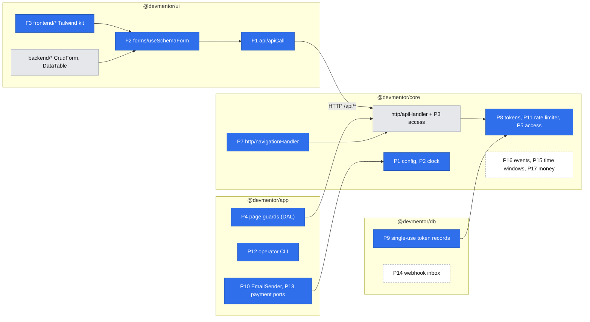

# Platform primitives — the reusable backend and frontend layer for Now

- Companion spec: [`2026-10-17-accounts-and-roles.md`](./2026-10-17-accounts-and-roles.md) (epic #28), the first consumer. It builds every primitive marked **E01** below, inside its own phases.
- Design authority: `.ai/specs/product-brief.md` (Now scope), `AGENTS.md` (stack and layer rules), `BACKWARD_COMPATIBILITY.md` (protected surfaces)
- Status: **draft for review** (Open Questions resolved 2026-10-17)

## 📝 TLDR

**Today.** The baseline has one reusable server layer: `apiHandler`, `makeCrudRoute`, `AppError` and `parseInput`. It also has one reusable client layer: `apiCall`, `CrudForm`, `DataTable` and the feedback states. That client layer is backend-only and styled with shadcn.

**What Now needs.** Every Now epic needs more than that:

- who is calling, plus role and ownership checks
- routes that answer a browser navigation with a redirect
- a way back to where the visitor was after signing in
- expiring single-use links
- outbound email
- a clock for time-window rules
- idempotent external callbacks
- frontend forms for three page areas

**Proposed (future behavior).** This spec designs every primitive the Now backlog needs. Each primitive gets one home, one contract and the story that builds it first. E01 builds only what E01 uses. The rest is designed here and built by its first consumer story, following the `AGENTS.md` rule to add a piece "with the first feature that needs it".

## 📝 Decisions

The product owner made these decisions while answering the Open Questions on 2026-10-17. They are spec-level ids, not brief ids.

| Id | Decision | Why | Changes a standing rule? |
|---|---|---|---|
| PD1 | Email goes through an `EmailSender` port. The real adapter is SMTP via `nodemailer`. Mailpit catches mail locally and in integration tests. The provider is chosen at launch through env vars only. (Q4) | Any provider speaks SMTP, so the provider choice stays a launch-time config. Mailpit's HTTP API lets integration tests follow a real confirmation link. | No. It applies the existing port and adapter rule. |
| PD2 | The UI is split into three areas by audience, not two (Q5):<br>• **Public** (`(frontend)`): listing, mentor profile, sign-in, sign-up, email and invitation links. Uses the Tailwind-only kit.<br>• **Signed-in** (`(app)`): account, mentor profile and slot editors, sessions, session screen. Uses shadcn.<br>• **Admin** (`/backend`): uses shadcn.<br>All three share one presentation-free core: `apiCall` and a form-state hook bound to Zod. | Public pages carry the product's look. Signed-in tools are form- and list-heavy, and shadcn already covers them. | **Yes.** It is a spec-sanctioned exception to "frontend pages don't use shadcn": the signed-in area may use shadcn. `AGENTS.md` is updated in accounts Phase 1. |
| PD3 | Every route states its access rule explicitly (`access: "public" \| "optional" \| "user" \| { role }`). There is no default. | Fail closed: a forgotten check becomes a type error, not an open endpoint. `/api/users` shipped open with a TODO for exactly this reason. | Extends the protected `apiHandler` and `makeCrudRoute` surface. Every in-repo caller is updated in the same PR. |
| PD4 | There is no `proxy.ts`. Authorization lives in `apiHandler` and `navigationHandler` and in the page guards of the data access layer. | The Next 16 docs say Proxy "should not be used as a full session management or authorization solution". Two enforcement points would drift. | No. |

## 📝 Problem Statement

- **Deferred pieces.** `AGENTS.md` and the engineering-standards implementation notes deferred these to "their first feature":
  - `core/src/http/auth.ts`
  - the zod env schema
  - ports with mock adapters
  - the typed event emitter

  The backlog (#28–#47) now names those features.
- **Redirect routes.** `apiHandler` always answers JSON. These routes need redirect responses with the same scope, logging and error mapping:
  - the OAuth start and callback (E01-S01)
  - the Stripe onboarding return (E02-S02)
  - the Stripe checkout return (E04-S02)

  Without a primitive, each one grows its own `try/catch`, which `AGENTS.md` forbids.
- **Time rules.** Four stories have time rules, and each needs a controllable clock to reach the 100% branch gate:
  - token expiry (E01)
  - the 2-hour lead time (D16, E04-S01)
  - the message window (D10, E05-S02)
  - upcoming and past lists (E05-S01)
- **Frontend reuse.** About a dozen Now screens are not admin screens. The only form primitive (`CrudForm`) is admin-styled. Without a shared core, each screen would re-implement Zod validation, the server `fieldErrors` mapping, submit state, and the empty and error states.

## 📝 Feature-type inventory (from the Now backlog)

Every Now story reduces to a small set of capability types. The primitives below come from this table. No primitive exists that a row does not need.

| Feature type | Now stories | Primitive(s) |
|---|---|---|
| Know who is calling; sign in and sign out | E01-S01, E01-S02, and every signed-in story after | P3 identity context, P4 page guards |
| Role gate (mentor-only tools, operator-only admin) | E01-S03, E02-S01–S03, Q6 admin | P3 (`access: { role }`), P4 |
| Ownership / participant-only access, concealing existence | E02-S01 (own profile), E02-S03 (own slots), E05-S01/S02 (own sessions; "denied without revealing the session") | P5 access assertions |
| Return to where the visitor was after sign-in | E01-S03 (invite link), E04-S01 ("returns to the same slot") | P6 `returnTo` |
| Browser-navigation route that ends in a redirect, internal or to an allowlisted provider | E01-S01 OAuth start and callback, E02-S02 Stripe onboarding return and refresh, E04-S02 checkout return | P7 navigation handler |
| Expiring, single-use, unguessable link | E01-S02 confirmation, E01-S03 invitation | P8 tokens, P9 single-use token records |
| Outbound email | E01-S02 confirmation, E04-S03 booking information | P10 `EmailSender` |
| Abuse control on credential endpoints | E01-S02 sign-in, sign-up, resend | P11 rate limiter |
| Operator action without a UI (D12, D14) | E01-S03-T01 invitations, Q6 operator grant | P12 operator CLI |
| Time-window rule | E01 token and session expiry, E04-S01 lead time (D16), E05-S01 upcoming/past, E05-S02 send window (D10) | P2 clock, P15 time windows |
| Configuration and secrets | E01 GitHub OAuth, E01 SMTP, E02/E04 Stripe | P1 config |
| External provider behind a port | E01-S01 GitHub OAuth, E01-S02 email, E02-S02 Stripe Connect onboarding, E04-S02 Stripe Checkout | port + adapter pattern: `GitHubOAuth` (accounts spec), P10, P13 |
| Idempotent external callback (retries, late duplicates) | E02-S02 ("callback is idempotent"), E04-S02 ("no second booking") | P14 webhook inbox |
| Side effect that must not roll back the main action | E04-S03 ("booking stays confirmed" when email fails) | P16 domain events |
| Money and price per format | E02-S01, E04-S01, E04-S02 | P17 money |
| Owner-scoped editor form (signed-in) | E01 account, E02-S01 profile, E02-S03 slots | F2 form core + shadcn skin (`CrudForm`) |
| Public form (signed-out) | E01-S01/S02 sign-in, sign-up | F2 form core + F3 Tailwind kit |
| Public read page (no sign-in) | E03-S01 listing and profile, E04-S01 slot picker | F4 area layouts, F5 server-read convention |
| Participant list with upcoming/past and empty state | E05-S01 | F6 lists (reuses `DataTable`/feedback) |
| Text exchange refreshed manually (no realtime, D10) | E05-S02 | none (refresh is enough; **realtime explicitly skipped**) |

## 📝 Proposed Solution

Extend the two layers that already exist rather than add a framework next to them:

- **Server.** `apiHandler` gains an access rule, a resolved principal and response cookies. A sibling `navigationHandler` covers redirect routes. Small, framework-agnostic contracts live in `core`: config reader, clock, tokens, rate-limiter port, access assertions and return-to schema. Next- and DB-bound bindings live in `app/src/server` (page guards, adapters, CLI) and `db` (single-use token records).
- **Client.** The presentation-free half of the backend kit moves to shared folders. A Tailwind skin sits beside the existing shadcn skin.

**Alternatives rejected:**

- **A plugin or module runtime per concept.** `AGENTS.md` and the engineering standards rule it out ("directory convention, not a module runtime").
- **Next Server Actions for mutations.** They would bypass `apiHandler`'s envelope, CSRF check and error mapping, and fork the client contract into two styles. Reads still happen in Server Components (F5).
- **One generic "resource" abstraction over `makeCrudRoute` for every concept.** The stories are workflows (sign in, accept, book, pay, send within a window), not CRUD. Forcing them into CRUD would be exactly the flattening the backlog warns against. `makeCrudRoute` stays for genuinely plain resources.
- **A full UI kit for the public area.** Only the pieces E01's public pages use are built (F3). E03 and E04 add theirs when they arrive.

## 📝 Research (shared by both specs)

One pass, checked 2026-10-17. Sources: the Next 16 docs in `node_modules/next/dist/docs/` (authentication, proxy, `cookies`), the installed `server-only` package, and the market research recorded below.

| Leader / source | What they get right that we adopt | Complexity we skip |
|---|---|---|
| **Lucia** (deprecated March 2025; now the reference file `auth_session.ts`) and **The Copenhagen Book** | Store only SHA-256 of a ≥256-bit token. 30-day sliding expiry, written to the database only when under 15 days remain, which throttles writes (P3, accounts AD2). New session token on sign-in and privilege gain. OAuth `state` plus PKCE in an HttpOnly Lax cookie. Link accounts only on a provider-verified email, keyed by the provider's user id. Email tokens: single-use, ≤24 h, bound to user **and** email, rate-limited sends. `Referrer-Policy` on token pages. | `id.secret` split tokens and per-hour `lastVerifiedAt` writes. A unique index on the hash suffices at our scale. |
| **Better Auth 1.7** | Implicit linking only for verified provider emails. Linking never overwrites the profile (accounts AD3: the display name is not overwritten). | Plugins, adapters, secondary storage, the cookie cache, "fresh session" gating, multi-provider. Its default rate limiter is also in-memory, the same trade-off as P11. |
| **Auth.js v5** (still beta) | `allowDangerousEmailAccountLinking` defaults to false, the same stance as AD3. | The Credentials provider is discouraged and leaves registration, verification and throttling to you, which confirms the in-house choice (accounts AD1). |
| **OWASP** Authentication, Session Management, Credential Stuffing and Password Storage cheat sheets | Generic sign-in and registration messages with equal timing (dummy hash). Session ids from a CSPRNG, regenerated on privilege change, invalidated on the server. Cookies `HttpOnly; Secure; SameSite=Lax; Path=/` with the `__Host-` prefix. bcrypt input capped at 72 bytes and rejected rather than truncated. Throttle rather than lock out. | MFA, account lockout, breached-password services. |
| **NIST 800-63B rev 4** | Single-factor passwords **SHALL** be ≥15 characters, with no composition rules and no truncation. The product owner adopted this (accounts AD6). | The blocklist check is replaced by the 15-character floor. That is a recorded deviation from the SHALL-blocklist clause, revisited if password sign-ups become common. |
| **GitHub OAuth docs** | `user:email` scope; `GET /user/emails` (`primary`, `verified`, `per_page` ≤100). A cancel returns `?error=access_denied&state=…`. Codes expire after 10 minutes. PKCE (S256) is supported since 2025-07-14. | Storing the GitHub access token: it is discarded after reading the identity. |
| **arctic 3.7** | `generateState`, `generateCodeVerifier`, and the generic `OAuth2Client` with `createAuthorizationURLWithPKCE` and `validateAuthorizationCode(endpoint, code, verifier)`. The generic client also takes **configurable endpoints**, which lets integration tests point it at a local stub. Errors: `OAuth2RequestError`, `ArcticFetchError`, `UnexpectedResponseError`. ESM-only, which suits our ESM repo. | arctic's `GitHub` class, which has no PKCE and fixed endpoints. |
| **Stripe** webhooks and Account Links (for P13 and P14) | Dedupe by `event.id`. Verify the signature over the raw body. Webhooks bypass CSRF. `return_url` is not proof of completion, so re-read the account. `refresh_url` must mint a new link. | Event ordering logic: state is re-read from Stripe instead. |
| **Scanner prefetch** of email links (Supabase, Auth0 community reports; no Microsoft documentation found) | A GET that grants something must render a page whose button POSTs (accounts AD5). | Typed codes and fragment tokens. |
| **Conform / react-hook-form** | Errors keyed by input name, a separate form-level error, a native `<form>`, focus on the first invalid field. F2 keeps `CrudForm`'s existing mapping and adds first-invalid focus. | A form library dependency. The hook is about 80 lines and already proven by `CrudForm`. |
| **Next 16 docs** (`node_modules/next/dist/docs/`) | Proxy is "not a full authorization solution", so authorization lives in the data access layer (PD4). `cookies().set` works only in Route Handlers and Server Functions, not during Server Component render, so there is no sliding refresh in page guards (P4). Auth checks belong in pages, not only layouts. | `authInterrupts` (`forbidden()`/`unauthorized()`) is experimental and not used. |
| **`server-only` package** (installed, read) | `exports["react-server"] → ./empty.js`, so `tsx --conditions=react-server` lets the operator CLI import the real `container.ts` (P12). | — |

**Package versions checked 2026-10-17:**

- `arctic@3.7.0` (ESM)
- `bcryptjs@3.0.3` (bundled types, so no `@types/bcryptjs`)
- `nodemailer@10.1.2` (TypeScript rewrite with bundled types, so no `@types/nodemailer`; high release churn means the lockfile is pinned)
- `cookie@2.0.1`
- Mailpit `axllent/mailpit:v1.31.6`:
  - SMTP on 1025, HTTP on 8025, readiness check `/readyz`
  - `GET /api/v1/search?query=to:…` and `GET /api/v1/message/{ID}` for tests
  - no Testcontainers module exists, so tests use `GenericContainer`

**Considered, not adopted:** `Sec-Fetch-Site`/`Origin` checks on top of the CSRF header. The custom header already forces a CORS preflight. Changing CSRF behavior is a protected surface (2) with no current gap, so it is left alone.

## 📝 Architecture



Takeaway: everything new hangs off the two existing seams, `apiHandler` and the form and API client. Solid blue boxes are built in E01. Dashed boxes are designed here and built by E02–E05.

**Isomorphism rule (new, written into `AGENTS.md`).** `@devmentor/core`'s `.` entry is server-side and may use `node:crypto`. `@devmentor/core/validators/*` must stay isomorphic, because client components import it. Anything a client needs (role names, the `returnTo` schema) goes in `validators/`.

## 📝 Primitive catalog — server

Each entry gives the home, the contract (TypeScript shape, abbreviated), what it reuses, and the **first builder**. "Planned" entries are binding designs that their first story may refine in its own spec.

### P1. Config, a lazily validated env (E01-S01)

- **Home:**
  - generic reader: `core/src/config/env.ts`
  - app schema: `app/src/server/config.ts`
  - cradle key: `config` (SINGLETON)
- **Contract:**
  ```ts
  defineConfigSection(schema, source?): () => z.output<schema>
  // memoized; throws ConfigError naming missing keys, never values
  interface AppConfig {
    app: () => { url: URL; trustProxy: boolean };
    github: () => { clientId; clientSecret; oauthUrl; apiUrl };
    email: () => { smtpUrl; from };
  }
  ```
- **Why sections:** `next build` and a developer without GitHub credentials must still boot. Only the route that needs a section fails, with a 500 that names the missing key in the server log.
- Existing `DATABASE_URL`/`DB_*` parsing in `db/src/config.ts` is left as is (protected surface 5).

### P2. Clock (E01-S01)

- **Home:** `core/src/time/clock.ts`. Cradle key: `clock` (SINGLETON).
- **Contract:**
  ```ts
  interface Clock { now(): Date }
  systemClock
  fixedClock(date)  // for tests
  ```
- **Rule:** every time comparison in a service reads `clock.now()`. It never calls `new Date()` directly. `baseProperties` timestamps stay as they are.

### P3. Request identity context on `apiHandler` (E01-S01)

- **Home:**
  - `core/src/http/auth.ts`: `Principal`, `Access`, `PrincipalResolver`
  - `core/src/http/cookies.ts`: `ResponseCookies`, `readCookie`
  - `core/src/validators/auth/role.schema.ts`: `roleSchema`, `Role`
- **Contract:**
  ```ts
  type Role = "mentee" | "mentor" | "operator";
  interface Principal { userId: string; sessionId: string; displayName: string; roles: readonly Role[] }
  type Access = "public" | "optional" | "user" | { role: Role };
  interface PrincipalResolver { resolve(req: Request, cookies: ResponseCookies): Promise<Principal | null> }
  // Cradle gains `principalResolver`; app registers it (accounts spec)

  apiHandler<TParams, A extends Access>(
    handler: (args: { req; params; cradle; principal: PrincipalFor<A>; cookies: ResponseCookies }) => Promise<unknown>,
    options: { access: A; status?: number },
  )
  // PrincipalFor<"public"> = null; <"optional"> = Principal | null; otherwise Principal
  ```
- **Order inside the wrapper:**
  1. create a scope
  2. check the CSRF header
  3. resolve the principal, unless the route is `public`
  4. `user` with no principal → `UnauthorizedError`
  5. missing role → `ForbiddenError`
  6. run the handler
  7. write `cookies` to the response (`Set-Cookie`)

  An unexpected error is logged with the request path and **no query string**, because query strings can carry tokens and the logger redacts keys, not values inside URLs.
- **Why the resolver receives `cookies`:** it can refresh a sliding session without the route knowing.
- **Framework-agnostic:** it reads `Cookie` from the Web `Request` and writes `Set-Cookie` itself. Nothing depends on Next's `cookies()` merging.
- `makeCrudRoute` config gains a required `access` passed through to every method. `/api/users` becomes `access: { role: "operator" }` (accounts Q6).
- `ResponseCookies` serializes with the `cookie` package (`cookie@2`, added to `core`) rather than hand-rolled code.

### P4. Page guards, the data access layer (E01-S01)

- **Home:** `app/src/server/auth/page-guards.ts` (server-only).
- **Contract:**
  ```ts
  getPrincipal(): Promise<Principal | null>  // React cache() per render; reads next/headers cookies()
  requirePrincipal({ returnTo }): Promise<Principal>  // redirect("/sign-in?returnTo=…")
  requireRole(role, { returnTo }): Promise<Principal>  // signed out → sign-in; wrong role → notFound()
  ```
- **No sliding refresh:** Server Components cannot set cookies. Expiry is extended on the next API or navigation call (P3/P7). See the accounts spec for why that is enough.
- **Wrong role → `notFound()`, not 403:** `forbidden()` requires the experimental `authInterrupts` flag. A 404 also conceals the admin area.
- **Used by:**
  - the `(app)` layout (`requirePrincipal`)
  - `/backend/layout.tsx` (`requireRole("operator")`)
  - the leaf pages that render private data, which repeat the check, per the Next docs' warning that layouts don't re-run on navigation

### P5. Access assertions (planned, first builder E02-S01)

- **Home:** `core/src/http/auth.ts`.
- **Contract:**
  ```ts
  assertSelf(principal, ownerUserId)  // ForbiddenError
  assertParticipant(principal, participantUserIds, { conceal: true })  // NotFoundError when conceal
  ```
- **Rule:** services receive the `Principal` (or its `userId`) as an argument and run the assertion themselves. Routes never pass raw ids taken from the body as "the owner".
- **E01 needs none:** its "me" endpoints act on `principal.userId` by construction.

### P6. `returnTo` (E01-S01)

- **Home:** `core/src/validators/auth/return-to.schema.ts` (isomorphic).
- **Contract:**
  ```ts
  returnToSchema  // same-origin relative path only: starts with "/" but not "//" or "/\";
                  // no scheme; ≤ 512 chars. Anything else becomes "/".
  ```
- **Carried through:**
  - the sign-in and sign-up pages' query string
  - the OAuth state cookie (E01-S01)
  - the email-confirmation link's query string (E01-S02; never stored, per P8)
  - later, the slot URL (E04-S01)
- **Rule:** a returned-to page must re-check everything. Returning never implies a reservation (brief Key flows, "does not reserve it").

### P7. Navigation handler (E01-S01)

- **Home:** `core/src/http/navigationHandler.ts`, bound in `app/src/server/http.ts` next to `apiHandler`.
- **Contract:**
  ```ts
  navigationHandler(
    handler: (args: { req; params; cradle; principal; cookies; url: URL }) => Promise<{ redirectTo: string } | { externalUrl: URL }>,
    options: { access: Access; onError?: (error: AppError) => string; externalOrigins?: (cradle) => string[] },
  )  // GET only
  ```
- **Behavior:**
  - **Internal success:** `303` to `redirectTo`. The target is resolved against `config.app().url` and never against the `Host` header. It must pass `returnToSchema`.
  - **External success:** `303` to `externalUrl`, only when its origin is in `externalOrigins` (e.g. `config.github().oauthUrl`, later the Stripe Connect origin). Any other origin is a bug: it is logged and redirected to `/error`.
  - **`AppError`:** redirect to `onError(error)`. The default is `/error?code=<code>`.
  - **Anything else:** logged with the path but no query string, then redirect to `/error?code=internal_error`.
- **No CSRF header:** a browser navigation can't carry one. The handler is therefore GET-only. State changes it makes must be protected by their own proof:
  - OAuth `state` plus PKCE
  - an unguessable single-use token
  - a provider signature
- **Shared error page:** `(frontend)/error/page.tsx` maps known codes to plain messages.

### P8. Tokens (E01-S01)

- **Home:** `core/src/security/tokens.ts`.
- **Contract:**
  ```ts
  generateToken(): string  // 32 random bytes from node:crypto, base64url
  hashToken(token): string  // SHA-256 hex
  ```
- **Rule:** only hashes are stored, and no column stores a URL or path that embeds a raw token. A `returnTo` that contains one travels in the link instead. A raw token exists in the cookie, the link or the CLI output, and nowhere else. Raw tokens never go into a log: the logger redacts the `token` key, and the handlers log paths without query strings.

### P9. Single-use token records (E01-S02; reused by E01-S03)

- **Home:**
  - `db/src/entities/single-use-token.ts`: the `singleUseTokenProperties` spread
  - `db/src/single-use-token.ts`: the helpers, exported from `@devmentor/db`
- **Contract:**
  ```ts
  singleUseTokenProperties = { tokenHash: unique string, expiresAt: datetime, consumedAt: datetime | null }
  inspectSingleUseToken(em, Entity, rawToken, now): Promise<TokenLookup<T>>
  consumeSingleUseToken(em, Entity, rawToken, now): Promise<TokenLookup<T>>
  type TokenLookup<T> = { status: "valid" | "consumed"; record: T } | { status: "invalid" } | { status: "expired" | "used"; record: T }
  ```
- **Atomicity:** `consume` performs a conditional `nativeUpdate` (`consumed_at IS NULL AND expires_at > now`). Of two concurrent consumers, exactly one sees `consumed`; the other sees `used`. The caller runs it inside `em.transactional` together with the effect it unlocks (a role grant, an email confirmation). Pages that only display a link's state use `inspect`, so a GET never consumes.
- The stories need a reason ("says why", E01-S02), so the helper distinguishes invalid, expired and used.

### P10. `EmailSender` port (E01-S02; reused by E04-S03)

- **Home:**
  - `app/src/server/services/notifications/email-sender.port.ts`
  - `adapters/smtp-email-sender.ts` (`nodemailer`)
  - `adapters/memory-email-sender.ts` (unit tests)
  - `templates/<name>.ts`
- **Cradle key:** `emailSender` (SINGLETON). The adapter is chosen from `config.email()`.
- **Contract:**
  ```ts
  interface EmailSender { send(message: { to: string; subject: string; text: string; html?: string }): Promise<void> }  // throws on failure
  // templates are pure functions: (data) => { subject, text, html }
  // every link inside is absolute, built from config.app().url
  ```
- **Failure policy is the caller's:** E01-S02 keeps the account and offers resend. E04-S03 keeps the booking.
- **Local dev and integration:** a `mailpit` service in `docker-compose.yml` (SMTP 1025, UI 8025). Integration tests run Mailpit through Testcontainers and read messages over its HTTP API.

### P11. Rate limiter (E01-S02)

- **Home:**
  - `core/src/security/rate-limiter.ts`: the port and a memory implementation
  - `core/src/http/client-ip.ts`
- **Cradle key:** `rateLimiter` (SINGLETON, depends on `clock`).
- **Contract:**
  ```ts
  interface RateLimiter { hit(key: string, rule: { limit: number; windowMs: number }): Promise<{ allowed: boolean; retryAfterMs: number }> }
  clientIp(req, { trustProxy }): string | null  // first X-Forwarded-For hop only when trustProxy; else null
  TooManyRequestsError  // new AppError: code "rate_limited", 429; apiHandler adds Retry-After
  ```
- **Unknown IP:** callers **skip** per-IP rules when `clientIp` is `null`. They never pool every visitor into one bucket, which would let one attacker lock everyone out. Per-account rules always apply. `TRUST_PROXY` defaults to `false` and is added in accounts Phase 2.
- **Adapter:** in-memory, per process. This is the engineering standards' "simple counter, note it needs a stronger backend". A Postgres adapter can replace it behind the port without touching callers, and is required before more than one app instance runs (see Risks).

### P12. Operator CLI (E01-S01 for `role grant`; E01-S03-T01 adds `invite create`)

- **Home:**
  - `app/src/server/cli/run-cli.ts`: argv parsing (`node:util` `parseArgs`), scope creation, output and exit codes, `container.dispose()`
  - `app/src/server/cli/commands/<name>.command.ts`
  - entry `app/src/server/cli/operator.ts`
- **Command:** `npm run operator -- <command> [flags]`. The root script delegates to `@devmentor/app`.
- **Mechanics (verified in research):**
  - It runs through `tsx --conditions=react-server`. `server-only` resolves to an empty module under that condition (`exports["react-server"]: "./empty.js"`), so the real composition root (`container.ts`) is reused unchanged.
  - Env loads through `@next/env` from `packages/app`, the same files as the db CLI.
- **Contract:**
  ```ts
  interface OperatorCommand<F> { name: string; summary: string; options: ParseArgsOptionsConfig; run(cradle: Cradle, flags: F, out: Output): Promise<void> }
  ```
- **Output rules:**
  - Commands print what the operator needs (e.g. the invitation URL) to stdout and nothing secret beyond that.
  - Errors exit 1 with an `AppError` message.
  - Unknown errors exit 1 with "unexpected error", and the details go to `logger`.

### P13. Payment and onboarding ports (planned, first builders E02-S02 and E04-S02)

- **Home:** `app/src/server/services/payments/`.
- **Ports:**
  - `PayoutOnboarding` (`createOnboardingLink(mentor, returnUrl, refreshUrl)`, `getStatus(accountId)`)
  - `PaymentGateway` (`createCheckout(booking draft) → redirect URL`, `verifyWebhook(rawBody, signature) → event`)
- **Adapters:** mock adapters under `adapters/`, then a Stripe adapter. The return URLs land on P7 navigation routes. The authoritative status comes from P14, never from the return URL's query string.
- E02-S02-T01 (#47, Stripe requirements) feeds the port's shape. This spec does not fix it.

### P14. Webhook inbox (planned, first builder E02-S02)

- **Home:**
  - entity `db/src/entities/integrations/processed-webhook-event.entity.ts` (`provider`, `eventId` unique, `processedAt`)
  - wrapper `webhookHandler` in `app/src/server/webhooks/`, **not `core`**, because it needs `em`, and `core` is MikroORM-free (`db → core`). It reads the raw body, skips the CSRF check (Stripe can't send the header) and checks the provider signature through the port.
- **Behavior:** the wrapper inserts the event id and applies the effect in one `em.transactional`. A duplicate id returns 200 with no effect. This is how "the callback is idempotent" (E02-S02) and "no second booking" (E04-S02) are met in one place.

### P15. Time windows (planned, first builders E04-S01 and E05-S02)

- **Home:** `core/src/time/windows.ts` (pure).
- **Contract:**
  ```ts
  isBookable(slotStart, now, minLeadMs)  // D16: two hours from the moment of selection
  sessionWindow(start, durationMinutes, now): "upcoming" | "open" | "ended"  // D10
  ```
- These are pure functions over P2. The server always decides; the client only displays.

### P16. Domain events (planned, first builder E04-S03)

- **Home:** `core/src/events/`. Cradle key: `events` (SINGLETON).
- **Contract:**
  ```ts
  createEventBus<EventMap>()  // emit(id, payload)
  ```
  Listeners are registered explicitly in `container.ts`.
- **Behavior:** the bus in `core` is a plain typed emitter with no ORM hooks. A service emits only **after** its `em.transactional(...)` call has resolved, which is an explicit ordering rule checked in review and tests. A listener's error is logged and never propagates. That is the E04-S03 rule "email failure leaves the booking confirmed". Ids follow `concept.entity.action` (e.g. `bookings.booking.confirmed`).
- **Why not in E01:** E01 has no cross-concept side effect. The confirmation email is part of the sign-up workflow itself, so a direct port call is honest and smaller.

### P17. Money (planned, first builder E02-S01)

- **Home:** `core/src/validators/money/money.schema.ts`.
- **Contract:** integer minor units plus an ISO currency code. The price is always recomputed on the server from the mentor's per-format price (engineering standards, "money correctness").
- **Open for E02:** the currency is not decided in the brief. E02-S01's spec must ask.

## 📝 Primitive catalog — frontend

### F1. Shared API client (E01-S01)

- **Move:** `ui/src/backend/api/{apiCall,types}.ts` moves to `ui/src/api/` with a new export path `./api/*`. Every importer is updated in the same PR. The `./backend/api/*` export is removed, with a 💥 note (protected surface 3).
- **Behavior:** unchanged. It is still the only sanctioned `fetch('/api/*')`.

### F2. Form core (E01-S01)

- **Home:**
  - `ui/src/forms/useSchemaForm.ts`
  - `ui/src/forms/field-errors.ts` (`toFieldErrors`, moved out of `CrudForm`)
- **Contract:**
  ```ts
  useSchemaForm({ schema, fields, initialValues, onSubmit, onSuccess, resetOnSuccess = true })
    → { values, setValue, fieldErrors, formError, isSubmitting, handleSubmit, handleKeyDown }
  ```
- **Behavior:**
  - Every field starts as `""`, which keeps the lesson of 2026-10-14.
  - Server `fieldErrors` land on their fields. A non-field failure becomes `formError`.
  - Cmd/Ctrl+Enter submits; Escape cancels.
  - `onSuccess` receives the response `data`, so a sign-in form can navigate to `data.redirectTo`.
- **`CrudForm` refactor:** it is rewritten as the shadcn skin over this hook. Its existing props are unchanged. One prop is added, `resetOnSuccess` (default `true`, today's behavior), so an edit form such as `/account` can keep the saved value.

### F3. Public Tailwind kit (E01-S01; grows per story)

- **Home:** `ui/src/frontend/`
  - `forms/SchemaForm.tsx`
  - `forms/TextField.tsx`
  - `forms/SubmitButton.tsx`
  - `feedback/Notice.tsx` (`info | success | error`, `role="status"`/`"alert"`)
  - `actions/LinkButton.tsx`
- **Exports:** `./frontend/*`. Plain Tailwind utilities only.
- **ESLint enforces:**
  - `ui/src/frontend/**` and `app/src/app/(frontend)/**` may not import `@devmentor/ui/components/*` or `@devmentor/ui/backend/*`.
  - `tests/eslint-config.test.ts` gains the matching cases.
- **Built only on demand:** E01 builds only these five pieces. Cards and filters for the listing arrive with E03-S01.

### F4. Area layouts (E01-S01)

| Area | Route group / path | Guard | Styling | E01 pages |
|---|---|---|---|---|
| Public | `app/src/app/(frontend)/` | none; header reads `getPrincipal()` to show "Sign in" or the display name | F3 Tailwind kit | `/`, `/sign-in`, `/sign-up`, `/sign-up/check-email`, `/confirm-email`, `/invite/[token]`, `/error` |
| Signed-in | `app/src/app/(app)/` (new) | `requirePrincipal` in layout **and** in each page | shadcn + `ui/src/backend/*` panel primitives | `/account` |
| Admin | `app/src/app/backend/` | `requireRole("operator")` | shadcn (unchanged) | `/backend`, `/backend/users` |

A public header that reads the session makes public pages render per request. That is acceptable: E03's pages query the database anyway, and `AGENTS.md` already requires `connection()` for those.

### F5. Read on the server, write through `/api` (convention, E01-S01)

- **Reads:** pages and layouts call services in Server Components through `createRequestScope().cradle` and render DTOs, as `/backend/page.tsx` already does.
- **Writes:** client components call `/api/*` with `apiCall`.
- **Result:** one write contract (`apiHandler`), no client data-fetching library, and no duplicated authorization. Page guards (P4) and `apiHandler` (P3) resolve the same principal through the same service.

### F6. Lists (planned, first builder E05-S01)

- **Signed-in lists:** they reuse `DataTable` and the feedback states.
- **Upcoming/past split:** computed on the server with P15.
- **Public lists:** E03-S01's listing gets a Tailwind card grid and an `EmptyState` twin in F3 when that story is built.

## 📝 API Contracts (framework surface changes)

| Surface | Change | Compatibility |
|---|---|---|
| `apiHandler(handler, options)` | `options.access` becomes **required**. Handler args gain `principal` and `cookies`. Error logs drop the query string. | Breaking for in-repo callers (1 route). Updated in the same PR (accounts Phase 1). |
| `makeCrudRoute(config)` | `config.access` becomes required. | Same as above. |
| Error codes | Adds `rate_limited` (429, sets `Retry-After`). The accounts spec adds `invalid_credentials` (401) and `email_not_confirmed` (403) as `AppError` subclasses. | Additive. The envelope shape is unchanged. |
| `navigationHandler` | New, with internal `redirectTo` or allowlisted `externalUrl`. | Additive. |
| `@devmentor/ui` exports | Adds `./api/*`, `./forms/*`, `./frontend/*`. Removes `./backend/api/*`. `CrudForm` gains an optional `resetOnSuccess`. | The path move is breaking, with all importers updated and 💥 in the PR. The prop is additive. |
| `@devmentor/core` exports | Adds `config`, `time`, `security` and `auth` modules to `.`. Adds `validators/auth/role.schema`, `validators/auth/return-to.schema`. | Additive. |
| Cradle | Adds `config`, `clock`, `principalResolver`, `emailSender`, `rateLimiter`. | Additive. |

## 📝 Edge Cases & Failure Scenarios

| Scenario | Behavior |
|---|---|
| A required env section is missing (e.g. no `SMTP_URL` in dev) | Only routes that touch that section fail: 500 `internal_error`, with the missing key names in the server log. Build and other pages are unaffected. |
| A malicious `returnTo` (`//evil.com`, `https://…`, `/\evil`) | Normalized to `/`. Covered by unit tests over a table of payloads. |
| A route forgets its access rule | Type error at build time (PD3). |
| The principal resolver throws (DB down) | 500 `internal_error`, logged. Never treated as signed out-and-allowed (fail closed). |
| Two consumers race on one single-use token | Exactly one gets `consumed`. The other gets `used` (P9 conditional update). |
| SMTP is down | `EmailSender.send` throws. The caller's documented policy applies: E01-S02 shows "We couldn't send the email — try Resend". |
| Several app instances behind a load balancer | The memory rate limiter undercounts. This is a known limitation, a launch checklist item and in Risks. |
| The CLI runs against the wrong database | It prints the database host (not credentials) before executing, and needs `--yes` when `NODE_ENV=production`. |

## 📝 Risks & Impact Review

- **Protected surfaces touched:** 1 (apiHandler options), 3 (ui and core exports), 5 (new env vars: `APP_URL`, `GITHUB_*`, `SMTP_URL`, `MAIL_FROM`, `TRUST_PROXY`), 6 (new `npm run operator`). Each is changed together with all its consumers, `.env.example`, `README.md` and CI, per `BACKWARD_COMPATIBILITY.md`.
- **The PD2 rule change is a direction call.** It was made by the product owner, and it reverses part of a standing `AGENTS.md` rule. Rollback is cheap while the signed-in area has one page (`/account`) and grows with each E02 and E05 page.
- **In-memory rate limiting is a deployment constraint.** No deployment target is recorded anywhere in the repo, so this spec cannot rule multi-instance hosting in or out. If hosting is serverless or multi-instance, the Postgres adapter must ship before launch. ⚠ This needs a hosting decision before release, not before planning.
- **Build budget (A02).** The primitives add surface to a 25-hour budget. Mitigation: only E01's pieces are built now, each by its first consumer. Planned primitives cost nothing until their story.

## 📝 Decisions in play

- **Brief:**
  - D12 (no operator screens: the CLI, not the admin UI, is the operator's tool)
  - D13 (sign-in methods)
  - D14 (invitation by the operator)
  - D10 (refresh, not realtime: no realtime primitive)
  - D15 and E04-S03 (email: P10, P16)
  - D16 and D10 (time rules: P2, P15)
  - D05 (onboarding gate: P13, P14)
- **Superseded:** none. PD2 changes a repository rule (`AGENTS.md`), not a brief decision. It is owned by the product owner, who is also tech lead.

## 📋 Phasing

This spec has no phases of its own. By the product owner's instruction, each accounts phase builds the primitives it first needs. Planned primitives are built by their first story.

| Primitive | Built in |
|---|---|
| P1 config, P2 clock, P3 identity context, P4 page guards, P6 `returnTo`, P7 navigation handler, P8 tokens, P12 CLI runner (`role grant`), F1–F5 | Accounts **Phase 1** (#34) |
| P9 single-use token records, P10 `EmailSender` + Mailpit, P11 rate limiter, F3 `PasswordField` | Accounts **Phase 2** (#35) |
| P12 `invite create` command (reuses P9) | Accounts **Phase 3** (#36 + #46) |
| P5 access assertions, P17 money | E02-S01 (#37) |
| P13 onboarding port, P14 webhook inbox | E02-S02 (#38) |
| P15 time windows | E04-S01 (#41) |
| P13 payment port (checkout) | E04-S02 (#42) |
| P16 domain events | E04-S03 (#43) |
| F6 lists | E05-S01 (#44) |

## 📋 Implementation Plan

The executable steps for every E01-built primitive are in the accounts spec's Implementation Plan. Each step names the primitive ids it delivers, and this spec stays the design reference. The planned primitives get their own steps in their stories' specs. Those specs should cite this catalog entry and either follow it or record a deviation.

The documentation updates this spec requires land in accounts Phase 1, Step 1.11:

- **`AGENTS.md`:**
  - the PD2 three-area rule
  - the PD3 required access rule
  - the isomorphism rule
  - the catalog homes
  - `npm run operator`
  - removing "`auth.ts` is added together with the auth concept"
- **`BACKWARD_COMPATIBILITY.md`:** the new protected surfaces (new export paths, new env vars, the `operator` command, the session cookie name).
