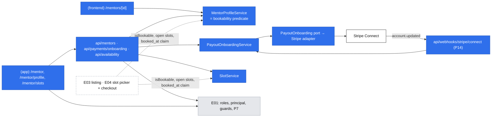
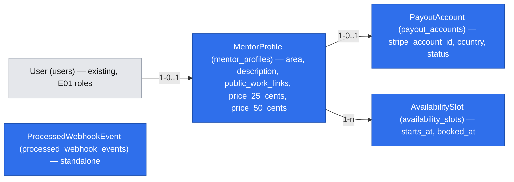

# E02 — Mentor setup: profile, prices, Stripe onboarding and slots

- Epic: #29 (E02) · Stories: #37 (E02-S01), #38 (E02-S02), #39 (E02-S03) · Task: #47 (E02-S02-T01)
- Depends on: E01 [`2026-10-17-accounts-and-roles.md`](./2026-10-17-accounts-and-roles.md) (the `mentor` role, sessions, page guards, `(app)` area). Platform catalog [`2026-10-17-platform-primitives.md`](./2026-10-17-platform-primitives.md) is cited as "platform P*n*/F*n*". **This spec holds the final contracts for P5, P13 (onboarding half), P14 and P17.** The catalog keeps only their status and a pointer here, changed in the same PR.
- Design authority: `.ai/specs/product-brief.md` (D03–D06, D12, D16, R01, N01, N02)
- Research: one shared pass for the three stories and #47 (section "Research"). It is #47's deliverable.
- Status: **draft for review** (gate answered by the PO 2026-10-18; fresh-context architectural review applied the same day)

## 📝 TLDR

**Today:** an invited mentor (E01) holds the `mentor` role and can do nothing with it. There is no profile, no price, no payout account and no schedule, so nobody can find or pay them.

**Proposed (future behavior):**

- A mentor works from one setup page, **Mentor setup** (`/mentor`). It is a three-item checklist with a single "bookable / not bookable yet" line on top.
- **Profile first.** It holds one area, links to public work, a plain description and a USD price for each of the two formats. Saving it publishes the public page `/mentors/<id>`, which never shows ratings.
- **Then Stripe and slots, in either order.**
  - Stripe: the mentor picks their country, finishes Stripe's hosted onboarding, and comes back to a plain status message.
  - Slots: the mentor publishes concrete start times and can withdraw any that are not booked.
- **Bookable** means the profile is saved and Stripe confirms the account (D05). It is computed from stored state, and Stripe's webhook keeps that state current, including when Stripe later restricts the account.

Listing (E03), slot picking and payment (E04) read what this spec stores; they are not built here.

**Identifier legend.** `MD` is a decision in this spec. `accounts.AD` and `platform.P`/`F`/`PD` point to the E01 specs. Brief `D`, `N`, `R`, `A` and zero-padded `Q` mean decision, non-goal, business rule, assumption and question. `gate.Q1` is a question from this spec's gate, recorded in the decisions table.

## 📝 Decisions

The PO answered the gate on 2026-10-18 (gate.Q0–Q7) and accepted the proposed defaults and the Stripe findings. The rows below are spec-level ids.

| Id | Decision | Why |
|---|---|---|
| MD1 | **A slot is a start time only.**<br>• It reserves a fixed 50-minute block of the mentor's time.<br>• The mentee picks 25 or 50 minutes at booking (E04).<br>• One slot gives one booking, whichever length is picked.<br>**PO reading of #39 AC 1** ("a start time and format"): the formats come from the profile's two prices, not from the slot. (gate.Q1 a) | It matches D10 and #41 ("the mentee selects the duration") and keeps one input per slot. Recorded under Risks as a PO decision, so a reviewer does not flag the AC wording. |
| MD2 | **The platform Stripe account is in the United States. Every price is in USD.** There is no per-mentor currency.<br>• A mentor enters whole dollars, **$5–$1,000** per session.<br>• The price is stored as integer cents.<br>• No currency column is stored; the money type carries the constant `"USD"` (platform P17, final below). (gate.Q2 c) | One currency means no conversion at checkout and no currency field. The bounds are this spec's choice, not the PO's: $5 sits well above Stripe's $0.50 minimum, and $1,000 catches typos. Changing them is one constant. |
| MD3 | **Exactly one area per mentor:** `typescript`, `react` or `python`. (gate.Q3 a) | #37 AC 1, and E03's filter stays a simple equality. |
| MD4 | **A saved profile is public at its direct link before the mentor is bookable.** The page says "Not taking bookings yet" and offers no booking. The E03 listing shows bookable mentors only. (gate.Q4 a) | #40 AC 4 already expects this. A mentor can check their page while onboarding. |
| MD5 | **The public URL is `/mentors/<profile id>`** (uuid). No slug. (gate.Q5 a) | Nothing to reserve, validate or rename. |
| MD6 | **Store instants as UTC `timestamptz`.**<br>• The mentor enters times in their browser's time zone.<br>• Every viewer sees times in their own browser's zone, with that zone named.<br>• There is no time-zone field. (gate.Q6 a) | The smallest model that is correct for a handful of times a few weeks ahead. Recurring rules would need a stored zone; there are none. |
| MD7 | **D05 stays strict (gate.Q7 a).** Stripe-hosted onboarding collects identity and a bank account up front. A mentor is **bookable** only when all of these hold:<br>• the user holds the `mentor` role<br>• a profile exists<br>• the payout account's `status = ready`, which requires the Stripe `transfers` capability `active`, `payouts_enabled`, and an empty `requirements.past_due` | `return_url` proves nothing (Stripe docs), so the status comes from the account itself. The `transfers` capability is what destination charges need. A mentor who refuses bank details is lost, as D05 accepts. |
| MD8 | **Stripe setup:**<br>• Connect accounts are created with controller properties: Express dashboard; the platform bears losses and pays Stripe fees.<br>• Each account requests only `transfers`, under the `full` service agreement for every country.<br>• Onboarding uses hosted Account Links with `collection_options.fields = eventually_due`.<br>• The mentor's country must be the US, UK, an EEA country, Canada or Switzerland.<br>• Accounts API v1, `stripe@23`, API version pinned to `2026-09-30.endive`. | This follows Stripe's marketplace recommendation for destination charges, and needs no account UI of our own. A US platform pays out cross-border only to those regions, self-serve. `recipient` accounts cannot receive cross-border payouts. v2 Account Links require HTTPS even in test mode, and the port makes a later move to v2 cheap. |
| MD9 | **Stripe's status reaches us in two ways:**<br>• the return route re-fetches the account<br>• a Connect webhook (`account.updated`) re-fetches the account by id<br>Events go through the platform.P14 inbox, which makes them idempotent by event id. Status can regress, and bookability follows it. | Stripe does not guarantee event order, so we re-fetch instead of trusting the event snapshot. A restriction that arrives later must make the mentor unbookable without anyone acting (accepted default). |
| MD10 | **Profile before Stripe and slots.** Stripe onboarding and slot publishing require a saved profile; the setup page locks both items until it exists. Slots can be published before Stripe finishes (accepted default). | The Stripe account is prefilled with the public profile URL, and slots hang off the profile. |
| MD11 | **Slot rules.** All are checked on the server:<br>• the start is at least 2 hours after now and at most 90 days ahead<br>• the start is a whole minute<br>• the start is not within 50 minutes of another of the mentor's slots<br>• a slot is removable only while not booked<br>• the booked state is a nullable `booked_at` column that E04 sets atomically | A slot starting sooner than 2 hours could never be booked (D16), so it is refused at publish time. `booked_at` gives E04 a race-safe "one slot, one booking" claim (#42 AC 2), and lets this spec refuse removal of booked slots (#39 AC 4) before bookings exist. |

## 📝 Problem Statement

- **Nobody can find or pay a mentor until the mentor is set up** (epic #29).
  - E03's listing shows only bookable mentors.
  - E04's checkout needs a price and a connected Stripe account.
  - E04's slot picker needs published slots.
- **D05 puts Stripe before bookability.** One interviewed mentor refused bank details before a first booking, and the PO accepts losing such mentors. The same mentor asked for "setup under twenty minutes" (`2026-09-03-interview-senior-python-meetups.md`), so the flow must stay short. Stripe's verification itself takes from minutes to a few business days, which this spec cannot shorten.
- **N02:** public work and a plain description replace ratings.
- **D06:** the mentor sets a price per format (R01: 25 and 50 minutes). The 20% commission is applied at payment (E04).
- **D03/D16:** a mentee picks a published slot that starts at least two hours after selection.

## 📝 Proposed Solution — the mentor's flows

Each story is a user flow, not a CRUD screen. All mentor pages are in the signed-in area (`(app)`, shadcn, platform PD2). They require `requireRole("mentor")`; any other account gets 404. The public profile is in `(frontend)` (Tailwind).

### Flow 1: first setup (all three stories)

1. The invitee accepts the invitation (accounts Flow 3). Their full browser navigation goes to `/mentor` instead of `/`; this is the one change to E01 (Step 1.6). The header gains a **Mentor setup** link for every account with the `mentor` role.
2. `/mentor` shows a status line and three items. Each item has a state and exactly one next action:

   | Item | States → action |
   |---|---|
   | 1. Profile | *Not started* → **Create your profile**; *Saved* → **Edit profile** + **View public page** |
   | 2. Payouts with Stripe | *Locked* ("Save your profile first"); *Not started* → country select + **Continue to Stripe**; *Incomplete* → **Continue with Stripe**; *Stripe is checking your details*; *Stripe needs more information* → **Update details on Stripe**; *Not supported* ("Stripe can't support this account. Contact the DevMentor team."); *Confirmed* → secondary **Review details on Stripe**. Before Phase 2 ships: *Coming soon* |
   | 3. Slots | *Locked* ("Save your profile first"); *No upcoming slots* → **Publish slots**; *N upcoming (M booked)* → **Manage slots** |

   The status line reads one of:
   - **"You are bookable."**, plus the public link with a copy button.
   - **"Not bookable yet: finish your profile and Stripe."** It names only the missing items.
   - **"You are bookable, but you have no upcoming slots, so mentees have nothing to pick."** This is shown when bookable with zero open future slots.
   - **"Not bookable yet: mentees can book you once payouts with Stripe are available."** This is the only variant before Phase 2 ships, whatever else is done, so the page never asks for a step it cannot offer.

3. The page is computed on every request from stored state (`MentorSetupDto`). No "setup complete" flag is stored.

### Flow 2: publish the profile (#37)

1. **Create your profile** opens `/mentor/profile`, a `CrudForm` that gains two additive field kinds (`textarea`, `select`). The fields:

   | Field | Input | Rule (`mentorProfileSchema`) |
   |---|---|---|
   | Area | select: TypeScript, React, Python | one of `typescript \| react \| python` (MD3) |
   | Description | textarea, plain text | trimmed, 50–2,000 characters; shown as plain text with line breaks, never as Markdown or HTML |
   | Links to public work | textarea, one URL per line | 1–5 lines after dropping blank lines. Each must parse as an absolute `https:` URL of at most 2,048 characters, and there are no duplicates. An error names the line ("Line 2: use a full https:// link") |
   | Price for 25 minutes (USD) | number | whole dollars, 5–1,000 (MD2) |
   | Price for 50 minutes (USD) | number | whole dollars, 5–1,000. Not constrained against the 25-minute price |

   The display name is not a profile field. The public page shows the account's display name (accounts: `users.name`), which the mentor edits on `/account`.
2. **Save** calls `PUT /api/mentors/profile`. The first save creates the profile; later saves replace it. On success, a full navigation goes to `/mentor`, where the checklist advances and **View public page** appears. Errors stay on the form, per field (#37 AC 3).
3. A changed price applies to future bookings only. E04 snapshots the price at booking (accepted default).
4. **The public page** `/mentors/<id>` shows:
   - the display name, an area badge, the description and the links (hostname plus path, opened in a new tab with `rel="nofollow noopener ugc"`)
   - "25 min · $40" and "50 min · $70"
   - "Text sessions only" (N01)
   - **no ratings or reviews** (#37 AC 4, N02)
   - "Not taking bookings yet" while the mentor is not bookable (MD4)

   An id with no profile, or whose user no longer holds `mentor`, returns 404. E03 later adds slots and the listing to this page; E04 adds booking.

### Flow 3: Stripe onboarding round trip (#38, #47)

1. **Pick a country.** On `/mentor`, item 2 shows a country select limited to MD8's list (US, UK, Canada, Switzerland and the EEA countries, by name), with the hint "The country of your bank account and residence. You can't change it later." **Continue to Stripe** calls `POST /api/payments/onboarding { country }`.
2. **Start.** The server runs `PayoutOnboardingService.start(principal, country)`:
   - **The database serializes first; Stripe is called second.**
     1. Insert the `payout_accounts` row with `INSERT … ON CONFLICT (mentor_profile_id) DO NOTHING`. It holds the requested country and `stripe_account_id = null`. The unique profile constraint arbitrates concurrent clicks, and the row's country wins from then on: a different `country` in a later request is ignored, and the stored country is shown read-only.
     2. If the row has no `stripe_account_id`, call `PayoutOnboarding.createAccount` with:
        - the Stripe idempotency key `payout-account-<row id>`
        - the **stored** country
        - the account's email
        - `business_profile.url` = the public profile URL when `APP_URL` is https; otherwise a fixed product description
        - `transfers` requested

        Store the result with `UPDATE … SET stripe_account_id = ? WHERE id = ? AND stripe_account_id IS NULL`.
   - **Same key, same parameters.** Because the key and the parameters always come from the same row, a retry after any failure sends identical parameters:
     - A finished earlier call returns the same account.
     - A call still in flight makes Stripe answer `idempotency_key_in_use`. The adapter maps that to 409 "Stripe onboarding is already starting. Try again in a moment."
   - Then create an Account Link with `return_url = /api/payments/onboarding/return` and `refresh_url = /api/payments/onboarding/refresh`. Check that its origin is `config.stripe().onboardingOrigin`, and answer `{ url }`. The client does `window.location.assign(url)`.
   - **Refused only when the status is `rejected`** (409 with the contact message). A `ready` mentor may open a link too: item 2 then shows a secondary **Review details on Stripe**, so requirements Stripe announces in advance can be met before they fall past due.
3. **At Stripe** the mentor enters identity and bank details on Stripe's hosted page (MD7, MD8).
4. **Return.** `GET /api/payments/onboarding/return` is a platform.P7 navigation route (role `mentor`):
   - It re-fetches the account (`getStatus`) and stores the mapped status.
   - It redirects to `/mentor?stripe=returned`, which shows a one-sentence banner for the stored status:

   | Status | Banner |
   |---|---|
   | `ready` | "Stripe confirmed your account." (+ "You are bookable." when the profile exists, which it always does after MD10) |
   | `pending` | "Stripe is checking your details. This takes from a few minutes to a few business days. We'll update this page when Stripe confirms; reload it later." |
   | `incomplete` | "Stripe onboarding isn't finished. Continue where you left off." with **Continue with Stripe** |
   | `action_required` | "Stripe needs more information before you can take bookings." with **Update details on Stripe** |
   | `rejected` | "Stripe can't support this account. Contact the DevMentor team." |

   If the re-fetch fails, the route redirects to `/mentor?stripe=check_failed`: "We couldn't reach Stripe to check your status. Reload this page in a minute." The stored status stays unchanged; it is never guessed.
5. **Refresh.** `GET /api/payments/onboarding/refresh` runs when Stripe sends the mentor back because a link expired, was reused, or was opened by a link preview. It applies the same rule as start:
   - It mints a new Account Link and redirects (303) to Stripe, an external origin allowlisted through P7 `externalOrigins`.
   - With no Stripe account, or a `rejected` one, it redirects to `/mentor`.
6. **Webhook.** `POST /api/webhooks/stripe/connect` goes through P14:
   - It verifies the signature over the raw body with the Connect endpoint secret.
   - An event id that was already processed is answered 200 with no effect (#38 AC 4).
   - For `account.updated` it re-fetches that account, then records the event id and stores the mapped status in one transaction.
   - Other event types are recorded and ignored.
   - An unknown account id is recorded and ignored with 200, because the account may be a Stripe-side orphan (see Edge Cases).
   - **Stale writes are refused.** Every status write (return route and webhook) captures `fetchStartedAt = clock.now()` before calling Stripe and writes with `WHERE status_synced_at IS NULL OR status_synced_at < :fetchStartedAt`. A slow, older fetch can therefore never overwrite a newer one.
7. **Regression.** When Stripe later restricts a confirmed account, the next webhook maps it to `action_required`. The mentor stops being bookable at once and sees **Update details on Stripe** on `/mentor`. Booked slots are untouched; the operator handles them (D12). This is an accepted default.
8. **Abandonment.** A mentor who closes Stripe's tab stays `incomplete` (or `pending`). Item 2 offers **Continue with Stripe** on every visit; nothing expires on our side.

**Status mapping.** This lives in the Stripe adapter as a pure function, and the first matching rule wins:

1. `requirements.disabled_reason` starts with `rejected` → `rejected`
2. `capabilities.transfers = active` and `payouts_enabled` and `requirements.past_due` empty → `ready`
3. `requirements.past_due` non-empty, or `details_submitted` with `currently_due` non-empty → `action_required`
4. `details_submitted = false` → `incomplete`
5. otherwise → `pending`

### Flow 4: publish and withdraw slots (#39)

1. **Publish slots** opens `/mentor/slots`. It has two parts:
   - **Upcoming slots.** These are slots starting after now, oldest first. Each row shows the start in the viewer's time zone, the time zone name, "Reserves 50 minutes; the mentee picks 25 or 50", and a state: *Open* or *Booked*.
   - **Add a slot.** One `datetime-local` input, labelled "Start time (your time zone: Europe/Warsaw)" with the browser's zone name, and **Publish slot**.
2. **Publish.** The form converts the local value to an ISO instant in the browser and calls `POST /api/availability/slots { startsAt }`. The server applies MD11 and answers with a reason per case:

   | Case | Response |
   |---|---|
   | Starts less than 2 hours from now, including the past (#39 AC 3) | 400 `startsAt`: "Pick a time at least 2 hours from now. Mentees need 2 hours' notice." |
   | More than 90 days ahead | 400 `startsAt`: "Pick a time within the next 90 days." |
   | Within 50 minutes of another of your slots (#39 AC 3) | 409 "This overlaps one of your slots. Each slot reserves 50 minutes." The list above the form shows which one. The envelope is unchanged. |
   | Valid | 201 `SlotDto`. The row appears in the list and the form keeps its date for the next entry. |

   The check and the insert run in one transaction that first locks the mentor's profile row (`FOR UPDATE`), so two concurrent publishes cannot both pass the overlap check. A unique `(mentor_profile_id, starts_at)` index is the backstop.
3. **Withdraw** (#39 AC 2). **Remove** sits on *Open* rows and opens a shadcn `alert-dialog` confirmation. It calls `DELETE /api/availability/slots?id=<uuid>`:
   - The server loads the slot with its profile's `user_id` and checks ownership with platform.P5 `assertOwner`; a foreign or unknown id gets 404.
   - It then runs a conditional `DELETE … WHERE id = ? AND booked_at IS NULL`.
   - Zero rows deleted means the slot was booked in the meantime: 409 "This slot is booked. To cancel, the mentee or you contact the DevMentor team by email." (#39 AC 4, D12).
   - *Booked* rows show that sentence instead of a button.
4. **Past slots** drop out of the list. They are never offered (D16), and nothing cleans them up.

## 📝 Research

This is the single shared pass for #37, #38, #39 and #47, checked 2026-10-18. Stripe claims come from docs.stripe.com. Scheduler claims come from Cal.com `main` (code read) and vendor help pages.

| Leader / source | What we adopt | Complexity we skip |
|---|---|---|
| **Cal.com** (open source) | Several lengths on one event type: the booker picks the duration. `minimumBookingNotice` defaults to 120 minutes, the same as D16. Overlaps are a half-open interval test. Instants are stored in UTC. | Weekly schedules, date overrides, buffers, slot intervals, seats, calendar sync, per-user time-zone fields. Its overlap check is in application code with no DB guard; we lock the profile row plus a unique index instead. |
| **Calendly, Topmate, MentorCruise, Codementor, Easy!Appointments** | Several durations on one event, shown in the viewer's zone (Calendly). The expert sets the price on one shareable page (Topmate; our MD4/MD5). Only verifiable information, with a complete profile as the gate to traffic (MentorCruise; N02, MD10). Codementor's rate range informed MD2's bounds. | Weekly plans plus exceptions (the industry default; we store concrete times, which a weekly rule could generate later), vanity slugs, calendar sync, skills lists, video, subscriptions. |
| **Stripe Connect** (marketplace guide, Account Links, webhooks) | MD7–MD9: controller properties (Express dashboard, platform liability and fees); `transfers` only; destination charges (E04); hosted Account Links, where `refresh_url` mints a new link and `return_url` proves nothing; `account.updated` on a Connect endpoint; re-fetch the account; dedupe by event id. | Embedded onboarding components, Accounts v2 (preview header), Custom accounts, our own KYC UI, event ordering logic. |

### #47 — Stripe onboarding requirements (the task's deliverable)

- **Account type.** Use Express-style accounts set through controller properties:
  - `controller.stripe_dashboard.type = express`
  - `controller.losses.payments = application`
  - `controller.fees.payer = application`
  - only `capabilities.transfers`
  - `tos_acceptance.service_agreement = full` for everyone

  Stripe calls Standard/Express/Custom legacy names. Standard accounts support only direct charges. Custom accounts would need our own account UI and support.
- **Countries.** A US platform transfers and pays out self-serve only to accounts in the US, UK, EEA, Canada and Switzerland. Other countries need Stripe sales or Global Payouts. `recipient` accounts cannot receive cross-border payouts. The account country is set at creation and cannot change.
- **What a mentor provides.** All of it is collected up front with `eventually_due`:

  | Mentor | Provides |
  |---|---|
  | Individual in PL or GB | name, date of birth, address, phone, business URL, terms acceptance, bank account; PL also nationality |
  | Individual in the US | name, business URL, terms acceptance, bank account; date of birth and SSN last 4 (eventually due) |

  ID document checks take "a few minutes to a few business days" (Stripe).
- **Bookable predicate.** `transfers` active, `payouts_enabled`, and an empty `past_due` (MD7). The status can regress when `currently_due` items pass their deadline; Stripe disables payouts first.
- **Inputs for E04's spec (recorded, not designed here).**
  - Destination charges in USD with a 20% platform fee and no `on_behalf_of`; Stripe converts the transferred part into a non-US mentor's currency. `application_fee_amount` lands the fee in the mentor's currency; `transfer_data.amount` keeps it in USD.
  - Minimum charge $0.50. Card, conversion and Connect fees apply; exact Express pricing is unverified.
  - Refunds and disputes live on the platform account. A refund without `reverse_transfer` leaves the mentor's share with the mentor, a reversal fails if the mentor's balance can't cover it, and Stripe's processing fee is not returned. These rules belong in E04's operator runbook.
- **Testing.**
  - Test-mode onboarding uses Stripe's documented values: SMS `000-000`, US routing `110000000` with account `000123456789`, SSN `000000000`, PL IBAN `PL61109010140000071219812874`. `111111111` produces a failing identity.
  - `stripe-mock` is stateless, and the Stripe CLI needs network, so CI uses our own HTTP stub. stripe-node supports `host`, `port` and `protocol`, and `webhooks.generateTestHeaderString` signs events.
- **SDK.** `stripe@23.0.0`, ESM, pinned to API version `2026-09-30.endive`.

**Impact on D05, brought to the PO with this spec.**
- D05 holds unchanged in substance (gate.Q7 a).
- Onboarding completion is defined by the account's status, not by the mentor's return, and it is re-checked over time.
- Identity can never be deferred. Deferring the bank account would need embedded onboarding (rejected).
- New consequence: mentors outside the US, UK, EEA, Canada and Switzerland cannot onboard. That narrows A04 by an unknown amount, since the 50-name list records no countries.

**Unverified (carried as risks, not blockers):**
- which side pays the 1% conversion fee on a cross-border transfer
- exact Express pricing
- whether the Dashboard refund screen exposes "reverse transfer"
- what Stripe does with balances that are never paid out
- whether US 1099 filing or W-8BEN collection applies to this platform, which needs a tax advisor (see Risks)

## 📝 Architecture

**Concepts and services.** Each service is one explicit line in `container.ts` and `cradle.ts`, TRANSIENT on the scoped `em`; adapters are SINGLETON.

| Concept folder | Service / port | Responsibility | Phase |
|---|---|---|---|
| `mentors` | `MentorProfileService` | `getOwn(principal)`, `save(principal, input) → MentorProfileDto` (upsert), `getPublic(profileId) → PublicMentorProfileDto` (404 rules of Flow 2), `getSetup(principal) → MentorSetupDto`, `isBookable(profileId)`. **The single definition of the MD7 predicate.** E03's listing and E04's checkout reuse it rather than re-deriving it. | 1 (bookability completes in 2) |
| `payments` | `PayoutOnboarding` port (`payout-onboarding.port.ts`) | Platform.P13 onboarding half, final contract below. | 2 |
| `payments` | `adapters/stripe-payout-onboarding.ts`, `adapters/mock-payout-onboarding.ts` | Stripe SDK adapter (status mapping, signature verification); in-memory mock for unit tests. Only the adapter imports `stripe`. | 2 |
| `payments` | `PayoutOnboardingService` | `start(principal, country) → { url }`, `refreshLink(principal) → URL`, `syncFromReturn(principal)`, `fetchStatus(stripeAccountId)` + `storeStatus(em, accountId, status, fetchStartedAt)` (the webhook's P14 prepare/apply). E04 calls `syncAccount` (fetch + store) right before creating a checkout, then `isBookable`: the stored state stays the single definition, refreshed live at the moment money moves. | 2 |
| `availability` | `SlotService` | `listUpcoming(principal) → SlotDto[]`, `publish(principal, startsAt) → SlotDto`, `withdraw(principal, slotId)`. | 3 |

**Routes.** Each goes through `@/server/http`, with no own `try/catch`.

| Route | Kind | Access |
|---|---|---|
| `api/mentors/profile/route.ts` (PUT) | `apiHandler` | `{ role: "mentor" }` |
| `api/payments/onboarding/route.ts` (POST) | `apiHandler` | `{ role: "mentor" }` |
| `api/payments/onboarding/return/route.ts` (GET) | `navigationHandler` | `{ role: "mentor" }` |
| `api/payments/onboarding/refresh/route.ts` (GET) | `navigationHandler`, `externalOrigins: [config.stripe().onboardingOrigin]` | `{ role: "mentor" }` |
| `api/webhooks/stripe/connect/route.ts` (POST) | `webhookHandler` (P14) | signature only |
| `api/availability/slots/route.ts` (POST, DELETE) | `apiHandler` | `{ role: "mentor" }` |

Signed-out visitors to navigation routes are sent to sign-in with `returnTo=/mentor` (P7 `onError`).

**Pages.**

| Page | Area | Guard |
|---|---|---|
| `(app)/mentor/page.tsx` | signed-in | `requireRole("mentor")` |
| `(app)/mentor/profile/page.tsx` | signed-in | `requireRole("mentor")` |
| `(app)/mentor/slots/page.tsx` | signed-in | `requireRole("mentor")` |
| `(frontend)/mentors/[id]/page.tsx` | public | `getPrincipal()` (activity) + `connection()` |



Takeaway: three flows feed one stored state (profile, payout status, slots), and `MentorProfileService.isBookable` is its only interpretation. Stripe is reached only through the port, and its status enters only through the return route and the webhook, both of which re-fetch.

## 📝 Data Model

Every table spreads `baseProperties`. Each phase ships one migration with a working `down()` and a migration test one directory above `src/migrations/`. Entities are listed in `entities/index.ts`.

**`mentor_profiles`** (Phase 1, `entities/mentors/mentor-profile.entity.ts`):

| Column | Type | Notes |
|---|---|---|
| `user_id` | FK `users`, unique, on delete cascade | One profile per mentor account. |
| `area` | enum `typescript \| react \| python`, check constraint | MD3 |
| `description` | `text` | 50–2,000 characters after trim (schema); plain text. |
| `public_work_links` | `text[]` | 1–5 https URLs (schema). Order kept as entered. |
| `price_25_cents` | `integer`, check `> 0` | USD cents (MD2); schema bounds 500–100,000. |
| `price_50_cents` | `integer`, check `> 0` | Same. |

**`payout_accounts`** (Phase 2, `entities/payments/payout-account.entity.ts`):

| Column | Type | Notes |
|---|---|---|
| `mentor_profile_id` | FK `mentor_profiles`, unique, on delete restrict | One Stripe account per mentor. |
| `stripe_account_id` | `varchar(64)`, null, unique | `acct_…`; null until Stripe answers (Flow 3 step 2). Not secret, but never shown in the UI. |
| `country` | `char(2)` | ISO 3166-1 alpha-2 from MD8's list; fixed when the row is created. |
| `status` | enum `incomplete \| pending \| action_required \| ready \| rejected`, check constraint | Mapped by the adapter (Flow 3). |
| `status_synced_at` | `timestamptz`, null | When the stored status's fetch started. Writes are conditional on it (Flow 3 step 6). |

**`processed_webhook_events`** (Phase 2, platform.P14, `entities/integrations/processed-webhook-event.entity.ts`):

| Column | Type | Notes |
|---|---|---|
| `provider` | `varchar(32)` | `stripe_connect` |
| `event_id` | `varchar(255)` | Unique with `provider`. |
| `event_type` | `varchar(255)` | For diagnosis. |

The row is inserted in the same transaction as the event's effect, so a committed row means the effect happened (P14).

**`availability_slots`** (Phase 3, `entities/availability/availability-slot.entity.ts`):

| Column | Type | Notes |
|---|---|---|
| `mentor_profile_id` | FK `mentor_profiles`, on delete restrict | |
| `starts_at` | `timestamptz` | UTC (MD6); unique with `mentor_profile_id`; indexed with it for the upcoming list and the overlap check. |
| `booked_at` | `timestamptz`, null | Set only by E04's atomic claim (`UPDATE … SET booked_at = now WHERE id = ? AND booked_at IS NULL`). This spec reads it and never writes it. |

The 50-minute block length is a constant in `core/src/validators/availability/` (`SLOT_BLOCK_MINUTES = 50`, the longest R01 format), not a column.

**Sensitive data.**
- No identity or bank data is stored; Stripe holds it.
- `stripe_account_id` and `country` are visible only to the owner (the country, read-only) and to operators through the DB.
- The public page exposes only what the mentor typed as public, plus their display name.
- Webhook secrets and the Stripe API key live only in env (P1), and are never logged.
- No mentor email goes to the public page.



Interactive view: `.ai/data-model/2026-10-18-mentor-setup.html`.

## 📝 API Contracts

Every JSON route uses the existing envelope. Schemas live in `core/src/validators/<concept>/` and are shared by the route and its form.

| Route | Request | Success | Failures |
|---|---|---|---|
| `PUT /api/mentors/profile` | `mentorProfileSchema` `{ area, description, publicWorkLinks: string /* one per line */, price25Dollars, price50Dollars }` | 200 `MentorProfileDto` | 400 field errors; 401; 403 non-mentor |
| `POST /api/payments/onboarding` | `onboardingStartSchema` `{ country: OnboardingCountry }` | 200 `{ url: string }` (Stripe origin only) | 400; 401; 403; 409 `conflict` when there is no profile ("Save your profile first"), the account is `rejected`, or Stripe reports the idempotency key in use ("already starting"); 502 `provider_unavailable` when Stripe fails ("Stripe is unavailable. Try again in a minute.") |
| `GET /api/payments/onboarding/return` | — | 303 → `/mentor?stripe=returned` | 303 → `/mentor?stripe=check_failed` (Stripe error); sign-in with `returnTo=/mentor` (signed out); `/error` for non-mentors (P7 default) |
| `GET /api/payments/onboarding/refresh` | — | 303 → Stripe Account Link | 303 → `/mentor` (no Stripe account, or `rejected`) or `/mentor?stripe=check_failed` |
| `POST /api/webhooks/stripe/connect` | raw Stripe event + `Stripe-Signature` | 200 `{ received: true }` (also for duplicates, unknown accounts and ignored types) | 400 bad signature; 500 on failure to sync, so Stripe retries |
| `POST /api/availability/slots` | `slotCreateSchema` `{ startsAt: ISO datetime with offset }` | 201 `SlotDto` | 400 `startsAt` (lead time, horizon, whole minute); 401; 403; 409 `conflict` (overlap, or no profile) |
| `DELETE /api/availability/slots?id=` | uuid | 200 `{ id }` | 404 unknown or foreign; 409 booked |

`provider_unavailable` (502) is a new `AppError` subclass in `core/src/http/errors.ts`. It is additive, so the envelope is unchanged.

```ts
type Area = "typescript" | "react" | "python";
type Money = { amountMinor: number; currency: "USD" };          // P17
type MentorProfileDto = { id: string; area: Area; description: string; publicWorkLinks: string[];
  prices: { 25: Money; 50: Money } };
type PublicMentorProfileDto = MentorProfileDto & { displayName: string; bookable: boolean };
type PayoutStatus = "not_started" | "incomplete" | "pending" | "action_required" | "ready" | "rejected";
type MentorSetupDto = {
  profile: MentorProfileDto | null;
  payout: { status: PayoutStatus; country: string | null };      // not_started when no row
  upcomingSlots: { open: number; booked: number };
  bookable: boolean;                                             // MD7
  publicUrl: string | null;
};
type SlotDto = { id: string; startsAt: string /* ISO UTC */; booked: boolean };
```

### Final primitive contracts (the platform catalog points here)

- **P5 access assertion.** `core/src/http/auth.ts`:
  ```ts
  assertOwner(principal: Principal, ownerUserId: string): void  // NotFoundError, conceals existence
  ```
  - E02 needs only this one assertion.
  - The catalog's `assertSelf` is dropped: "me" endpoints act on `principal.userId` by construction.
  - `assertParticipant` stays provisional and passes to E05's spec.
- **P13 onboarding half.** `app/src/server/services/payments/payout-onboarding.port.ts`:
  ```ts
  interface PayoutOnboarding {
    createAccount(input: { idempotencyKey: string; email: string; country: OnboardingCountry; profileUrl: URL | null }): Promise<{ accountId: string }>;
    // idempotency_key_in_use → ConflictError("Stripe onboarding is already starting…")
    createOnboardingLink(accountId: string, urls: { returnUrl: URL; refreshUrl: URL }): Promise<URL>;
    getStatus(accountId: string): Promise<Exclude<PayoutStatus, "not_started">>;
    parseWebhook(rawBody: string, signature: string | null): { id: string; type: string; accountId: string | null };  // throws ValidationError
  }
  ```
  - Adapter errors other than a bad signature map to `ProviderUnavailableError`.
  - The checkout half (`PaymentGateway`) stays provisional for E04.
- **P14 webhook inbox.** `app/src/server/webhooks/webhook-handler.ts`:
  ```ts
  webhookHandler<E, D>({
    provider: string,
    parse: (cradle, rawBody: string, signature: string | null) => E & { id: string },  // throws ValidationError → 400
    prepare?: (cradle, event: E) => Promise<D>,          // outside any transaction: external calls go here
    apply: (em, cradle, event: E, prepared: D) => Promise<void>,  // inside the inbox transaction
  })
  ```
  The order:
  1. Read the raw body; no CSRF check, no session.
  2. Parse and verify; failure → 400.
  3. If `(provider, id)` is already recorded → 200, no effect. This is a cheap read that saves a needless `prepare`.
  4. Run `prepare`.
  5. In one `em.transactional`: `INSERT (provider, event_id) … ON CONFLICT DO NOTHING RETURNING`. When no row returns, a concurrent delivery won, so roll back and answer 200. Otherwise run `apply`.
  6. If anything throws → 500, nothing recorded, and Stripe retries.

  The catalog's guarantee holds: the event row and its effect commit together, so a duplicate can never apply twice. That is what E04's "no second booking" needs. `prepare` is the addition that keeps external calls out of the transaction.
  - E02 uses `prepare` = `fetchStatus` and `apply` = the conditional status write.
  - E04 can use `apply` alone.
- **P17 money.** `core/src/validators/money/money.schema.ts`, isomorphic:
  ```ts
  CURRENCY = "USD"; type Money = { amountMinor: number; currency: "USD" };
  priceDollarsSchema  // z.coerce.number().int().min(5).max(1000), message per bound
  toCents(dollars): number; formatMoney(money): string
  // "$40": Intl.NumberFormat("en-US", { style: "currency", currency: "USD", minimumFractionDigits: 0, maximumFractionDigits: 0 })
  ```
  The server always recomputes a price from the stored cents (engineering standards, "money correctness").

## 📝 UI/UX

| Page | Area | Unique states (beyond loading, error and empty) |
|---|---|---|
| `/mentor` | signed-in | The status line (three variants, Flow 1); per-item states; the `?stripe=returned` / `check_failed` banner; the country select only before an account exists |
| `/mentor/profile` | signed-in | Prefilled when editing (`resetOnSuccess={false}` is not needed, because success navigates away); line-numbered link errors |
| `/mentor/slots` | signed-in | Time-zone label from `Intl.DateTimeFormat().resolvedOptions().timeZone`; *Open*/*Booked* rows; overlap message naming the other slot; empty state "No upcoming slots. Mentees can only book times you publish." |
| `/mentors/[id]` | public | "Not taking bookings yet"; no rating UI anywhere |
| Header | both | **Mentor setup** link for mentors |

- **Times** render through one Tailwind-only client component, `ui/src/components/availability/LocalTime.tsx`. It formats an ISO instant in the viewer's zone with the zone's short name. Before mount it renders the ISO string inside `<time dateTime>`, which avoids a hydration mismatch. E04's slot picker reuses it on public pages.
- **Field kinds.** `CrudForm` (F2 `useSchemaForm`) gains `textarea` and `select` field kinds, built on shadcn `textarea` and `native-select` added with `npm run ui:add`. The change is additive; existing props and tests are unchanged.
- **The slot form** is colocated (`mentor/slots/slot-form.tsx`) on `useSchemaForm`. The client-side schema only requires a non-empty value, and `onSubmit` converts it to an ISO instant. Server errors on `startsAt` land on the same field.
- **Remove confirmation** uses shadcn `alert-dialog`, added with `npm run ui:add`.
- **Accessibility specific to this spec.** Each checklist item's state is text, not only a colour. External profile links say "(opens in a new tab)" to screen readers.

## 📝 Edge Cases & Failure Scenarios

| Scenario | What happens / what the user sees |
|---|---|
| A mentor's role is removed manually by the operator | Their public page returns 404 and they are not bookable; rows stay. |
| Two tabs save the profile at once | The last write wins; the unique `user_id` arbitrates the first insert, and the loser retries as an update. |
| Price changed after slots were published | The new price shows at once; existing bookings keep their snapshot (E04). |
| Double click on **Continue to Stripe** | One `payout_accounts` row (unique profile). The second request either gets the same account from Stripe or 409 "already starting" while the first is in flight. |
| Stripe failed or timed out after creating the account, before we stored its id | The row keeps `stripe_account_id = null`. The next click repeats the call with the same key and the same stored parameters, and gets the same account back within Stripe's 24-hour key window. A retry after 24 hours creates a second account and leaves the first as a harmless orphan; webhooks for it are ignored. |
| A ready mentor gets requirements announced in advance (`currently_due`) | They stay `ready` until the deadline. **Review details on Stripe** lets them act before it; Stripe also emails them. |
| The mentor picked the wrong country | It cannot be changed in the product (Stripe makes it immutable). The operator deletes the Stripe account and the `payout_accounts` row by hand (D12 runbook). |
| Country outside MD8's list | Not offered in the select; a forged value gets 400. |
| The Account Link expires, is reused, or a chat app previews it | Stripe sends the mentor to `refresh`, which mints a new link. |
| The mentor abandons Stripe | Status stays `incomplete`; **Continue with Stripe** on every visit (#38 AC 4). |
| Return arrives before Stripe finishes verifying | `pending` banner; the webhook later moves it to `ready`. |
| Stripe is down on start, return or refresh | 502 message on start; `check_failed` banner on return/refresh; the stored status is unchanged (#38 AC 4). |
| Webhook replayed or duplicated | The event id is applied once (P14); a replay is answered 200 with no effect (#38 AC 4). |
| Webhooks out of order, or two fetches for one account racing | Each delivery re-fetches the current account. The write is conditional on `status_synced_at < fetchStartedAt`, so a slower, older fetch never overwrites a newer one. |
| Webhook with a bad signature | 400; nothing stored. |
| Stripe restricts a confirmed account | `action_required`; not bookable at once; booked slots untouched (operator). |
| A mentee opens a non-bookable mentor's direct link (#38 AC 3) | Profile shown with "Not taking bookings yet"; no booking option. |
| Slot in the past, or under 2 hours away | 400 with the 2-hour sentence (#39 AC 3). |
| Overlapping slots from two tabs at once | The profile-row lock serializes them; the second gets 409. |
| DST: a local time that does not exist (spring forward) | The browser shifts it when converting; the list shows the stored result, which the mentor can withdraw. Ambiguous fall-back times take the browser's choice. **Accepted;** no server-side zone logic (MD6). |
| The mentor's laptop is set to the wrong time zone | Times are published in that zone; the label on the form names it, which is the only safeguard (MD6, accepted). |
| Remove races with E04's booking claim | The conditional delete and the conditional claim touch the same row; exactly one wins. The loser sees 409 "booked" or E04's "slot is gone". |
| Removing someone else's slot by id | 404, which does not reveal it exists (P5). |

## 📝 Risks & Impact Review

- **PO decision recorded (gate.Q1 a):** #39 AC 1 ("a start time and format") is read as "a start time; the formats come from the profile's two prices". Every slot reserves 50 minutes. A reviewer should not flag the AC wording.
- **Schema (protected surface 4, `risk-high`).**
  - Three additive migrations add new tables only; no existing column changes.
  - `down()` is tested for disposable environments. It is never the production rollback: rollback is code-only, keeping the tables (the same rule as accounts).
- **API (protected surface 1).** The new routes are additive, as is the `provider_unavailable` error code.
- **Env (protected surface 5).** New variables, each documented in `.env.example`, `README.md` and CI in Phase 2:
  - `STRIPE_SECRET_KEY`, `STRIPE_CONNECT_WEBHOOK_SECRET`
  - optional `STRIPE_API_URL` (integration stub) and `STRIPE_ONBOARDING_ORIGIN` (default `https://connect.stripe.com`)

  The `stripe()` config section is lazy (P1), so build and other pages work without it.
- **Exports (protected surface 3).** The changes are additive:
  - `CrudForm` field kinds
  - `ui/src/components/availability/LocalTime`
  - new shadcn `textarea` and `native-select`
  - `core` money and availability validators
- **Risk by phase.**
  - Phase 2 is `risk-high`. The SDLC gate requires a second reviewer and tests for failure, retry and idempotency. Phase 2 moves no money; it only stores whether money can move.
  - Phases 1 and 3 are `risk-medium` (schema, no money).
- **Platform liability (release condition).** Platform losses and fees mean the platform pays refunds, disputes and negative balances. A founder must acknowledge this in the Stripe Dashboard before live mode.
- **US tax (release condition, new).** A US platform may have 1099 duties for US mentors, and may need W-8BEN-style information for non-US mentors. This needs a tax advisor before live payouts. It joins brief.Q05 (legal owner); it does not block building.
- **Operator runbook (D12)** gains one E02 rule: a wrong-country account is fixed by hand. The refund rules are E04 inputs (Research #47).
- **Mentor reach (A04).** Mentors outside the US, UK, EEA, Canada and Switzerland cannot onboard, and hosted verification can take days. That conflicts with "setup under twenty minutes" for the slow cases. D05 already accepts the loss; the country limit is new information for the PO.
- **E04 inputs, not decisions here.**
  - The fee currency (Research #47).
  - `syncAccount` followed by `isBookable` before creating a checkout.
  - The `booked_at` claim.
  - Any slot hold during checkout.
- **Price bounds ($5–$1,000)** are this spec's choice (MD2). The PO can change one constant without a migration.
- **Rollback.** Each phase is one PR. Roll back by deploying previous code and keeping tables and data. Stripe accounts created in test mode carry no risk; in live mode they stay with Stripe and are reused by the idempotent start on redeploy.

## 📝 Decisions in play

- **Relied on:** D03, D04, D05 (strict), D06, D12 (no screens for booked-slot cancellation or wrong-country fixes), D16, R01, N01, N02. How each is applied is in the MD table.
- **Proposed for the brief:** US platform and USD only (MD2), the reading of #39 AC 1 (MD1), and the onboarding country limit (Research #47). Owner: product owner. The PO carries them into the brief refresh (#49). This spec does not edit the brief.

## 📝 Non-goals

Not part of E02; reviewers should not flag their absence:

- Recurring weekly availability, calendar sync, buffers between slots, or editing a published slot's time (withdraw and publish again).
- Pausing a profile or hiding it from the listing without losing bookability.
- More than one area, slugs, a profile photo, or a headline.
- Changing the Stripe country, an "Open Stripe dashboard" link (Stripe emails Express users their dashboard access), or embedded onboarding.
- Stripe accounts for mentors outside MD8's countries.
- Showing payout balances or earnings.
- Cleaning up past slots or processed webhook events.
- The public listing, slots on the public profile, slot picking, checkout and the commission (E03, E04).

## 📋 Phasing

| Phase | Story | Ships | Primitives finalized | Done when |
|---|---|---|---|---|
| 1 | #37 E02-S01 | Profile + prices, `/mentor` checklist with item 1 live (items 2–3 *Coming soon* until their phase ships), public `/mentors/[id]` (always "Not taking bookings yet"), invitation lands on `/mentor` | P17; `CrudForm` textarea/select | #37 ACs 1–4 pass. |
| 2 | #47 + #38 E02-S02-T01, E02-S02 | Stripe onboarding round trip, webhook, status banners, MD7 bookability on `/mentor` and the public page | P13 onboarding half, P14 | #38 ACs 1–4 pass with the Stripe stub. #47 closes when this spec merges (its Research section is the write-up, and the D05 impact went to the PO with it). |
| 3 | #39 E02-S03 | Slot publish/list/withdraw, `LocalTime`, setup item 3 and the "no upcoming slots" status line | P5 (`assertOwner`) | #39 ACs 1–4 pass; AC 4 uses `booked_at` set through the test database. |

Phases 2 and 3 depend only on Phase 1 and can ship in either order. Each needs E01 Phase 3 (the `mentor` role) to be merged first. Every phase ends with the full gate:
- `npm run lint`, `npm run typecheck`, `npm run build`
- `npm run test:coverage` (100% per file), `npm run test:integration`
- the migration applying cleanly
- a run log in `.ai/runs/`

## 📋 Implementation Plan

Each step leaves the app working and names its tests. Unit tests are colocated; integration tests live in `packages/app/tests/integration/`.

### Phase 1 — #37 profile and prices

1. **Money and profile validators** (P17).
   - Build:
     - `core/src/validators/money/money.schema.ts`
     - `core/src/validators/mentors/mentor-profile.schema.ts` (area enum, description, line-split links, two prices)
   - Tests:
     - each bound and message, including 4, 5, 1,000, 1,001 and fractional or non-numeric dollars
     - links: none, six, `http:`, relative, duplicate, over-long, blank lines dropped, line-numbered messages
     - description length after trim
     - `formatMoney`
2. **Schema:** the `MentorProfile` entity and migration (`text[]`, enum check, price checks, unique `user_id`) with `down()`.
   - Tests: a migration test; the entity is listed in `entities/index.ts`.
3. **`MentorProfileService`:** `getOwn`, `save` (upsert, retry on unique conflict), `getPublic` (404 without a profile or without the mentor role), `getSetup`, and `isBookable`, which is always `false` until Phase 2 adds payout status. All return DTOs.
   - Tests: create then replace; concurrent first insert retries as an update; DTO money mapping; the 404 cases; setup DTO with and without a profile.
4. **Route** `PUT /api/mentors/profile` (`access: { role: "mentor" }`).
   - Tests: access matrix (signed out 401, mentee 403, mentor 200); 400 field errors.
5. **UI.**
   - `npm run ui:add -- textarea native-select`; `CrudForm`/`useSchemaForm` gain `textarea` and `select` kinds (additive; existing tests unchanged).
   - `(app)/mentor/page.tsx` with the checklist: item 1 live, items 2–3 *Coming soon*, and the pre-Phase-2 status line.
   - `(app)/mentor/profile/page.tsx`.
   - `(frontend)/mentors/[id]/page.tsx` (plain text with line breaks, safe links, prices, "Text sessions only", "Not taking bookings yet").
   - The header **Mentor setup** link.
   - Tests: RTL for each state, and no rating text or element on the public page.
6. **Invitation destination.** Accounts Flow 3's successful acceptance navigates to `/mentor`, a one-line change to the accept client component.
   - Integration:
     - accept an invitation and land on `/mentor` with item 1 *Not started*
     - save a profile with invalid input and see per-field errors
     - fix and save, then land on `/mentor` with *Saved*
     - open the public page signed out: links, both prices, "Not taking bookings yet", no ratings
     - a mentee gets 404 on `/mentor`
7. **Documentation:** `BACKWARD_COMPATIBILITY.md` (routes, exports); `AGENTS.md` adds the `mentors` concept to the examples only if a new rule emerges (none is expected); the run log.

### Phase 2 — #47 and #38 Stripe onboarding

1. **Config and port** (P1 section, P13).
   - Build:
     - `config.stripe()` (`secretKey`, `connectWebhookSecret`, optional `apiUrl`, `onboardingOrigin`)
     - `payout-onboarding.port.ts`
     - `OnboardingCountry` list in `core/src/validators/payments/onboarding-start.schema.ts`
     - `ProviderUnavailableError` (502)
   - Update `.env.example` and `README.md` (Stripe test-mode keys and the Connect webhook endpoint with `stripe listen` for local development).
   - Tests: missing keys name the keys only; country list validation; the error mapping.
2. **Stripe adapter** (`stripe@23`, pinned API version; the SDK's `host`/`port`/`protocol` come from `STRIPE_API_URL`).
   - Build: `createAccount` (controller properties, `transfers`, `full`, idempotency key, URL only when https), `createOnboardingLink` (`eventually_due`), `getStatus` with the pure mapping function, `parseWebhook`.
   - Plus `mock-payout-onboarding.ts` for unit tests.
   - Tests:
     - the mapping table, each rule and its precedence
     - request parameters asserted against a fake HTTP layer
     - SDK errors → `ProviderUnavailableError`
     - bad signature → `ValidationError`
     - a signature from `generateTestHeaderString` → parsed event
3. **Schema:** `payout_accounts` and `processed_webhook_events` with a migration and `down()`, plus migration tests.
4. **`PayoutOnboardingService` and the webhook inbox** (P14).
   - Tests (mock port):
     - `start` without a profile → 409
     - the row is inserted before Stripe is called, and the idempotency key is derived from the row id
     - a second start reuses the row and its stored country, ignoring a different one
     - a row whose `stripe_account_id` is null retries with identical parameters
     - `idempotency_key_in_use` → 409 "already starting"
     - `rejected` → 409; `ready` → a link
     - link origin check
     - `syncFromReturn` stores the mapped status; a provider failure leaves it unchanged
     - the conditional write refuses a fetch that started before the stored `status_synced_at`
     - a status write for an unknown account is a no-op
   - `webhookHandler` tests:
     - 400 on a bad signature
     - an already recorded id skips `prepare`
     - two concurrent deliveries of one id (real DB, integration) apply once
     - an `apply` failure rolls back the event row and returns 500
     - a `prepare` failure records nothing
5. **Routes:** POST onboarding, the return and refresh navigation routes (P7 allowlist), and the webhook route.
   - Tests:
     - access matrix
     - return → `stripe=returned` or `check_failed`
     - refresh → 303 to the allowlisted origin, or `/mentor` without an account
     - a non-allowlisted link origin is a logged bug → `/error`
     - the webhook route skips CSRF and sessions
6. **Bookability:** `MentorProfileService.isBookable` and `getSetup` read the payout status (MD7), and the public page drops "Not taking bookings yet" when bookable.
   - Tests: the predicate truth table (role × profile × each status).
7. **UI:** `/mentor` item 2 (country select, every status state, the banners) and the bookable status line.
   - Tests: RTL per status and banner; `window.location.assign` only after a successful start.
8. **Integration with a Stripe stub** (`tests/integration/stripe-stub.ts`). The stub serves:
   - `POST /v1/accounts`, which honours `Idempotency-Key` the way Stripe does: the same account for a completed key, 409 `idempotency_key_in_use` while a request with that key is in flight, and 400 for the same key with different parameters
   - `POST /v1/account_links`, `GET /v1/accounts/:id`
   - a fake hosted page with **Complete**, **Submit pending**, **Abandon** and **Expire link** buttons that redirect to `return_url`/`refresh_url`
   - a helper that posts signed `account.updated` events to the app

   Scenarios:
   - complete → `/mentor` shows "Stripe confirmed your account" and "You are bookable"; the public page has no "Not taking bookings yet"
   - submit pending → `pending` banner; a signed webhook moves it to `ready`; the same event re-posted changes nothing and is stored once
   - abandon → `incomplete` with **Continue with Stripe**, which resumes the same account
   - expire link → refresh mints a new link
   - a restricted-account webhook makes a bookable mentor not bookable
   - a bad signature → 400
   - Stripe down on return → `check_failed`, status unchanged
   - two concurrent starts (stub delays account creation) → one `payout_accounts` row, one stub account, and the other request answers 409 "already starting"
   - two concurrent deliveries of the same event id → applied once, one inbox row
9. **Documentation:**
   - `README.md`: the Stripe setup and the D12 operator runbook rule for a wrong-country account
   - `BACKWARD_COMPATIBILITY.md`: env vars, routes, the error code
   - the release conditions (Dashboard liability acknowledgement, tax advice, live webhook endpoint)
   - the run log

### Phase 3 — #39 slots

1. **Validators and time rules:** `core/src/validators/availability/slot-create.schema.ts` (ISO instant with offset, whole minute) and the `SLOT_BLOCK_MINUTES`, `MIN_LEAD_MINUTES = 120` and `MAX_AHEAD_DAYS = 90` constants.
   - Tests: the format, seconds rejected, offsets normalized to UTC.
2. **Schema:** `availability_slots` (unique `(mentor_profile_id, starts_at)`, nullable `booked_at`) with a migration and `down()`, plus migration tests.
3. **P5 `assertOwner`** in `core/src/http/auth.ts`.
   - Tests: owner passes; others get `NotFoundError`.
4. **`SlotService`** (fixed clock, P2): `listUpcoming`, `publish` (profile lock, lead and horizon checks, ±50-minute overlap query, insert), `withdraw` (assertOwner, conditional delete).
   - Tests:
     - exactly 2 hours passes and 2 hours minus 1 minute fails
     - 90 days passes and 90 days plus 1 minute fails
     - overlap at ±49 minutes fails, ±50 passes
     - the lock is taken before the check
     - unique-index conflict → 409
     - withdraw open → deleted; booked → 409; foreign → 404
     - past slots excluded from the list
     - `getSetup` counts open and booked upcoming slots
5. **Routes** `POST`/`DELETE /api/availability/slots`.
   - Tests: access matrix and the error mapping.
6. **UI:** `LocalTime` (Tailwind-only, in `ui/src/components/availability/`), `/mentor/slots` with the colocated slot form, setup item 3 and the "bookable, but no upcoming slots" status line.
   - Tests: RTL for each state; `LocalTime` before and after mount; the ESLint public-import rule allows `LocalTime`.
7. **Integration:**
   - publish a slot 3 hours ahead → listed with the zone label. Use a fixed browser time zone if agent-browser supports one. Otherwise read the zone from the page (`Intl` evaluated in the browser) and assert against it.
   - a time 1 hour ahead → the 2-hour message
   - an overlapping time → 409 naming the other slot
   - remove an open slot → gone
   - set `booked_at` through the test database → *Booked* row with no button, and a forced `DELETE` → 409
   - one real-DB race test: two concurrent publishes 30 minutes apart → exactly one stored
8. **Documentation:** `BACKWARD_COMPATIBILITY.md` (routes, the `LocalTime` export); the run log. Move this spec to `.ai/specs/implemented/` after Phase 3's full gate (and Phase 2's, if Phase 3 ships first). Update the platform catalog's P5/P13/P14/P17 status to "implemented".
