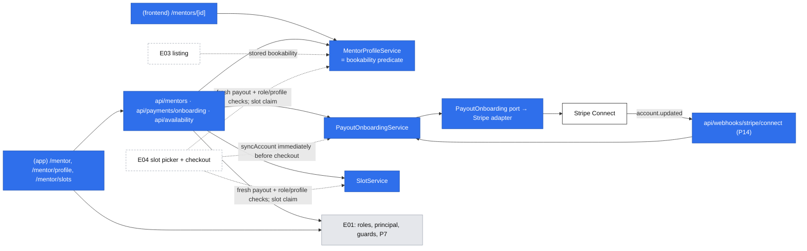
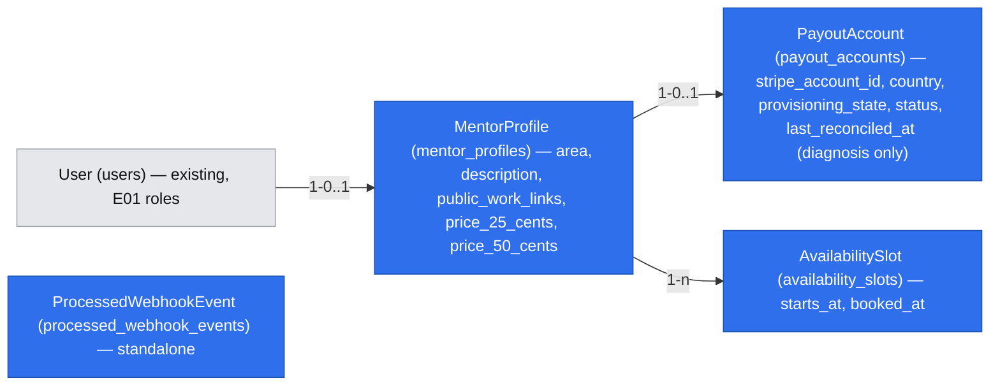

# E02 — Mentor setup: profile, prices, Stripe onboarding and slots

- Epic: #29 (E02) · Stories: #37 (E02-S01), #38 (E02-S02), #39 (E02-S03) · Task: #47 (E02-S02-T01)
- Depends on: E01 [`2026-10-17-accounts-and-roles.md`](./2026-10-17-accounts-and-roles.md) (the `mentor` role, sessions, page guards, `(app)` area). Platform catalog [`2026-10-17-platform-primitives.md`](./2026-10-17-platform-primitives.md) is cited as "platform P*n*/F*n*". **This spec holds the final contracts for P5, P13 (onboarding half), P14 and P17.** The catalog keeps only their status and a pointer here, changed in the same PR.
- Design authority: `.ai/specs/product-brief.md` (D03–D06, D12, D16, R01, N01, N02)
- Research: one shared pass for the three stories and #47 (section "Research"). It is #47's deliverable.
- Status: **draft for review** (gate answered by the PO 2026-10-18; joint E01/E02 review revised with the PO's explicit recovery and status-write decisions the same day; implementation and real Stripe verification remain outstanding)

## 📝 TLDR

**Today:** an invited mentor (E01) holds the `mentor` role and can do nothing with it. There is no profile, no price, no payout account and no schedule, so nobody can find or pay them.

**Proposed (future behavior):**

- A mentor works from one setup page, **Mentor setup** (`/mentor`). It is a three-item checklist with a single "bookable / not bookable yet" line on top.
- **Profile first.** It holds one area, links to public work, a plain description and a USD price for each of the two formats. Saving it publishes the public page `/mentors/<id>`, which never shows ratings.
- **Then Stripe and slots, in either order.**
  - Stripe: the mentor picks their country, finishes Stripe's hosted onboarding, and comes back to a plain status message.
  - Slots: the mentor publishes concrete start times and can withdraw any that are not booked.
- **Bookable** means the profile is saved and the provisioned Stripe account is ready (D05). Stored state drives the setup page and listing, and fresh Stripe fetches reconcile it. Concurrent fetches can finish out of order; this is accepted for display. **Money never moves on a stored status:** E04 must call `syncAccount` immediately before checkout and gate that operation on the account snapshot returned by that fresh fetch.

Listing (E03), slot picking and payment (E04) read what this spec stores; they are not built here.

**Identifier legend.** `MD` is a decision in this spec. `accounts.AD` and `platform.P`/`F`/`PD` point to the E01 specs. Brief `D`, `N`, `R`, `A` and zero-padded `Q` mean decision, non-goal, business rule, assumption and question. `gate.Q1` is a question from this spec's gate, recorded in the decisions table.

## 📝 Decisions

The PO answered the gate on 2026-10-18 (gate.Q0–Q7) and accepted the proposed defaults and the Stripe findings. The rows below are spec-level ids.

**Review revision, 2026-10-18 (PO instructed).** The latest decisions below supersede the earlier timestamp ordering guard and account prefill. There is no revision column or conditional status ordering. Provisioning recovery is explicit; metadata links a Stripe account to the one existing local row. The PO retains the price bounds and country list, accepts a 1-character description minimum, and removes the upper slot horizon. These changes and the E01 amendments are one documentation change.

| Id | Decision | Why |
|---|---|---|
| MD1 | **A slot is a start time only.**<br>• It reserves a fixed 50-minute block of the mentor's time.<br>• The mentee picks 25 or 50 minutes at booking (E04).<br>• One slot gives one booking, whichever length is picked.<br>**PO reading of #39 AC 1** ("a start time and format"): the formats come from the profile's two prices, not from the slot. (gate.Q1 a) | It matches D10 and #41 ("the mentee selects the duration") and keeps one input per slot. Recorded under Risks as a PO decision, so a reviewer does not flag the AC wording. |
| MD2 | **The platform Stripe account is in the United States. Every price is in USD.** There is no per-mentor currency.<br>• A mentor enters whole dollars, **$5–$1,000** per session; the PO confirmed these bounds during review.<br>• The price is stored as integer cents.<br>• No currency column is stored; the money type carries the constant `"USD"` (platform P17, final below). (gate.Q2 c) | One currency means no conversion at checkout and no currency field. $5 sits above Stripe's $0.50 minimum, and $1,000 catches typos. Changing the bounds is one constant. |
| MD3 | **Exactly one area per mentor:** `typescript`, `react` or `python`. (gate.Q3 a) | #37 AC 1, and E03's filter stays a simple equality. |
| MD4 | **A saved profile is public at its direct link before the mentor is bookable.** The page says "Not taking bookings yet" and offers no booking. The E03 listing shows bookable mentors only. (gate.Q4 a) | #40 AC 4 already expects this. A mentor can check their page while onboarding. |
| MD5 | **The public URL is `/mentors/<profile id>`** (uuid). No slug. (gate.Q5 a) | Nothing to reserve, validate or rename. |
| MD6 | **Store instants as UTC `timestamptz`.**<br>• The mentor enters times in their browser's time zone.<br>• Every viewer sees times in their own browser's zone, with that zone named.<br>• There is no time-zone field. (gate.Q6 a) | The smallest model that is correct for a handful of times a few weeks ahead. Recurring rules would need a stored zone; there are none. |
| MD7 | **D05 stays strict (gate.Q7 a).** Stripe-hosted onboarding collects identity and a bank account up front as our policy; configure **Require at least one bank account** in Stripe.<br>A mentor is **bookable** only when the user holds `mentor`, a profile exists, provisioning is `provisioned`, and payout `status = ready` (`transfers` active, `payouts_enabled`, empty `requirements.past_due`). | `return_url` proves nothing, so the status comes from a fresh account fetch. Stored readiness is for display/discovery; E04 uses `syncAccount`'s freshly fetched result immediately before checkout. A mentor who refuses bank details is lost, as D05 accepts. |
| MD8 | **Stripe setup:**<br>• Controller properties: Express dashboard; the platform bears losses and pays Stripe fees; Stripe collects requirements.<br>• Request only `transfers`; omit `tos_acceptance`, whose documented default is the `full` agreement.<br>• **No prefill.** The creation payload contains only stored country, fixed controller properties, `transfers` and local-ID metadata; the idempotency key is derived from the local payout row.<br>• Hosted Account Links use `collection_options.fields = eventually_due`.<br>• The PO accepts the country limit: US, UK, EEA, Canada or Switzerland.<br>• Accounts API v1, `stripe@23`, pinned `2026-09-30.endive`. | A US platform supports these self-serve Connect cross-border regions with the chosen funds flow; `recipient` agreements are not supported for that flow. v1 is the bounded implementation choice, not a claim that v2 needs a preview header. The account holder enters their details on Stripe. |
| MD9 | **Every synchronization fetches Stripe afresh:** return, explicit retry, webhook and immediately after binding an account ID. Each successful write stores that snapshot unconditionally and sets diagnostic `last_reconciled_at`.<br>There is no ordering condition or revision column. P14 deduplicates event IDs; status can regress. | Concurrent snapshots may overwrite each other in completion order; later reconciliation corrects display state. E04 **never** authorizes money movement from the stored status: `syncAccount` fetches immediately before checkout, fails closed on error and returns the fresh result to the caller. |
| MD10 | **Profile before Stripe and slots.** Stripe onboarding and slot publishing require a saved profile; the setup page locks both items until it exists. Slots can be published before Stripe finishes. | Both payout and slot rows belong to the saved profile. No profile content or email is prefilled into Stripe account creation. |
| MD11 | **Slot rules.** All are checked on the server:<br>• the start is at least 2 hours after now, with no product-imposed upper horizon<br>• the start is a whole minute<br>• the start is not within 50 minutes of another of the mentor's slots<br>• a slot is removable only while not booked<br>• the booked state is a nullable `booked_at` column that E04 sets atomically | The lead time follows D16. `booked_at` gives E04 a race-safe one-slot claim and lets this spec refuse removal of booked slots before bookings exist. |
| MD12 | **Provisioning and payout readiness are separate.** Provisioning is `pending`, `provisioned`, `reconciliation_required` or `failed`. Commit the local row before any Stripe call. Ambiguous outcomes require reconciliation: one metadata match attaches; a **complete zero-match listing permits the retry to create**, using the same row and retained idempotency key after committing `pending`. | Zero matches is ordinary automated recovery, not an operator case. Partial/failed listings never count as zero. Multiple matches, conflicting IDs or mismatched metadata fail closed; log safe IDs for manual Stripe Dashboard/database reconciliation (D12), with no new command. |

## 📝 Problem Statement

- **Nobody can find or pay a mentor until the mentor is set up** (epic #29).
  - E03's listing shows only bookable mentors.
  - E04's checkout needs a price and a connected Stripe account.
  - E04's slot picker needs published slots.
- **D05 puts Stripe before bookability.** One interviewed mentor refused bank details before a first booking, and the PO accepts losing such mentors. The same mentor asked for "setup under twenty minutes" (`2026-09-03-interview-senior-python-meetups.md`), so the flow must stay short. Stripe's verification itself takes from minutes to a few business days, which this spec cannot shorten.
- **N02:** public work and a plain description replace ratings.
- **D06:** the mentor sets a price per format (R01: 25 and 50 minutes). The 20% commission is applied at payment (E04).
- **D03/D16:** a mentee picks a published slot that starts at least two hours after selection.

## 📝 Proposed Solution — the mentor's flows

Each story is a user flow, not a CRUD screen. All mentor pages are in the signed-in area (`(app)`, shadcn, platform PD2). They require `requireRole("mentor")`; any other account gets 404. The public profile is in `(frontend)` (Tailwind).

### Flow 1: first setup (all three stories)

1. The invitee accepts the invitation (accounts Flow 3). When E02 Phase 1 ships, full browser navigation changes from E01's `/` fallback to `/mentor`. The matching amendments to accounts Flow 3, its header/tests, and platform P1/P5/P13/P14/P17 land in this same change. Both personalized headers gain **Mentor setup** for accounts with `mentor`; `/error` keeps its identity-free header.
2. `/mentor` shows a status line and three items. Each item has a state and exactly one next action:

   | Item | States → action |
   |---|---|
   | 1. Profile | *Not started* → **Create your profile**; *Saved* → **Edit profile** + **View public page** |
   | 2. Payouts with Stripe | *Locked* ("Save your profile first"); no row → country + **Continue to Stripe**; provisioning `pending` → *Starting Stripe setup* + **Retry setup**; `reconciliation_required` → *We need to check an earlier setup attempt* + **Retry setup**; `failed` → **Contact the DevMentor team**. Once `provisioned`: *Incomplete* → **Continue with Stripe**; *Stripe is checking your details* → **Check status**; *Stripe needs more information* → **Update details on Stripe**; *Blocked* or *Not supported* → **Contact the DevMentor team**; *Confirmed* → secondary **Complete outstanding requirements on Stripe**. Before Phase 2 ships: *Coming soon* |
   | 3. Slots | *Locked* ("Save your profile first"); *No upcoming slots* → **Publish slots**; *N upcoming (M booked)* → **Manage slots** |

   The status line reads one of:
   - **"You are bookable."**, plus the public link with a copy button.
   - **"Not bookable yet: finish your profile and Stripe."** It names only the missing items.
   - **"You are bookable, but you have no upcoming slots, so mentees have nothing to pick."** This is shown when bookable with zero open future slots.
   - **"Not bookable yet: mentees can book you once payouts with Stripe are available."** This is the only variant before Phase 2 ships, whatever else is done, so the page never asks for a step it cannot offer.

3. The page is computed on every request from stored state (`MentorSetupDto`). No "setup complete" flag is stored.

### Flow 2: publish the profile (#37)

1. **Create your profile** opens `/mentor/profile`, a `CrudForm` that gains two additive field kinds (`textarea`, `select`). The fields:

   | Field | Input | Rule (`mentorProfileSchema`) |
   |---|---|---|
   | Area | select: TypeScript, React, Python | one of `typescript \| react \| python` (MD3) |
   | Description | textarea, plain text | 1–2,000 characters after trim; shown as plain text with line breaks, never as Markdown or HTML |
   | Links to public work | textarea, one URL per line | 1–5 lines after dropping blank lines. Each must parse as an absolute `https:` URL of at most 2,048 characters, and there are no duplicates. An error names the line ("Line 2: use a full https:// link") |
   | Price for 25 minutes (USD) | number | whole dollars, 5–1,000 (MD2) |
   | Price for 50 minutes (USD) | number | whole dollars, 5–1,000. Not constrained against the 25-minute price |

   The display name is not a profile field. The public page shows the account's display name (accounts: `users.name`), which the mentor edits on `/account`.
2. **Save** calls `PUT /api/mentors/profile`. The first save creates the profile; later saves replace it. On success, a full navigation goes to `/mentor`, where the checklist advances and **View public page** appears. Errors stay on the form, per field (#37 AC 3).
3. A changed price applies to future bookings only. E04 snapshots the price at booking (accepted default).
4. **The public page** `/mentors/<id>` shows:
   - the display name, an area badge, the description and the links (hostname plus path, opened in a new tab with `rel="nofollow noopener ugc"`)
   - "25 min · $40" and "50 min · $70"
   - "Text sessions only" (N01)
   - **no ratings or reviews** (#37 AC 4, N02)
   - "Not taking bookings yet" while the mentor is not bookable (MD4)

   An id with no profile, or whose user no longer holds `mentor`, returns 404. E03 later adds slots and the listing to this page; E04 adds booking.

### Flow 3: Stripe onboarding round trip (#38, #47)

1. **Pick a country.** Item 2 offers MD8's accepted list and the hint "Where you reside, or where your business is legally established. You can't change this Stripe account's country later." **Continue to Stripe** calls `POST /api/payments/onboarding { country }`. After the local row exists its stored country is read-only; later requests cannot change it.
2. **Provision the account.** `PayoutOnboardingService.start(principal, country)`:
   - Insert one `payout_accounts` row with `INSERT … ON CONFLICT (mentor_profile_id) DO NOTHING`. A new row has `provisioning_state = pending`, `stripe_account_id = null`, payout `status = incomplete` and `last_reconciled_at = null`. **Commit before calling Stripe.** Only the request that inserted the row initiates its first creation; an existing unresolved row follows step 3. Concurrent clicks reuse that row, never insert a replacement.
   - `createAccount` sends only this stable payload, with `Idempotency-Key: payout-account-<local row id>` in the request options:
     ```ts
     {
       country: row.country,
       controller: {
         stripe_dashboard: { type: "express" },
         losses: { payments: "application" },
         fees: { payer: "application" },
         requirement_collection: "stripe"
       },
       capabilities: { transfers: { requested: true } },
       metadata: { payout_account_id: row.id, mentor_profile_id: row.mentorProfileId }
     }
     ```
     There is no email, business profile, product description, identity prefill or `APP_URL`-derived creation parameter. Omitted `tos_acceptance` defaults to `full`; verify that agreement in Phase 2's real test-mode check. Keep these fixed parameters unchanged during recovery of the same row.
   - A successful creation response with an account ID binds that ID to the existing row in a short transaction and sets `provisioning_state = provisioned`; a first binding retains the default payout `incomplete`. An already-bound row preserves any payout state/timestamp a concurrent successful sync stored; account attachment itself never overwrites payout status. Lock the row and check the known creation inputs and any binding; a webhook that already attached that same ID is success, while a different ID is an operator conflict, never an overwrite. **Immediately after binding, call `syncAccount`** to fetch the account afresh, validate metadata/country and store its payout snapshot with diagnostic `last_reconciled_at`. A fetch failure leaves the binding and any previously reconciled payout state intact; a newly attached account with no successful sync remains `incomplete`. **Check status** retries it without another create. Failure to persist the binding leaves the creation outcome unresolved for step 3.
   - A timeout, connection interruption, provider 5xx or any other ambiguous result sets `reconciliation_required`. A deterministic, non-retryable rejection that proves creation did not succeed sets `failed`. `idempotency_key_in_use` answers 409 "Stripe onboarding is already starting. Try again in a moment" and leaves the unresolved row retryable. An error response must never downgrade a row another request/webhook already provisioned; transitions recheck the locked row.
3. **Recover an interrupted attempt.** A later **Retry setup** posts to the same endpoint with the stored country. Existing `pending` rows (including a process crash before the first Stripe call) and `reconciliation_required` rows enter reconciliation; neither permits an unconditional fresh create.
   - Reuse the **same** local-row idempotency key. While a prior result remains safely replayable, the adapter may repeat the identical request to recover that result; it never uses a new key to escape an unresolved attempt. An in-flight key returns 409; a cached 5xx leaves reconciliation unresolved. Stripe retains results for at least 24 hours, not exactly 24. Use the local row's creation time conservatively: do not assume replay remains safe once the row is 24 hours old or retention is uncertain. Never blindly replay an expired key, because that POST could create another account.
   - If the result can no longer be replayed, **list connected accounts** using the platform's authenticated Stripe API and inspect **all pages** for the exact pair of metadata IDs. There is no metadata-filter/search assumption in the list API. Validate country and ensure the returned account is not attached to any other local row.
   - Exactly one matching account → validate and attach it under the same lock/checks as step 2, then immediately call `syncAccount` for a fresh post-binding payout fetch.
   - **Zero matches after a complete listing → the retry may create the account.** Lock the existing local row and recheck its country, provisioning state and binding. If another request/webhook has already bound an account, reuse that binding instead. Otherwise move the same unresolved row to `pending` and **commit before calling Stripe**, then invoke the original stable creation/bind/post-binding-sync path with the **same retained row-derived idempotency key and metadata**. This resolves the no-account case without operator approval, another local row or a new key. An in-flight same-key request still answers 409; a cached failure or another ambiguous outcome returns the row to `reconciliation_required` under the existing transition rules.
   - A partial or failed listing never authorizes creation: keep reconciliation unresolved and retry later. More than one match, conflicting IDs or mismatched metadata/country → fail closed, retain `reconciliation_required`, log safe local/account IDs, and let the operator reconcile **by hand in the Stripe Dashboard and database** (D12). No account is chosen arbitrarily and no operator command is added. A deterministic `failed` outcome still requires correcting its cause before retry; any manual database correction returns it to normal reconciliation, which performs a complete lookup before another create. The product never deletes the row to mint another key.
4. **Create the onboarding link.** Only a `provisioned` row may proceed. Refuse payout `rejected` or `blocked` with 409 and the contact message. Otherwise mint an Account Link with `return_url = /api/payments/onboarding/return`, `refresh_url = /api/payments/onboarding/refresh` and `collection_options.fields = eventually_due`. Check its origin against `config.stripe().onboardingOrigin`, return `{ url }`, then `window.location.assign(url)`. A `ready` mentor can collect outstanding requirements through `account_onboarding`; this is not a general account-details editor. Express accounts cannot use `account_update` links.
5. **At Stripe.** The mentor enters the required business, identity and bank details. The platform's **Require at least one bank account** Dashboard setting is a prerequisite; a payout-capable debit card alone does not satisfy our policy.
6. **Return and explicit status retry.** `GET /api/payments/onboarding/return` is a P7 navigation route guarded by `mentor`. It calls `syncAccount` for the principal's provisioned account, stores the freshly fetched state unconditionally, and redirects to `/mentor?stripe=returned`. It never trusts query parameters as evidence of completion.

   | Payout status | Banner / action |
   |---|---|
   | `ready` | "Stripe confirmed your account." (+ "You are bookable" when MD7 holds); **Complete outstanding requirements on Stripe** |
   | `pending` | "Stripe is checking your details. This can take a few minutes to a few business days." **Check status** |
   | `incomplete` | "Stripe onboarding isn't finished. Continue where you left off." **Continue with Stripe** |
   | `action_required` | "Stripe needs more information before you can take bookings." **Update details on Stripe** |
   | `blocked` | "Stripe can't enable payouts yet. Contact the DevMentor team." |
   | `rejected` | "Stripe can't support this account. Contact the DevMentor team." |

   **Check status** and **Try checking again** link to this same navigation route, causing a new Stripe fetch. On a provider error it redirects to `/mentor?stripe=check_failed`: "We couldn't reach Stripe to check your status. Try checking again." Stored payout state and `last_reconciled_at` stay unchanged on fetch failure. Reloading `/mentor` only re-renders stored state; it does not retry Stripe. With no provisioned account, return redirects to `/mentor`, where **Retry setup** runs step 3.

   A POST start/recovery failure can occur after binding. On a 502/409 provisioning error, refresh the server-read setup state while retaining the error message. Choose recovery from that committed state: `provisioned` offers an error-banner **Check status** link even when payout is `incomplete`; unresolved provisioning offers **Retry setup**; `failed` offers operator contact. The normal incomplete checklist item may still offer **Continue with Stripe**. Never assume every 502 means creation should be retried.
7. **Refresh.** `GET /api/payments/onboarding/refresh` follows the same link eligibility as step 4 and mints a new link after expiry/reuse/preview. It uses P7 `externalOrigins: (cradle) => [cradle.config.stripe().onboardingOrigin]` and redirects 303. With no provisioned account, or payout `rejected`/`blocked`, it redirects to `/mentor`. It does not create an account or bypass provisioning reconciliation.
8. **Webhook.** `POST /api/webhooks/stripe/connect` uses P14's signature-only path, without CSRF or session resolution:
   - Verify `Stripe-Signature` against the raw body with the Connect endpoint secret. A recorded event ID returns 200 without an effect. Other event types are recorded and ignored.
   - For `account.updated`, `prepare` fetches the account **by the authenticated event's account ID** through the platform's Stripe client. Only the returned metadata is trusted for attachment; never attach using a browser-supplied account ID or metadata from an unverified payload.
   - If the account ID is not yet stored, its `payout_account_id` and `mentor_profile_id` must identify exactly one existing matching local payout row and its profile. In `apply`, lock that row, recheck both IDs, stored country and any existing binding, and attach the account as `provisioned`. If the row is already bound to that same account, continue normally. Never insert another local row. Apply the same checks for known bindings so a conflicting metadata pair is not accepted silently.
   - Missing metadata, a nonexistent/mismatched row or profile, a country conflict, another bound account, a uniqueness conflict, or multiple candidates **fail closed**. No attachment or status change commits; the inbox row rolls back, the delivery answers 500 and remains retryable. Log safe diagnostic IDs for the operator, never the raw payload or identity/bank details. Do not classify such accounts as harmless orphans and mark them processed.
   - A valid attachment, the freshly fetched payout state, diagnostic `last_reconciled_at` and the inbox event row commit in the same transaction. Duplicate deliveries cannot apply the same event ID twice.
9. **Reconciliation and money safety.** Return, explicit retry, webhook and the fetch immediately after account binding all store their freshly fetched snapshot **without an ordering predicate**. `last_reconciled_at` records when a successful reconciliation was persisted; it is diagnostic only, never used for authorization, ordering or a freshness threshold. Concurrent fetches may commit out of order. The setup page and E03 listing are eventually consistent. **Money never moves on a stored status:** immediately before creating checkout, E04 calls `syncAccount`, uses its returned fresh readiness together with the current role/profile/provisioning checks, and fails closed on fetch failure. It must not discard that result and re-read a potentially overwritten cached status. Stripe errors during checkout also fail closed; the fetch is not an atomic guarantee against a later Stripe-side restriction.
10. **Regression and abandonment.** A reconciled restriction removes displayed bookability, with **Update details on Stripe** for missing requirements or operator contact for a blocked/rejected account. Booked slots are untouched (D12). Leaving onboarding unfinished does not lose the provisioned account: `incomplete` offers continuation, and genuine `pending` offers a fresh status check.

**Payout status mapping.** A pure Stripe-adapter function returns the first match:

1. `requirements.disabled_reason` starts with `rejected` → `rejected`.
2. `capabilities.transfers = active`, `payouts_enabled` and `requirements.past_due` empty → `ready` (currently due items may still be completed before their deadline).
3. `requirements.past_due` non-empty, or `details_submitted` with `currently_due` non-empty → `action_required`.
4. A verification/review reason (`requirements.pending_verification`, `under_review`, `listed`), or non-empty `pending_verification` → `pending`.
5. Any other non-null disabled reason, except `requirements.past_due` with unsubmitted onboarding details → `blocked`, requiring operator contact.
6. `details_submitted = false` → `incomplete`.
7. Otherwise → `blocked`: absence of readiness is not evidence that verification is in progress.

Provisioning state is mapped separately and takes precedence over payout status in the setup UI. A non-provisioned row is never bookable, regardless of its payout status.

### Flow 4: publish and withdraw slots (#39)

1. **Publish slots** opens `/mentor/slots`. It has two parts:
   - **Upcoming slots.** These are slots starting after now, oldest first. Each row shows the start in the viewer's time zone, the time zone name, "Reserves 50 minutes; the mentee picks 25 or 50", and a state: *Open* or *Booked*.
   - **Add a slot.** One `datetime-local` input, labelled "Start time (your time zone: Europe/Warsaw)" with the browser's zone name, and **Publish slot**.
2. **Publish.** The form converts the local value to an ISO instant in the browser and calls `POST /api/availability/slots { startsAt }`. The server applies MD11 and answers with a reason per case:

   | Case | Response |
   |---|---|
   | Starts less than 2 hours from now, including the past (#39 AC 3) | 400 `startsAt`: "Pick a time at least 2 hours from now. Mentees need 2 hours' notice." |
   | Within 50 minutes of another of your slots (#39 AC 3) | 409 `conflict` whose message names the other slot's ISO UTC start: "This overlaps your slot at <ISO start>. Each slot reserves 50 minutes." The zone is explicit and the existing envelope is unchanged. |
   | Valid | 201 `SlotDto`. The row appears in the list and the form keeps its date for the next entry. |

   The check and the insert run in one transaction that first locks the mentor's profile row (`FOR UPDATE`), so two concurrent publishes cannot both pass the overlap check. A unique `(mentor_profile_id, starts_at)` index is the backstop.
3. **Withdraw** (#39 AC 2). **Remove** sits on *Open* rows and opens a shadcn `alert-dialog` confirmation. It calls `DELETE /api/availability/slots?id=<uuid>`:
   - The server loads the slot with its profile's `user_id` and checks ownership with platform.P5 `assertOwner`; a foreign or unknown id gets 404.
   - It then runs a conditional `DELETE … WHERE id = ? AND booked_at IS NULL`.
   - Zero rows deleted means the slot was booked in the meantime: 409 "This slot is booked. To cancel, the mentee or you contact the DevMentor team by email." (#39 AC 4, D12).
   - *Booked* rows show that sentence instead of a button.
4. **Past slots** drop out of the list. They are never offered (D16), and nothing cleans them up.

## 📝 Research

This is the single shared pass for #37, #38, #39 and #47, checked 2026-10-18. **Documentation-verified only: no real Stripe test-mode onboarding run has been performed.** The CI stub is an application test double, not evidence of Stripe behavior. Scheduler claims come from Cal.com `main` (code read) and vendor help pages; the Stripe sources and the outstanding real-provider check are below.

| Leader / source | What we adopt | Complexity we skip |
|---|---|---|
| **Cal.com** (open source) | Several lengths on one event type: the booker picks the duration. `minimumBookingNotice` defaults to 120 minutes, the same as D16. Overlaps are a half-open interval test. Instants are stored in UTC. | Weekly schedules, date overrides, buffers, slot intervals, seats, calendar sync, per-user time-zone fields. Its overlap check is in application code with no DB guard; we lock the profile row plus a unique index instead. |
| **Calendly, Topmate, MentorCruise, Codementor, Easy!Appointments** | Several durations on one event, shown in the viewer's zone (Calendly). The expert sets the price on one shareable page (Topmate; our MD4/MD5). Only verifiable information, with a complete profile as the gate to traffic (MentorCruise; N02, MD10). Codementor's rate range informed MD2's bounds. | Weekly plans plus exceptions (the industry default; we store concrete times, which a weekly rule could generate later), vanity slugs, calendar sync, skills lists, video, subscriptions. |
| **Stripe Connect** (marketplace guide, Account Links, webhooks) | MD7–MD9: controller properties (Express dashboard, platform liability and fees); `transfers` only; destination charges (E04); hosted Account Links, where `refresh_url` mints a new link and `return_url` proves nothing; `account.updated` on a Connect endpoint; re-fetch the account; dedupe by event id. | Embedded onboarding components, Accounts v2 (deferred scope, not a preview-header requirement), Custom accounts, our own KYC UI, event ordering logic. |

### #47 — Stripe onboarding requirements (the task's deliverable)

- **Account type.** Use Express-style accounts set through controller properties:
  - `controller.stripe_dashboard.type = express`
  - `controller.losses.payments = application`
  - `controller.fees.payer = application`
  - only `capabilities.transfers`
  - omit `tos_acceptance` to use its documented `full` default; no prefill, and only the stable MD8 payload plus local-ID metadata

  Stripe calls Standard/Express/Custom legacy names. Standard accounts support only direct charges. Custom accounts have no Stripe Dashboard and would add account-management/support responsibilities; they can still use Stripe-hosted onboarding.
- **Countries.** A US platform transfers and pays out self-serve only to accounts in the US, UK, EEA, Canada and Switzerland. Other countries need Stripe sales or Global Payouts. `recipient` agreements do not support the selected self-serve Connect cross-border flow; Global Payouts is a separate integration. The account country is set at creation and cannot change.
- **What a mentor provides.** These are documentation examples for a US platform, v1, Express dashboard, `full` agreement, an individual and `transfers` only. Our policy collects `eventually_due` up front; the account holder enters it at Stripe because creation has no prefill. Requirements vary by business type and may change:

  | Mentor | Provides |
  |---|---|
  | Individual in PL or GB | name, date of birth, address, phone, business URL, terms acceptance, bank account; PL also nationality |
  | Individual in the US | name, business URL, terms acceptance, bank account; date of birth and SSN last 4 (eventually due) |

  ID document checks take "a few minutes to a few business days" (Stripe).
- **Bookable predicate.** A provisioned account with `transfers` active, `payouts_enabled` and empty `past_due` (MD7). Requirements can disable functionality at their deadline; payout suspension is typical, not a universal ordering guarantee. This is a display predicate; E04 requires a fresh `syncAccount` result before checkout.
- **Inputs for E04's spec (recorded, not designed here).**
  - Destination charges in USD with a 20% platform fee and no `on_behalf_of`; Stripe converts the transferred part into a non-US mentor's currency. `application_fee_amount` lands the fee in the mentor's currency; `transfer_data.amount` keeps it in USD.
  - Minimum charge $0.50. Card, conversion and Connect fees apply; exact Express pricing is unverified.
  - Refunds and disputes live on the platform account. A refund without `reverse_transfer` leaves the mentor's share with the mentor, a reversal fails if the mentor's balance can't cover it, and Stripe's processing fee is not returned. These rules belong in E04's operator runbook.
- **Testing.**
  - Test-mode onboarding uses Stripe's documented values: SMS `000-000`, US routing `110000000` with account `000123456789`, SSN `000000000`, PL IBAN `PL61109010140000071219812874`. `111111111` produces a failing identity.
  - `stripe-mock` is stateless, and the Stripe CLI needs network, so CI uses our own HTTP stub. stripe-node supports `host`, `port` and `protocol`, and `webhooks.generateTestHeaderString` signs events.
- **SDK.** `stripe@23.0.0`, ESM, pinned to API version `2026-09-30.endive`.

**Impact on D05, brought to the PO with this spec.**
- D05 holds unchanged in substance (gate.Q7 a).
- Onboarding completion is defined by the account's status, not by the mentor's return, and it is re-checked over time.
- Collecting identity fields and bank details up front is **our chosen policy**, not a universal Stripe limitation. Stripe also supports incremental collection; hosted external-account opt-out exists for configurations where the platform collects requirements, which does not prove it is available for this Express/Stripe-collected configuration. Keep `eventually_due` and enable **Require at least one bank account** for this product.
- New consequence: mentors outside the US, UK, EEA, Canada and Switzerland cannot onboard. That narrows A04 by an unknown amount, since the 50-name list records no countries.

**Primary Stripe sources (checked 2026-10-18):**
- [Account creation](https://docs.stripe.com/api/accounts/create): stable controller/capability/metadata payload, optional prefill, and omitted `tos_acceptance` defaulting to `full`.
- [Idempotent requests](https://docs.stripe.com/api/idempotent_requests): matching parameters, cached failures as well as successes, and key retention of at least 24 hours; [list connected accounts](https://docs.stripe.com/api/accounts/list): paginate before concluding how many metadata matches exist.
- [Hosted onboarding](https://docs.stripe.com/connect/hosted-onboarding) and [external payout accounts](https://docs.stripe.com/connect/payouts-bank-accounts): Account Link behavior, incremental/upfront collection, Express update-link limits and the bank-account Dashboard setting.
- [Verification requirements](https://docs.stripe.com/connect/required-verification-information), [verification states](https://docs.stripe.com/connect/handling-api-verification), [cross-border payouts](https://docs.stripe.com/connect/cross-border-payouts), [destination charges](https://docs.stripe.com/connect/destination-charges?platform=web&ui=stripe-hosted), [Connect testing](https://docs.stripe.com/connect/testing) and the [stable v2 Account Links reference](https://docs.stripe.com/api/v2/core/account-links/create).

**#47 completion and evidence.** This corrected Research section is the documentation deliverable and may close #47 when merged, explicitly labelled documentation-verified. It does not establish that hosted onboarding or this application's status mapping works in test mode. **Phase 2 acceptance additionally requires one real Stripe test-mode smoke pass**, with representative US, PL and GB individual accounts: verify the minimal no-prefill creation payload and `full` agreement, bank-account requirement, continue/abandon/return/expired-link flows, actual account snapshots and signed `account.updated` delivery. Record safe outcomes and mapping discrepancies in its run log; never store keys, raw webhook bodies, bank/identity data or Account Link URLs in evidence. Do not mark this check passed merely because the stub passes. Test mode also cannot establish live tax obligations or guarantee enforcement of every capability.

**Unverified (carried as risks, not blockers to specification):**
- which side pays the 1% conversion fee on a cross-border transfer
- exact Express pricing
- whether the Dashboard refund screen exposes "reverse transfer"
- what Stripe does with balances that are never paid out
- whether US 1099 filing or W-8BEN collection applies to this platform, which needs a tax advisor (see Risks)

## 📝 Architecture

**Concepts and services.** Each service is one explicit line in `container.ts` and `cradle.ts`, TRANSIENT on the scoped `em`; adapters are SINGLETON.

| Concept folder | Service / port | Responsibility | Phase |
|---|---|---|---|
| `mentors` | `MentorProfileService` | `getOwn(principal)`, `save(principal, input) → MentorProfileDto` (upsert), `getPublic(profileId) → PublicMentorProfileDto` (404 rules of Flow 2), `getSetup(principal) → MentorSetupDto`, `isBookable(profileId, freshPayout?)`. **The single definition of MD7.** Display/listing calls use stored state; E04 must supply the fresh snapshot returned by `syncAccount` and never fall back to a stored payout status. | 1 (bookability completes in 2) |
| `payments` | `PayoutOnboarding` port (`payout-onboarding.port.ts`) | Platform.P13 onboarding half, final contract below. | 2 |
| `payments` | `adapters/stripe-payout-onboarding.ts`, `adapters/mock-payout-onboarding.ts` | Stripe SDK adapter (status mapping, signature verification); in-memory mock for unit tests. Only the adapter imports `stripe`. | 2 |
| `payments` | `PayoutOnboardingService` | `start(principal, country) → { url }` (including provisioning recovery), `refreshLink(principal) → URL`, `syncFromReturn(principal)`, `syncAccount(mentorProfileId) → PayoutAccountSnapshot`, `fetchAccount(stripeAccountId)` + `attachAndStore(em, snapshot)` (P14 prepare/apply). Attach validates both metadata IDs and country under a row lock; status writes have no ordering condition. E04 immediately uses `syncAccount`'s fresh result with MD7 before checkout; failed fetches never authorize payment. | 2 |
| `availability` | `SlotService` | `listUpcoming(principal) → SlotDto[]`, `publish(principal, startsAt) → SlotDto`, `withdraw(principal, slotId)`. | 3 |

**Routes.** Each goes through `@/server/http`, with no own `try/catch`.

| Route | Kind | Access |
|---|---|---|
| `api/mentors/profile/route.ts` (PUT) | `apiHandler` | `{ role: "mentor" }` |
| `api/payments/onboarding/route.ts` (POST) | `apiHandler` | `{ role: "mentor" }` |
| `api/payments/onboarding/return/route.ts` (GET) | `navigationHandler` | `{ role: "mentor" }` |
| `api/payments/onboarding/refresh/route.ts` (GET) | `navigationHandler`, `externalOrigins: (cradle) => [cradle.config.stripe().onboardingOrigin]` | `{ role: "mentor" }` |
| `api/webhooks/stripe/connect/route.ts` (POST) | `webhookHandler` (P14) | signature only |
| `api/availability/slots/route.ts` (POST, DELETE) | `apiHandler` | `{ role: "mentor" }` |

Signed-out visitors to navigation routes are sent to sign-in with `returnTo=/mentor` (P7 `onError`).

**Pages.**

| Page | Area | Guard |
|---|---|---|
| `(app)/mentor/page.tsx` | signed-in | `requireRole("mentor")` |
| `(app)/mentor/profile/page.tsx` | signed-in | `requireRole("mentor")` |
| `(app)/mentor/slots/page.tsx` | signed-in | `requireRole("mentor")` |
| `(frontend)/mentors/[id]/page.tsx` | public | `getPrincipal()` (activity) + `connection()` |



Takeaway: profile, provisioning, payout status and slots drive the setup UI. Stripe is reached only through the port. Return, explicit retry, webhook and post-binding synchronization all fetch fresh account state. The UI/listing may be temporarily stale; E04 must use `syncAccount`'s fresh result immediately before checkout. No status-ordering mechanism is introduced.

## 📝 Data Model

Every table spreads `baseProperties`. Each phase ships one migration with a working `down()` and a migration test one directory above `src/migrations/`. Entities are listed in `entities/index.ts`.

**`mentor_profiles`** (Phase 1, `entities/mentors/mentor-profile.entity.ts`):

| Column | Type | Notes |
|---|---|---|
| `user_id` | FK `users`, unique, on delete cascade | One profile per mentor account. |
| `area` | enum `typescript \| react \| python`, check constraint | MD3 |
| `description` | `text` | 1–2,000 characters after trim (schema); plain text. |
| `public_work_links` | `text[]` | 1–5 https URLs (schema). Order kept as entered. |
| `price_25_cents` | `integer`, check `> 0` | USD cents (MD2); schema bounds 500–100,000. |
| `price_50_cents` | `integer`, check `> 0` | Same. |

**`payout_accounts`** (Phase 2, `entities/payments/payout-account.entity.ts`):

| Column | Type | Notes |
|---|---|---|
| `mentor_profile_id` | FK `mentor_profiles`, unique, on delete restrict | One Stripe account per mentor. |
| `stripe_account_id` | `varchar(64)`, null, unique | `acct_…`; attached only through validated provisioning/reconciliation. Unique across local rows. Not shown in the UI. |
| `country` | `char(2)` | ISO 3166-1 alpha-2 from MD8's list; fixed when the row is created. |
| `provisioning_state` | enum `pending \| provisioned \| reconciliation_required \| failed`, check constraint, default `pending` | Separate from payout readiness; `provisioned` requires an attached account ID. Null account ID requires non-provisioned state. |
| `status` | enum `incomplete \| pending \| action_required \| ready \| blocked \| rejected`, check constraint, default `incomplete` | Payout readiness mapped by the adapter. It never overrides a non-provisioned state. |
| `last_reconciled_at` | `timestamptz`, null | Last successful account-state reconciliation persisted by the app. Diagnostic only; never a write condition, revision, freshness gate or payment authorization. |

The row's base `id` and `mentor_profile_id` are mirrored in Stripe metadata as `payout_account_id` and `mentor_profile_id`; metadata is not a new relationship or a replacement row. The local row is committed before Stripe creation. Use base `created_at` conservatively for the minimum key-retention window; no extra revision or ordering column exists. Enforce that only `provisioned` rows have a non-null Stripe ID and that every provisioned row has one; a separately attached but unreconciled account stays `provisioned` with payout `incomplete` until its next successful fetch. Reconciliation failures and pending operator work are logged safely; they never create a duplicate row.

**`processed_webhook_events`** (Phase 2, platform.P14, `entities/integrations/processed-webhook-event.entity.ts`):

| Column | Type | Notes |
|---|---|---|
| `provider` | `varchar(32)` | `stripe_connect` |
| `event_id` | `varchar(255)` | Unique with `provider`. |
| `event_type` | `varchar(255)` | For diagnosis. |

The row is inserted in the same transaction as the event's effect, so a committed row means the effect happened (P14).

**`availability_slots`** (Phase 3, `entities/availability/availability-slot.entity.ts`):

| Column | Type | Notes |
|---|---|---|
| `mentor_profile_id` | FK `mentor_profiles`, on delete restrict | |
| `starts_at` | `timestamptz` | UTC (MD6); unique with `mentor_profile_id`; indexed with it for the upcoming list and the overlap check. |
| `booked_at` | `timestamptz`, null | Set only by E04's atomic claim (`UPDATE … SET booked_at = now WHERE id = ? AND booked_at IS NULL`). This spec reads it and never writes it. |

The 50-minute block length is a constant in `core/src/validators/availability/` (`SLOT_BLOCK_MINUTES = 50`, the longest R01 format), not a column.

**Sensitive data.**
- No identity or bank data is stored; Stripe holds it.
- `stripe_account_id` and `country` are visible only to the owner (the country, read-only) and to operators through the DB.
- The public page exposes only what the mentor typed as public, plus their display name.
- Webhook secrets and the Stripe API key live only in env (P1), and are never logged.
- No mentor email goes to the public page.



Interactive view: `.ai/data-model/2026-10-18-mentor-setup.html`.

## 📝 API Contracts

Every JSON route uses the existing envelope. Schemas live in `core/src/validators/<concept>/` and are shared by the route and its form.

| Route | Request | Success | Failures |
|---|---|---|---|
| `PUT /api/mentors/profile` | `mentorProfileSchema` `{ area, description, publicWorkLinks: string /* one per line */, price25Dollars, price50Dollars }` | 200 `MentorProfileDto` | 400 field errors; 401; 403 non-mentor |
| `POST /api/payments/onboarding` | `onboardingStartSchema` `{ country: OnboardingCountry }` | 200 `{ url: string }` (Stripe origin only) | 400; 401; 403; 409 `conflict` when there is no profile ("Save your profile first"), provisioning is `failed` or requires operator reconciliation, payout is `rejected`/`blocked`, or Stripe reports the idempotency key in use ("already starting"); 502 `provider_unavailable` on retryable provider/reconciliation failure (including an incomplete or failed account listing); preserve committed state and refresh setup: unresolved → **Retry setup**, provisioned → **Check status**, failed → operator contact |
| `GET /api/payments/onboarding/return` | — | 303 → `/mentor?stripe=returned` | 303 → `/mentor?stripe=check_failed` (Stripe error, with a retry link to this route); `/mentor` without a provisioned account; sign-in with `returnTo=/mentor` (signed out); `/error` for non-mentors (P7 default) |
| `GET /api/payments/onboarding/refresh` | — | 303 → Stripe Account Link | 303 → `/mentor` (no provisioned account, or payout `rejected`/`blocked`) or `/mentor?stripe=check_failed` |
| `POST /api/webhooks/stripe/connect` | raw Stripe event + `Stripe-Signature` | 200 `{ received: true }` (duplicates, successfully reconciled accounts and ignored event types) | 400 bad signature; 500 on provider, metadata, binding or transaction failure; no processed event row, so Stripe retries |
| `POST /api/availability/slots` | `slotCreateSchema` `{ startsAt: ISO datetime with offset }` | 201 `SlotDto` | 400 `startsAt` (lead time, whole minute); 401; 403; 409 `conflict` (overlap, or no profile) |
| `DELETE /api/availability/slots?id=` | uuid | 200 `{ id }` | 404 unknown or foreign; 409 booked |

`provider_unavailable` (502) is a new `AppError` subclass in `core/src/http/errors.ts`. It is additive, so the envelope is unchanged.

```ts
type Area = "typescript" | "react" | "python";
type Money = { amountMinor: number; currency: "USD" };          // P17
type MentorProfileDto = { id: string; area: Area; description: string; publicWorkLinks: string[];
  prices: { 25: Money; 50: Money } };
type PublicMentorProfileDto = MentorProfileDto & { displayName: string; bookable: boolean };
type PayoutStatus = "not_started" | "incomplete" | "pending" | "action_required" | "ready" | "blocked" | "rejected";
type ProvisioningState = "pending" | "provisioned" | "reconciliation_required" | "failed";
type MentorSetupDto = {
  profile: MentorProfileDto | null;
  payout: { status: PayoutStatus; country: string | null; provisioningState: ProvisioningState | null }; // both states are distinct; null provisioning and not_started payout when no row
  upcomingSlots: { open: number; booked: number };
  bookable: boolean;                                             // MD7
  publicUrl: string | null;
};
type SlotDto = { id: string; startsAt: string /* ISO UTC */; booked: boolean };
```

### Final primitive contracts (the platform catalog points here)

- **P5 access assertion.** `core/src/http/auth.ts`:
  ```ts
  assertOwner(principal: Principal, ownerUserId: string): void  // NotFoundError, conceals existence
  ```
  - Its current caller is `SlotService.withdraw`: a foreign slot ID gets 404 before the conditional delete. E02 needs only this ownership assertion; profile endpoints already scope by `principal.userId`.
  - The catalog's `assertSelf` is dropped: "me" endpoints act on `principal.userId` by construction.
  - `assertParticipant` stays provisional and passes to E05's spec.
- **P13 onboarding half.** `app/src/server/services/payments/payout-onboarding.port.ts`:
  ```ts
  type PayoutAccountSnapshot = {
    accountId: string;
    country: string;
    metadata: { payoutAccountId: string | null; mentorProfileId: string | null };
    status: Exclude<PayoutStatus, "not_started">;
  }; // adapter exposes no identity or bank data
  type AccountCreationResult =
    | { outcome: "provisioned"; accountId: string }
    | { outcome: "reconciliation_required" }
    | { outcome: "failed" }; // only a definitive, non-retryable rejection
  interface PayoutOnboarding {
    createAccount(input: {
      idempotencyKey: string; country: OnboardingCountry;
      payoutAccountId: string; mentorProfileId: string;
    }): Promise<AccountCreationResult>;
    // no prefill; ambiguous errors become reconciliation_required;
    // idempotency_key_in_use throws ConflictError (409), not ProviderUnavailableError
    findAccounts(input: { payoutAccountId: string; mentorProfileId: string }): Promise<PayoutAccountSnapshot[]>;
    // exhausts GET /v1/accounts pages and matches both metadata IDs exactly;
    // throws on incomplete listing; no metadata search/filter API is assumed
    createOnboardingLink(accountId: string, urls: { returnUrl: URL; refreshUrl: URL }): Promise<URL>;
    fetchAccount(accountId: string): Promise<PayoutAccountSnapshot>;
    parseWebhook(rawBody: string, signature: string | null): { id: string; type: string; accountId: string | null };
  }
  ```
  - `createAccount` exposes a classified outcome so the service commits `provisioning_state` **before** returning its public error. `failed` → 409 with operator contact; an ambiguous outcome → 502 with retry/reconciliation guidance. A failed HTTP request does not roll back the already committed local row. Unrecognized provider errors are treated as ambiguous, never as proof that no account exists.
  - `fetchAccount`, `findAccounts` and link failures map to `ProviderUnavailableError` (502). Only invalid webhook signatures/body map to `ValidationError` (400); configuration or internal verification failures are 500, not bad signatures. Log only safe error categories and local/account IDs.
  - Service `syncAccount` fetches through this port, validates the binding, persists the snapshot without an ordering condition and returns that **same fresh snapshot**. All display and fresh-checkout callers share the MD7 readiness function; E04 must provide this result to `isBookable`, never perform a later cached payout read as authorization.
  - The current caller is E02 onboarding/reconciliation. The checkout half (`PaymentGateway`) stays provisional for E04; no checkout implementation is added here.
- **P14 webhook inbox.** `app/src/server/webhooks/webhook-handler.ts`:
  ```ts
  webhookHandler<E, D>({
    provider: string,
    parse: (cradle, rawBody: string, signature: string | null) => E & { id: string; type: string },  // throws ValidationError → 400
    prepare?: (cradle, event: E) => Promise<D>,          // outside any transaction: external calls go here
    apply: (em, cradle, event: E, prepared: D) => Promise<void>,  // inside the inbox transaction
  })
  ```
  The order:
  1. Read the raw body; no CSRF check, no session.
  2. Parse and verify; an invalid signature/body → 400. Unexpected/configuration failures → logged 500, with nothing recorded.
  3. If `(provider, id)` is already recorded → 200, no effect. This is a cheap read that saves a needless `prepare`.
  4. Run `prepare`.
  5. In one `em.transactional`: `INSERT (provider, event_id, event_type) … ON CONFLICT DO NOTHING RETURNING`. When no row returns, a concurrent delivery won, so roll back and answer 200. Otherwise run `apply`.
  6. If anything throws → 500, nothing recorded, and Stripe retries.

  The event row and its DB effect commit together, so the **same event ID** cannot apply twice. Different event IDs may describe the same payment; P14 alone does **not** guarantee one booking. E04 must additionally enforce unique payment/checkout identity and an atomic slot claim.
  - E02's real caller uses `prepare` = `fetchAccount` and `apply` = locked metadata/binding validation, attachment if needed, and the unconditional fresh-status write with diagnostic `last_reconciled_at`. A failed attachment rolls back the inbox row and stays retryable.
  - `prepare` keeps Stripe calls and full account listings outside the transaction. E04 may use `apply` alone, but its business idempotency remains its own contract.
- **P17 money.** `core/src/validators/money/money.schema.ts`, isomorphic:
  ```ts
  CURRENCY = "USD"; type Money = { amountMinor: number; currency: "USD" };
  priceDollarsSchema  // z.coerce.number().int().min(5).max(1000), message per bound
  toCents(dollars): number; formatMoney(money): string
  // "$40": Intl.NumberFormat("en-US", { style: "currency", currency: "USD", minimumFractionDigits: money.amountMinor % 100 === 0 ? 0 : 2, maximumFractionDigits: 2 })
  ```
  `formatMoney` converts integer minor units to dollars, renders `$40` without `.00`, and preserves meaningful cents (for example `$1.40`). It never rounds away cents; whole-dollar session input does not imply whole-dollar fees. The server always recomputes a price from the stored cents (engineering standards, "money correctness").

## 📝 UI/UX

| Page | Area | Unique states (beyond loading, error and empty) |
|---|---|---|
| `/mentor` | signed-in | Flow 1's status-line variants; provisioning state before payout state; `?stripe=returned` / `check_failed` banners; country select only before a local payout row exists; **Retry setup** posts to onboarding and **Check status** / **Try checking again** navigate to the return route |
| `/mentor/profile` | signed-in | Prefilled when editing (`resetOnSuccess={false}` is not needed, because success navigates away); line-numbered link errors |
| `/mentor/slots` | signed-in | Time-zone label from `Intl.DateTimeFormat().resolvedOptions().timeZone`; *Open*/*Booked* rows; overlap message naming the other slot; empty state "No upcoming slots. Mentees can only book times you publish." |
| `/mentors/[id]` | public | "Not taking bookings yet"; no rating UI anywhere |
| Header | personalized public and signed-in | **Mentor setup** link for mentors from Phase 1; `/error` keeps its identity-free header |

- **Times** render through a Tailwind-only client component colocated at `app/src/app/(app)/mentor/slots/local-time.tsx`. It formats an ISO instant in the viewer's zone with the zone's short name; before mount it renders the ISO string inside `<time dateTime>`, avoiding a hydration mismatch. E02 has one consuming page, so no shared UI export or special public-import allowance is added. When E04 introduces a second consumer, extract it to `ui/src/components/availability/LocalTime.tsx` with the corresponding contract tests.
- **Field kinds.** `CrudForm` (F2 `useSchemaForm`) gains `textarea` and `select` field kinds, built on shadcn `textarea` and `native-select` added with `npm run ui:add`. The change is additive; existing props and tests are unchanged.
- **The slot form** is colocated (`mentor/slots/slot-form.tsx`) on `useSchemaForm`. The client-side schema only requires a non-empty value, and `onSubmit` converts it to an ISO instant. Server errors on `startsAt` land on the same field.
- **Remove confirmation** uses shadcn `alert-dialog`, added with `npm run ui:add`.
- **Accessibility specific to this spec.** Each checklist item's state is text, not only a colour. External profile links say "(opens in a new tab)" to screen readers.

## 📝 Edge Cases & Failure Scenarios

| Scenario | What happens / what the user sees |
|---|---|
| A mentor's role is removed manually by the operator | Their public page returns 404 and they are not bookable; rows stay. |
| Two tabs save the profile at once | The last write wins; the unique `user_id` arbitrates the first insert, and the loser retries as an update. |
| Price changed after slots were published | The new price shows at once; existing bookings keep their snapshot (E04). |
| Double click on **Continue to Stripe** | One committed payout row. Only its initial inserter starts creation; contenders reconcile/replay the same attempt or get 409. No replacement row/key. |
| Process crashes after committing `pending`, before calling Stripe | A later request treats the existing pending row as unresolved and enters recovery. A safely replayable original attempt or a complete zero-match account listing permits recovery with the same row/key; commit `pending` before calling Stripe. No operator confirmation is needed. |
| Timeout after Stripe may have created the account | Set `reconciliation_required` unless a webhook already provisioned it. Retry the same retained key; cached failures remain unresolved. After replay is unsafe, exhaust account-list pages and match both metadata IDs before any possible new create. |
| A creation result remains a cached 5xx, or key retention is uncertain | No new key or blind POST. Reconcile by full metadata lookup; a complete zero-match listing permits creation with the same retained key after committing the same row as `pending`. Multiple/conflicting matches require manual Dashboard/database reconciliation. Keys are retained for at least 24 hours, not exactly 24. |
| A deterministic non-retryable create rejection | Commit provisioning `failed`, then return 409 with operator contact. Never label an ambiguous failure deterministic or roll back the original local row. |
| A successful create binds an ID, but the immediate fetch fails | Keep `provisioned`, the attached ID and any prior successful payout snapshot (otherwise default `incomplete`). Return a retryable error and expose **Check status**; do not call create again. |
| Webhook arrives before the creation response is saved | Fetch the account from Stripe, validate metadata/country, lock and attach the one existing local row, and store fresh payout state plus event ID atomically. The original request accepts the same binding and cannot downgrade it after a late error. |
| Webhook has missing/mismatched metadata or a conflicting/multiple binding | 500; no attachment/status change or processed event row. Safe operator log; delivery remains retryable. No second local row. |
| Full account listing fails halfway | Reconciliation remains unresolved; a partial list is never evidence of zero/one matches. |
| A ready mentor gets requirements announced in advance (`currently_due`) | Stay `ready` until readiness changes. **Complete outstanding requirements on Stripe** collects them through `account_onboarding`; it does not promise editing all details. |
| The mentor picked the wrong country | Contact the operator. The immutable country cannot be changed; reconcile any unresolved creation before closing the wrong account and replacing its local row under the runbook. This is not an escape from ambiguous provisioning. |
| Country outside MD8's accepted list | Not offered; a forged value gets 400. The accepted reach limit remains in Risks and Decisions in play. |
| Account Link expires, is reused or is previewed | Refresh mints a new link only for an eligible provisioned account. It never creates a payout account. |
| The mentor abandons Stripe | The provisioned account remains resumable. `incomplete` offers **Continue with Stripe**; genuine verification `pending` offers **Check status**. |
| Return precedes verification completion | Show genuine `pending`. A webhook or **Check status** fetch can later show `ready`. |
| Stripe is down on return or explicit status retry | `check_failed` with **Try checking again**, which fetches afresh. Stored payout state/timestamp are unchanged on failure. Reload alone only reads stored state. |
| Webhook replayed or duplicated | The same event ID applies once (P14). A duplicate returns 200; different event IDs are not deduplicated as the same business operation. |
| Webhooks out of order or concurrent fetches | Every sync fetches fresh Stripe state and writes without an ordering predicate. Completion order may temporarily regress display state; `last_reconciled_at` is diagnostic only. E04 fetches again and uses that result before checkout. |
| Webhook has a bad signature | 400; nothing stored. Verification configuration/internal errors are 500, rather than an invalid-signature response. |
| Stripe restricts a confirmed account | The next successful sync changes displayed bookability. Missing requirements → `action_required`; other disabled states → operator-facing `blocked`/`rejected`. Existing bookings are untouched. |
| A mentee opens a non-bookable mentor's direct link (#38 AC 3) | Profile shown with "Not taking bookings yet"; no booking option. |
| Slot in the past, or under 2 hours away | 400 with the 2-hour sentence (#39 AC 3). |
| Overlapping slots from two tabs at once | The profile-row lock serializes them; the second gets 409. |
| DST: a local time that does not exist (spring forward) | The browser shifts it when converting; the list shows the stored result, which the mentor can withdraw. Ambiguous fall-back times take the browser's choice. **Accepted;** no server-side zone logic (MD6). |
| The mentor's laptop is set to the wrong time zone | Times are published in that zone; the label on the form names it, which is the only safeguard (MD6, accepted). |
| Remove races with E04's booking claim | The conditional delete and the conditional claim touch the same row; exactly one wins. The loser sees 409 "booked" or E04's "slot is gone". |
| Removing someone else's slot by id | 404, which does not reveal it exists (P5). |

## 📝 Risks & Impact Review

- **PO decision recorded (gate.Q1 a):** #39 AC 1 ("a start time and format") is read as "a start time; the formats come from the profile's two prices". Every slot reserves 50 minutes. A reviewer should not flag the AC wording.
- **Schema (protected surface 4, `risk-high`).**
  - Three additive migrations add new tables only; no existing column changes.
  - `down()` is tested for disposable environments. It is never the production rollback: rollback is code-only, keeping the tables (the same rule as accounts).
- **API (protected surface 1).** New routes and `provider_unavailable` are additive. Provisioning retries use the existing onboarding endpoint; no new operator command, browser endpoint or account-recreation screen is introduced.
- **Env (protected surface 5).** New variables, each documented in `.env.example`, `README.md` and CI in Phase 2:
  - `STRIPE_SECRET_KEY`, `STRIPE_CONNECT_WEBHOOK_SECRET`
  - optional `STRIPE_API_URL` (integration stub) and `STRIPE_ONBOARDING_ORIGIN` (default `https://connect.stripe.com`)

  The `stripe()` config section is lazy (P1), so build and other pages work without it.
- **Exports (protected surface 3).** The changes are additive:
  - `CrudForm` field kinds
  - new shadcn `textarea` and `native-select`
  - `core` money and availability validators
- **Risk by phase.**
  - Phase 2 is `risk-high`. The SDLC gate requires a second reviewer and tests for failure, retry and idempotency. Phase 2 moves no money; it only stores whether money can move.
  - Phases 1 and 3 are `risk-medium` (schema, no money).
- **Platform liability (release condition).** Platform losses and fees mean the platform pays refunds, disputes and negative balances. A founder must acknowledge this in the Stripe Dashboard before live mode.
- **US tax (release condition, new).** A US platform may have 1099 duties for US mentors, and may need W-8BEN-style information for non-US mentors. This needs a tax advisor before live payouts. It joins brief.Q05 (legal owner); it does not block building.
- **Operator runbook (D12)** covers wrong-country replacement and manual reconciliation of multiple matches, conflicting IDs or mismatched metadata/country in the Stripe Dashboard and database. Log safe IDs only; no new command. A complete zero-match listing is an automated retry case: retain the row/key, commit `pending`, then call Stripe. Partial/failed listings stay unresolved. Failed/ambiguous requests never justify deleting the row or minting another key. Refund rules remain E04 inputs.
- **Mentor reach (A04, accepted by the PO).** This product only onboards mentors in the US, UK, EEA, Canada and Switzerland. The PO accepts that reach limit; it still narrows A04 by an unknown amount because the prospect list has no country data. Hosted verification can take days, so setup cannot promise readiness within twenty minutes.
- **E04 inputs, not decisions here.**
  - The fee currency (Research #47).
  - **Mandatory money-safety contract:** call `syncAccount` immediately before checkout and pass its returned fresh payout snapshot to `isBookable`, with current role/profile/provisioning checks. Never authorize money from stored payout status; a fetch failure fails closed. A later Stripe restriction may still cause checkout itself to fail.
  - The `booked_at` claim.
  - Any slot hold during checkout.
- **Accepted profile/slot rules.** MD2's whole-dollar $5–$1,000 bounds stay. Description length is 1–2,000 characters after trim. Slots retain the two-hour lead time and 50-minute spacing without a product-imposed maximum future date.
- **Eventual status and recovery.** No revision column or timestamp ordering condition is introduced. Concurrent fetches can temporarily regress stored readiness; later reconciliation corrects it. `last_reconciled_at` is diagnostic only. Failed lookup/attachment remains retryable and visible to the operator. E04 must use a fresh fetch before checkout, never the stored ready flag.
- **Stripe acceptance prerequisites.** Configure required bank-account collection and complete the real test-mode smoke pass in Phase 2. The stub and documentation research do not satisfy this check.
- **Rollback.** Each phase is one PR. Deploy previous compatible code while keeping tables/data and Stripe accounts. On redeploy, provisioned bindings are reused; unresolved rows follow reconciliation before another creation. Never presume a reused key is retained forever.

## 📝 Decisions in play

- **Relied on:** D03, D04, D05 (strict), D06, D12 (no screens for booked-slot cancellation or wrong-country fixes), D16, R01, N01, N02. How each is applied is in the MD table.
- **PO-accepted decisions for the brief refresh (#49):** US platform and USD with $5–$1,000 bounds (MD2), the reading of #39 AC 1 (MD1), the country limit (MD8; US, UK, EEA, Canada and Switzerland), 1–2,000 trimmed description characters, and no upper slot horizon while keeping 50-minute spacing. Owner: product owner. Risks retain the country limit's effect on A04; this revision does not edit the brief.
- **PO-directed technical supersessions:** unconditional fresh status writes with diagnostic `last_reconciled_at`, no prefill, explicit provisioning/reconciliation (MD9/MD12) and fresh checkout gating. Accounts and platform amendments are included in the same change; prior E01 approval does not imply E02 implementation approval.

## 📝 Non-goals

Not part of E02; reviewers should not flag their absence:

- Recurring weekly availability, calendar sync, buffers between slots, or editing a published slot's time (withdraw and publish again).
- Pausing a profile or hiding it from the listing without losing bookability.
- More than one area, slugs, a profile photo, or a headline.
- Changing the Stripe country, an "Open Stripe dashboard" link (Stripe emails Express users their dashboard access), or embedded onboarding.
- Stripe accounts for mentors outside MD8's countries.
- Showing payout balances or earnings.
- Cleaning up past slots or processed webhook events.
- The public listing, slots on the public profile, slot picking, checkout and the commission (E03, E04).

## 📋 Phasing

| Phase | Story | Ships | Primitives finalized | Done when |
|---|---|---|---|---|
| 1 | #37 E02-S01 | Profile + prices, `/mentor` checklist with item 1 live (items 2–3 *Coming soon* until their phase ships), public `/mentors/[id]` (always "Not taking bookings yet"), invitation lands on `/mentor` | P17; `CrudForm` textarea/select | #37 ACs 1–4 pass. |
| 2 | #47 + #38 E02-S02-T01, E02-S02 | Stripe onboarding round trip, webhook, status banners, MD7 bookability on `/mentor` and the public page | P13 onboarding half, P14 | #38 ACs 1–4 and provisioning-recovery cases pass with the stub **and the real test-mode smoke pass is recorded**. #47 may close on this spec's corrected documentation deliverable without claiming a test-mode run; Phase 2's real-provider check remains mandatory. |
| 3 | #39 E02-S03 | Slot publish/list/withdraw, `LocalTime`, setup item 3 and the "no upcoming slots" status line | P5 (`assertOwner`) | #39 ACs 1–4 pass; AC 4 uses `booked_at` set through the test database. |

Phases 2 and 3 depend only on Phase 1 and can ship in either order. Each needs E01 Phase 3 (the `mentor` role) to be merged first. Every phase ends with the full gate:
- `npm run lint`, `npm run typecheck`, `npm run build`
- `npm run test:coverage` (100% per file), `npm run test:integration`
- the migration applying cleanly
- a run log in `.ai/runs/`

## 📋 Implementation Plan

Each step leaves the app working and names its tests. Unit tests are colocated; integration tests live in `packages/app/tests/integration/`.

### Phase 1 — #37 profile and prices

1. **Money and profile validators** (P17).
   - Build:
     - `core/src/validators/money/money.schema.ts`
     - `core/src/validators/mentors/mentor-profile.schema.ts` (area enum, description, line-split links, two prices)
   - Tests:
     - each bound and message, including 4, 5, 1,000, 1,001 and fractional or non-numeric dollars
     - links: none, six, `http:`, relative, duplicate, over-long, blank lines dropped, line-numbered messages
     - description: empty/whitespace-only fails, one trimmed character passes, 2,000 passes and 2,001 fails
     - `formatMoney`: `$40`, `$1.40` and `$0.01`, preserving minor units
2. **Schema:** the `MentorProfile` entity and migration (`text[]`, enum check, price checks, unique `user_id`) with `down()`.
   - Tests: a migration test; the entity is listed in `entities/index.ts`.
3. **`MentorProfileService`:** `getOwn`, `save` (upsert, retry on unique conflict), `getPublic` (404 without a profile or without the mentor role), `getSetup`, and `isBookable`, which is always `false` until Phase 2 adds payout status. All return DTOs.
   - Tests: create then replace; concurrent first insert retries as an update; DTO money mapping; the 404 cases; setup DTO with and without a profile.
4. **Route** `PUT /api/mentors/profile` (`access: { role: "mentor" }`).
   - Tests: access matrix (signed out 401, mentee 403, mentor 200); 400 field errors.
5. **UI.**
   - `npm run ui:add -- textarea native-select`; `CrudForm`/`useSchemaForm` gain `textarea` and `select` kinds (additive; existing tests unchanged).
   - `(app)/mentor/page.tsx` with the checklist: item 1 live, items 2–3 *Coming soon*, and the pre-Phase-2 status line.
   - `(app)/mentor/profile/page.tsx`.
   - `(frontend)/mentors/[id]/page.tsx` (plain text with line breaks, safe links, prices, "Text sessions only", "Not taking bookings yet").
   - The header **Mentor setup** link.
   - Tests: RTL for each state, and no rating text or element on the public page.
6. **Invitation destination and E01 amendments.** Acceptance keeps `AccountDto`, ordinary P3 cookie renewal and the existing session token. The client fully navigates to `/mentor` when E02 Phase 1 ships; E01 alone retains `/`. Amend accounts Flow 3/header/tests and platform contracts in the same change. `/error` retains its identity-free header.
   - Integration:
     - accept an invitation and land on `/mentor` with item 1 *Not started*
     - save a profile with invalid input and see per-field errors
     - fix and save, then land on `/mentor` with *Saved*
     - open the public page signed out: links, both prices, "Not taking bookings yet", no ratings
     - a mentee gets 404 on `/mentor`
7. **Documentation:** `BACKWARD_COMPATIBILITY.md` (routes, exports); `AGENTS.md` adds the `mentors` concept to the examples only if a new rule emerges (none is expected); the run log.

### Phase 2 — #47 and #38 Stripe onboarding

1. **Config and port** (P1 section, P13).
   - Build `config.stripe()` (`secretKey`, `connectWebhookSecret`, optional `apiUrl`, `onboardingOrigin`), the final P13 port/snapshot/outcome types, the `OnboardingCountry` list in `core/src/validators/payments/onboarding-start.schema.ts`, and `ProviderUnavailableError` (502).
   - Update `.env.example`, `README.md` and CI for the new lazy section; document local test keys, the Connect webhook endpoint, `stripe listen`, the default `full` agreement and **Require at least one bank account**. No real key is required for unrelated routes/build or stub CI.
   - Tests: missing-key errors name keys only, country validation, error mapping, and lazy Stripe config independent of E01.
2. **Stripe adapter** (`stripe@23`, pinned stable API version; `STRIPE_API_URL` supplies SDK `host`/`port`/`protocol`).
   - Build `createAccount` with **exactly** the MD8 stable payload, classified creation outcomes and no prefill; `findAccounts` with exhaustive account-list pagination and exact metadata-pair matching; `fetchAccount` exposing only safe snapshot fields and pure payout mapping; `createOnboardingLink` with `eventually_due`; and signature parsing. Add the mock port adapter for unit tests.
   - Tests:
     - ready/action-required/verification-pending/incomplete/blocked/rejected mapping, precedence and unknown disabled reasons
     - exact country/controller/transfers/metadata parameters and local-row key; no email, business URL/product description, `APP_URL` dependency or `tos_acceptance` in creation
     - ambiguous timeout/5xx → `reconciliation_required`; definitive non-retryable rejection → `failed`; key-in-use → 409; fetch/list/link failures → 502
     - metadata match on a later page, zero/one/multiple matches, and partial-list errors (never report partial results as zero/one)
     - invalid signature/body → 400; verification config/internal failure → 500; `generateTestHeaderString` signature parses successfully
3. **Schema:** `payout_accounts` (provisioning enum/default, payout enum including `blocked`, diagnostic `last_reconciled_at`, unique profile and Stripe ID, ID/provisioned consistency check) and `processed_webhook_events` (`provider`, `event_id`, `event_type`, base properties), one migration with `down()` and migration tests. No revision column or timestamp-ordering condition.
4. **`PayoutOnboardingService` and P14 inbox.**
   - Unit tests with mock port and fixed clock:
     - no profile → 409; one local pending row commits before any Stripe request; the inserting request owns the first creation
     - later start reuses stored country and key; existing pending/reconciliation-required rows never unconditionally create
     - success binds the ID as provisioned, then fetches freshly; failure of that fetch preserves the binding and existing payout state/timestamp (default incomplete if never reconciled); a concurrent webhook-ready state is not reset by attachment
     - ambiguous or definitive outcomes commit their provisioning state before public error handling; a late error cannot downgrade an already-provisioned row
     - safe same-key replay, cached 5xx, key-in-use, conservative retention boundary, crash-before-call, and no blind replay once retention is uncertain
     - exhaustive lookup: one valid match attaches; a complete zero-match listing permits creation using the same retained key and local row, with a locked binding recheck and a committed transition to pending before Stripe; partial/failed listings never authorize creation; multiple/mismatched/conflicting matches fail closed and log safe IDs for manual Dashboard/database reconciliation
     - attach from an API-fetched metadata pair under a row lock, rechecking profile/country/current binding and Stripe-ID uniqueness; never insert another local row
     - provisioned rejected/blocked → 409 with contact guidance; ready/incomplete/action-required can mint eligible Account Links; origin allowlist checked
     - return, retry, webhook and post-binding fetch each store fresh status and diagnostic timestamp without ordering predicates, including equal clock values and reversed completion order
     - fetch failure preserves payout state/timestamp; `syncAccount` returns the exact fresh result even if another writer overwrites the stored snapshot later
   - Inbox tests: bad signature 400; duplicate skips `prepare`; `prepare`/metadata/attachment/`apply` failure records nothing; event row, attachment and fresh status commit together. A duplicate key conflict answers 200 without another effect. Errors are sanitized; no raw payload/Account Link/PII in logs.
5. **Routes:** POST onboarding for initial provisioning/recovery; P7 return for return **and explicit status retry**; P7 refresh with callable `externalOrigins`; P14 signature-only webhook.
   - Tests: access matrix; failed return → `check_failed` with a retry action that fetches again; no provisioned account → `/mentor`; refresh never creates; blocked/rejected accounts get contact guidance; invalid external origin → logged bug and `/error`; webhook never resolves sessions or requires CSRF.
6. **Bookability:** `MentorProfileService.isBookable`/`getSetup` implement MD7 with separate provisioning and payout states.
   - Tests: current role × profile × provisioning × payout truth table; no row → `not_started`; pending/reconciliation-required/failed are never bookable. The same readiness predicate accepts `syncAccount`'s fresh snapshot; callers cannot mistake a later cached read for the fetched result. E04's spec/implementation must enforce the fresh-checkout requirement; no checkout code is added in E02.
7. **UI:** `/mentor` item 2 shows provisioning before payout state, the fixed country after local-row creation, retry/setup/contact actions, status banners and the bookable line.
   - Tests: every provisioning and payout state; retries use the correct existing route; reload alone does not claim to call Stripe; POST failure refreshes committed setup and exposes **Check status** for an attached but incomplete account; navigation to Stripe happens only after successful link creation; ready action describes outstanding requirements rather than a general details editor.
8. **Integration with Stripe stub** (`tests/integration/stripe-stub.ts`).
   - Serve `POST /v1/accounts` with stable-parameter enforcement, cached success **and cached failure**, 409 in-flight key handling and controllable key pruning; persist metadata. Serve paginated `GET /v1/accounts`, `GET /v1/accounts/:id` and `POST /v1/account_links`.
   - A fake hosted page supports **Complete**, **Submit pending**, **Abandon**, **Expire link**; a helper posts signed events. Fault controls cover timeout-after-create, deterministic rejection, partial listing failure and callbacks delivered before the creation response is saved.
   - Scenarios:
     - normal complete → provisioned/ready, bookable setup/public page; submit pending → later signed webhook makes ready; abandonment resumes the same account; expired links refresh without account creation
     - bad signature → 400; duplicate event ID → one effect/inbox row; different event IDs may reconcile the same account without claiming business-operation deduplication
     - restriction payloads produce actionable information or operator contact instead of false verification-pending copy
     - failed return followed by **Try checking again** actually performs a new fetch
     - concurrent starts create one local row and at most one Stripe account for the logical attempt
     - timeout-after-create → reconciliation-required; same-key retry or complete metadata lookup recovers the original account without another create
     - first lookup page has no match but a later page does → attach that account; only a complete zero-match listing allows creation with the same row/key after committing pending; failed pagination and multiple/conflicting matches never authorize creation
     - cached 5xx and pruned-key scenarios require reconciliation; no new key or presumed 24-hour expiry; complete zero matches permit automatic creation with the retained key after the same row commits pending
     - webhook-before-ID-persistence attaches via trusted metadata; two concurrent attachments of the same account are idempotent
     - missing/mismatched metadata, country/profile conflicts and a different already-bound ID return 500 with no inbox row or duplicate payout row
     - attachment/status failure rolls back the inbox effect; a later retry succeeds; delayed creation errors do not downgrade a webhook-provisioned row
     - equal-clock and out-of-order fetch completion writes follow the explicit eventual-consistency policy and update diagnostic timestamps without an ordering gate
9. **Real Stripe test-mode smoke pass (Phase 2 acceptance).** Perform the Research section's representative US/PL/GB checks. Confirm the stable no-prefill payload, omitted-`tos_acceptance` full default, required bank collection, actual onboarding/return/refresh behavior and webhook/account-state mapping. Record only safe results in the Phase 2 log. This remains outstanding at spec revision; passing the stub is not a substitute.
10. **Documentation:**
    - `README.md`: Stripe configuration, the bank-account setting, automated zero-match recovery and the D12 runbook for manual Stripe Dashboard/database reconciliation of multiple/conflicting/mismatched accounts and wrong-country replacement
    - `BACKWARD_COMPATIBILITY.md`: new env/routes/error code; platform catalog: final canonical links and status only
    - release conditions: liability acknowledgement, tax advice, live webhook endpoint; the log distinguishes documentation research, stub validation and the real-provider smoke pass
    - E04 handoff: `syncAccount` fresh result immediately before checkout; unique payment/checkout identity plus atomic slot claim in addition to P14 event-ID deduplication

### Phase 3 — #39 slots

1. **Validators and time rules:** `core/src/validators/availability/slot-create.schema.ts` (ISO instant with offset, whole minute) and the `SLOT_BLOCK_MINUTES = 50` and `MIN_LEAD_MINUTES = 120` constants. There is no maximum-ahead constant or upper-date validation.
   - Tests: the format, seconds rejected, offsets normalized to UTC.
2. **Schema:** `availability_slots` (unique `(mentor_profile_id, starts_at)`, nullable `booked_at`) with a migration and `down()`, plus migration tests.
3. **P5 `assertOwner`** in `core/src/http/auth.ts`.
   - Tests: owner passes; others get `NotFoundError`.
4. **`SlotService`** (fixed clock, P2): `listUpcoming`, `publish` (profile lock, lead-time check, ±50-minute overlap query, insert), `withdraw` (assertOwner, conditional delete).
   - Tests:
     - exactly 2 hours passes and 2 hours minus 1 minute fails
     - a whole-minute slot one year ahead passes when it meets lead-time and spacing rules
     - overlap at ±49 minutes fails, ±50 passes
     - the lock is taken before the check
     - unique-index conflict → 409
     - withdraw open → deleted; booked → 409; foreign → 404
     - past slots excluded from the list
     - `getSetup` counts open and booked upcoming slots
5. **Routes** `POST`/`DELETE /api/availability/slots`.
   - Tests: access matrix and the error mapping.
6. **UI:** `/mentor/slots` with colocated Tailwind-only `local-time.tsx` and the slot form, setup item 3 and the "bookable, but no upcoming slots" status line.
   - Tests: RTL for each state and `LocalTime` before/after mount. No shared export or public-import exception is introduced until E04 adds a second consumer.
7. **Integration:**
   - publish a slot 3 hours ahead → listed with the zone label. Use a fixed browser time zone if agent-browser supports one. Otherwise read the zone from the page (`Intl` evaluated in the browser) and assert against it.
   - a time 1 hour ahead → the 2-hour message
   - an overlapping time → 409 naming the other slot
   - remove an open slot → gone
   - set `booked_at` through the test database → *Booked* row with no button, and a forced `DELETE` → 409
   - one real-DB race test: two concurrent publishes 30 minutes apart → exactly one stored
8. **Documentation:** `BACKWARD_COMPATIBILITY.md` (routes; `LocalTime` is still colocated); the run log. Move this spec to `.ai/specs/implemented/` after Phase 3's full gate (and Phase 2's, if Phase 3 ships first). Update the platform catalog's P5/P13/P14/P17 status to "implemented".
