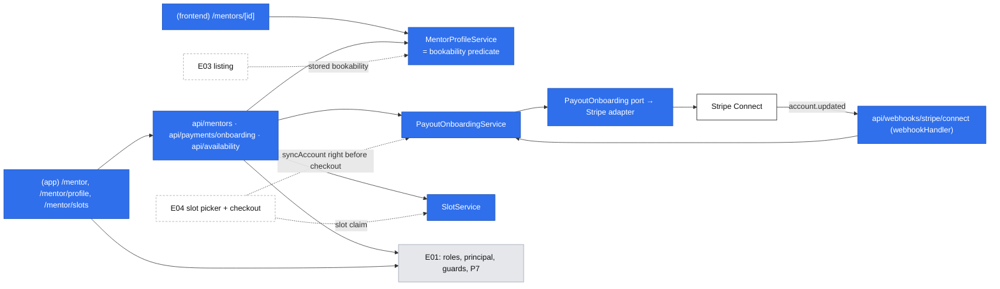
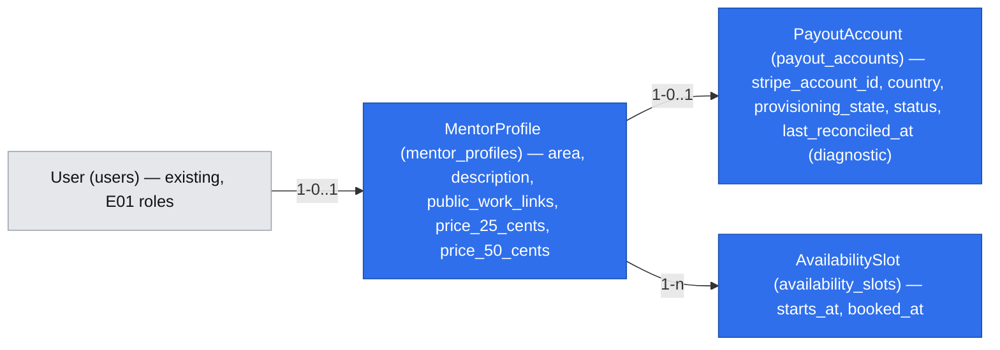

# E02 — Mentor setup: profile, prices, Stripe onboarding and slots

- Epic: #29 (E02) · Stories: #37 (E02-S01), #38 (E02-S02), #39 (E02-S03) · Task: #47 (E02-S02-T01)
- Depends on: E01 [`2026-10-17-accounts-and-roles.md`](./implemented/2026-10-17-accounts-and-roles.md) (the `mentor` role, sessions, page guards, `(app)` area). Platform catalog [`2026-10-17-platform-primitives.md`](./2026-10-17-platform-primitives.md) is cited as "platform P*n*/F*n*". **This spec holds the final contracts for P5 (`assertOwner`), P13 (onboarding half) and P17, and builds P14's signature-only `webhookHandler` wrapper.** P14's inbox (event-ID deduplication) stays provisional for E04. The catalog keeps only status and a pointer here, changed in the same PR.
- Design authority: `.ai/specs/product-brief.md` (D03–D06, D12, D16, R01, N01, N02)
- Research: one shared pass for the three stories and #47 (section "Research"). It is #47's deliverable.
- Grey prototype (mentor onboarding, source of the questions at the end): `.ai/prototypes/discovery/mentor-onboarding/revision-002/`
- Status: **draft for review** (gate answered by the PO 2026-10-18; joint E01/E02 review revised the same day; grilling decisions G1–G12 applied 2026-10-18; implementation and the real Stripe test-mode run remain outstanding)

## 📝 TLDR

**Today:** an invited mentor (E01) holds the `mentor` role and can do nothing with it. There is no profile, no price, no payout account and no schedule, so nobody can find or pay them.

**Proposed (future behavior):**

- A mentor works from one setup page, **Mentor setup** (`/mentor`). It is a checklist (profile, payouts with Stripe, slots) with a single "bookable / not bookable yet" line on top.
- **Profile first.** It holds one area, links to public work, a plain description and a USD price for each of the two formats. Saving it publishes the public page `/mentors/<id>`, which never shows ratings.
- **Then Stripe, then slots** (Phases 2 and 3).
  - Stripe: the mentor picks their country, finishes Stripe's hosted onboarding, and comes back to a plain status message.
  - Slots: the mentor publishes concrete start times and can withdraw any that are not booked.
- **Bookable** means the profile is saved and the provisioned Stripe account is ready (D05, MD7). Stored state drives the setup page and the listing; fresh Stripe fetches keep it up to date (MD9).

Listing (E03), slot picking and payment (E04) read what this spec stores; they are not built here.

**Identifier legend.** `MD` is a decision in this spec and `G` a grilling decision that amends it. `accounts.AD` and `platform.P`/`F`/`PD` point to the E01 specs. Brief `D`, `N`, `R`, `A` and zero-padded `Q` mean decision, non-goal, business rule, assumption and question. `gate.Q1` is a question from this spec's gate, recorded in the decisions table.

## 📝 Decisions

The PO answered the gate on 2026-10-18 (gate.Q0–Q7) and accepted the proposed defaults and the Stripe findings. The rows below are spec-level ids.

**Review revision, 2026-10-18 (PO instructed).** This revision superseded the earlier timestamp ordering guard and account prefill. There is no revision column or conditional status ordering. Provisioning recovery is explicit; metadata links a Stripe account to the one existing local row. The PO retains the price bounds and country list, accepts a 1-character description minimum, and removes the upper slot horizon.

| Id | Decision | Why |
|---|---|---|
| MD1 | **A slot is a start time only.**<br>• It reserves a fixed 50-minute block of the mentor's time.<br>• The mentee picks 25 or 50 minutes at booking (E04).<br>• One slot gives one booking, whichever length is picked.<br>**PO reading of #39 AC 1** ("a start time and format"): the formats come from the profile's two prices, not from the slot. (gate.Q1 a) | It matches D10 and #41 ("the mentee selects the duration") and keeps one input per slot. Recorded under Risks as a PO decision, so a reviewer does not flag the AC wording. |
| MD2 | **The platform Stripe account is in the United States. Every price is in USD.** There is no per-mentor currency.<br>• A mentor enters whole dollars, **$5–$1,000** per session; the PO confirmed these bounds during review.<br>• The price is stored as integer cents.<br>• No currency column is stored; the money type carries the constant `"USD"` (platform P17, final below). (gate.Q2 c) | One currency means no conversion at checkout and no currency field. $5 sits above Stripe's $0.50 minimum, and $1,000 catches typos. Changing the bounds is one constant. |
| MD3 | **Exactly one area per mentor:** `typescript`, `react` or `python`. (gate.Q3 a) | #37 AC 1, and E03's filter stays a simple equality. |
| MD4 | **A saved profile is public at its direct link before the mentor is bookable.** The page says "Not taking bookings yet" and offers no booking. The E03 listing shows bookable mentors only. (gate.Q4 a) | #40 AC 4 already expects this. A mentor can check their page while onboarding. |
| MD5 | **The public URL is `/mentors/<profile id>`** (uuid). No slug. (gate.Q5 a) | Nothing to reserve, validate or rename. |
| MD6 | **Store instants as UTC `timestamptz`.**<br>• The mentor enters times in their browser's time zone.<br>• Every viewer sees times in their own browser's zone, with that zone named.<br>• There is no time-zone field. (gate.Q6 a) | The smallest model that is correct for a handful of times a few weeks ahead. Recurring rules would need a stored zone; there are none. |
| MD7 | **D05 stays strict (gate.Q7 a).** Stripe-hosted onboarding collects identity and a bank account up front as our policy; configure **Require at least one bank account** in Stripe.<br>A mentor is **bookable** only when the user holds `mentor`, a profile exists, provisioning is `provisioned`, and payout `status = ready` (`transfers` active, `payouts_enabled`, empty `requirements.past_due`). | `return_url` proves nothing, so the status comes from a fresh account fetch (MD9). A mentor who refuses bank details is lost, as D05 accepts. |
| MD8 | **Stripe setup:**<br>• Controller properties: Express dashboard; the platform bears losses and pays Stripe fees; Stripe collects requirements.<br>• Request only `transfers`; omit `tos_acceptance`, whose documented default is the `full` agreement.<br>• **No prefill.** The creation payload contains only stored country, fixed controller properties, `transfers` and local-ID metadata; the idempotency key is derived from the local payout row.<br>• Hosted Account Links use `collection_options.fields = eventually_due`.<br>• The PO accepts the country limit: US, UK, EEA, Canada or Switzerland.<br>• Accounts API v1, `stripe@23`, pinned `2026-09-30.endive`. | A US platform supports these self-serve Connect cross-border regions with the chosen funds flow; `recipient` agreements are not supported for that flow. v1 is the bounded implementation choice. The account holder enters their details on Stripe. |
| MD9 | **Every synchronization fetches Stripe afresh:** return, **Check status**, webhook and immediately after binding an account ID. Each successful write stores that snapshot unconditionally and sets the diagnostic column `last_reconciled_at`. There is no ordering condition or revision column, so concurrent snapshots land in completion order and the next sync corrects display state. **E04 re-fetches the account with `syncAccount` right before creating a checkout.** | Re-reading Stripe replaces event-ordering logic. `last_reconciled_at` helps diagnosis and is never a write condition or authorization input. |
| MD10 | **Profile before Stripe and slots.** Stripe onboarding and slot publishing require a saved profile; the setup page locks both items until it exists. | Both payout and slot rows belong to the saved profile. No profile content or email is prefilled into Stripe account creation. |
| MD11 | **Slot rules.** All are checked on the server:<br>• the start is at least 2 hours after now, with no product-imposed upper horizon<br>• the start is a whole minute<br>• the start is not within 50 minutes of another of the mentor's slots<br>• a slot is removable only while not booked<br>• the booked state is a nullable `booked_at` column that E04 sets atomically | The lead time follows D16. `booked_at` gives E04 a race-safe one-slot claim and lets this spec refuse removal of booked slots before bookings exist. |
| MD12 | **Provisioning and payout readiness are separate.** Provisioning is `pending`, `provisioned`, `reconciliation_required` or `failed`. Commit the local row before any Stripe call. Creation errors are classified (G9). **A retry always lists connected accounts first** (G8): one metadata match attaches; a **complete zero-match listing permits the retry to create**, using the same row and retained idempotency key after committing `pending`. | Zero matches is ordinary automated recovery, not an operator case. Partial/failed listings never count as zero. Multiple matches, conflicting IDs or mismatched metadata fail closed; log safe IDs for manual Stripe Dashboard/database reconciliation (D12), with no new command. |

**Grilling, 2026-10-18 (PO answers).**

| Id | Decision | Changes |
|---|---|---|
| G1 | MD12 is retained: local row first, four provisioning states, metadata reconciliation, and a complete zero-match listing lets the retry create with the same row and key. | none |
| G2 | The `account.updated` webhook re-fetches the account. A known account is overwritten with the fresh snapshot. An account ID not yet stored attaches through the trusted metadata (MD12); if that cannot be resolved, or conflicts, the delivery answers 500 so Stripe retries, never 200-and-ignore. There is no inbox table: repeating a fetch-and-overwrite gives the same result, which satisfies #38 AC 4. P14's inbox returns to provisional and E04 finalizes it. | Flow 3 step 8, data model, P14 |
| G3 | Four payout statuses: `ready`, `pending`, `incomplete`, `blocked`. A ready mentor gets no extra Stripe action. | payout mapping, Flow 1, Flow 3, data model |
| G4 | `last_reconciled_at` stays as a diagnostic column. One sentence (MD9) says E04 re-fetches with `syncAccount` right before creating a checkout. The `freshPayout` parameter and the repeated money-safety paragraphs are removed. | MD9, Architecture, Risks |
| G5 | Phases ship in a fixed order, 1 → 2 → 3. Each phase renders only the checklist items it ships; there are no *Coming soon* states. | Flow 1, Phasing |
| G6 | Phase 2 acceptance includes one manual Stripe test-mode run with one US and one PL individual, recorded in the run log. | Research, Phase 2 step 9 |
| G7 | Phases 1 and 3 stay as written. | none |
| G8 | Recovery of a `pending` or `reconciliation_required` row always starts with the complete metadata listing. There is no replay-safety branch and no reasoning about key-retention windows. | MD12, Flow 3 step 3 |
| G9 | Creation errors: `StripeInvalidRequestError` (a 4xx other than 409/429) → `failed`; `idempotency_key_in_use` → 409, row unchanged; everything else (timeout, connection error, 5xx, 429, unknown) → `reconciliation_required`. | MD12, Flow 3 step 2, P13 |
| G10 | E02 builds a minimal `webhookHandler` (raw body, no CSRF or session, `parse` → 400, `prepare` outside a transaction, `apply` inside one, any throw → logged 500) with no deduplication step. E04 adds the inbox insert to the same wrapper when it finalizes P14. | Architecture, P14 contract |
| G11 | Each rule is stated once, in its decision row or flow step. | whole spec |
| G12 | The Phase 2 test matrix covers only the remaining cases (Implementation Plan, Phase 2). | Phase 2 steps 2, 4, 8 |

## 📝 Problem Statement

- **Nobody can find or pay a mentor until the mentor is set up** (epic #29).
  - E03's listing shows only bookable mentors.
  - E04's checkout needs a price and a connected Stripe account.
  - E04's slot picker needs published slots.
- **D05 puts Stripe before bookability.** One interviewed mentor refused bank details before a first booking, and the PO accepts losing such mentors. The same mentor asked for "setup under twenty minutes" (`2026-09-03-interview-senior-python-meetups.md`), so the flow must stay short. Stripe's verification itself takes from minutes to a few business days, which this spec cannot shorten.
- **N02:** public work and a plain description replace ratings.
- **D06:** the mentor sets a price per format (R01: 25 and 50 minutes). The 20% commission is applied at payment (E04).
- **D03/D16:** a mentee picks a published slot that starts at least two hours after selection.

## 📝 Proposed Solution — the mentor's flows

Each story is a user flow, not a CRUD screen. All mentor pages are in the signed-in area (`(app)`, shadcn, platform PD2). They require `requireRole("mentor")`; any other account gets 404. The public profile is in `(frontend)` (Tailwind).

### Flow 1: first setup (all three stories)

1. The invitee accepts the invitation (accounts Flow 3). When E02 Phase 1 ships, full browser navigation changes from E01's `/` fallback to `/mentor`. The matching amendments to accounts Flow 3, its header/tests, and platform P1/P5/P13/P14/P17 land in this same change. Both personalized headers gain **Mentor setup** for accounts with `mentor`; `/error` keeps its identity-free header.
2. `/mentor` shows a status line and one item per shipped phase (G5). Each item has a state and exactly one next action:

   | Item (phase) | States → action |
   |---|---|
   | 1. Profile (1) | *Not started* → **Create your profile**; *Saved* → **Edit profile** + **View public page** |
   | 2. Payouts with Stripe (2) | *Locked* ("Save your profile first"); no row → country + **Continue to Stripe**; provisioning `pending` → *Starting Stripe setup* + **Retry setup**; `reconciliation_required` → *We need to check an earlier setup attempt* + **Retry setup**; `failed` → **Contact the DevMentor team**. Once `provisioned`: *Incomplete* → **Continue with Stripe**; *Stripe is checking your details* → **Check status**; *Blocked* → **Contact the DevMentor team**; *Confirmed* (no action) |
   | 3. Slots (3) | *Locked* ("Save your profile first"); *No upcoming slots* → **Publish slots**; *N upcoming (M booked)* → **Manage slots** |

   The status line reads one of:
   - **"You are bookable."**, plus the public link with a copy button.
   - **"Not bookable yet: finish your profile and Stripe."** It names only the missing items.
   - **"You are bookable, but you have no upcoming slots, so mentees have nothing to pick."** This is shown when bookable with zero open future slots (from Phase 3).
   - In Phase 1, before item 2 exists, the line is always **"Not bookable yet."**

3. The page is computed on every request from stored state (`MentorSetupDto`). No "setup complete" flag is stored. Reloading it does not call Stripe.

### Flow 2: publish the profile (#37)

1. **Create your profile** opens `/mentor/profile`, a `CrudForm` that gains two additive field kinds (`textarea`, `select`). The fields:

   | Field | Input | Rule (`mentorProfileSchema`) |
   |---|---|---|
   | Area | select: TypeScript, React, Python | one of `typescript \| react \| python` (MD3) |
   | Description | textarea, plain text | 1–2,000 characters after trim; shown as plain text with line breaks, never as Markdown or HTML |
   | Links to public work | textarea, one URL per line | 1–5 lines after dropping blank lines. Each must parse as an absolute `https:` URL of at most 2,048 characters, and there are no duplicates. An error names the line ("Line 2: use a full https:// link") |
   | Price for 25 minutes (USD) | number | whole dollars, 5–1,000 (MD2) |
   | Price for 50 minutes (USD) | number | whole dollars, 5–1,000. Not constrained against the 25-minute price |

   The display name is not a profile field. The public page shows the account's display name (accounts: `users.name`), which the mentor edits on `/account`.
2. **Save** calls `PUT /api/mentors/profile`. The first save creates the profile; later saves replace it. On success, a full navigation goes to `/mentor`, where the checklist advances and **View public page** appears. Errors stay on the form, per field (#37 AC 3).
3. A changed price applies to future bookings only. E04 snapshots the price at booking (accepted default).
4. **The public page** `/mentors/<id>` shows:
   - the display name, an area badge, the description and the links (hostname plus path, opened in a new tab with `rel="nofollow noopener ugc"`)
   - "25 min · $40" and "50 min · $70"
   - "Text sessions only" (N01)
   - **no ratings or reviews** (#37 AC 4, N02)
   - "Not taking bookings yet" while the mentor is not bookable (MD4)

   An id with no profile, or whose user no longer holds `mentor`, returns 404. E03 later adds slots and the listing to this page; E04 adds booking.

### Flow 3: Stripe onboarding round trip (#38, #47)

1. **Pick a country.** Item 2 offers MD8's accepted list and the hint "Where you reside, or where your business is legally established. You can't change this Stripe account's country later." **Continue to Stripe** calls `POST /api/payments/onboarding { country }`. After the local row exists its stored country is read-only; later requests cannot change it.
2. **Provision the account.** `PayoutOnboardingService.start(principal, country)`:
   - Insert one `payout_accounts` row with `INSERT … ON CONFLICT (mentor_profile_id) DO NOTHING`. A new row has `provisioning_state = pending`, `stripe_account_id = null`, payout `status = incomplete` and `last_reconciled_at = null`. **Commit before calling Stripe.** Only the request that inserted the row initiates its first creation; an existing unresolved row follows step 3. Concurrent clicks reuse that row, never insert a replacement.
   - `createAccount` sends only this stable payload, with `Idempotency-Key: payout-account-<local row id>` in the request options:
     ```ts
     {
       country: row.country,
       controller: {
         stripe_dashboard: { type: "express" },
         losses: { payments: "application" },
         fees: { payer: "application" },
         requirement_collection: "stripe"
       },
       capabilities: { transfers: { requested: true } },
       metadata: { payout_account_id: row.id, mentor_profile_id: row.mentorProfileId }
     }
     ```
     There is no email, business profile, product description, identity prefill or `APP_URL`-derived creation parameter. Omitted `tos_acceptance` defaults to `full`; verify that agreement in Phase 2's test-mode run. Keep these fixed parameters unchanged during recovery of the same row.
   - **Success** binds the account ID to the existing row in a short transaction under a row lock and sets `provisioning_state = provisioned`; a first binding keeps the default payout `incomplete`. If a webhook already attached that same ID, that is success and its stored payout state is kept; a different ID is an operator conflict, never an overwrite. **Immediately after binding, call `syncAccount`.** A fetch failure leaves the binding and any stored payout state intact, and **Check status** retries it without another create. Failure to persist the binding leaves the row unresolved for step 3.
   - **Errors** follow G9: an invalid request sets `failed` (409 with operator contact); `idempotency_key_in_use` answers 409 "Stripe onboarding is already starting. Try again in a moment" and leaves the row as it is; everything else sets `reconciliation_required` (502). Each transition rechecks the locked row, so an error never downgrades a row another request or webhook already provisioned.
3. **Recover an interrupted attempt** (G8). **Retry setup** posts to the same endpoint with the stored country. A `pending` row (including a process crash before the first Stripe call) or a `reconciliation_required` row never creates unconditionally:
   - **List connected accounts** through the platform's Stripe API and inspect **all pages** for the exact pair of metadata IDs. No metadata search/filter API is assumed.
   - **Exactly one match** → validate country and that it is not bound to another local row, attach it under the step 2 lock and checks, then call `syncAccount`.
   - **Zero matches after a complete listing** → lock the row and recheck its country, state and binding. If another request or webhook bound an account meanwhile, reuse it. Otherwise set `pending`, **commit**, and run step 2's creation with the **same retained key and metadata**. A cached failure for that key, or another ambiguous outcome, returns the row to `reconciliation_required`; a key still in flight answers 409.
   - **A partial or failed listing** never counts as zero or one: the row stays unresolved and the request answers 502.
   - **More than one match, conflicting IDs or mismatched metadata/country** → fail closed, keep `reconciliation_required`, log safe local/account IDs, and the operator reconciles **by hand in the Stripe Dashboard and database** (D12). No account is chosen arbitrarily and no operator command is added.
   - A `failed` row requires the operator to correct its cause; a manual database correction to `reconciliation_required` returns it to this recovery path. The product never deletes the row to mint another key.
4. **Create the onboarding link.** Only a `provisioned` row may proceed; payout `blocked` is refused with 409 and the contact message. Otherwise mint an Account Link with `return_url = /api/payments/onboarding/return`, `refresh_url = /api/payments/onboarding/refresh` and `collection_options.fields = eventually_due`. Check its origin against `config.stripe().onboardingOrigin`, return `{ url }`, then `window.location.assign(url)`. Express accounts cannot use `account_update` links.
5. **At Stripe.** The mentor enters the required business, identity and bank details. The platform's **Require at least one bank account** Dashboard setting is a prerequisite; a payout-capable debit card alone does not satisfy our policy.
6. **Return and Check status.** `GET /api/payments/onboarding/return` is a P7 navigation route guarded by `mentor`. It calls `syncAccount` for the principal's provisioned account and redirects to `/mentor?stripe=returned`. It never trusts query parameters as evidence of completion.

   | Payout status | Banner / action |
   |---|---|
   | `ready` | "Stripe confirmed your account." (+ "You are bookable" when MD7 holds) |
   | `pending` | "Stripe is checking your details. This can take a few minutes to a few business days." **Check status** |
   | `incomplete` | "Stripe onboarding isn't finished. Continue where you left off." **Continue with Stripe** |
   | `blocked` | "Stripe can't enable payouts for this account. Contact the DevMentor team." |

   **Check status** and **Try checking again** link to this same route, causing a new Stripe fetch. On a provider error it redirects to `/mentor?stripe=check_failed`: "We couldn't reach Stripe to check your status. Try checking again." With no provisioned account, return redirects to `/mentor`, where **Retry setup** runs step 3.

   After a 502/409 from the POST, the page re-reads setup state, keeps the error message and offers recovery from the committed state: `provisioned` → **Check status**; unresolved → **Retry setup**; `failed` → operator contact.
7. **Refresh.** `GET /api/payments/onboarding/refresh` follows step 4's eligibility and mints a new link after expiry/reuse/preview. It uses P7 `externalOrigins: (cradle) => [cradle.config.stripe().onboardingOrigin]` and redirects 303. With no provisioned account, or payout `blocked`, it redirects to `/mentor`. It never creates an account.
8. **Webhook** (G2, G10). `POST /api/webhooks/stripe/connect` uses `webhookHandler`, without CSRF or session resolution:
   - Verify `Stripe-Signature` against the raw body with the Connect endpoint secret. Event types other than `account.updated` answer 200 with no effect.
   - `prepare` fetches the account **by the authenticated event's account ID** through the platform's Stripe client. Only the returned metadata is trusted; never a browser-supplied account ID or unverified payload metadata.
   - `apply`, in one transaction: a **known account** has its row locked and the fresh snapshot written with `last_reconciled_at`. An **account ID not yet stored** must have `payout_account_id` and `mentor_profile_id` metadata identifying exactly one existing local row and its profile; lock it, recheck both IDs, country and any existing binding, attach it as `provisioned` and store the snapshot. Never insert another local row.
   - Missing metadata, a nonexistent/mismatched row or profile, a country conflict, another bound account or a uniqueness conflict throw: nothing commits, the delivery answers 500 and Stripe retries. Log safe IDs, never the raw payload or identity/bank details.
   - A repeated delivery repeats the same fetch-and-overwrite (and finds the same binding), so the stored state stays correct (#38 AC 4).
9. **Regression and abandonment.** A sync that sees a restriction removes displayed bookability, with **Continue with Stripe** for missing requirements or operator contact for `blocked`. Booked slots are untouched (D12). Leaving onboarding unfinished does not lose the provisioned account: `incomplete` offers continuation, and `pending` offers **Check status**.

**Payout status mapping** (G3). A pure Stripe-adapter function returns the first match:

1. `requirements.disabled_reason` starts with `rejected` → `blocked`.
2. `capabilities.transfers = active`, `payouts_enabled` and `requirements.past_due` empty → `ready` (currently due items may still be completed before their deadline).
3. `details_submitted = false`, or `requirements.past_due` / `currently_due` non-empty → `incomplete`.
4. Disabled reason `requirements.pending_verification`, `under_review` or `listed`, or non-empty `requirements.pending_verification` → `pending`.
5. Otherwise → `blocked`: absence of readiness is not evidence that verification is in progress.

Provisioning state is mapped separately and takes precedence over payout status in the setup UI. A non-provisioned row is never bookable.

### Flow 4: publish and withdraw slots (#39)

1. **Publish slots** opens `/mentor/slots`. It has two parts:
   - **Upcoming slots.** These are slots starting after now, oldest first. Each row shows the start in the viewer's time zone, the time zone name, "Reserves 50 minutes; the mentee picks 25 or 50", and a state: *Open* or *Booked*.
   - **Add a slot.** One `datetime-local` input, labelled "Start time (your time zone: Europe/Warsaw)" with the browser's zone name, and **Publish slot**.
2. **Publish.** The form converts the local value to an ISO instant in the browser and calls `POST /api/availability/slots { startsAt }`. The server applies MD11 and answers with a reason per case:

   | Case | Response |
   |---|---|
   | Starts less than 2 hours from now, including the past (#39 AC 3) | 400 `startsAt`: "Pick a time at least 2 hours from now. Mentees need 2 hours' notice." |
   | Within 50 minutes of another of your slots (#39 AC 3) | 409 `conflict` whose message names the other slot's ISO UTC start: "This overlaps your slot at <ISO start>. Each slot reserves 50 minutes." The zone is explicit and the existing envelope is unchanged. |
   | Valid | 201 `SlotDto`. The row appears in the list and the form keeps its date for the next entry. |

   The check and the insert run in one transaction that first locks the mentor's profile row (`FOR UPDATE`), so two concurrent publishes cannot both pass the overlap check. A unique `(mentor_profile_id, starts_at)` index is the backstop.
3. **Withdraw** (#39 AC 2). **Remove** sits on *Open* rows and opens a shadcn `alert-dialog` confirmation. It calls `DELETE /api/availability/slots?id=<uuid>`:
   - The server loads the slot with its profile's `user_id` and checks ownership with platform.P5 `assertOwner`; a foreign or unknown id gets 404.
   - It then runs a conditional `DELETE … WHERE id = ? AND booked_at IS NULL`.
   - Zero rows deleted means the slot was booked in the meantime: 409 "This slot is booked. To cancel, the mentee or you contact the DevMentor team by email." (#39 AC 4, D12).
   - *Booked* rows show that sentence instead of a button.
4. **Past slots** drop out of the list. They are never offered (D16), and nothing cleans them up.

## 📝 Research

This is the single shared pass for #37, #38, #39 and #47, checked 2026-10-18. **Documentation-verified only: no real Stripe test-mode onboarding run has been performed.** The CI stub is an application test double, not evidence of Stripe behavior. Scheduler claims come from Cal.com `main` (code read) and vendor help pages; the Stripe sources and the outstanding test-mode run are below.

| Leader / source | What we adopt | Complexity we skip |
|---|---|---|
| **Cal.com** (open source) | Several lengths on one event type: the booker picks the duration. `minimumBookingNotice` defaults to 120 minutes, the same as D16. Overlaps are a half-open interval test. Instants are stored in UTC. | Weekly schedules, date overrides, buffers, slot intervals, seats, calendar sync, per-user time-zone fields. Its overlap check is in application code with no DB guard; we lock the profile row plus a unique index instead. |
| **Calendly, Topmate, MentorCruise, Codementor, Easy!Appointments** | Several durations on one event, shown in the viewer's zone (Calendly). The expert sets the price on one shareable page (Topmate; our MD4/MD5). Only verifiable information, with a complete profile as the gate to traffic (MentorCruise; N02, MD10). Codementor's rate range informed MD2's bounds. | Weekly plans plus exceptions (the industry default; we store concrete times, which a weekly rule could generate later), vanity slugs, calendar sync, skills lists, video, subscriptions. |
| **Stripe Connect** (marketplace guide, Account Links, webhooks) | MD7–MD9: controller properties (Express dashboard, platform liability and fees); `transfers` only; destination charges (E04); hosted Account Links, where `refresh_url` mints a new link and `return_url` proves nothing; `account.updated` on a Connect endpoint; re-fetch the account on every event, which makes repeated deliveries harmless. | Embedded onboarding components, Accounts v2, Custom accounts, our own KYC UI, event ordering logic, an event-ID inbox (E04). |

### #47 — Stripe onboarding requirements (the task's deliverable)

- **Account type.** Use Express-style accounts set through controller properties:
  - `controller.stripe_dashboard.type = express`
  - `controller.losses.payments = application`
  - `controller.fees.payer = application`
  - only `capabilities.transfers`
  - omit `tos_acceptance` to use its documented `full` default; no prefill, and only the stable MD8 payload plus local-ID metadata

  Stripe calls Standard/Express/Custom legacy names. Standard accounts support only direct charges. Custom accounts have no Stripe Dashboard and would add account-management/support responsibilities; they can still use Stripe-hosted onboarding.
- **Countries.** A US platform transfers and pays out self-serve only to accounts in the US, UK, EEA, Canada and Switzerland. Other countries need Stripe sales or Global Payouts. `recipient` agreements do not support the selected self-serve Connect cross-border flow; Global Payouts is a separate integration. The account country is set at creation and cannot change.
- **What a mentor provides.** These are documentation examples for a US platform, v1, Express dashboard, `full` agreement, an individual and `transfers` only. Our policy collects `eventually_due` up front; the account holder enters it at Stripe because creation has no prefill. Requirements vary by business type and may change:

  | Mentor | Provides |
  |---|---|
  | Individual in PL or GB | name, date of birth, address, phone, business URL, terms acceptance, bank account; PL also nationality |
  | Individual in the US | name, business URL, terms acceptance, bank account; date of birth and SSN last 4 (eventually due) |

  ID document checks take "a few minutes to a few business days" (Stripe).
- **Bookable predicate.** A provisioned account with `transfers` active, `payouts_enabled` and empty `past_due` (MD7). Requirements can disable functionality at their deadline; payout suspension is typical, not a universal ordering guarantee.
- **Inputs for E04's spec (recorded, not designed here).**
  - Destination charges in USD with a 20% platform fee and no `on_behalf_of`; Stripe converts the transferred part into a non-US mentor's currency. `application_fee_amount` lands the fee in the mentor's currency; `transfer_data.amount` keeps it in USD.
  - Minimum charge $0.50. Card, conversion and Connect fees apply; exact Express pricing is unverified.
  - Refunds and disputes live on the platform account. A refund without `reverse_transfer` leaves the mentor's share with the mentor, a reversal fails if the mentor's balance can't cover it, and Stripe's processing fee is not returned. These rules belong in E04's operator runbook.
- **Testing.**
  - Test-mode onboarding uses Stripe's documented values: SMS `000-000`, US routing `110000000` with account `000123456789`, SSN `000000000`, PL IBAN `PL61109010140000071219812874`. `111111111` produces a failing identity.
  - `stripe-mock` is stateless, and the Stripe CLI needs network, so CI uses our own HTTP stub. stripe-node supports `host`, `port` and `protocol`, and `webhooks.generateTestHeaderString` signs events.
- **SDK.** `stripe@23.0.0`, ESM, pinned to API version `2026-09-30.endive`.

**Impact on D05, brought to the PO with this spec.**
- D05 holds unchanged in substance (gate.Q7 a).
- Onboarding completion is defined by the account's status, not by the mentor's return, and it is re-checked over time.
- Collecting identity fields and bank details up front is **our chosen policy**, not a universal Stripe limitation. Stripe also supports incremental collection; hosted external-account opt-out exists for configurations where the platform collects requirements, which does not prove it is available for this Express/Stripe-collected configuration. Keep `eventually_due` and enable **Require at least one bank account** for this product.
- New consequence: mentors outside the US, UK, EEA, Canada and Switzerland cannot onboard. That narrows A04 by an unknown amount, since the 50-name list records no countries.

**Primary Stripe sources (checked 2026-10-18):**
- [Account creation](https://docs.stripe.com/api/accounts/create): stable controller/capability/metadata payload, optional prefill, and omitted `tos_acceptance` defaulting to `full`.
- [Idempotent requests](https://docs.stripe.com/api/idempotent_requests): matching parameters, cached failures as well as successes, and key retention of at least 24 hours; [list connected accounts](https://docs.stripe.com/api/accounts/list): paginate before concluding how many metadata matches exist.
- [Hosted onboarding](https://docs.stripe.com/connect/hosted-onboarding) and [external payout accounts](https://docs.stripe.com/connect/payouts-bank-accounts): Account Link behavior, incremental/upfront collection, Express update-link limits and the bank-account Dashboard setting.
- [Verification requirements](https://docs.stripe.com/connect/required-verification-information), [verification states](https://docs.stripe.com/connect/handling-api-verification), [cross-border payouts](https://docs.stripe.com/connect/cross-border-payouts), [destination charges](https://docs.stripe.com/connect/destination-charges?platform=web&ui=stripe-hosted), [Connect testing](https://docs.stripe.com/connect/testing) and the [stable v2 Account Links reference](https://docs.stripe.com/api/v2/core/account-links/create).

**#47 completion and evidence.** This Research section is the documentation deliverable and may close #47 when merged, explicitly labelled documentation-verified. **Phase 2 acceptance additionally requires one manual Stripe test-mode run** (G6) with one US and one PL individual: complete, abandon and resume, expired link, and a signed `account.updated` that makes the account ready; check the no-prefill payload, the `full` agreement and the bank-account requirement on the way. Record safe outcomes and mapping discrepancies in the run log; never store keys, raw webhook bodies, bank/identity data or Account Link URLs. Passing the stub does not satisfy this run.

**Unverified (carried as risks, not blockers to specification):**
- which side pays the 1% conversion fee on a cross-border transfer
- exact Express pricing
- whether the Dashboard refund screen exposes "reverse transfer"
- what Stripe does with balances that are never paid out
- whether US 1099 filing or W-8BEN collection applies to this platform, which needs a tax advisor (see Risks)

## 📝 Architecture

**Concepts and services.** Each service is one explicit line in `container.ts` and `cradle.ts`, TRANSIENT on the scoped `em`; adapters are SINGLETON.

| Concept folder | Service / port | Responsibility | Phase |
|---|---|---|---|
| `mentors` | `MentorProfileService` | `getOwn(principal)`, `save(principal, input) → MentorProfileDto` (upsert), `getPublic(profileId) → PublicMentorProfileDto` (404 rules of Flow 2), `getSetup(principal) → MentorSetupDto`, `isBookable(profileId)` on stored state. **The single definition of MD7.** | 1 (bookability completes in 2) |
| `payments` | `PayoutOnboarding` port (`payout-onboarding.port.ts`) | Platform.P13 onboarding half, final contract below. | 2 |
| `payments` | `adapters/stripe-payout-onboarding.ts`, `adapters/mock-payout-onboarding.ts` | Stripe SDK adapter (status mapping, error classification, signature verification); in-memory mock for unit tests. Only the adapter imports `stripe`. | 2 |
| `payments` | `PayoutOnboardingService` | `start(principal, country) → { url }` (including provisioning recovery), `refreshLink(principal) → URL`, `syncFromReturn(principal)`, `syncAccount(mentorProfileId) → PayoutAccountSnapshot`, `fetchAccount(stripeAccountId)` + `attachAndStore(em, snapshot)` (webhook prepare/apply). | 2 |
| `availability` | `SlotService` | `listUpcoming(principal) → SlotDto[]`, `publish(principal, startsAt) → SlotDto`, `withdraw(principal, slotId)`. | 3 |

**Routes.** Each goes through `@/server/http` or `@/server/webhooks`, with no own `try/catch`.

| Route | Kind | Access |
|---|---|---|
| `api/mentors/profile/route.ts` (PUT) | `apiHandler` | `{ role: "mentor" }` |
| `api/payments/onboarding/route.ts` (POST) | `apiHandler` | `{ role: "mentor" }` |
| `api/payments/onboarding/return/route.ts` (GET) | `navigationHandler` | `{ role: "mentor" }` |
| `api/payments/onboarding/refresh/route.ts` (GET) | `navigationHandler`, `externalOrigins: (cradle) => [cradle.config.stripe().onboardingOrigin]` | `{ role: "mentor" }` |
| `api/webhooks/stripe/connect/route.ts` (POST) | `webhookHandler` (G10) | signature only |
| `api/availability/slots/route.ts` (POST, DELETE) | `apiHandler` | `{ role: "mentor" }` |

Signed-out visitors to navigation routes are sent to sign-in with `returnTo=/mentor` (P7 `onError`).

**Pages.**

| Page | Area | Guard |
|---|---|---|
| `(app)/mentor/page.tsx` | signed-in | `requireRole("mentor")` |
| `(app)/mentor/profile/page.tsx` | signed-in | `requireRole("mentor")` |
| `(app)/mentor/slots/page.tsx` | signed-in | `requireRole("mentor")` |
| `(frontend)/mentors/[id]/page.tsx` | public | `getPrincipal()` (activity) + `connection()` |



Takeaway: profile, provisioning, payout status and slots drive the setup UI. Stripe is reached only through the port, and every sync re-reads the account from Stripe.

## 📝 Data Model

Every table spreads `baseProperties`. Each phase ships one migration with a working `down()` and a migration test one directory above `src/migrations/`. Entities are listed in `entities/index.ts`.

**`mentor_profiles`** (Phase 1, `entities/mentors/mentor-profile.entity.ts`):

| Column | Type | Notes |
|---|---|---|
| `user_id` | FK `users`, unique, on delete cascade | One profile per mentor account. |
| `area` | enum `typescript \| react \| python`, check constraint | MD3 |
| `description` | `text` | 1–2,000 characters after trim (schema); plain text. |
| `public_work_links` | `text[]` | 1–5 https URLs (schema). Order kept as entered. |
| `price_25_cents` | `integer`, check `> 0` | USD cents (MD2); schema bounds 500–100,000. |
| `price_50_cents` | `integer`, check `> 0` | Same. |

**`payout_accounts`** (Phase 2, `entities/payments/payout-account.entity.ts`):

| Column | Type | Notes |
|---|---|---|
| `mentor_profile_id` | FK `mentor_profiles`, unique, on delete restrict | One Stripe account per mentor. |
| `stripe_account_id` | `varchar(64)`, null, unique | `acct_…`; attached only through validated provisioning/reconciliation. Not shown in the UI. |
| `country` | `char(2)` | ISO 3166-1 alpha-2 from MD8's list; fixed when the row is created. |
| `provisioning_state` | enum `pending \| provisioned \| reconciliation_required \| failed`, check constraint, default `pending` | A check constraint enforces that a row is `provisioned` exactly when `stripe_account_id` is set. |
| `status` | enum `incomplete \| pending \| ready \| blocked`, check constraint, default `incomplete` | Payout readiness mapped by the adapter (G3). It never overrides a non-provisioned state. |
| `last_reconciled_at` | `timestamptz`, null | When the last successful sync was stored. Diagnostic only (MD9). |

The row's `id` and `mentor_profile_id` are mirrored in Stripe metadata as `payout_account_id` and `mentor_profile_id`; metadata is not a new relationship or a replacement row. Reconciliation failures are logged safely and never create a duplicate row.

**`availability_slots`** (Phase 3, `entities/availability/availability-slot.entity.ts`):

| Column | Type | Notes |
|---|---|---|
| `mentor_profile_id` | FK `mentor_profiles`, on delete restrict | |
| `starts_at` | `timestamptz` | UTC (MD6); unique with `mentor_profile_id`; indexed with it for the upcoming list and the overlap check. |
| `booked_at` | `timestamptz`, null | Set only by E04's atomic claim (`UPDATE … SET booked_at = now WHERE id = ? AND booked_at IS NULL`). This spec reads it and never writes it. |

The 50-minute block length is a constant in `core/src/validators/availability/` (`SLOT_BLOCK_MINUTES = 50`, the longest R01 format), not a column.

**Sensitive data.**
- No identity or bank data is stored; Stripe holds it.
- `stripe_account_id` and `country` are visible only to the owner (the country, read-only) and to operators through the DB.
- The public page exposes only what the mentor typed as public, plus their display name.
- Webhook secrets and the Stripe API key live only in env (P1), and are never logged.
- No mentor email goes to the public page.



Interactive view: `.ai/data-model/2026-10-18-mentor-setup.html`.

## 📝 API Contracts

Every JSON route uses the existing envelope. Schemas live in `core/src/validators/<concept>/` and are shared by the route and its form.

| Route | Request | Success | Failures |
|---|---|---|---|
| `PUT /api/mentors/profile` | `mentorProfileSchema` `{ area, description, publicWorkLinks: string /* one per line */, price25Dollars, price50Dollars }` | 200 `MentorProfileDto` | 400 field errors; 401; 403 non-mentor |
| `POST /api/payments/onboarding` | `onboardingStartSchema` `{ country: OnboardingCountry }` | 200 `{ url: string }` (Stripe origin only) | 400; 401; 403; 409 `conflict`: no profile ("Save your profile first"), provisioning `failed` or needing manual reconciliation, payout `blocked`, or key in use ("already starting"); 502 `provider_unavailable`: ambiguous creation or an incomplete/failed account listing. The page then re-reads setup state (Flow 3 step 6) |
| `GET /api/payments/onboarding/return` | — | 303 → `/mentor?stripe=returned` | 303 → `/mentor?stripe=check_failed` (Stripe error); `/mentor` without a provisioned account; sign-in with `returnTo=/mentor` (signed out); `/error` for non-mentors (P7 default) |
| `GET /api/payments/onboarding/refresh` | — | 303 → Stripe Account Link | 303 → `/mentor` (no provisioned account, or payout `blocked`) or `/mentor?stripe=check_failed` |
| `POST /api/webhooks/stripe/connect` | raw Stripe event + `Stripe-Signature` | 200 `{ received: true }` (account stored or attached; other event types ignored) | 400 bad signature; 500 on provider, metadata, binding or transaction failure, so Stripe retries |
| `POST /api/availability/slots` | `slotCreateSchema` `{ startsAt: ISO datetime with offset }` | 201 `SlotDto` | 400 `startsAt` (lead time, whole minute); 401; 403; 409 `conflict` (overlap, or no profile) |
| `DELETE /api/availability/slots?id=` | uuid | 200 `{ id }` | 404 unknown or foreign; 409 booked |

`provider_unavailable` (502) is a new `AppError` subclass in `core/src/http/errors.ts`. It is additive, so the envelope is unchanged.

```ts
type Area = "typescript" | "react" | "python";
type Money = { amountMinor: number; currency: "USD" };          // P17
type MentorProfileDto = { id: string; area: Area; description: string; publicWorkLinks: string[];
  prices: { 25: Money; 50: Money } };
type PublicMentorProfileDto = MentorProfileDto & { displayName: string; bookable: boolean };
type PayoutStatus = "not_started" | "incomplete" | "pending" | "ready" | "blocked";
type ProvisioningState = "pending" | "provisioned" | "reconciliation_required" | "failed";
type MentorSetupDto = {
  profile: MentorProfileDto | null;
  payout: { status: PayoutStatus; country: string | null; provisioningState: ProvisioningState | null }; // no row: not_started + null
  upcomingSlots: { open: number; booked: number };
  bookable: boolean;                                             // MD7
  publicUrl: string | null;
};
type SlotDto = { id: string; startsAt: string /* ISO UTC */; booked: boolean };
```

### Final primitive contracts (the platform catalog points here)

- **P5 access assertion.** `core/src/http/auth.ts`:
  ```ts
  assertOwner(principal: Principal, ownerUserId: string): void  // NotFoundError, conceals existence
  ```
  - Its current caller is `SlotService.withdraw`: a foreign slot ID gets 404 before the conditional delete. E02 needs only this ownership assertion; profile endpoints already scope by `principal.userId`.
  - The catalog's `assertSelf` is dropped: "me" endpoints act on `principal.userId` by construction.
  - `assertParticipant` stays provisional and passes to E05's spec.
- **P13 onboarding half.** `app/src/server/services/payments/payout-onboarding.port.ts`:
  ```ts
  type PayoutAccountSnapshot = {
    accountId: string;
    country: string;
    metadata: { payoutAccountId: string | null; mentorProfileId: string | null };
    status: Exclude<PayoutStatus, "not_started">;
  }; // adapter exposes no identity or bank data
  type AccountCreationResult =
    | { outcome: "provisioned"; accountId: string }
    | { outcome: "reconciliation_required" }  // timeout, connection, 5xx, 429, unknown
    | { outcome: "failed" };                  // StripeInvalidRequestError other than 409/429
  interface PayoutOnboarding {
    createAccount(input: {
      idempotencyKey: string; country: OnboardingCountry;
      payoutAccountId: string; mentorProfileId: string;
    }): Promise<AccountCreationResult>;
    // no prefill; idempotency_key_in_use throws ConflictError (409)
    findAccounts(input: { payoutAccountId: string; mentorProfileId: string }): Promise<PayoutAccountSnapshot[]>;
    // exhausts GET /v1/accounts pages and matches both metadata IDs exactly; throws on an incomplete listing
    createOnboardingLink(accountId: string, urls: { returnUrl: URL; refreshUrl: URL }): Promise<URL>;
    fetchAccount(accountId: string): Promise<PayoutAccountSnapshot>;
    parseWebhook(rawBody: string, signature: string | null): { id: string; type: string; accountId: string | null };
  }
  ```
  - `createAccount` returns a classified outcome so the service commits `provisioning_state` before returning its public error. A failed HTTP request does not roll back the committed local row.
  - `fetchAccount`, `findAccounts` and link failures map to `ProviderUnavailableError` (502). Only invalid webhook signatures/body map to `ValidationError` (400); configuration or internal verification failures are 500. Log only safe error categories and local/account IDs.
  - Service `syncAccount` fetches through this port, validates the binding, stores the snapshot (MD9) and returns it.
  - The checkout half (`PaymentGateway`) stays provisional for E04.
- **P14 webhook handler, without the inbox** (G10). `app/src/server/webhooks/webhook-handler.ts`:
  ```ts
  webhookHandler<E, D>({
    provider: string,
    parse: (cradle, rawBody: string, signature: string | null) => E & { id: string; type: string },  // throws ValidationError → 400
    prepare?: (cradle, event: E) => Promise<D>,                     // outside any transaction: external calls go here
    apply: (em, cradle, event: E, prepared: D) => Promise<void>,    // inside one em.transactional
  })
  ```
  The order: read the raw body (no CSRF check, no session); `parse` (invalid → 400; configuration/unexpected failures → logged 500); `prepare`; `apply` in one transaction; success → 200 `{ received: true }`; anything that throws → logged 500, nothing committed, the provider retries. There is no event-ID deduplication: E02's effect is a fetch-and-overwrite, so a repeat is harmless. E04 adds the inbox insert (`provider`, `event_id`) to this wrapper when it finalizes P14.
- **P17 money.** `core/src/validators/money/money.schema.ts`, isomorphic:
  ```ts
  CURRENCY = "USD"; type Money = { amountMinor: number; currency: "USD" };
  priceDollarsSchema  // z.coerce.number().int().min(5).max(1000), message per bound
  toCents(dollars): number; formatMoney(money): string
  // "$40": Intl.NumberFormat("en-US", { style: "currency", currency: "USD", minimumFractionDigits: money.amountMinor % 100 === 0 ? 0 : 2, maximumFractionDigits: 2 })
  ```
  `formatMoney` converts integer minor units to dollars, renders `$40` without `.00`, and preserves meaningful cents (for example `$1.40`). It never rounds away cents; whole-dollar session input does not imply whole-dollar fees. The server always recomputes a price from the stored cents (engineering standards, "money correctness").

## 📝 UI/UX

| Page | Area | Unique states (beyond loading, error and empty) |
|---|---|---|
| `/mentor` | signed-in | Flow 1's status-line variants; provisioning state before payout state; `?stripe=returned` / `check_failed` banners; country select only before a local payout row exists; **Retry setup** posts to onboarding and **Check status** / **Try checking again** navigate to the return route |
| `/mentor/profile` | signed-in | Prefilled when editing (`resetOnSuccess={false}` is not needed, because success navigates away); line-numbered link errors |
| `/mentor/slots` | signed-in | Time-zone label from `Intl.DateTimeFormat().resolvedOptions().timeZone`; *Open*/*Booked* rows; overlap message naming the other slot; empty state "No upcoming slots. Mentees can only book times you publish." |
| `/mentors/[id]` | public | "Not taking bookings yet"; no rating UI anywhere |
| Header | personalized public and signed-in | **Mentor setup** link for mentors from Phase 1; `/error` keeps its identity-free header |

- **Times** render through a Tailwind-only client component colocated at `app/src/app/(app)/mentor/slots/local-time.tsx`. It formats an ISO instant in the viewer's zone with the zone's short name; before mount it renders the ISO string inside `<time dateTime>`, avoiding a hydration mismatch. E02 has one consuming page, so no shared UI export or special public-import allowance is added. When E04 introduces a second consumer, extract it to `ui/src/components/availability/LocalTime.tsx` with the corresponding contract tests.
- **Field kinds.** `CrudForm` (F2 `useSchemaForm`) gains `textarea` and `select` field kinds, built on shadcn `textarea` and `native-select` added with `npm run ui:add`. The change is additive; existing props and tests are unchanged.
- **The slot form** is colocated (`mentor/slots/slot-form.tsx`) on `useSchemaForm`. The client-side schema only requires a non-empty value, and `onSubmit` converts it to an ISO instant. Server errors on `startsAt` land on the same field.
- **Remove confirmation** uses shadcn `alert-dialog`, added with `npm run ui:add`.
- **Accessibility specific to this spec.** Each checklist item's state is text, not only a colour. External profile links say "(opens in a new tab)" to screen readers.

## 📝 Edge Cases & Failure Scenarios

| Scenario | What happens / what the user sees |
|---|---|
| A mentor's role is removed manually by the operator | Their public page returns 404 and they are not bookable; rows stay. |
| Two tabs save the profile at once | The last write wins; the unique `user_id` arbitrates the first insert, and the loser retries as an update. |
| Price changed after slots were published | The new price shows at once; existing bookings keep their snapshot (E04). |
| Double click on **Continue to Stripe** | One committed payout row. Only its inserter creates; the other request lists first, then gets the same account or 409 "already starting". |
| Process crashes after committing `pending`, before calling Stripe | **Retry setup** lists accounts, finds zero, commits `pending` and creates with the same key. |
| Timeout after Stripe may have created the account | `reconciliation_required` (unless a webhook already provisioned it). **Retry setup** finds the account by metadata and attaches it; no second account. |
| The retried create hits a cached failure for the key | The row returns to `reconciliation_required`; a later retry lists and creates again. No new key. |
| An invalid creation request | `failed`, 409 with operator contact. |
| Binding succeeds, but the fetch right after fails | `provisioned` with the stored payout state (default `incomplete`); **Check status** retries the fetch, never the create. |
| Webhook arrives before the creation response is saved | The webhook attaches the one local row through metadata and stores the status. The original request accepts the same binding and cannot downgrade it. |
| Webhook with missing/mismatched metadata or a conflicting binding | 500; nothing committed; safe operator log; Stripe retries. No second local row. |
| Account listing fails halfway | The row stays unresolved (502); a partial list is never evidence of zero or one match. |
| Several accounts match, or metadata/country mismatch | Fail closed; the operator reconciles in the Stripe Dashboard and database (D12). |
| A ready mentor has requirements due in the future (`currently_due`) | Stays `ready` with no action offered. If they become past due, the next sync shows `incomplete` with **Continue with Stripe**, and bookability is lost until they finish. |
| The mentor picked the wrong country | Contact the operator. The country cannot be changed; the operator closes the account and replaces the local row under the runbook, after resolving any unfinished creation. |
| Country outside MD8's accepted list | Not offered; a forged value gets 400. |
| Account Link expires, is reused or is previewed | Refresh mints a new link for an eligible provisioned account. It never creates an account. |
| The mentor abandons Stripe | The account stays resumable: `incomplete` offers **Continue with Stripe**. |
| Return precedes verification completion | `pending`; a webhook or **Check status** later shows `ready`. |
| Stripe is down on return or Check status | `check_failed` with **Try checking again**; stored state is unchanged. |
| Webhook replayed or duplicated | The same fetch-and-overwrite runs again with the same result (#38 AC 4). |
| Webhooks out of order or concurrent fetches | Each writes the fresh snapshot it fetched; the last to commit wins and the next sync corrects it (MD9). |
| Webhook has a bad signature | 400; nothing stored. |
| Stripe restricts a confirmed account | The next sync removes displayed bookability: missing requirements → `incomplete`, other disabled states → `blocked`. Existing bookings are untouched. |
| A mentee opens a non-bookable mentor's direct link (#38 AC 3) | Profile shown with "Not taking bookings yet"; no booking option. |
| Slot in the past, or under 2 hours away | 400 with the 2-hour sentence (#39 AC 3). |
| Overlapping slots from two tabs at once | The profile-row lock serializes them; the second gets 409. |
| DST: a local time that does not exist (spring forward) | The browser shifts it when converting; the list shows the stored result, which the mentor can withdraw. Ambiguous fall-back times take the browser's choice. **Accepted;** no server-side zone logic (MD6). |
| The mentor's laptop is set to the wrong time zone | Times are published in that zone; the label on the form names it, which is the only safeguard (MD6, accepted). |
| Remove races with E04's booking claim | The conditional delete and the conditional claim touch the same row; exactly one wins. The loser sees 409 "booked" or E04's "slot is gone". |
| Removing someone else's slot by id | 404, which does not reveal it exists (P5). |

## 📝 Risks & Impact Review

- **PO decision recorded (gate.Q1 a):** #39 AC 1 ("a start time and format") is read as "a start time; the formats come from the profile's two prices". Every slot reserves 50 minutes. A reviewer should not flag the AC wording.
- **Schema (protected surface 4, `risk-high`).**
  - Three additive migrations add new tables only; no existing column changes.
  - `down()` is tested for disposable environments. It is never the production rollback: rollback is code-only, keeping the tables (the same rule as accounts).
- **API (protected surface 1).** New routes and `provider_unavailable` are additive. Provisioning retries use the existing onboarding endpoint; no new operator command or account-recreation screen is introduced.
- **Env (protected surface 5).** New variables, each documented in `.env.example`, `README.md` and CI in Phase 2:
  - `STRIPE_SECRET_KEY`, `STRIPE_CONNECT_WEBHOOK_SECRET`
  - optional `STRIPE_API_URL` (integration stub) and `STRIPE_ONBOARDING_ORIGIN` (default `https://connect.stripe.com`)

  The `stripe()` config section is lazy (P1), so build and other pages work without it.
- **Exports (protected surface 3).** The changes are additive:
  - `CrudForm` field kinds
  - new shadcn `textarea` and `native-select`
  - `core` money and availability validators
- **Risk by phase.**
  - Phase 2 is `risk-high`. The SDLC gate requires a second reviewer and tests for failure, retry and idempotency. Phase 2 moves no money; it only stores whether money can move.
  - Phases 1 and 3 are `risk-medium` (schema, no money).
- **Platform liability (release condition).** Platform losses and fees mean the platform pays refunds, disputes and negative balances. A founder must acknowledge this in the Stripe Dashboard before live mode.
- **US tax (release condition).** A US platform may have 1099 duties for US mentors, and may need W-8BEN-style information for non-US mentors. This needs a tax advisor before live payouts. It joins brief.Q05 (legal owner); it does not block building.
- **Operator runbook (D12)** covers wrong-country replacement and manual reconciliation of multiple matches, conflicting IDs or mismatched metadata/country in the Stripe Dashboard and database. Log safe IDs only; no new command. Failed or ambiguous requests never justify deleting the row or minting another key. Refund rules remain E04 inputs.
- **Mentor reach (A04, accepted by the PO).** This product only onboards mentors in the US, UK, EEA, Canada and Switzerland. It narrows A04 by an unknown amount because the prospect list has no country data. Hosted verification can take days, so setup cannot promise readiness within twenty minutes.
- **E04 inputs, not decisions here:** the fee currency (Research #47); the `syncAccount` re-fetch right before checkout (MD9); the `booked_at` claim; any slot hold during checkout; P14's event-ID inbox.
- **Accepted profile/slot rules.** MD2's whole-dollar $5–$1,000 bounds stay. Description length is 1–2,000 characters after trim. Slots retain the two-hour lead time and 50-minute spacing without a product-imposed maximum future date.
- **Stripe acceptance prerequisites.** Configure required bank-account collection and complete the manual test-mode run in Phase 2 (G6).
- **Rollback.** Each phase is one PR. Deploy previous compatible code while keeping tables/data and Stripe accounts. On redeploy, provisioned bindings are reused; unresolved rows go through recovery before another creation.

## 📝 Decisions in play

- **Relied on:** D03, D04, D05 (strict), D06, D12 (no screens for booked-slot cancellation or wrong-country fixes), D16, R01, N01, N02. How each is applied is in the MD table.
- **PO-accepted decisions for the brief refresh (#49):** US platform and USD with $5–$1,000 bounds (MD2), the reading of #39 AC 1 (MD1), the country limit (MD8; US, UK, EEA, Canada and Switzerland), 1–2,000 trimmed description characters, and no upper slot horizon while keeping 50-minute spacing. Owner: product owner. This revision does not edit the brief.
- **PO-directed technical decisions:** unconditional fresh status writes with diagnostic `last_reconciled_at` (MD9), no prefill (MD8), explicit provisioning and reconciliation (MD12), and grilling decisions G1–G12. Accounts and platform amendments are included in the same change; prior E01 approval does not imply E02 implementation approval.

## 📝 Non-goals

Not part of E02; reviewers should not flag their absence:

- Recurring weekly availability, calendar sync, buffers between slots, or editing a published slot's time (withdraw and publish again).
- Pausing a profile or hiding it from the listing without losing bookability.
- More than one area, slugs, a profile photo, or a headline.
- Changing the Stripe country, an "Open Stripe dashboard" link (Stripe emails Express users their dashboard access), or embedded onboarding.
- Stripe accounts for mentors outside MD8's countries.
- Showing payout balances or earnings.
- An event-ID webhook inbox (E04, P14).
- Cleaning up past slots.
- The public listing, slots on the public profile, slot picking, checkout and the commission (E03, E04).

## 📋 Phasing

Phases ship in order 1 → 2 → 3 (G5).

| Phase | Story | Ships | Primitives finalized | Done when |
|---|---|---|---|---|
| 1 | #37 E02-S01 | Profile + prices, `/mentor` with item 1 and the line "Not bookable yet.", public `/mentors/[id]` (always "Not taking bookings yet"), invitation lands on `/mentor` | P17; `CrudForm` textarea/select | #37 ACs 1–4 pass. |
| 2 | #47 + #38 E02-S02-T01, E02-S02 | Item 2: Stripe onboarding round trip, webhook, status banners, MD7 bookability on `/mentor` and the public page | P13 onboarding half; P14 `webhookHandler` without inbox | #38 ACs 1–4 and the recovery cases pass with the stub, **and the manual test-mode run is recorded** (G6). #47 may close on the Research deliverable. |
| 3 | #39 E02-S03 | Item 3: slot publish/list/withdraw, `LocalTime` and the "no upcoming slots" status line | P5 (`assertOwner`) | #39 ACs 1–4 pass; AC 4 uses `booked_at` set through the test database. |

Each phase needs E01 Phase 3 (the `mentor` role) merged first. Every phase ends with the full gate:
- `npm run lint`, `npm run typecheck`, `npm run build`
- `npm run test:coverage` (100% per file), `npm run test:integration`
- the migration applying cleanly
- a run log in `.ai/runs/`

## 📋 Implementation Plan

Each step leaves the app working and names its tests. Unit tests are colocated; integration tests live in `packages/app/tests/integration/`.

### Phase 1 — #37 profile and prices

1. **Money and profile validators** (P17).
   - Build:
     - `core/src/validators/money/money.schema.ts`
     - `core/src/validators/mentors/mentor-profile.schema.ts` (area enum, description, line-split links, two prices)
   - Tests:
     - each bound and message, including 4, 5, 1,000, 1,001 and fractional or non-numeric dollars
     - links: none, six, `http:`, relative, duplicate, over-long, blank lines dropped, line-numbered messages
     - description: empty/whitespace-only fails, one trimmed character passes, 2,000 passes and 2,001 fails
     - `formatMoney`: `$40`, `$1.40` and `$0.01`, preserving minor units
2. **Schema:** the `MentorProfile` entity and migration (`text[]`, enum check, price checks, unique `user_id`) with `down()`.
   - Tests: a migration test; the entity is listed in `entities/index.ts`.
3. **`MentorProfileService`:** `getOwn`, `save` (upsert, retry on unique conflict), `getPublic` (404 without a profile or without the mentor role), `getSetup`, and `isBookable`, which is always `false` until Phase 2 adds payout status. All return DTOs.
   - Tests: create then replace; concurrent first insert retries as an update; DTO money mapping; the 404 cases; setup DTO with and without a profile.
4. **Route** `PUT /api/mentors/profile` (`access: { role: "mentor" }`).
   - Tests: access matrix (signed out 401, mentee 403, mentor 200); 400 field errors.
5. **UI.**
   - `npm run ui:add -- textarea native-select`; `CrudForm`/`useSchemaForm` gain `textarea` and `select` kinds (additive; existing tests unchanged).
   - `(app)/mentor/page.tsx` with item 1 and the status line "Not bookable yet." (G5).
   - `(app)/mentor/profile/page.tsx`.
   - `(frontend)/mentors/[id]/page.tsx` (plain text with line breaks, safe links, prices, "Text sessions only", "Not taking bookings yet").
   - The header **Mentor setup** link: `SiteHeader` shows it only when the app passes `mentorSetupHref`, which `AppSiteHeader` starts doing in this phase. Don't link to `/mentor` before it exists.
   - Tests: RTL for each state, and no rating text or element on the public page.
6. **Invitation destination and E01 amendments.** Acceptance keeps `AccountDto`, ordinary P3 cookie renewal and the existing session token. The client fully navigates to `/mentor` when E02 Phase 1 ships; E01 alone retains `/`. `INVITATION_ACCEPTED_DESTINATION` (`packages/app/src/app/(frontend)/auth-links.ts`, now `/?invitation=accepted`) becomes `/mentor` in this phase. Amend accounts Flow 3/header/tests and platform contracts in the same change. `/error` retains its identity-free header.
   - Integration:
     - accept an invitation and land on `/mentor` with item 1 *Not started*
     - save a profile with invalid input and see per-field errors
     - fix and save, then land on `/mentor` with *Saved*
     - open the public page signed out: links, both prices, "Not taking bookings yet", no ratings
     - a mentee gets 404 on `/mentor`
7. **Documentation:** `BACKWARD_COMPATIBILITY.md` (routes, exports); `AGENTS.md` adds the `mentors` concept to the examples only if a new rule emerges (none is expected); the run log.

### Phase 2 — #47 and #38 Stripe onboarding

1. **Config and port** (P1 section, P13).
   - Build `config.stripe()` (`secretKey`, `connectWebhookSecret`, optional `apiUrl`, `onboardingOrigin`), the P13 port/snapshot/outcome types, the `OnboardingCountry` list in `core/src/validators/payments/onboarding-start.schema.ts`, and `ProviderUnavailableError` (502).
   - Update `.env.example`, `README.md` and CI for the new lazy section; document local test keys, the Connect webhook endpoint, `stripe listen`, the default `full` agreement and **Require at least one bank account**. No real key is required for unrelated routes/build or stub CI.
   - Tests: missing-key errors name keys only, country validation, error mapping, and lazy Stripe config independent of E01.
2. **Stripe adapter** (`stripe@23`, pinned API version; `STRIPE_API_URL` supplies SDK `host`/`port`/`protocol`) and the mock port adapter.
   - Tests:
     - the four-status mapping and its precedence
     - the exact creation payload and row-derived key; no email, business URL, product description, `APP_URL` dependency or `tos_acceptance`
     - G9 classification: invalid request → `failed`; key in use → 409; timeout, connection error, 5xx, 429 and unknown → `reconciliation_required`; fetch/list/link failures → 502
     - `findAccounts`: a match on a later page, zero/one/many matches, and a partial-list error (never reported as zero or one)
     - invalid signature/body → 400; verification config/internal failure → 500; a `generateTestHeaderString` signature parses
3. **Schema:** `payout_accounts` (provisioning enum/default, four-value payout enum, `last_reconciled_at`, unique profile and Stripe ID, ID/provisioned check) with a migration, `down()` and migration tests.
4. **`PayoutOnboardingService` and `webhookHandler`.**
   - Service unit tests (mock port, fixed clock):
     - no profile → 409; the row commits before any Stripe request; only the inserting request creates
     - a retry always lists first: one match attaches; complete zero matches commit `pending` and create with the same key; many or mismatched matches fail closed and log safe IDs; a partial listing → 502 with the row unresolved
     - a late error never downgrades a `provisioned` row; a webhook-attached binding is accepted, a different ID is a conflict
     - a fetch failure right after binding keeps the binding and stored payout state
     - only `blocked` is refused a link; the link origin is checked against the allowlist
     - each sync overwrites the snapshot and sets `last_reconciled_at`; a fetch failure leaves both unchanged; `syncAccount` returns the fresh snapshot
   - Webhook unit tests: a known account is refetched and overwritten; an unknown account attaches through metadata under a row lock; unresolvable metadata or a conflict → 500 with nothing committed; other event types → 200 with no effect; `webhookHandler` maps parse errors to 400 and throws to 500, runs `prepare` outside and `apply` inside the transaction, and logs no raw payload, Account Link or PII.
5. **Routes:** POST onboarding (start and recovery); P7 return (return and **Check status**); P7 refresh with callable `externalOrigins`; signature-only webhook.
   - Tests: access matrix; failed return → `check_failed`; no provisioned account → `/mentor`; refresh never creates; `blocked` gets contact guidance; invalid external origin → logged bug and `/error`; the webhook never resolves sessions or requires CSRF.
6. **Bookability:** `MentorProfileService.isBookable`/`getSetup` implement MD7 with separate provisioning and payout states.
   - Tests: role × profile × provisioning × payout truth table; no row → `not_started`; `pending`/`reconciliation_required`/`failed` are never bookable.
7. **UI:** `/mentor` item 2 shows provisioning before payout state, the fixed country after the row exists, retry/setup/contact actions, the four status banners and the bookable line.
   - Tests: every provisioning and payout state; retries use the correct route; a POST failure re-reads setup and offers **Check status** for an attached but incomplete account; navigation to Stripe happens only after a successful link creation.
8. **Integration with a Stripe stub** (`tests/integration/stripe-stub.ts`).
   - Serve `POST /v1/accounts` (idempotency by key, metadata kept, 409 for an in-flight key), paginated `GET /v1/accounts`, `GET /v1/accounts/:id` and `POST /v1/account_links`. A fake hosted page offers **Complete**, **Submit pending**, **Abandon**, **Expire link**; a helper posts signed events. Fault controls: timeout-after-create and a callback delivered before the creation response is saved.
   - Scenarios:
     1. complete → ready; setup and public page show bookable
     2. submit pending → a signed webhook makes it ready
     3. abandon → resume on the same account
     4. an expired link refreshes without a create
     5. the same signed event delivered twice → one binding and the same status (#38 AC 4)
     6. timeout-after-create → `reconciliation_required` → **Retry setup** attaches through the listing, with no second account
     7. the webhook arrives before the ID is persisted → it attaches through metadata
     8. a failed return → **Try checking again** fetches again
     9. concurrent starts → one row and one account
9. **Manual Stripe test-mode run (Phase 2 acceptance, G6).** One US and one PL individual, as described under Research "#47 completion and evidence". Record only safe results in the Phase 2 run log. Passing the stub is not a substitute.
10. **Documentation:**
    - `README.md`: Stripe configuration, the bank-account setting, and the D12 runbook for manual Stripe Dashboard/database reconciliation and wrong-country replacement
    - `BACKWARD_COMPATIBILITY.md`: new env/routes/error code; platform catalog: canonical links and status only
    - release conditions: liability acknowledgement, tax advice, live webhook endpoint; the run log distinguishes documentation research, stub validation and the manual test-mode run
    - E04 handoff: `syncAccount` right before checkout (MD9); P14's inbox plus payment/checkout uniqueness and the atomic slot claim

### Phase 3 — #39 slots

1. **Validators and time rules:** `core/src/validators/availability/slot-create.schema.ts` (ISO instant with offset, whole minute) and the `SLOT_BLOCK_MINUTES = 50` and `MIN_LEAD_MINUTES = 120` constants. There is no maximum-ahead constant or upper-date validation.
   - Tests: the format, seconds rejected, offsets normalized to UTC.
2. **Schema:** `availability_slots` (unique `(mentor_profile_id, starts_at)`, nullable `booked_at`) with a migration and `down()`, plus migration tests.
3. **P5 `assertOwner`** in `core/src/http/auth.ts`.
   - Tests: owner passes; others get `NotFoundError`.
4. **`SlotService`** (fixed clock, P2): `listUpcoming`, `publish` (profile lock, lead-time check, ±50-minute overlap query, insert), `withdraw` (assertOwner, conditional delete).
   - Tests:
     - exactly 2 hours passes and 2 hours minus 1 minute fails
     - a whole-minute slot one year ahead passes when it meets lead-time and spacing rules
     - overlap at ±49 minutes fails, ±50 passes
     - the lock is taken before the check
     - unique-index conflict → 409
     - withdraw open → deleted; booked → 409; foreign → 404
     - past slots excluded from the list
     - `getSetup` counts open and booked upcoming slots
5. **Routes** `POST`/`DELETE /api/availability/slots`.
   - Tests: access matrix and the error mapping.
6. **UI:** `/mentor/slots` with colocated Tailwind-only `local-time.tsx` and the slot form, setup item 3 and the "bookable, but no upcoming slots" status line.
   - Tests: RTL for each state and `LocalTime` before/after mount. No shared export or public-import exception is introduced until E04 adds a second consumer.
7. **Integration:**
   - publish a slot 3 hours ahead → listed with the zone label. Use a fixed browser time zone if agent-browser supports one. Otherwise read the zone from the page (`Intl` evaluated in the browser) and assert against it.
   - a time 1 hour ahead → the 2-hour message
   - an overlapping time → 409 naming the other slot
   - remove an open slot → gone
   - set `booked_at` through the test database → *Booked* row with no button, and a forced `DELETE` → 409
   - one real-DB race test: two concurrent publishes 30 minutes apart → exactly one stored
8. **Documentation:** `BACKWARD_COMPATIBILITY.md` (routes; `LocalTime` is still colocated); the run log. Move this spec to `.ai/specs/implemented/` after Phase 3's full gate. Update the platform catalog's P5/P13/P17 status, and P14's wrapper, to "implemented".

## 📝 Open questions and prototype observation

Source: `.ai/specs/research/walkthroughs/2026-10-27-mentor-onboarding-session-001/report.md` (grey prototype `.ai/prototypes/discovery/mentor-onboarding/revision-002/`). Nothing below is a requirement or changes a decision.

### Open question from E01

- After a mentor is redirected to `/mentor` (accounts Flow 3, SM-AC8b), should the message "Invitation accepted. You're now a mentor." also be shown? E01 shows it on `/` (`.ai/specs/2026-10-17-accounts-and-roles.md`, SM-AC8a). Undecided. Owner: product owner.

### Prototype observation (not a persona hypothesis)

- In the grey prototype, the notice "Back from Stripe. Stripe is checking your details." stays above "You are bookable. / Payouts confirmed" (report finding 2, observed by the main agent in the screenshot). Question for this spec: can the `?stripe=returned` banner and a `ready` payout status be shown together? No criterion is added.

### Questions to verify (synthetic hypotheses, not requirements)

- **[SYNTHETIC]** Do mentors stop at identity and payout details before a first booking, and what, short of a booking, would make this step feel safe? (findings 1 and 11; D05, A04)
- **[SYNTHETIC]** How do first-time mentors set two prices when the 20% commission is marked provisional, with and without a reference range? (finding 5; D06, MD2)
- **[SYNTHETIC]** What do mentors expect to happen after "ready": how a mentee finds them, what a booking looks like and when money arrives? (finding 6)
- **[SYNTHETIC]** Do mentors expect the public page to work before they can be booked? (finding 7; MD4)
- **[SYNTHETIC]** Do mentors expect an email when Stripe finishes instead of pressing **Check status**? (finding 8; MD9)
- **[SYNTHETIC]** How many slots do mentors type by hand before they give up on a missing repeat option? (finding 9; recurring slots are a Non-goal)
- **[SYNTHETIC]** When would a mentor with a twenty-minute limit stop during setup? (finding 14)

Findings 12 (notes after a session, D01) and 13 (listing beside strangers, D04) concern the brief and a future listing spec; they stay in the report.
