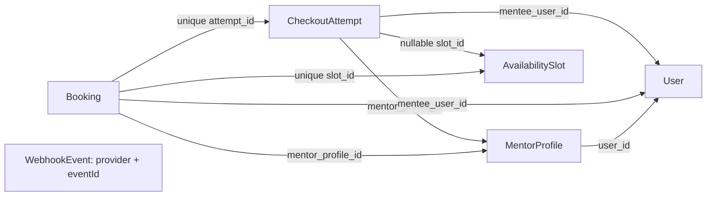

# E04 — Booking and payment (#31, stories #41–#43)

- Authority: [product brief](product-brief.md), [backlog](backlog.md), [E03](2026-11-03-mentor-discovery.md), implemented [E01](implemented/2026-10-17-accounts-and-roles.md) and [E02](implemented/2026-10-18-mentor-setup.md), PO-approved independent review B1–B5 and S1–S17 (2026-11-04).
- Status: specification revised to apply the approved findings; implementation and Stripe evidence pending. This document describes future behavior, not a shipped payment flow. Three phases and stories #41–#43 are preserved.

## 📝 TLDR

A mentee selects a public slot, signs in, reviews its current price and clicks Pay. Only Pay creates an atomic checkout hold. Verified payment creates one booking or a durable compensating-refund obligation. The five-minute hold is a target: release requires Stripe proof that payment can no longer succeed. This course MVP uses request-triggered recovery and an operator CLI, without a scheduler, WebSockets or new monitoring infrastructure.

## 📝 Problem Statement

The [brief](product-brief.md) records individual interviews about finding help and knowing the price before writing. A01 willingness to pay, A03 waiting time, A04 mentor supply, A05 booking time and A02's 25-hour estimate remain untested. D02's provisional target is ten paid sessions weekly for two weeks by 2026-12-31; D08 requires renewed discovery if missed. E04 depends on #34, #38 and #40; E03 is a proposed dependency, not assumed merged.

## 📝 Proposed Solution

Carry the public slot UUID in `/book/<slotId>` and E01's validated sign-in `returnTo`. There is no Selection entity, selection expiry, opaque handle, selection API or token page. Selection reserves nothing. Re-read availability, D16 and mentor bookability on public display, selection/review, post-auth return and checkout/resume requests. A URL or prior successful review never freezes eligibility. At payment fulfillment recheck D16 and current bookability too; if a paid attempt is no longer eligible, refund rather than strand the payment.

At Pay, create the hold transactionally. An owner returning from Stripe cancel can resume their existing open session or safely reconcile a closed session and start again without waiting five minutes. Other buyers cannot acquire a second hold. After the deadline, public availability exposes overdue-held slots as **potentially selectable**, allowing another visitor to trigger reconciliation before review or checkout. Never advertise these as guaranteed free. A paid previous attempt is resolved first and rejects the new attempt; uncertainty keeps the hold and rejects the new attempt.

Keep card-only hosted Checkout, USD, 25/50 minutes and D06's provisional 20% commission (revisit after 20 sessions). Whole-dollar prices yield exact integer-cent fees with `amountCents * 20 / 100`; no new rounding policy. Exceptional paid losers may remain `refund_pending` until Stripe confirms refund success. Exclude calendar sync, messaging, video, cancellations and discretionary refunds (D12), general booking lists and session screens (E05), VAT invoices and employer billing (D07).

## 📝 Research and provider constraints

E03's [Cal.diy](https://github.com/calcom/cal.diy) and [Easy!Appointments](https://github.com/alextselegidis/easyappointments) references motivate visible starts and direct links; omit their general scheduling systems. They are not evidence of payment correctness or demand.

Stripe [fulfillment](https://docs.stripe.com/checkout/fulfillment) requires server-side repeat-safe fulfillment; browser return proves nothing. [Session creation](https://docs.stripe.com/api/checkout/sessions/create) permits native expiry only from 30 minutes, so five-minute recovery uses [explicit expiration](https://docs.stripe.com/api/checkout/sessions/expire) and subsequent verification. [Idempotency](https://docs.stripe.com/api/idempotent_requests) keys can expire after at least 24 hours: durable attempts and reconciliation remain necessary. [Destination charges](https://docs.stripe.com/connect/destination-charges) need transfer reversal and application-fee refund for a full unwind. Real E02 onboarding for US/Poland and destination/refund behavior still require test-mode evidence.

Stripe [receipts](https://docs.stripe.com/receipts) require account configuration and a recipient address. Test payments do not automatically email receipts: Phase 2 verifies the receipt recipient and manually sends a test receipt from the Dashboard, recording receipt evidence and the platform account's successful-payment email setting. Do not mistake Mailpit booking email for a Stripe receipt.

## 📝 Architecture and finalized primitives

Reuse `MentorProfileService`'s MD7 bookability authority, `SlotService`, scoped `em`, `clock`, `EmailSender`, `formatMoney`, auth/returnTo guards, `apiHandler`, `navigationHandler` and signature-authenticated `webhookHandler`. Explicitly register services in `container.ts`/`cradle.ts`; services return DTOs. No ORM/vendor imports in UI/core; provider calls never run under row locks.

- **P13:** `CheckoutGateway` under `packages/app/src/server/services/payments/checkout-gateway.port.ts`, with deterministic mock and Stripe adapters under `adapters/`: create/retrieve/expire session, retrieve payment/refund truth, request full refund. Inputs are server snapshots; returned IDs/statuses are verified. Keep E02's onboarding port unchanged. Call existing `PayoutOnboardingService.syncAccount` immediately before Checkout creation/resume, outside the hold transaction, then recheck stored MD7 inside it. Provider failure fails closed.
- **P14:** Checkout opts into a transactional event-ID inbox. Add an optional `deduplicate` hook to the existing wrapper, default absent; run it inside the same transaction as `apply`. Connect keeps its fetch-and-overwrite behavior with no inbox or new required options. Preparation fetches provider truth outside the transaction; a duplicate inbox insert skips the local effect. Commit the inbox only with the effect or durable refund obligation. Perform refund I/O after commit; failure leaves a durable obligation recoverable by delivery retry or CLI. Extend an optional post-commit hook only if needed to invoke this work; hook failure cannot roll back or erase an already committed effect. Different event IDs still need business uniqueness.
- **P15:** pure `isBookable(slotStart, now, minLeadMs)` in `packages/core/src/time/windows.ts`, used with `clock` and existing `MIN_LEAD_MINUTES` on each relevant request and claim. This is a current-time test, never a stored selection-time entitlement. E05's `sessionWindow` remains provisional, not implemented by E04.
- **P16:** not used or built. Directly call existing `EmailSender` after booking commit; independently catch and record each recipient's failure. No event bus/listener or durable email infrastructure.

## 📝 Data Model



- `CheckoutAttempt` (`checkout_attempts`): UUID; mentee FK to `users.id`, mentor FK to `mentor_profiles.id`; nullable slot FK `ON DELETE SET NULL` and immutable original slot UUID; start, duration, USD amount/fee and destination-account snapshots; account email snapshot from the authenticated user; unique `(mentee_user_id, submission_id)`; unique provider session/payment-intent IDs; refund ID/status; hold deadline and nullable `hold_released_at`. No selection timestamp or token. Immutable pricing preserves the reviewed price; browser values are only comparison inputs.
- Attempt `state`: `active` (unsettled payment/creation/closure), `confirmed` (booking committed), `refund_pending` (paid without booking, refund incomplete), `refunded` (provider-confirmed refund), `closed` (no booking, definitively unable to pay). **Active hold** means `hold_released_at IS NULL`, independent of business state; deadline alone never changes it. Provider phase `creating | open | closing | resolved`, a committed creation operation ID and `creation_settled_at` distinguish in-flight work. The creation marker is written before the create call; closing marker before retrieve/expire calls. Only conditional transitions from the expected phase/operation ID may publish results. No return from `closing`/`resolved` to `creating`/`open`.
- `Booking`: unique attempt FK and unique slot FK (restrict deletion), `mentee_user_id → users.id`, `mentor_profile_id → mentor_profiles.id` (mentor user via profile's `user_id`); immutable start/duration/amount/currency and confirmation time. Both participant checks use these server relations. Set `availability_slots.booked_at` and insert booking in the same transaction. Price or display-name edits cannot change financial snapshots.
- `WebhookEvent`: minimal provider/event ID and processed timestamp, unique `(provider, event_id)`, no raw payload. Failed transactions leave no completed inbox row. Retain financial obligations and minimal per-recipient email outcome for manual recovery; no payment credentials or provider secrets.

All slot-changing paths lock **slot, then attempt** (including webhook, withdrawal and reconciliation); pre-read immutable original slot ID to find the lock target. Re-read markers under lock before applying prepared provider results. If the slot has been deleted, resolve the attempt without inventing a slot or confirming a booking. Use conditional updates plus uniqueness to handle a race, not stale prepared state.

The new migration explicitly executes this SQL, rather than relying on ORM index generation:

```sql
CREATE UNIQUE INDEX checkout_attempts_one_hold_per_slot
  ON checkout_attempts (slot_id)
  WHERE hold_released_at IS NULL AND slot_id IS NOT NULL;
```

`down()` explicitly executes `DROP INDEX checkout_attempts_one_hold_per_slot;` before dropping new dependent tables/constraints in reverse FK order. Add entity/base-property registrations, schema checks and reversible up/down tests, without editing existing migrations. Test a blocked concurrent insert and reacquisition only after safe release, including `refund_pending` with both held and released values. Booking's unique slot remains independent of this index. Destructive rollback is only for disposable databases; disable new checkout and reconcile live sessions before production rollback, retaining bookings/attempts/refunds.

## 📝 Payment and hold lifecycle (B1, B4, B5, S12)

1. **Selection/review:** validate UUID before DB access; read current slot, D16, price and MD7. A non-overdue foreign hold is unavailable. For an overdue hold, reconcile **before** issuing review or accepting checkout. A signed-out selection may trigger only this safe reconciliation, never a new hold; sign in with validated `/book/<slotId>` returnTo and repeat the checks afterwards. For the authenticated owner of a non-overdue active attempt, show Resume checkout if current eligibility still holds. If eligibility is lost, reconcile/close the attempt; never resume an ineligible checkout.
2. **Pay/atomic hold:** check duration and reviewed price against server values; sync payout readiness; lock slot and inspect current attempt. Recheck D16, unbooked state and MD7. If safely unheld, insert an `active`, `creating` attempt with deadline `clock.now() + 5 minutes` and committed creation operation marker. Only this winning request issues create; retries find its attempt and do not create in parallel. Commit before provider I/O. Same submission ID always resolves its original attempt; a safely closed attempt needs a fresh submission ID to start again. Unique-index conflict maps to generic unavailability.
3. **Create/bind:** stable attempt-derived Stripe idempotency key, attempt metadata on Session and PaymentIntent. Bind the response only with a conditional update matching the creation marker, `state=active`, `phase=creating`, unreleased hold and unelapsed deadline. If the response is late, closing has begun, or state already changed (including webhook-first), record the returned session for reconciliation; never redirect or bind it as an active open checkout. Retrieve/expire it outside locks and resolve payment truth. Mark creation settled only when that operation's outcome is known. If webhook-first already confirmed the same paid session, preserve that booking rather than treating its late create response as a losing payment; reconcile any additional session separately. A failed/timeout response does not prove no session exists. A creator delayed before issuing its call still counts as unresolved; a closer cannot release while it could issue a late call. Request cancellation, a timeout or an elapsed lease is not proof of settlement. Do not introduce a time-based unlock.
4. **Cancel/resume:** Stripe cancel is navigation only, not proof of payment failure or closure. On another Pay by its authenticated owner, retrieve the current session outside locks; if open, before deadline and still eligible, conditionally resume its existing URL without another hold/session. `creating` shows processing; `closing` cannot resume. If already closed, reconcile now, without waiting for deadline; once definitively unpayable and creation settled, close/release and allow a fresh attempt for the same slot. If paid, confirm/refund and show that result. If ambiguous, retain hold and show processing/unavailability. After deadline, even the owner reconciles before any new attempt; no deadline extension on resume.
5. **Due closure/recovery:** atomically mark `closing` before provider reconciliation; no new create/resume may start from that marker. Retrieve the session/payment, explicitly expire an open session, then verify provider final session/payment status (retrieve any associated PaymentIntent and establish that it is terminal/non-succeeding, not merely that Session status is expired). A definitively expired session plus a non-succeeding payment, with all creation work settled and no other payable session/intent for this attempt, permits `closed` and hold release in one transaction. An unpaid open session, failure event, timer or cancel return alone never permits release. Processing, missing create response, Stripe outage, or completion/expiry race retains the hold. If create outcome is unknown, recover using the same stable key within Stripe retention and metadata/provider records, without concurrent creators; reconcile every discovered session. Never blindly replay create after key retention; unresolved creation stays held for operator investigation. A marker is not a provider fence: release requires proving the outstanding creator can no longer issue or publish a payable session as well as verifying provider truth.
6. **Paid confirmation:** validate signature, expected live/test mode and platform account, provider metadata/local binding, amount, currency and destination against snapshots. Retrieve truth before the transaction. Under slot-then-attempt locks, an owned unreleased hold plus unbooked slot, current D16 and MD7 permits atomic booking insertion, `booked_at` and `confirmed`. Deadline passage by itself does not reject a paid holder. D16 loss or lost readiness/slot claim instead records `refund_pending`. Browser return cannot make either transition. A previous successful payment rejects a competing visitor even if it needs compensation; that visitor may retry only after reconciliation has safely resolved the hold. Duplicate events and different events for one payment never create another booking or refund. On confirmation, release the checkout hold only when creation has settled and no additional payment can succeed; otherwise retain it until reconciliation proves that condition. The unique booking/booked slot protects the time after hold release.
7. **Losing paid attempt and release:** record `refund_pending` before refund I/O. Consumed successful payment cannot claim the slot again: the committed compensation decision permanently forbids booking for that attempt. Release its hold in that transaction **only if** creation has settled and every associated session/payment is terminal or otherwise proven unable to produce another payment/claim. Otherwise retain it while refund is pending **and even if refunded**, until safe closure is proven. `refund_pending` may therefore have a released hold while money is still returning; `refunded` alone is not a release condition. Releasing this attempt never changes another attempt's hold or a booked slot.
8. **Refund:** full refund with stable attempt-derived key, `reverse_transfer=true` and `refund_application_fee=true`. Store refund ID/status and mark `refunded` only on provider success. Pending, failed or ambiguous results retain the durable obligation; before retry retrieve payment/refund truth, particularly after idempotency retention, never blindly request a second refund. Mismatched bindings are quarantined for operator investigation, without confirming a booking or refunding an unrelated payment.
9. **After commit:** on the unique new booking transition call `EmailSender` directly for each participant with start, duration, other person's display name and protected detail link. Catch and record outcomes separately; SMTP failure never rolls back booking or suppresses the other send. SMTP acceptance is not delivery; a crash can leave unsent or duplicated email, with manual recovery, no durable outbox. No booking email for a compensated attempt.

Five minutes includes provider latency and is never a guaranteed maximum. Without a request or operator action the session can remain payable beyond it; verified payment is honored only if the remaining claim checks pass. No scheduler, polling service or additional monitoring infrastructure is required.

## 📝 API, pages and configuration

| Surface | Contract |
| --- | --- |
| `GET /book/[slotId]` | Leaf request-time guarded review page, not a secret-token route. Signed out → existing sign-in returnTo; malformed/missing/hidden target → neutral unavailable/404 without mentor-private data. Reconcile overdue holds before review. Public slot ID grants no ownership. No Selection API. |
| `POST /api/bookings/checkout` | `access: user`, existing CSRF. `{ slotId, duration: 25 | 50, displayedPriceCents, submissionId }` → `{ url }` only after safe create/resume. Validated UUIDs/bounded core schemas; principal supplies identity/email, server supplies amounts/payee. 409 for stale price/eligibility/foreign hold; existing provider 502 on failure, 429 limiter refusal. In-flight same-attempt work gives 409 with processing guidance and retry, never a second create. Reuse `apiCall` and `unlessSessionExpired` with current review returnTo. |
| `POST /api/webhooks/stripe/checkout` | Signature-only raw body, distinct Checkout secret, no session/CSRF; 1 MiB limit. Invalid signature/body 400, oversize 413, transient preparation/apply failure 500, accepted/duplicate/ignored 200 `{ received: true }`. Inbox is opt-in for this endpoint only. |
| `GET /bookings/checkout-return?attempt=<uuid>` | Principal plus buyer ownership; missing/foreign → neutral 404. Request-time private/no-store page showing processing, confirmed, cancelled-but-still-open, failed/closed, refund pending or refunded. Explicit refresh/status action can reconcile; return parameters never establish payment state. Confirmed state links to `/bookings/<bookingId>`. |
| `GET /bookings/[id]` | Participant-only booking detail; resolve mentee user/mentor profile user before DTO or metadata. Foreign/missing → neutral 404. Start, duration, timezone and other participant's display name; no email/payment identifiers exposed. No list. |

Checkout webhook handles `checkout.session.completed`, `checkout.session.expired`, defensive `checkout.session.async_payment_succeeded` and `checkout.session.async_payment_failed`, and refund notifications `refund.created`, `refund.updated`, `refund.failed`, `charge.refunded`. All fetch current provider truth; async failure alone cannot release. Refund events map back through saved payment/refund IDs and verify platform scope. Other signed event types return 200 without effects. Duplicates can resume a durable outstanding refund outside the deduplicated booking transaction. Preserve E02 Connect's `account.updated` semantics and endpoint response/security behavior.

**Checkout configuration:** extend lazy configuration with `STRIPE_CHECKOUT_WEBHOOK_SECRET`, `STRIPE_CHECKOUT_ORIGIN` (default `https://checkout.stripe.com`, normalize via `new URL(...).origin` as E02 does), and `CHECKOUT_ENABLED` (strict boolean, default false) in a separate lazy Checkout section so E02 does not require the new secret. Reuse `STRIPE_SECRET_KEY`, `STRIPE_API_URL` and `APP_URL`; no duplicate API keys/base URLs, publishable key or per-route callback env. Validate returned URLs against the configured origin using E02's validated external redirect approach; localhost origin overrides only for the fake gateway tests.

Create hosted `mode=payment`, `payment_method_types=['card']`, server line item/quantity one, destination and provisional fee in `payment_intent_data`. Set `customer_email` from the authenticated mentee's **server account email**, and set supported `payment_intent_data.receipt_email` to the same server value; never accept a browser receipt address or trust a returned customer email as user identity. Enable **Successful payments** receipt emails on the **platform** Stripe account. Set `invoice_creation.enabled=false`, `tax_id_collection.enabled=false`, `automatic_tax.enabled=false`; omit business/employer billing fields and optional billing-address collection (card-required billing checks remain Stripe's responsibility). No VAT invoice generation or employer-paid flow.

Build absolute URLs from trusted `APP_URL`: `success_url=/bookings/checkout-return?attempt=<id>` and `cancel_url=/book/<slotId>?attempt=<id>&checkout=cancelled`. Cancel page checks ownership before using attempt details and says “Checkout was cancelled. Your time may still be held. Resume checkout or choose another time.” Choosing another time does not instantly release the previous hold. A forged cancel flag only changes neutral copy; it cannot expire or refund. Success return shows processing until verified, with explicit refresh; never confirms from query parameters.

**P7 and route precedence:** checkout-return deliberately renders a status page under `(app)/bookings/checkout-return/page.tsx`, rather than a P7 redirect-only navigation handler; authorization and error mapping use existing page guards. The static `checkout-return` segment takes precedence over `(app)/bookings/[id]`; test it is not parsed as a booking UUID. Review lives in `(app)/book/[slotId]` with its signed-out leaf redirect before rendering protected content. Public E03 profiles stay in `(frontend)/mentors`, public Tailwind-only; signed-in review/detail/return and existing `(app)/mentor/slots` use the approved signed-in UI. For all guarded pages, `generateMetadata` checks the same principal/ownership as render and returns neutral not-found metadata when unauthorized (E01 lesson); no static private titles or participant data in metadata/RSC. Use private/no-store and noindex for private pages. No selection-token headers/hosting exception is added; existing E01 secret-token protections remain unchanged.

**Minimal P11 limits:** define `BOOKING_RATE_LIMITS` next to booking service: selection/review reconciliation 20 per minute per authenticated user and 30 per minute per trusted IP; checkout creation/resume 10 per minute per user and 20 per minute per trusted IP; explicit return/status reconciliation 20 per minute per user. Read-only public projection has no Stripe calls. Consume applicable buckets before business transactions/provider calls, including failed attempts. Use existing `rateLimitKey`, hashed keys, `clientIp(req, config.app())`, skip per-IP when null, existing PostgreSQL limiter and 429/Retry-After/form message. Signed webhooks retain provider retry handling, not browser user/IP limits. No new limiter infrastructure.

## 📝 Public availability, withdrawal and participant access

E03 projection filters booked slots, current D16 and MD7 as before, excludes non-overdue unreleased holds, and includes overdue-held starts as potentially selectable without provider I/O on listing. Do not expose buyer/attempt IDs publicly. Selection/review/checkout reconciles those candidates before proceeding. Regular navigation refresh is sufficient; an uncertain candidate returns “This time is no longer available; try again later.” A paid previous attempt is processed first, never replaced by another hold based only on deadline.

Withdrawal is implemented in E02's `SlotService.withdraw`, not E03's read-only projection. E04 extends that contract: under slot-then-attempt lock refuse an unreleased hold with 409 `conflict`, “This slot has a checkout in progress. Try again after payment is resolved.” If overdue, reconcile outside locks first and retry the transaction; provider uncertainty keeps the same hold error. After safe release an unbooked slot can be deleted; booked slots retain E02's existing 409 cancellation-contact message. Check the booked-slot outcome before the hold-specific error, including a confirmed attempt with unsettled creation. Same locking order and partial uniqueness protect withdrawal/hold/confirmation races.

Add a “View booking” link on each **booked entry of existing `/mentor/slots`**, resolving only the current mentor's confirmed booking. Add the same protected detail link on the mentee's confirmed checkout-return. Both work when email fails. Email also links to that page. No new booking list; E05 owns lists and text-session screens. Display current local time with named zone through E03 `LocalTime`, server ISO fallback, semantic time/labels, keyboard controls and accessible status feedback. Price changes require a new review; no problem description collected. No prototype is accepted.

## 📝 Recovery CLI and minimal runbook plan

Implement `npm run operator -- booking reconcile [--attempt <uuid>] [--yes]` in `packages/app/src/server/cli/commands/booking-reconcile.command.ts`, dispatch from `run-cli.ts`, using scoped booking/payment services. Follow existing env-first bootstrap, type-only service imports, argument validation, production `--yes` and existing exit codes 0 success, 1 unresolved/provider failure, 2 usage/invalid arguments. Without `--attempt`, inspect overdue active holds plus any unsettled creation/closure/refund obligations (including released refund-pending attempts). Repeat-safe, bounded provider calls, safe summary of attempt IDs/outcomes, no emails/secrets/Checkout URLs. Never force-release an ambiguous hold.

The README includes a clearly marked planned runbook; at implementation activate and verify it: configure platform receipt emails and Checkout secret/origin/enable flag; keep flag false until all three phases and Stripe evidence pass; run the command after abandoned/uncertain checkout or refund reports, repeat after provider recovery, investigate exit 1 rather than forcing release; use `--attempt` for one case and `--yes` in production; manually recover recorded booking email failures through existing `EmailSender` without reconfirming/charging. A named operator, refund funding and reconciliation routine are enough for this course MVP; no scheduler or new monitoring stack.

## 📝 Edge cases and required evidence

| Trigger | Invariant / test |
| --- | --- |
| Two-hour boundary | Existing slots are whole-minute instants. Fixed minute-aligned now: start exactly +120 minutes eligible, +119 minutes refused. Advance clock across selection, sign-in, Pay/resume and fulfillment: recheck at each, refund if already paid and now ineligible. Do not create sub-minute slots for boundary tests. |
| Overdue abandoned checkout from public profile | Candidate is visible; next selection reconciles old session, expires/verifies it and can review/acquire only after safe release. Paid or unknown rejects competitor. No exact five-minute guarantee. |
| Owner cancels and retries before deadline | Resume same open eligible session; already closed/unpayable → safe fresh attempt without waiting. Browser cancel alone releases nothing. |
| Concurrent creates, create vs expiry, late response, crash before ID binding | Committed markers precede I/O; no provider calls under locks; one create issuer, no active bind from closing/released state; unresolved creator prevents release; late sessions safely expired/reconciled. Force both race orderings, including webhook before create response. |
| Two buyers / withdrawal / completion vs expiry | PostgreSQL deterministic lock-based races, partial index and unique booking permit at most one claim; safe closure before another hold. Test migration up/down and index SQL. |
| Paid loser with pending/failed refund | Durable compensation, no booking/instant-refund claim; test release both permitted and forbidden while refund pending, and refunded-but-creation-unsettled stays held. |
| Duplicate/different/out-of-order events, mismatched provider metadata | Same payment cannot book/refund twice; mismatches quarantined. Unknown event 200; existing Connect regression tests still pass with opt-in inbox absent. |
| Provider outage, stale idempotency key or lost create/refund response | Retain uncertain hold/obligation, reconcile truth, no blind create/refund. CLI safe to repeat. |
| Email unavailable / unauthorized viewer | Confirmed detail reachable from mentor slot and buyer return without email. Recipient failures independent, no rollback; neutral metadata/404 for nonparticipant or forged attempt. |
| Stripe receipts and D07 | Adapter asserts server email/configuration; test-mode manual receipt verification and platform successful-payment setting recorded separately from Mailpit; invoice/tax-ID/employer fields disabled. |

## 📝 Risks, compatibility and decisions

This moves money, so keep signature, amount/destination validation, unique claims, durable refunds and participant scoping even in a course project. Payout readiness can change after sync; fulfillment rechecks stored MD7 and compensates if necessary. No claim of guaranteed delivery, instant refunds or bounded hold duration. No additional monitoring infrastructure is a release prerequisite.

[PO decision record](research/decisions/2026-11-04-d17-checkout-holds-and-compensation.md) and brief D17 supersede earlier no-hold/competing-payment assumptions and the draft 30-minute Selection design. D16's [clarification](research/decisions/2026-10-17-d16-booking-lead-time.md) removes frozen eligibility. D09/D12 manual cancellation/dispute policies remain; automatic system-failure compensation is the explicit narrow exception. D06 stays provisional; D07/D13/D15 still apply. Q05 legal ownership and Q13 operator email remain release conditions; Q11 mentor cancellation policy remains external/nonblocking for planning.

At implementation update `BACKWARD_COMPATIBILITY.md` for Checkout's signature-only CSRF exception, opt-in wrapper additions, new routes/DTOs/exports/Cradle keys/schema/config, and the withdrawal 409 hold outcome/additive booked-slot booking link. Update `.env.example`, README and CI fixtures for lazy config without requiring Checkout secrets for E02. Preserve E01/E02 behavior except these explicit E04 integration changes. This specification task changes no application code, migrations, live configuration or GitHub Issues.

**Deferred GitHub synchronization (read-only checked 2026-11-04; no issues changed):**

| Issue | Stale text / later documentation update |
| --- | --- |
| [#31](https://github.com/rafsaw/ai_techleaders/issues/31) | Open questions still say recovery must be specified and “no slot-hold duration is decided”. Replace with D17's target hold/safe closure/compensation decision; point the “spec still owed” section to E04. Clarify D12's narrow compensation exception. |
| [#41](https://github.com/rafsaw/ai_techleaders/issues/41) | Same stale hold/recovery open question and missing-spec text. Clarify that returning to the same slot preserves the choice, not availability; current D16 is rechecked after sign-in and at Pay, with no Selection entity. |
| [#42](https://github.com/rafsaw/ai_techleaders/issues/42) | Same stale open question; implementation notes still record the 2026-10-17 “no hold duration” assumption. Clarify that “slot stays available” means potentially selectable after target then safely released only after provider closure, and “no payment left without a booking” allows a durable, temporarily pending compensating refund. Add owner cancel/resume and creation/closure concurrency criteria; link this spec. |
| [#43](https://github.com/rafsaw/ai_techleaders/issues/43) | Same copied stale hold/recovery open question and missing-spec text. Link E04's protected detail access from existing mentor slots/buyer return and direct post-commit emails. |

Q13's concrete operator email remains a genuine release condition in all four issues; do not mark it resolved. Preserve #31 and stories #41–#43 and their acceptance intent. The old no-hold, frozen-selection and Selection-handle assumptions are superseded locally; only the observed issue wording above is attributed to GitHub.

## 📋 Phasing

1. **Selection and review (#41):** URL slot selection, sign-in return and current eligibility/price review with checkout disabled; no schema for Selection or charges. Recovery hooks integrate with Phase 2 when attempts exist.
2. **Safe payment and booking mechanics (#42):** atomic hold, committed create/close markers, card Checkout, repeat-safe booking confirmation, compensating refunds, receipts and operator reconciliation delivered together. Test with fake gateway and Stripe test mode; live checkout stays disabled.
3. **Participant information (#43):** participant detail, links from existing mentor slots and checkout-return, and direct post-commit emails. Enable live checkout only after the full journey, recovery and applicable evidence are safe. Phase 2 already creates the booking; Phase 3 adds its participant-facing presentation.

## 📋 Implementation Plan

### Phase 1 — select and review (#41)
1. Implement current-time P15 rule and `/book/[slotId]` with existing returnTo, UUID validation and guarded metadata. Test sign-in delays, whole-minute boundary, deleted/unbookable slot and tampered URL; no Selection migration/API/token page.
2. Add accessible duration/price review and stale-price/session-expiry handling using E03 projection and existing UI; checkout disabled. Integrate read-side hold checks/recovery when Phase 2 lands. Test signed-out and signed-in navigation.

### Phase 2 — safe payment and booking mechanics (#42)
1. Add attempt/booking/inbox entities and reversible migration with explicit partial SQL index; withdrawal integration and deterministic hold/hold, hold/delete, confirmation/expiry and creating/closing concurrency tests. Test refunded/compensated holds, distinct FKs and index up/down behavior.
2. Add P13 mock/Stripe adapter and lazy Checkout config, committed markers, conditional binds, owner resume, late-session recovery, server email/receipts and destination-charge full reversal. Test lost/late responses and no I/O under locks; keep live flag false.
3. Add opt-in P14 inbox and named event routing, repeat-safe fulfillment/refund service and post-commit refund execution. Test replay, distinct/out-of-order events, unknown events, duplicate payments, D16/bookability loss, pending refund/release rules and unchanged Connect behavior.
4. Add named CLI and README recovery entry; test crash/key-retention/outage and repeated reconciliation. Capture Stripe test-mode charge, account/country readiness, safe expiration, compensation, transfer/fee reversal and **manual test receipt verification**, plus platform email setting evidence. Public overdue-candidate selection must demonstrate safe traffic-triggered recovery.

### Phase 3 — participant information and release (#43)
1. Add protected detail/return views, mentor booked-entry link and buyer return link; direct `EmailSender` calls after commit with independent outcome recording/manual recovery. Test SMTP failure, metadata leaks, unauthorized reads, route precedence and duplicate event/no duplicate normal sends; document crash duplicate possibility.
2. End-to-end fake-gateway/Mailpit and real-browser journey: sign-in return, current D16, owner cancel/resume/new attempt, competing/overdue hold, late create/expiry race, confirmed booking, pending/refunded loser, CLI recovery and access without email. Checkout disabled until all three phases and release evidence pass.
3. Update compatibility, env/README/CI and design-system records as affected. Run `npm run lint`, `npm run typecheck`, `npm run build`, `npm run test:coverage` (100% per source file), `npm run test:integration`, `npm run check:agents`, and affected UI `npm run test:storybook`/`npm run check:tokens`; apply/revert new migration on disposable DB. Resolve Q05/Q13, name operator and refund funding, review evidence before enabling live payments. Autonomous implementation records its run under `.ai/runs/` and updates this spec's status; no new monitoring system.
