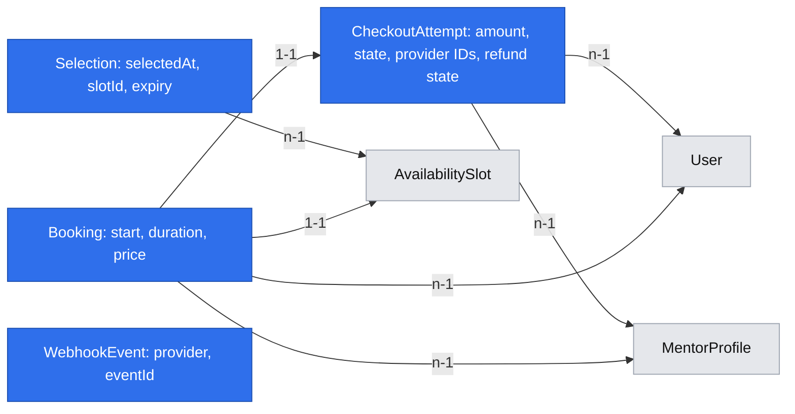

# Booking and payment

## 📝 TLDR

Developers seeking help need a clear price and a dependable path to a paid text session. This proposal joins epic #31 and stories #41–#43 into one booking journey: select an eligible slot, sign in, pay with Stripe, and give both participants the confirmed details. It designs reusable primitives where this journey needs them and phases the work without exposing an unsafe partial payment flow.

## 📝 Problem Statement

The [product brief](product-brief.md) cites individual developer interviews about finding help and knowing the price in advance. Willingness to pay (A01), time to session (A03), mentor supply (A04) and booking time (A05) remain untested. D02's provisional product check is ten paid sessions a week for two consecutive weeks by 2026-12-31; D08 calls for renewed discovery if missed. Accounts and mentor setup are implemented; [E03 discovery](2026-11-03-mentor-discovery.md) is a separate proposed dependency, not assumed merged. E04 depends on #34, #38 and #40.

## 📝 Proposed Solution

A mentee chooses an available start and 25 or 50 minutes, sees the mentor's price and returns to the selected slot after sign-in. The server rechecks availability immediately before creating Stripe Checkout; this is not a reservation. Payment confirmation claims the slot atomically, and only the winner becomes a confirmed booking. A paid loser is automatically refunded in full. Both participants receive booking information after confirmation. The PO chose competing payments without temporary holds on 2026-11-04; selection alone never reserves availability. The acceptance criteria and dependencies in #41–#43 remain authoritative.

Keep Stripe checkout card-only for the first release to avoid asynchronous payment methods; nevertheless process delayed and duplicated notifications. Skip calendar sync, payment method choice, session messaging, cancellations and refunds other than automatic recovery of failed booking claims. D12's operator processes and E05's session lists/screens remain separate. One spec is intentional: the user explicitly requested joint planning of these dependent journey steps; deployable phases below keep money disabled until recovery is present.

## 📝 Shared research

- [Cal.diy](https://github.com/calcom/cal.diy) and [Easy!Appointments](https://github.com/alextselegidis/easyappointments) are open-source scheduling systems with user-facing appointment flows. The existing [E03 research](2026-11-03-mentor-discovery.md) identifies direct links and visible times as useful. Reuse those ideas; omit their general scheduling, calendar integrations and service catalogs. They do not validate the no-hold payment design.
- [Stripe Checkout fulfillment](https://docs.stripe.com/checkout/fulfillment.md?ui=full-page) requires server-side fulfillment and repeat-safe handling, since a browser return alone is unreliable. [Stripe idempotency](https://docs.stripe.com/api/idempotent_requests) warns keys can be pruned after at least 24 hours and cached responses include errors: a durable local payment record and provider reconciliation are necessary, not an idempotency key alone.
- [Stripe destination charges](https://docs.stripe.com/connect/destination-charges.md?platform=web&ui=stripe-hosted) transfer funds to connected accounts and require explicit transfer reversal and application-fee refund for a full unwind. Provider configuration, account capabilities, supported countries and failure behavior must be validated in Stripe test mode before release; E02's real onboarding is not yet validated for US or Poland.

## 📝 Architecture

Reuse the E02 `MentorProfileService` bookability authority, `SlotService`, scoped `em`, `clock`, `EmailSender`, `formatMoney`, existing auth/returnTo guards, `apiHandler`, `navigationHandler` and signature-authenticated webhook wrapper. E03's public availability projection is a dependency; adapt its profile slot links to the booking journey. Preserve existing API, account and profile contracts. Add explicit Awilix registrations for booking service, checkout/refund port and adapter; service methods return DTOs. UI and core never import the ORM or vendor SDK. Keep workflow routes separate from CRUD factories.

**Flow:** selection → authenticated review → server availability and current mentor readiness check → Stripe-hosted Checkout → verified paid event → atomic booking claim or refund obligation → participant confirmation. Browser success is only a status view; it cannot confirm payment. Checkout creation, confirmation, refund and notification are separate failure boundaries; no provider call occurs while a database row lock is held.

**Primitives, with present consumers:**

- Extend E02's payment port pattern with `CheckoutGateway`: create/retrieve a Checkout Session, retrieve payment/refund state and create a full refund. Stripe and deterministic mock adapters have identical semantics. Existing E02 onboarding remains independent. Provider SDK/HTTP is confined to adapters. Never accept amounts, payee or status from the browser.
- Extend E02's webhook wrapper (P14) for a separately configured Checkout endpoint and raw-body signature verification. Persist provider event IDs only with the corresponding transactional effect. Event ID deduplication does not replace unique checkout/payment/slot constraints.
- Add one availability selection policy over `clock` and `MIN_LEAD_MINUTES`; E03's read and E04 use the same rule at selection, not a fresh two-hour promise after checkout. The server records the selection timestamp; an untrusted client timestamp cannot establish eligibility. Short-lived server-side selection record below carries this across sign-in but is never a hold.
- Reuse `EmailSender` and pure escaped templates. Add a small typed in-process post-commit booking-confirmed event only if it has both the booking publisher and email subscriber in the same phase (P16); do not claim durable delivery. Page-specific slot/duration controls remain colocated until a second real consumer exists. Reuse E03 `LocalTime` and existing presentation primitives; follow public Tailwind versus signed-in UI boundaries.

## 📝 Data Model

- `Selection`: random opaque identifier, slot UUID as a **scalar snapshot**, server `selectedAt`, `expiresAt` (30 minutes to limit stale state, not a slot hold), optional user binding once authenticated. It survives sign-in. Store a hash of its random secret, not the raw secret. No FK to slot: withdrawal may delete it. Purge expired selections; a valid selection must have met D16 at its original server-recorded selection time. On expiry ask the mentee to reselect and apply D16 again. The diagram's selection-to-slot edge is a logical reference, not a database FK.
- `CheckoutAttempt`: UUID, mentee user FK, mentor profile FK, original slot UUID as scalar, start instant, selection instant, 25/50 duration, USD integer cents, fee cents, payout account ID snapshot, unique provider session ID and unique payment-intent ID when known; state `creating | open | paid | confirmed | refund_pending | refund_submitted | refunded | failed | expired | needs_review`, with timestamps, stable provider idempotency keys and refund ID. Immutable commercial snapshots stop later profile edits changing an agreed price. No raw payment credentials or provider secrets. Selection identifiers and payment references are not logged.
- `Booking`: one unique attempt, one unique slot FK (restrict delete), mentee and mentor references, start, duration, amount and currency snapshots, confirmed time. Slot FK and unique constraint enforce one confirmed booking. `availability_slots.booked_at` changes in the same transaction; existing mentor withdrawal's conditional deletion must race safely with this claim.
- `WebhookEvent`: provider plus event ID unique, processing status and timestamps; event record and final local transition commit atomically. Store only identifiers and minimum status, not the raw event. Failed processing is retryable; an event is never acknowledged as completed before its obligation is durable.

Migrations use `defineEntity`, base properties, explicit registration and a new reversible migration with up/down tests. Do not modify existing migrations. Production rollback disables new checkout first and preserves all booking, attempt and refund records until reconciled; a destructive down migration is only for disposable environments. Limit participant DTOs to required details. Define retention and deletion operationally before production; do not purge unsettled attempts, bookings or refund evidence.

## 📝 Payment and consistency contract

1. **Selection and price:** server verifies mentor readiness, unbooked existing slot and D16 using its own clock at selection. Sign-in returns through the validated internal `returnTo`; re-read slot and readiness after authentication. Review shows current server price. Changing price before checkout requires a fresh review; never silently charge a different price. At checkout start validate selection ownership, expiry, duration and displayed price, re-fetch E02 payout readiness using `syncAccount`, and immediately recheck slot and bookability. Fail closed on provider/readiness errors. This check cannot prevent a later race and makes no reservation.
2. **Create:** write a durable `creating` attempt before provider I/O, then create Checkout with a stable key derived from attempt UUID and metadata containing only the attempt UUID. Use USD amount and 20% application fee rounded to the nearest cent, half up; transfer remaining amount as a destination charge to the verified connected account. On timeout use same key with identical parameters and reconcile via provider session/metadata before creating another; never blindly recreate after Stripe's key retention expires. Require a unique client submission token bound to user and selection to avoid double-click creating duplicate attempts. Configure Stripe receipt to the authenticated mentee email, no employer/VAT flow.
3. **Paid event:** verify raw-body signature and expected live/test mode and account; retrieve Checkout and payment from Stripe, check paid status, session/attempt binding, currency, amount, destination and payment identity. Never trust redirect parameters. `checkout.session.completed` is actionable only when paid; asynchronous success, if unexpectedly enabled, follows the same validation; unpaid/failed/expired events never create a booking. Lock the attempt then atomically `UPDATE availability_slots SET booked_at = :now WHERE id = :id AND booked_at IS NULL` and insert the unique booking in the same transaction. If the row was deleted, already booked, the scheduled start has passed, or the mentor is no longer bookable, record `refund_pending` instead. Do not reapply the two-hour lead time at confirmation: it was checked at selection. Slot claim and withdrawal must be tested concurrently; one wins. A duplicate event or another event for the same payment returns the already recorded outcome. Unique constraints protect different event IDs and retries.
4. **Losing payment:** commit `refund_pending` first, then request a full Stripe refund using a stable attempt-derived key, with `reverse_transfer=true` and `refund_application_fee=true`. Store the refund ID and status; a submitted/pending refund is not described as completed. Verify final status using Stripe's refund events or retrieve API. In case of API failure or process crash return a retryable webhook failure; duplicate delivery resumes the durable obligation. Because webhooks eventually stop retrying and Stripe idempotency keys expire, provide an operator reconciliation command that lists unsettled attempts and retrieves provider payment/refund state before safely resuming. Never issue another refund merely because a key is old; unresolved or ambiguous provider responses enter `needs_review`, alert the operator, and block release until a monitored retry/response procedure is documented. An operator can run reconciliation repeatedly. This cannot guarantee immediate refund while Stripe is unavailable; the buyer sees refund pending and the incident remains visible until settled.
5. **Notifications:** after a committed winning booking, send one message per participant with start, duration and other participant's display name. Record each SMTP attempt/outcome without rolling back confirmation. SMTP acceptance is not delivery; failure is visible to the operator for manual retry, with possible duplicate email after crash disclosed. No email sends on a losing claim. In-product confirmation is backed by the booking record, not email delivery.

## 📝 API Contracts

- `POST /api/bookings/selections` (`access: optional`, shared CSRF): `{ slotId }` → opaque selection handle and expiry; eligibility is assessed server-side. Limit requests with the existing rate limiter. Invalid, unavailable or too-near slots return a generic conflict; do not reveal hidden mentor data. The handle grants no booking or user-data access. Validate safe `returnTo`; do not place provider secrets in URLs or logs.
- `GET /book/:selection` is a request-time leaf page. A signed-out visitor follows existing sign-in with this internal return target; signed-in users see review. Expired or lost slots show recovery and a link to the public mentor profile. Send private/no-store, no-referrer and noindex headers on the handle route and redirects; do not expose the handle in external links. E01's token-page protections must be extended to cover this route and slash redirects, including the documented hosting release condition.
- `POST /api/bookings/checkout` (`access: user`, CSRF): `{ selection, duration: 25 | 50, displayedPriceCents, submissionId }` → `{ url }` for allowlisted Stripe Checkout origin; mismatch, unavailable or expired selection → 409; provider failure → existing 502. Validate positive server price, UUIDs and bounded input using core schemas. Bind attempt to principal; rate-limit creation. Reuse `apiCall` and `unlessSessionExpired`; navigation only to configured provider origin.
- `POST /api/webhooks/stripe/checkout`: signature-only raw-body endpoint through existing webhook wrapper, separate Checkout signing secret, body limit 1 MiB; invalid signature/body 400, oversized 413, transient processing 500, accepted or safely duplicate 200. It does not resolve a user session or require browser CSRF. Record this narrowly scoped exception in `BACKWARD_COMPATIBILITY.md`.
- `GET /bookings/checkout-return?attempt=<opaque-id>`: require principal, verify ownership, request-time private/no-store; display `processing`, `confirmed`, `unavailable / refund pending`, `refunded`, or `failed`. A missing or foreign attempt returns neutral 404. Return is never payment proof. `GET /bookings/:id` likewise requires participant authorization; foreign users receive 404. No general booking listing is introduced; E05 owns lists.

## 📝 UI/UX

A visitor on a mentor profile chooses a listed start; the control says this is not reserved. If signed out they sign in and return to it; if withdrawn, booked or expired they see why and a way back to other times. The review shows local start with timezone, mentor display name, text-only format, duration options and corresponding USD price before requesting any problem description. A changed price requires acknowledgment by a new review. Checkout is clearly a Stripe handoff. Returning shows processing until verified, a confirmed summary only after the claim, or a clear message that the slot is gone and a refund is pending or completed; never promise an arrival date not supplied by Stripe. Both participants can reach their private confirmation via the email link and see start, duration and the other participant's display name. No problem entry, mentor preview, in-product rejection, video, self-service cancellation or session screen is added here.

Use semantic labels, keyboard-operable controls, visible focus, non-color-only errors, accessible status announcements and responsive layout. Existing public Tailwind-only and signed-in shadcn boundaries apply; handle loading, empty, error and session expiry through the approved components. No accepted prototype exists; do not imply one.

## 📝 Edge Cases & Failure Scenarios

| Trigger | Required result |
|---|---|
| Exactly two hours at selection / one millisecond less | First eligible, second refused; test the boundary with `clock`. |
| Slot removed, booked or mentor becomes unbookable during sign-in or before checkout | Recheck and offer other slots; selection confers no ownership. |
| Two paid sessions for one slot, including same user in two tabs | One confirmed booking; each other paid attempt becomes a separate refund obligation. |
| Provider succeeds but response is lost, webhook arrives before attempt binds session, or worker crashes | Resolve from signed session metadata and durable attempt, retrieve provider truth; never issue another charge or discard the obligation. |
| Repeated/out-of-order or distinct event IDs for same payment; duplicate refund event | State transitions are monotonic and keyed by payment/attempt; no second booking, refund or confirmation email. |
| Checkout abandoned or payment failed | No confirmed booking; a slot remains available unless another transaction claimed or withdrew it. |
| Payment received after slot deletion or start, or account lost readiness | No booking; full refund path, surfaced as pending until confirmed. |
| Stripe refund fails, is pending, or returns an ambiguous response | Persist debt, retry/reconcile and alert operator; never claim it completed or discard the record. |
| Email fails or process stops after commit | Booking remains confirmed and in-product details remain available; log/record unsent state and provide manual recovery. |
| Foreign user, forged handle, bad signature, amount or account mismatch | Deny or quarantine without leaking participant data; mismatches alert operator and never create booking. |

## 📝 Risks & Impact Review

Money, identity, schema and participant scoping are high-impact surfaces irrespective of issue labels. Test charge/refund failure, retries, duplicate and concurrent events, wrong-scope reads, migrations up/down and race conditions; a second review and the applicable risk-high QA gate follow SDLC. Refund automation is not the D12 manual cancellation/refund feature: it compensates a payment for a booking the system could not provide. The in-process email event is not durable; operator visibility and manual recovery are necessary. Automatic refunds can remain pending during provider outages or insufficient balances; only provider-confirmed completion closes the obligation. Checkout remains disabled in production until a recurring reconciliation schedule, alert owner, refund funding and test-mode race/recovery evidence are documented; no always-running worker is assumed.

Existing `returnTo`, public profile, slot deletion and webhook contracts must remain compatible. New public routes, exports, schema and lazy Checkout configuration are recorded in `BACKWARD_COMPATIBILITY.md`, `.env.example`, README and CI as appropriate. Retain production financial data on rollback; reconcile live Stripe sessions before disabling webhooks. The 25-hour build estimate A02 remains unverified. Synthetic mentor-onboarding hypotheses H01–H06 concern E02 and are not demand evidence or E04 requirements.

## 📝 Decisions in play

- PO: D03 booked and prepaid; D05 verified onboarding before bookable; D06 mentor prices, provisional 20% fee; D07 Stripe receipt only; D10 problem only during session; D12 operator processes outside product; D13 return after sign-in; D15 both participants' display names and booking details; D16 two-hour selection lead time.
- PO: R01 25/50 minutes, R03 Stripe prepayment, R04 price before writing; N01 no video, N02 no ratings, N03 no password reset. No supersession proposed. PO confirmed no holds and automatic resolution of losing payments on 2026-11-04. Q13's operator address and Q05's legal ownership remain release conditions; Q11 remains manual and non-blocking for planning.

## 📋 Phasing

1. **Selection and review (#41):** deploy the read-only journey and sign-in return with checkout disabled. No charge can be taken.
2. **Payment and safe recovery (#42):** deliver checkout, atomic claiming, compensating refunds, monitoring and reconciliation as one implementation gate; never expose live payment before the whole phase is operational.
3. **Participant information (#43):** after Phase 2 is complete, enable booking confirmation and both post-commit emails together; until then keep paid checkout behind a disabled release flag. Each phase leaves existing app flows working; Phase 2 can be exercised with fake gateway while production payment stays disabled until Phase 3.

## 📋 Implementation Plan

### Phase 1 — select and review
1. Implement and test server selection, signed/hashed handle, expiry, D16 boundary, identity binding and safe sign-in return; exercise expired, deleted and competing slot cases. Add schema migration and rollback tests. Existing slot and sign-in paths remain available.
2. Add accessible selection/review screens using E03 availability and existing UI primitives; test prices, durations, timezone, stale price, browser navigation and session expiry. Checkout remains disabled; integration test signed-out and signed-in journeys.

### Phase 2 — safe payment foundation
1. Add attempt, booking and event entities/migration, unique constraints and atomic slot claim compatible with withdrawal. Test PostgreSQL concurrent claim/delete, wrong scope and migration both directions.
2. Add checkout/refund port, deterministic mock and Stripe adapter with idempotent creation, retrieval and full destination-charge reversal. Test errors, lost responses and mismatch checks; do not enable live checkout.
3. Add signed webhook and repeat-safe transition service. Test distinct/replayed/out-of-order events, two successful payments, deleted slot, delayed confirmation, failure paths and at-most-one booking/refund; exercise provider I/O outside locks.
4. Add durable refund reconciliation and operator runbook, alerting and repeat-safe command. Test crash after provider success, stale idempotency key, pending/failed refund, provider outage and ambiguous states. Require test-mode Stripe evidence for charge, fee reversal, full refund and configured account/country capabilities before release.

### Phase 3 — confirmed information and release
1. Add participant-scoped confirmation views and post-commit notification templates/listener, recording per-recipient send outcome; test email failure, wrong participant and display names. Add documented manual retry and check duplicates after crashes.
2. Integrate return states and end-to-end journey with fake gateway and Mailpit; cover sign-in return, stale selection, successful payment, competing payments and refund recovery, webhook replay, email failure and unauthorized access. Keep checkout disabled until all checks and operational prerequisites pass.
3. Update affected design-system documentation, environment/runbook and compatibility records. Run `npm run lint`, `npm run typecheck`, `npm run build`, `npm run test:coverage`, `npm run test:integration`, `npm run test:storybook`, `npm run check:tokens`, and migration apply/up/down as applicable. Include 100% per-file unit coverage and real-browser QA. Before production, configure monitored reconciliation, validate real Stripe onboarding and test-mode destination/refund flows, and resolve Q05/Q13. Review spec and record approval before implementation.
