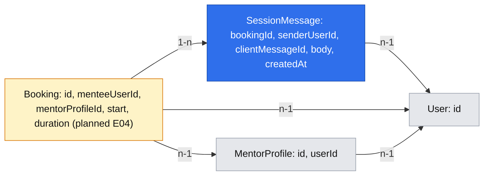

# E05 — Private text sessions (#32, stories #44–#45)

- Authority: [product brief](product-brief.md), [backlog](backlog.md), [E01](implemented/2026-10-17-accounts-and-roles.md), [E02](implemented/2026-10-18-mentor-setup.md), [E03](2026-11-03-mentor-discovery.md), [E04](2026-11-04-booking-and-payment.md), [platform primitives](2026-10-17-platform-primitives.md).
- Status: proposed future behavior. E04's booking model is specified but not implemented in the inspected tree; E05 depends on confirmed bookings from E04.
- Product owner gate, 2026-11-05: one spec for #44 and #45 in two phases; retained past messages stay readable to the two participants. Retention and deletion policy is deferred, with no automatic deletion and no promise of permanent storage.

## 📝 TLDR

Mentees and mentors currently cannot find or use a private text session in DevMentor. **Proposed future behavior:** after E04 confirms payment, each participant finds the booking in their own upcoming or past list and opens a session screen; both can exchange plain text during the booked 25- or 50-minute window and read retained messages afterward. The booking, rather than a new session record, defines who may enter and when sending is open.

## 📝 Problem Statement

[Epic #32](https://github.com/rafsaw/ai_techleaders/issues/32) asks for a private paid exchange; [story #44](https://github.com/rafsaw/ai_techleaders/issues/44) requires participant-only upcoming and past lists, and [story #45](https://github.com/rafsaw/ai_techleaders/issues/45) requires stored text during the booked window and read-only past sessions. The [product brief](product-brief.md) records developers with specific blockers and the D10/D15 product choices; A01 willingness to pay, A03 willingness to wait and A06 whether text is enough remain untested. E04 promises a confirmed booking and participant-only booking detail, but explicitly leaves lists and the session screen to E05.

## 📝 Proposed Solution

Keep one spec because the two stories form one paid-session journey, while shipping them in order. Phase 1 (#44) gives participants a list and a read-only session destination with booking information and a time-dependent state. Phase 2 (#45) adds stored plain-text messages and a composer to that screen. Separate specs were considered because a list can function alone, but would repeat the participant-access, route and time contracts the exchange must share.

Use E04's confirmed `Booking` as the authority for participant access, schedule and session identity. A checkout attempt, public slot ID, email link or current mentor role is never sufficient to read or send. No standalone `Session` entity, chat provider, WebSocket, polling job, event bus or moderation console is needed.

## 📝 Research

| Source | Useful lesson | Simplification for E05 |
| --- | --- | --- |
| Open-source [Zulip channel permissions](https://api.zulip.com/help/channel-permissions) and [message retrieval](https://docs.zulip.com/api/get-messages) | Content visibility and posting are separate checks; ordered, bounded reads make history usable. | A booking fixes exactly two members; no channel administration, topics, presence or realtime feed. |
| Open-source [Mattermost channel types](https://docs.mattermost.com/end-user-guide/collaborate/channel-types) and [post API permission contract](https://github.com/mattermost/mattermost/blob/master/api/v4/source/posts.yaml) | A private conversation authorizes each read and post. | No team/channel roles, reactions, attachments, edit history or operator content view. |
| Existing [Codementor](research/2026-09-04-benchmark-codementor.md) and [Topmate](research/2026-09-04-benchmark-topmate.md) benchmarks | A paid-help flow needs a clear path from booking to the exchange. | These older snapshots do not validate DevMentor demand; D10 remains the format authority. |

These products are communication references, not evidence for A06. Their full moderation and notification systems are unnecessary for the two stories.

## 📝 Architecture

E04's `Booking` owns immutable start, duration, mentee user ID and mentor profile ID; the mentor user is resolved through the profile. Add one `SessionMessageService` under `packages/app/src/server/services/sessions/` for participant-scoped history and sending. It uses the scoped `em` and `clock`, returns DTOs rather than entities or HTTP responses, and is registered in the request container. Signed-in pages live under `packages/app/src/app/(app)/sessions/`; the POST route uses `apiHandler({ access: "user" })`, the existing CSRF/envelope and the shared `apiCall`. A session read or send never calls Stripe.

Finalize two provisional platform primitives when E05 uses them:

- **P5 participant assertion:** `assertParticipant(principal: Principal, participantUserIds: readonly string[]): void` beside E02's `assertOwner` in `core/src/http/auth.ts`, exported from `@devmentor/core`. It throws `NotFoundError` for a nonparticipant. E04 and E05 pass user IDs from the loaded booking's mentee and mentor-profile owner, never from the request. E04's participant-only booking detail can use it without changing its neutral 404 or DTO. The caller derives the mentee/mentor perspective after access passes; an operator has no content override.
- **P15 time window:** pure `sessionWindow(start, durationMinutes, now): "upcoming" | "open" | "ended"` in `core/src/time/windows.ts`, exported from `@devmentor/core` beside E04's `isBookable`. The window is `[start, start + duration)`: exactly at start is open; exactly at end is ended. Callers use `clock.now()` and the immutable booking snapshot, never browser time or the slot's reserved 50-minute block.
- **F6 signed-in list:** use the existing `DataTable` without CRUD actions, plus `EmptyState`, `LoadingMessage` and `ErrorMessage`. The participant list is its first domain consumer; no general list system is added. Session-specific display stays page-local until a second consumer appears.

Use E03's planned shared `LocalTime` component for named viewer-zone display once E03 lands; do not add a second date formatter. The mentor slot's 50-minute reservation does not determine E05's 25/50-minute message window.

List queries restrict bookings to `mentee_user_id = principal.userId` or a mentor profile owned by that user; each detail/history/send request also rechecks participation. An account holding both roles gets one row per booking. Losing the mentor role later does not rewrite booked participant identity. List and detail expose no other person's email, payment IDs, checkout state or message excerpt.

Messages are plain text, escaped on render; preserve line breaks but never render HTML or Markdown. No attachments, link previews or remote-media fetches. Never put message bodies in email, logs, analytics, error causes, page metadata or URL parameters. There is no general content-encryption primitive in the repository; this spec adds no custom crypto. Database and backup access remains an operator/hosting boundary under brief Q05/Q08.

## 📝 Data Model

Blue is new E05 data, amber is E04's planned booking, and gray is already modeled in E01/E02. The [interactive graph](../data-model/2026-11-04-text-sessions.md.html) is a convenience; the Mermaid diagram is the model of record.

Add `session_messages` in Phase 2 only: inherited UUID `id`, `created_at`, `updated_at`; `booking_id` FK to `bookings.id` with `ON DELETE RESTRICT`; `sender_user_id` FK to `users.id` with `ON DELETE RESTRICT`; `client_message_id` UUID; and `body` text. Unique `(booking_id, sender_user_id, client_message_id)` makes one draft repeat-safe. Index `(booking_id, created_at DESC, id DESC)` supports bounded history. The sender FK alone does not establish permission: the service checks the booking's two users. Define the entity with MikroORM v7 `defineEntity`/`p`, register it explicitly, and add a reversible migration. No `Session` table or booking column is needed.

Store the exact submitted text, including whitespace and line breaks, after validation. Accept 1–4,000 Unicode code points, require at least one non-whitespace code point, and reject NUL and control characters other than tab and newline. Do not trust client timestamps; use one server clock value for the acceptance check and `createdAt`. A later policy may require a migration, but this phase adds no expiry column, deletion job or permanent-storage promise. Production rollback keeps the table and message data; migration `down()` is for disposable databases because it destroys conversation content.

## 📝 API Contracts

| Surface | Contract |
| --- | --- |
| `GET /sessions` | Request-time signed-in page; signed out follows E01 sign-in with `returnTo=/sessions`. Query only the caller's confirmed bookings. Split server-side into Upcoming (including open) and Past; start ascending for Upcoming, most recently ended first for Past. No new public API or booking state. |
| `GET /sessions/[bookingId]` | Request-time participant-only page. Validate UUID; missing, unconfirmed or foreign booking gets neutral 404, including metadata. Phase 1 shows booking time, other participant display name, text-only note and time state; Phase 2 adds history. Private/no-store and noindex, with no body or other participant in metadata. |
| `GET /sessions/[bookingId]?before=<messageId>` | Phase 2 older-history page: up to 100 messages before the cursor in `(createdAt,id)` order. The cursor must belong to this booking; malformed/foreign cursor gets neutral 404. Show an Earlier messages link only when older records exist. The newest page is the send/refresh destination; older pages are read-only. No history JSON route. |
| `POST /api/sessions/[bookingId]/messages` | Phase 2, `access: "user"`, existing CSRF. Body `{ clientMessageId: uuid, body: string }`; booking ID comes from path and sender from `principal.userId`. A replay with the same ID and exact body returns the original `{ id, createdAt }` (200), including after close; same ID with changed body is 409. A new send succeeds only while `sessionWindow === "open"` and returns the same DTO (200). Invalid input → 400, signed out → 401, foreign/absent booking → 404, outside window → 409 with not-started/ended copy, existing rate-limit refusal → 429. |

Use `parseInput` with an isomorphic validator in `@devmentor/core/validators/sessions/` and the common `AppError` mapping. Generate `clientMessageId` once per draft and retain it for a network retry. The service checks participant access and an existing replay before the window, so an in-window send whose response was lost can be recognized after the end. Concurrent duplicate POSTs resolve through the unique constraint to the same row, never two. Define a modest P11 per-user send limit next to the service (30 attempts per minute); count it before the write transaction, including failed attempts, using the existing hashed-key limiter and 429/Retry-After. The server always rechecks the window even if a stale browser still displays a composer.

## 📝 UI/UX

### Flow 1 — find a booked session (#44)

From `/account`, a participant follows **My sessions** to `/sessions`; E04's confirmed booking detail also links to the session once E05 exists. A booked mentor-slot entry already links to that detail under E04. The page shows Upcoming and Past in separate labelled sections. Each row has the other participant's display name, scheduled start, duration, named viewer timezone and a clear **Open session** link. An active booking stays in Upcoming with **In progress** until the exact end, then appears in Past on the next request. No bookings produces one clear empty state; an empty section identifies which kind is empty. A signed-out visit follows E01's sign-in return flow. The list shows no payment or message excerpt.

In Phase 1, **Open session** reaches a useful read-only screen even before messaging exists: booking facts, its time state, the text-only statement and a link back to My sessions. Do not show a disabled composer or promise that chat is available yet. In Phase 2, an upcoming session explains when sending opens; an open session shows the composer; a past one shows retained history and says sending has ended. Never claim the mentor is online or will answer immediately.

### Flow 2 — exchange and revisit text (#45)

At or after the start, each participant refreshes the session page and writes plain text in a labelled multiline field. With no history, say **No messages yet**; prompt the mentee to describe the blocker here, while the mentor sees that the mentee has not written yet. **Send message** submits through `apiCall`; only a confirmed response clears the draft, then the page refreshes to show the stored message. **Refresh messages** or a browser refresh retrieves the other person's latest messages. No realtime or automatic polling promise. On a network error, keep the draft and its `clientMessageId`, so Retry cannot duplicate it. On a time-window 409, refresh and explain **Session has not started** or **Session has ended**; keep the unsent text available to copy. A past participant can page through older history but cannot compose. Arriving late never extends the booked end.

Display sender name, server time and text in chronological order; preserve line breaks and distinguish the caller's messages without relying on color alone. Use semantic list/paragraph elements, a real label for the textarea, keyboard-accessible actions and a polite status announcement after a send or error. Use signed-in shadcn primitives, existing theme tokens and feedback components; keep session-specific composition near the page. Every state visibly says **Text session only — no audio or video** (N01). No E05 prototype version is accepted.

There is no edit, unsend or delete action in E05. Sending commits the text to the private history; the composer must clearly identify **Send message** as that action, and the product must not imply a later undo.

## 📝 Edge Cases & Failure Scenarios

| Trigger | Participant-visible result / invariant |
| --- | --- |
| Signed-out or expired account session | Redirect to sign-in with safe returnTo; a 401 during send uses E01's full-navigation session-expired path. A locally typed draft is not claimed as saved. |
| Foreign, malformed, missing or unconfirmed booking ID; foreign history cursor | Neutral 404 for page and API, without participant names or timing leak. The list query never returns the booking. |
| Exactly at start / exactly at end | P15 boundary: start permits new send, end refuses it. An idle browser may look stale; the server decision wins and refresh corrects the screen. |
| Two roles on one account; mentor role revoked later | Booking relations decide access; role labels do not add or remove a participant. One list row per booking. |
| Concurrent clicks, lost response, retry after end | Same `clientMessageId` and body return one stored row; changed body conflicts. A fresh ID after end is refused. |
| Empty, whitespace-only, oversized or control-character body | Field error, no storage; entered text remains available to correct. Accepted text renders escaped, without rich HTML or remote media. |
| Database read/write failure | Existing generic error UI and 500 envelope; never report an unconfirmed send as delivered. Retry with the same draft ID. |
| Many messages | Load at most 100 at once with stable order and an older-history cursor. A past participant can reach all retained pages. |
| Operator-managed refund/cancellation outside DevMentor | E04 has no cancellation state to revoke a confirmed booking; that booking remains accessible. A later owner-approved rule must define any access change. |

## 📝 Risks & Impact Review

- **Private content:** Booked users may share code, configuration or personal information. Authorize each read and write, and keep content out of public pages, metadata, URLs, email, logs and telemetry. App operators get no content UI/API override, though database administrators and backups are a separate access boundary. No attachments or HTML rendering.
- **Retention:** The owner deferred retention/deletion and did not authorize a permanent-storage promise. Legal/data-processing ownership (brief Q05) and whether users may share employer code (Q08) remain release decisions or guidance before real-use launch. This spec does not resolve them through an invented default.
- **Irreversible send in this phase:** A participant cannot edit or unsend a message. This is a deliberate course-MVP limit, not a promise that content will remain forever. A later deletion/erasure policy may require schema, backup and operator-process changes.
- **Time and delivery:** The server's half-open window is authoritative; users may see a stale page until refresh. E04 booking emails are not message notifications. Payment and refund behavior is unchanged.
- **Paid release dependency:** E04 can create a booking before E05 exists, but a customer must not pay for a text session that cannot take place. Keep E04's `CHECKOUT_ENABLED` off for real users until E05 Phase 2, its isolation/window tests and E04's own release evidence pass. Phase 1 is independently usable with test or existing bookings, not a paid-production launch gate.
- **Two-person booking prerequisite:** D10 assumes a mentee and a different mentor. E04's current draft does not state a self-booking guard; its fulfillment must reject a mentee booking their own mentor profile before E05 can promise a two-person exchange. Verify this in E04 integration or add it there during implementation; E05 cannot repair an already confirmed self-booking.
- **Compatibility and rollback:** Routes, validator export, Cradle key, message entity/table and optional navigation link are additive. Sharing the participant assertion must preserve E04's existing detail response and neutral 404. Update `BACKWARD_COMPATIBILITY.md` and in-repo consumers if its internal shape changes. Roll back code while keeping message data; migration down is test-only.

## 📝 Decisions in play

| Id | E05 use |
| --- | --- |
| D10, R01 | Text inside the booked 25/50-minute window; no problem submission before booking and no realtime requirement. |
| D15 | Participant-only upcoming/past lists, other participant's display name and route to the session screen. |
| N01, N02 | Text-only statement on every session screen; no video/audio or ratings. |
| D12, R05–R10 | Cancellation, no-shows, refunds and disputes stay outside DevMentor; E05 adds no screens or workflow for them. |
| D13, D14 | E01 sign-in and dual-role account; invitation/current mentor role is not a session-access substitute. |
| D17 | E04 payment confirmation produces the booking before a session appears; an attempt or compensated payment is not a session. |

No active brief decision is superseded. The product owner approved the one-spec and deferred-retention gate choices on 2026-11-05; later retention, deletion or in-product cancellation rules need their own owner-approved decisions.

## 📋 Phasing

1. **Phase 1 — #44 private access and destination.** After E04 #43, participants find their confirmed bookings and open a time-aware, read-only session screen. No message table or composer. This is a working navigation flow on its own.
2. **Phase 2 — #45 booked-window exchange.** Add the message table, participant-scoped history, repeat-safe sending and refresh-based UI. Past reading continues after the window. This builds on Phase 1 without changing booking or payment behavior.

## 📋 Implementation Plan

### Phase 1 — #44: find and open a session

1. Add P15 `sessionWindow` with fixed-clock tests just before start, at start, just before end and at end for both durations. Add P5 participant assertion at E04's booking boundary; test mentee, mentor, dual role, role revocation, foreign user and absent booking. Preserve E04 booking detail's neutral 404.
2. Add participant-scoped booking-list DTO/query and `/sessions` leaf page. Use `DataTable` and existing feedback states; add **My sessions** from `/account`. Test signed-out returnTo, two-user isolation, empty lists, ordering, time split and in-progress state. This works with E04 bookings and no E05 schema.
3. Add `/sessions/[bookingId]` read-only screen and list-row links. Reuse the participant assertion for page and metadata, neutral 404 for foreign/missing/unconfirmed IDs, private/no-store and noindex. Show time, duration, other display name and N01 statement. Add an E04 booking-detail link only where a confirmed booking is already visible to that participant. Test direct URL, metadata nonleak, narrow/keyboard states and end boundary.
4. Verify the Phase 1 flow with PostgreSQL integration and a real browser: mentee and mentor reach the same booking, a third account sees neither list row nor detail, signed-out requests return to the intended path, and E04 cannot confirm a self-booking. Update affected design-system/compatibility docs; run scoped lint, typecheck, 100%-per-file coverage, build, integration, Storybook and token checks. Keep live behavior dependent on E04's release gate.

### Phase 2 — #45: exchange and read text

1. Add `SessionMessage` entity, explicit registration and reversible migration, body validator and unique retry key/index. Test migration up/down on a disposable database and duplicate-key persistence under concurrent requests; do not rewrite existing booking or slot data.
2. Add `SessionMessageService` with participant-scoped newest-100/older-cursor reads and repeat-safe send. Test absent/foreign booking and cursor, role changes, body validation, exact time boundaries, lost-response retry after end, same-key/different-body conflict, two simultaneous sends and DB errors. Return DTOs and never log bodies.
3. Add POST `apiHandler` route and client composer with existing `apiCall`, 429 handling and retained draft ID; after send, refresh the server-rendered newest page. Test 400/401/404/409/429/500, CSRF, no duplicate send, accessible status and plain-text escaping. Add older-history navigation and read-only past view; verify there is no polling, media or unsanctioned fetch.
4. Run PostgreSQL integration and browser journeys with two participants and a nonparticipant across start/end, message persistence after refresh, past paging and uncertain-response retry. Update the spec status, platform catalog P5/P15/F6, design-system and compatibility records as affected. Keep real-user checkout disabled until this flow and E04's own release checks pass. Run `npm run lint`, `npm run typecheck`, `npm run build`, `npm run test:coverage`, `npm run test:integration`, `npm run check:agents` and affected UI `npm run test:storybook`/`npm run check:tokens`. Autonomous implementation logs under `.ai/runs/`; this design task adds no implementation log.
