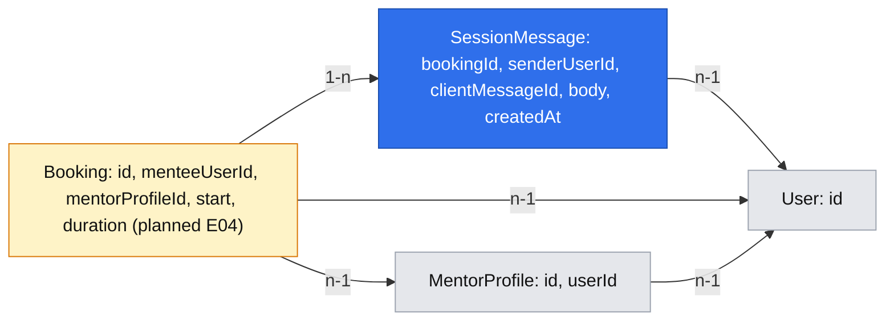

# E05 — Private text sessions (#32, stories #44–#45)

- Authority: [product brief](product-brief.md), [backlog](backlog.md), [E01](implemented/2026-10-17-accounts-and-roles.md), [E02](implemented/2026-10-18-mentor-setup.md), [E03](2026-11-03-mentor-discovery.md), [E04](2026-11-04-booking-and-payment.md), [platform primitives](2026-10-17-platform-primitives.md).
- Status: proposed future behavior. E04's booking model is specified but not implemented in the inspected tree; E05 depends on confirmed bookings from E04.
- Product owner decisions: [D18](research/decisions/2026-11-05-d18-text-session-experience.md) records the approved one-spec/two-phase scope, retained past reading with deletion policy deferred, no edit/unsend/delete UI, 4,000-code-point limit, 100-message history pages, visible-tab polling, immediate return refresh and final read at the booked end. D10's participant and server-window rules remain active.

## 📝 TLDR

Mentees and mentors currently cannot find or use a private text session in DevMentor. **Proposed future behavior:** after E04 confirms payment, each participant finds the booking in their own upcoming or past list and opens a session screen; both can exchange plain text during the booked 25- or 50-minute window and read retained messages afterward. During an active session, a visible browser tab checks for messages every five seconds. The booking, rather than a new session record, defines who may enter and when sending is open.

## 📝 Problem Statement

[Epic #32](https://github.com/rafsaw/ai_techleaders/issues/32) asks for a private paid exchange; [story #44](https://github.com/rafsaw/ai_techleaders/issues/44) requires participant-only upcoming and past lists, and [story #45](https://github.com/rafsaw/ai_techleaders/issues/45) requires stored text during the booked window and read-only past sessions. The [product brief](product-brief.md) records developers with specific blockers and the D10/D15 product choices; A01 willingness to pay, A03 willingness to wait and A06 whether text is enough remain untested. E04 promises a confirmed booking and participant-only booking detail, but explicitly leaves lists and the session screen to E05.

## 📝 Proposed Solution

Keep one spec because the two stories form one paid-session journey, while shipping them in order. Phase 1 (#44) adds a private list and time/text-only state to E04's existing participant-only `/bookings/[id]` page. Phase 2 (#45) adds stored plain-text messages and a composer to that same page. Separate specs were considered because a list can function alone, but would repeat the participant-access, route and time contracts the exchange must share.

Use E04's confirmed `Booking` as the authority for participant access, schedule and session identity. A checkout attempt, public slot ID, email link or current mentor role is never sufficient to read or send. A page-local browser timer polls the existing application over HTTP; no standalone `Session` entity, external chat provider, WebSocket, background polling service, event bus or moderation console is needed.

## 📝 Research

| Source | Useful lesson | Simplification for E05 |
| --- | --- | --- |
| Open-source [Zulip channel permissions](https://api.zulip.com/help/channel-permissions) and [message retrieval](https://docs.zulip.com/api/get-messages) | Content visibility and posting are separate checks; ordered, bounded reads make history usable. | A booking fixes exactly two members; no channel administration, topics, presence or realtime feed. |
| Open-source [Mattermost channel types](https://docs.mattermost.com/end-user-guide/collaborate/channel-types) and [post API permission contract](https://github.com/mattermost/mattermost/blob/master/api/v4/source/posts.yaml) | A private conversation authorizes each read and post. | No team/channel roles, reactions, attachments, edit history or operator content view. |
| Existing [Codementor](research/2026-09-04-benchmark-codementor.md) and [Topmate](research/2026-09-04-benchmark-topmate.md) benchmarks | A paid-help flow needs a clear path from booking to the exchange. | These older snapshots do not validate DevMentor demand; D10 remains the format authority. |

These products are communication references, not evidence for A06. Their full moderation and notification systems are unnecessary for the two stories. Five-second visible-tab polling is the PO's E05 delivery choice; it does not imply instant delivery.

## 📝 Architecture

E04's `Booking` owns immutable start, duration, mentee user ID and mentor profile ID; the mentor user is resolved through the profile. E04 inserts a Booking only after verified payment, so an attempt or unknown UUID is simply a missing Booking. E04's `BookingService` owns participant-scoped booking projections; E05 adds `listForParticipant(principal)` there and uses its existing participant detail on `/bookings/[id]`. The private `/sessions` page renders two simple server-side lists from those DTOs. E05 adds `SessionMessageService` under `packages/app/src/server/services/sessions/` only for message history and sending. It uses the scoped `em` and `clock`, returns DTOs rather than entities or HTTP responses, and is registered in the request container. GET and POST message routes use `apiHandler({ access: "user" })`, the existing envelope and shared `apiCall` (CSRF applies to POST). A session read or send never calls Stripe.

Finalize two platform primitives when E05 uses them:

- **P5 participant assertion:** `assertParticipant(principal: Principal, participantUserIds: readonly string[]): void` beside E02's `assertOwner` in `core/src/http/auth.ts`, exported from `@devmentor/core`. It always throws `NotFoundError` for a nonparticipant; there is no optional conceal flag or operator override. E04 and E05 pass user IDs from the loaded booking's mentee and mentor-profile owner, never from the request. E04's participant-only detail keeps its neutral 404 and DTO.
- **P15 time window:** pure `sessionWindow(start, durationMinutes, now): "upcoming" | "open" | "ended"` in `core/src/time/windows.ts`, exported from `@devmentor/core` beside E04's `isBookable`. The window is `[start, start + duration)`: exactly at start is open; exactly at end is ended. Callers use `clock.now()` and the immutable booking snapshot, never browser time or the slot's reserved 50-minute block.
F6 is declined. The participant list uses two semantic server-rendered lists, page-local rows and the existing signed-in `EmptyState`; it needs no `DataTable`, client wrapper, generic list primitive or unused loading/error branches.

Use E03's planned shared `LocalTime` component for named viewer-zone display once E03 lands; do not add a second date formatter. The mentor slot's 50-minute reservation does not determine E05's 25/50-minute message window.

Only `BookingService.listForParticipant(principal)` queries the list: `mentee_user_id = principal.userId` or a mentor profile owned by that user. It returns one DTO per Booking, sorted Upcoming by start and Past by actual end (`start + duration`) descending. It returns booking ID, start, duration and other participant's display name; no message data, payment IDs or email. Each detail/history/send request rechecks participation. An account holding both roles gets one row per booking; losing the mentor role later does not rewrite booked participant identity. `SessionMessageService` never owns booking-list queries.

In Phase 2, the newest `/bookings/[id]` page renders the latest 100 messages, `window`, `serverNow` and `endsAt` on the server. On that newest page only, the client calls a participant-checked GET every five seconds while the server-booked window is open and `document.visibilityState === "visible"`. Send the newest displayed message ID as an `after` cursor; an unchanged read returns no message bodies. Up to 100 new messages arrive per read; `hasMore` allows sequential catch-up, and the Earlier messages path preserves access to all retained history. Never overlap requests. Hidden tabs and `?before=` older pages pause polling; returning to a visible newest page refreshes immediately and resumes only if open. A one-shot start-time transition activates the newest page; at the exact booked end stop sending and recurring polling, then perform one final message read if the newest page is visible. A hidden/older page makes no end-time network request; its next visible/latest visit reads history. Abort or ignore stale in-flight responses on hide, navigation or end; the final read is a separate one-shot request. Client timers use server-provided time for scheduling, while the service's `clock.now()` decides the window. No shared polling infrastructure is added.

Messages are plain text, escaped on render; preserve line breaks but never render HTML or Markdown. No attachments, link previews or remote-media fetches. Never put message bodies in email, logs, analytics, error causes, page metadata or URL parameters. There is no general content-encryption primitive in the repository; this spec adds no custom crypto. Database and backup access remains an operator/hosting boundary under brief Q05/Q08.

## 📝 Data Model

Blue is new E05 data, amber is E04's planned booking, and gray is already modeled in E01/E02. The [interactive graph](../data-model/2026-11-04-text-sessions.md.html) is a convenience; the Mermaid diagram is the model of record.

Add `SessionMessage` at `packages/db/src/entities/sessions/session-message.entity.ts` and its `session_messages` table in Phase 2 only: inherited UUID `id`, `created_at`, `updated_at`; `booking_id` FK to `bookings.id` with `ON DELETE RESTRICT`; `sender_user_id` FK to `users.id` with `ON DELETE RESTRICT`; `client_message_id` UUID; and `body` text. Unique `(booking_id, sender_user_id, client_message_id)` makes one draft repeat-safe. Index `(booking_id, created_at DESC, id DESC)` supports bounded history. The sender FK alone does not establish permission: the service checks the booking's two users. Define the entity with MikroORM v7 `defineEntity`/`p`, register it explicitly, and add a reversible migration. No `Session` table or booking column is needed.

Normalize CRLF and lone CR to LF before validation, replay comparison and storage. Preserve all other whitespace and line breaks without trimming. Accept 1–4,000 Unicode code points in the normalized body, require at least one non-whitespace code point, and reject NUL and control characters other than tab and LF. Thus newline spelling never creates a false same-key/different-body conflict. Do not trust client timestamps; use one server clock value for the acceptance check and `createdAt`. A later policy may require a migration, but this phase adds no expiry column, deletion job or permanent-storage promise. Production rollback keeps the table and message data; migration `down()` is for disposable databases because it destroys conversation content.

## 📝 API Contracts

| Surface | Contract |
| --- | --- |
| `GET /sessions` | Request-time signed-in page; signed out follows E01 sign-in with `returnTo=/sessions`. Call `BookingService.listForParticipant(principal)`; no separate list service or public API. Split server-side into Upcoming (including open) and Past. Sort Upcoming by start ascending, Past by actual end (`start + duration`) descending. |
| `GET /bookings/[id]` | E04's sole participant-only booking/session detail. E05 Phase 1 adds the window status and text-only note; Phase 2 adds the latest 100 messages and composer. Validate Booking UUID before lookup; a checkout-attempt ID, unknown UUID or foreign booking gets neutral 404 in render and metadata. Private/no-store and noindex; no message body or participant identity in metadata. |
| `GET /bookings/[id]?before=<messageId>` | Phase 2 older-history view, at most 100 messages before the cursor in `(createdAt,id)` order. Cursor must belong to this Booking; malformed/foreign cursor → neutral 404. **Earlier messages** reaches all retained history, and **Latest messages** returns to the newest view. Older views have no composer or automatic polling. |
| `GET /api/bookings/[id]/messages` | Phase 2, `access: "user"`, private/no-store. No cursor returns the latest 100 with `hasEarlier`. `?after=<messageId>` returns at most 100 newer messages in ascending order plus `hasMore`; unchanged polls return `messages: []` and do not resend old bodies. `?clientMessageId=<uuid>` returns the caller's exact previously sent message for 409 recovery. Each response includes server `window, serverNow, endsAt`. Mutually exclusive query modes; invalid syntax → 400, foreign cursor/key or missing/foreign Booking → neutral 404, signed out → 401, read-limit refusal → 429 with Retry-After, read failure → 500. All modes recheck participation. |
| `POST /api/bookings/[id]/messages` | Phase 2, `access: "user"`, existing CSRF. Body `{ clientMessageId: uuid, body: string }`; Booking ID comes from path and sender from `principal.userId`. A new in-window send and a same-key/same-normalized-body replay both return the identical saved `SessionMessageDto` shape (200), including a replay after close. Same key with changed normalized body → 409. Invalid input → 400, signed out → 401, missing/foreign Booking → 404, new send outside window → 409, send-limit refusal → 429. |

The page and GET API share `SessionMessageService`; the GET adds no storage or queue. `SessionMessageDto` contains `id, senderDisplayName, isOwn, body, createdAt`, never participant IDs, emails or payment data. Normalize new and replay bodies identically before validation/comparison. Use `parseInput` with an isomorphic validator in `@devmentor/core/validators/sessions/` and the common `AppError` mapping. Generate `clientMessageId` once per draft and retain it for a network retry. Check participant access and an existing replay before the window, so an in-window send whose response was lost can be recognized after the end. Concurrent duplicate POSTs resolve through the unique constraint to the same saved DTO, never two rows. Define P11 limits beside the service: 60 message GETs per user per minute (headroom for the five-second cadence) and 30 send attempts per user per minute. Apply the existing hashed-key Postgres limiter before business transactions/reads, including failed attempts; use its 429/Retry-After contract and no new infrastructure. The server always rechecks the window even if a stale browser still displays a composer.

## 📝 UI/UX

### Flow 1 — find a booked session (#44)

From `/account`, a participant follows **My sessions** to `/sessions`; E04's confirmed checkout return and booked mentor-slot entry already reach the same `/bookings/[id]` detail. The list page renders Upcoming and Past as two simple semantic server-rendered lists with page-local rows and existing `EmptyState`; it needs no `DataTable`, client wrapper or new list primitive. Each row has the other participant's display name, scheduled start, duration, named viewer timezone and an **Open session** link to `/bookings/[id]`. An active booking stays in Upcoming with **In progress** until the exact end, then appears in Past ordered by actual end time. No bookings produces one clear empty state; an empty section identifies which kind is empty. A signed-out visit follows E01's sign-in return flow. The list shows no payment or message excerpt.

In Phase 1, E04's detail gains booking-window status, the text-only statement and a link to My sessions. It remains useful before messaging exists; do not show a disabled composer or promise chat is available yet. In Phase 2, an upcoming detail explains when sending opens and makes a one-time transition at the scheduled start; the newest detail view shows the composer and five-second message updates while open; a past detail shows retained history without recurring polling. Never claim the mentor is online or will answer immediately.

### Flow 2 — exchange and revisit text (#45)

During the open window on the newest `/bookings/[id]` view, each participant writes plain text in a labelled multiline field. With no history, say **No messages yet**; prompt the mentee to describe the blocker here, while the mentor sees that the mentee has not written yet. **Send message** submits through `apiCall`; only a confirmed response clears the draft and adds the saved message. While this newest view and tab are visible, incremental reads update messages every five seconds. Hiding the tab pauses reads; returning refreshes immediately and resumes only if the server still reports an open window. At the exact booked end, stop sending/recurring polling and make one final read on a visible newest view so late stored messages appear. A past detail never polls. A reader following **Earlier messages** sees 100 at a time, with a persistent **Latest messages** link; older views pause polling and have no composer. Returning to Latest resumes polling only if still open. This is periodic refresh, not a promise of instant delivery.

On a send network error, keep the draft and its `clientMessageId`, so Retry cannot duplicate it. If the user edits that draft and retries with the old ID, a same-key/different-normalized-body 409 means the original was already sent: refresh the newest history, show the original saved message (using the own-message key lookup if it has left the latest 100), explain **Already sent; send your correction as a new message**, retain the edited text and assign it a new `clientMessageId`. On a time-window 409, update the screen and explain **Session has not started** or **Session has ended**; keep unsent text available to copy. Arriving late never extends the booked end. A polling failure keeps displayed messages, shows a quiet retryable status and tries again on the next visible tick; authentication loss follows E01's sign-in path.

Display sender name, server time and text in chronological order; preserve line breaks and distinguish the caller's messages without relying on color alone. Use semantic list/paragraph elements, a real label for the textarea, keyboard-accessible actions and a polite status announcement after a send or error. Use signed-in shadcn primitives, existing theme tokens and feedback components; keep session-specific composition near the page. Every state visibly says **Text session only — no audio or video** (N01). No E05 prototype version is accepted.

There is no edit, unsend or delete action in E05. Sending commits the text to the private history; the composer must clearly identify **Send message** as that action. A participant can correct an error with a follow-up message during the booked window, not by changing history. After the window, no correction can be sent in the product.

## 📝 Edge Cases & Failure Scenarios

| Trigger | Participant-visible result / invariant |
| --- | --- |
| Signed-out or expired account session | Redirect to sign-in with safe returnTo; a 401 during send uses E01's full-navigation session-expired path. A locally typed draft is not claimed as saved. |
| Foreign, malformed or missing Booking ID; checkout-attempt ID; foreign history cursor | Neutral 404 for page and API, without participant names or timing leak. E04 creates no unconfirmed Booking, and the list query never returns a missing or foreign booking. |
| Exactly at start / exactly at end | P15 boundary: start permits a new send, end refuses it. An already-open upcoming page makes one start-time refresh. At end, the visible newest page stops sending and recurring polling, then makes one final read of stored messages; ended history stays readable. Server checks win if a browser timer is early or late. |
| Tab becomes hidden while a poll is pending | Cancel the pending read and timer; do not start another hidden-tab request. A late response is ignored, leaving the visible history intact. |
| Tab returns before or after the end | On the newest page, refresh immediately and recheck the server window. Resume five-second polling only if still open; show the final read-only state without recurring polling if ended. An older page stays paused until **Latest messages** is chosen. |
| Poll takes longer than five seconds, fails or is rate limited | Never overlap requests. Keep the last confirmed messages and draft, show a quiet update error, and try again on the next visible tick; for 429, honor `Retry-After` before another read. A 401 uses E01 sign-in handling; a 404 stops polling and shows neutral access failure. |
| Two roles on one account; mentor role revoked later | Booking relations decide access; role labels do not add or remove a participant. One list row per booking. |
| Concurrent clicks, lost response, retry after end or edited draft | Same `clientMessageId` and normalized body return one stored row with the same DTO; changed body conflicts. After a mismatch 409, refresh newest history, retrieve the caller's original message by key if needed, explain it was sent, retain edited text and give that draft a new ID. A fresh ID after end is refused. |
| Empty, whitespace-only, oversized or control-character body | Field error, no storage; entered text remains available to correct. Accepted text renders escaped, without rich HTML or remote media. |
| Database read/write failure | Existing generic error UI and 500 envelope; never report an unconfirmed send as delivered. Retry with the same draft ID. |
| More than 100 retained messages, including new messages while reading an older page | Each read returns at most 100 in stable order. **Earlier messages** reaches every retained page; older pages pause polling and hide the composer. **Latest messages** returns to the newest view, refreshes, and resumes polling if still open. An unchanged incremental poll sends no old message bodies. Past sessions do not poll. |
| Operator-managed refund/cancellation outside DevMentor | E05 adds no no-show or cancellation workflow. E04 has no cancellation state to revoke a confirmed booking; that booking remains accessible. A later owner-approved rule must define any access change. |

## 📝 Risks & Impact Review

- **Private content:** Booked users may share code, configuration or personal information. Authorize each read and write, and keep content out of public pages, metadata, URLs, email, logs and telemetry. App operators get no content UI/API override, though database administrators and backups are a separate access boundary. No attachments or HTML rendering.
- **Retention:** The owner deferred retention/deletion and did not authorize a permanent-storage promise. Legal/data-processing ownership (brief Q05) and whether users may share employer code (Q08) remain release decisions or guidance before real-use launch. This spec does not resolve them through an invented default.
- **Irreversible send in this phase:** A participant cannot edit, unsend or delete a message through E05; a follow-up correction is possible only while sending is open. This is a deliberate course-MVP limit, not a promise that content will remain forever. A later deletion/erasure policy may require schema, backup and operator-process changes.
- **Time and delivery:** The server's half-open window remains authoritative for sends; client timers only schedule reads and display transitions. A visible newest open page can lag the other participant by up to roughly five seconds plus request latency; it makes one final read at the exact end. Hidden, older-history and past pages do not recur. E04 booking emails are not message notifications. Payment and refund behavior is unchanged.
- **Polling load and session activity:** Each visible newest open tab makes about 12 authenticated incremental GETs per minute; unchanged replies contain no old message bodies. The existing Postgres rate limiter caps message reads at 60 per user per minute, with `Retry-After` on 429. There are no overlapping reads or new infrastructure. Under E01's request-based activity rule, these GETs renew an otherwise idle sign-in session while the tab remains visible; hidden tabs pause and do not keep it alive.
- **Paid release dependency:** E04 can create a booking before E05 exists, but a customer must not pay for a text session that cannot take place. Keep E04's `CHECKOUT_ENABLED` off for real users until E05 Phase 2, its isolation/window tests and E04's own release evidence pass. Phase 1 is independently usable with test or existing bookings, not a paid-production launch gate.
- **Two-person booking prerequisite:** D10 assumes a mentee and a different mentor. E04 requires `menteeUserId != mentorProfile.userId` before checkout and before a paid claim confirms a Booking, with its own edge and integration tests. E05 depends on that E04 guard; it does not implement it.
- **Compatibility and rollback:** Routes, validator export, Cradle key, message entity/table and optional navigation link are additive. Sharing the participant assertion must preserve E04's existing detail response and neutral 404. Update `BACKWARD_COMPATIBILITY.md` and in-repo consumers if its internal shape changes. Roll back code while keeping message data; migration down is test-only.

## 📝 Decisions in play

| Id | E05 use |
| --- | --- |
| D10, R01 | Text inside the booked 25/50-minute window; no problem submission before booking. D10 permits refresh without realtime transport; the PO's E05 choice adds five-second visible-tab polling through the existing API. |
| D15 | Participant-only upcoming/past lists, other participant's display name and route to the session screen. |
| N01, N02 | Text-only statement on every session screen; no video/audio or ratings. |
| D12, R05–R10 | Cancellation, no-shows, refunds and disputes stay outside DevMentor; E05 adds no screens or workflow for them. |
| D13, D14 | E01 sign-in and dual-role account; invitation/current mentor role is not a session-access substitute. |
| D17 | E04 payment confirmation produces the booking before a session appears; an attempt or compensated payment is not a session. |
| D18 | One spec/two phases; past retained reading; no edit/unsend/delete; 4,000 code points; 100-message pages; five-second visible newest-page polling, immediate return refresh and one final read at end. |

No active brief decision is superseded. D18 records the product owner's 2026-11-05 choices; later retention, deletion or in-product cancellation rules need their own owner-approved decisions.

## 📋 Phasing

1. **Phase 1 — #44 private access and destination.** After E04 #43, participants find their confirmed bookings and open E04's `/bookings/[id]` detail with a time-aware, text-only session state. No message table or composer. This is a working navigation flow on its own.
2. **Phase 2 — #45 booked-window exchange.** Add the message table, participant-scoped 100-message history, repeat-safe sending and incremental five-second polling on a visible newest page during the open window. Past reading continues without polling after the window. This builds on Phase 1 without changing booking or payment behavior.

## 📋 Implementation Plan

### Phase 1 — #44: find and open a session

1. Add P15 `sessionWindow` with fixed-clock tests just before start, at start, just before end and at end for both durations. Finalize P5 `assertParticipant(principal, participantUserIds)` beside E02's assertion; test mentee, mentor, dual role, role revocation and foreign user. E04 owns the self-booking guard and its integration test; preserve its booking detail's neutral 404.
2. Extend E04's `BookingService` with `listForParticipant(principal)` and add the `/sessions` leaf page. Render two semantic server-side lists, Upcoming and Past, with page-local rows and existing `EmptyState`; add **My sessions** from `/account`. Test signed-out returnTo, two-user isolation, empty lists, start/actual-end ordering, time split and in-progress state. Do not add pagination or a client list wrapper. This works with E04 bookings and no E05 schema.
3. Extend E04's `/bookings/[id]` participant detail and list-row links with the read-only session window and text-only statement. Reuse the participant assertion for page and metadata; foreign/missing Booking, checkout-attempt ID and malformed ID get neutral 404. Keep private/no-store and noindex, with no private content in metadata. Test direct URL, metadata nonleak, narrow/keyboard states and the end boundary.
4. Verify the Phase 1 flow with PostgreSQL integration and a real browser: mentee and mentor reach the same booking detail from their lists, a third account sees neither list row nor detail, and signed-out requests return to the intended path. Confirm E04's separate integration suite rejects self-booking before confirmation. Update affected design-system/compatibility docs; run scoped lint, typecheck, 100%-per-file coverage, build, integration, Storybook and token checks. Keep live behavior dependent on E04's release gate.

### Phase 2 — #45: exchange and read text

1. Add `SessionMessage` entity at `packages/db/src/entities/sessions/session-message.entity.ts`, explicit registration and reversible migration, 4,000-code-point normalized-body validator and unique retry key/index. Test CRLF/lone-CR normalization, exact limit, 4,001-code-point refusal, whitespace/control cases, migration up/down on a disposable database and duplicate-key persistence under concurrent requests; do not rewrite existing booking or slot data.
2. Add `SessionMessageService` with participant-scoped newest-100, older-cursor, incremental-after and own-key recovery reads, plus repeat-safe send. Test absent/foreign Booking and cursor, checkout-attempt ID, role changes, stable ordering across the 100-message boundary, access to every retained page, unchanged incremental response with zero old message bodies, catch-up after more than 100 new messages, exact start/end boundaries, final read after end, lost-response replay after end, same-key/different-body conflict, two simultaneous sends and DB errors. New send and replay return the same DTO; no edit/delete service or booking-list query.
3. Add participant-checked GET and repeat-safe POST `apiHandler` routes, then the composer and page-local visible-tab timer through existing `apiCall` on `/bookings/[id]`. Test GET's 400/401/404/429/500, `Retry-After` and private/no-store response; POST's 400/401/404/409/429/500 and CSRF; Postgres per-user read limit near 60/minute; and no duplicate send. With fake timers and visibility events, prove five-second visible newest-page polling, no overlap, hidden/older-page pause, immediate return and Latest refresh, one-shot transition at start, stop sending and recurring polling at exact end with one final visible read, no past-session polling, stale-response discard and navigation cleanup. Test edited-draft 409 recovery: show the stored original, retain edited text, assign a new ID; test accessible status, plain-text escaping and all Earlier/Latest pages. No WebSocket, media or direct `fetch`.
4. Run PostgreSQL integration and browser journeys with two participants and a nonparticipant across start/end, automatic update on both visible newest pages, no hidden/older/past polling, exact-end final read, message persistence after reopening, all retained history pages, uncertain-response retry and edited-draft correction. Update the spec status, design-system and compatibility records as affected. Keep real-user checkout disabled until this flow and E04's own release checks pass. Run `npm run lint`, `npm run typecheck`, `npm run build`, `npm run test:coverage`, `npm run test:integration`, `npm run check:agents` and affected UI `npm run test:storybook`/`npm run check:tokens`. Autonomous implementation logs under `.ai/runs/`; this design task adds no implementation log.
