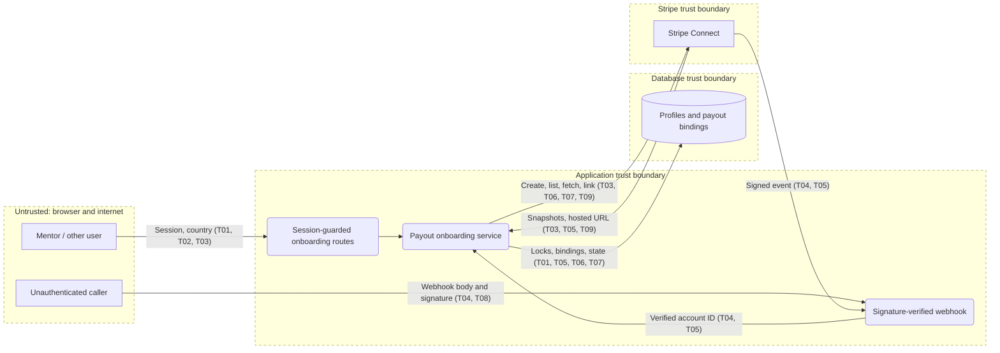

# Threat model: Stripe mentor onboarding

**Scope:** Phase 2 of mentor setup; **last updated:** 2026-10-31; **owner:** DevMentor engineering.

Mentors connect a Stripe account for payouts. The principal risks are binding the wrong account to a mentor and treating an unverified or stale provider event as proof of payout readiness. This model records required controls for the planned feature; it is not a claim that they are already implemented.

## 1. What are we working on?

### System profile

| Application | Type | Stack | Deployment | Authentication | Tenancy | AI |
| --- | --- | --- | --- | --- | --- | --- |
| DevMentor app | Browser app and HTTP API | Next.js, TypeScript, PostgreSQL | Deployment environment not established here | Session cookie and roles; webhook uses Stripe signature | No organization tenancy; profiles and payout bindings belong to individual users | None in scope |

The app is a modular monolith using PostgreSQL and Stripe Connect. Assets are mentor ownership and payout bindings, bookability, Stripe API and webhook secrets, session credentials, and identity and bank information held by Stripe. Actors include anonymous callers, mentors, users without the mentor role, operators, and Stripe. A different mentor is the relevant cross-owner actor; organizational cross-tenant isolation is not applicable to this feature.

Entry points are the planned onboarding POST, return and refresh GET routes, and Connect webhook POST. The existing shared API wrapper enforces session access rules and a CSRF header on mutations (`packages/core/src/http/apiHandler.ts`); the webhook needs a separate signature-only wrapper. Stripe receives only country, controller configuration, capability and local identifiers, not profile or email prefill.

### Data flow and trust boundaries

The diagram source is `docs/security/threat-model.mmd`. Boundaries are browser to application, Stripe to application, and application to database and Stripe. The planned webhook must verify the raw body before trusting an account ID and fetch current account data from Stripe. There are no AI components in scope.

### Assumptions and open questions

- Stripe test-mode credentials, the live deployment, and the Dashboard bank-account requirement are not verified by this model.
- The specified platform liability, tax advice, and production webhook setup remain release conditions, not established controls.

## 2. What can go wrong?

All STRIDE categories were considered for each boundary; threats below group the relevant cases. Controls described as required are not yet established by code.

| ID | Threat | STRIDE | L / I | Required response and present control | Verification | Mapping |
| --- | --- | --- | --- | --- | --- | --- |
| T01 | A mentor accesses or changes another mentor's payout account. | I, E | M / H | Derive profile from the authenticated principal; lock and scope every lookup. Existing API wrapper checks roles; payout ownership is not implemented. | Integration test with two mentors swapping identifiers and sessions. | API1:2023, CWE-639 |
| T02 | A non-mentor starts or refreshes onboarding, or a third party causes a signed-in mentor to start it. | S, T, E | M / H | Require mentor role and CSRF on POST; guarded navigation for GET. Shared wrapper exists; routes are pending. | Anonymous, mentee, operator, mentor and missing-CSRF access matrix. | API5:2023, CWE-352 |
| T03 | A forged host or provider response sends a mentor or credentials to an attacker-controlled URL. | T, I | M / H | Build callbacks from configured app URL and allowlist the Stripe onboarding origin. Navigation wrapper exists; provider validation is pending. | Reject malicious Host and unexpected link origins; assert configured callbacks. | A01:2025, CWE-601 |
| T04 | A forged webhook changes bookability or binds an attacker's account. | S, T, E | H / H | Verify signature over raw body with Connect secret before parsing; fetch by verified event account ID. Webhook is pending. | Invalid, absent and altered signatures return 400 with no fetch or write; valid signature proceeds. | API2:2023, CWE-345 |
| T05 | A valid event with conflicting, missing or mismatched metadata attaches a Stripe account to the wrong profile. | T, E | M / H | Fetch fresh Stripe data; lock existing row, verify both IDs, country and binding, fail transaction and return 500 on conflicts. Pending. | Exercise known/unknown IDs, swapped metadata, wrong country, duplicate IDs and rollback. | API1:2023, CWE-862 |
| T06 | Concurrent retries, timeouts or crashes create duplicate connected accounts or overwrite a valid binding. | T, R | M / H | Commit one unique row before create, stable idempotency key, list every page before retry, lock and recheck before binding or downgrading. Pending. | Simulate concurrent starts, ambiguous failures, partial listings, webhook race and conflicting matches. | API4:2023, CWE-362 |
| T07 | A forged return or stale event grants bookability before Stripe confirms readiness. | T, E | M / H | Return never proves readiness; fetch fresh state for every sync; gate on role, profile, provisioned binding and required payout status. Pending. | Return without completion, duplicate/out-of-order events and readiness regression; assert truth table. | API6:2023, CWE-841 |
| T08 | Invalid webhook traffic consumes resources or failures are acknowledged and never retried. | D, R | M / M | Reject bad signatures; return 500 for authenticated processing failures; log safe categories and IDs. Pending; infrastructure request limits are an open deployment assumption. | Check error status and rollback for fetch, metadata and transaction failures; inspect logs for safe diagnostics. | API4:2023, CWE-400 |
| T09 | Logs, error messages, or URLs disclose secrets, identity/bank data, raw webhook bodies or single-use links. | I, R | M / H | Store no sensitive Stripe identity data; log safe categories and IDs only, keep secrets in environment. Existing config is lazy; provider and logging are pending. | Assert errors and logs omit keys, raw bodies, personal fields and links across failure paths. | A09:2025, CWE-532 |

## 3. Test scope

Use isolated local infrastructure and Stripe test mode with synthetic data only. Unit and integration tests cover T01–T09 as specified above, including two mentor accounts and multiple roles. Manual US and PL test-mode acceptance verifies hosted onboarding, recovery and the bank-account setting without recording identity, bank details, secrets or links. Provider infrastructure, production data, volumetric testing and social engineering are out of scope. Do not test shared environments without their owner's authorization.

## 4. Review checklist

The application, boundaries, STRIDE categories, cross-owner and cross-role threats, threat IDs on the diagram, proposed controls, concrete verification and assumptions are recorded. All high-impact threats have planned mitigations and tests; implementation and test results remain to be established.

## Changelog

- 2026-10-31: Initial feature threat model.
